# Runtime Kernel and Middleware

<cite>
**Referenced Files in This Document**
- [runtime_kernel.py](file://products/agent-platform/src/agent_service/runtime_kernel.py)
- [kernel_middleware.py](file://products/agent-platform/src/agent_service/services/kernel_middleware.py)
- [request_context.py](file://products/agent-platform/src/agent_service/core/request_context.py)
- [telemetry.py](file://products/agent-platform/src/agent_service/core/telemetry.py)
- [metrics.py](file://products/agent-platform/src/agent_service/core/metrics.py)
- [runtime_settings.py](file://products/agent-platform/src/agent_service/runtime_settings.py)
- [app.py](file://products/agent-platform/src/agent_service/app.py)
- [routes.py](file://products/agent-platform/src/agent_service/api/v2/routes.py)
- [test_kernel_middleware.py](file://products/agent-platform/tests/test_kernel_middleware.py)
- [test_runtime_kernel.py](file://products/agent-platform/tests/test_runtime_kernel.py)
- [test_runtime_settings.py](file://products/agent-platform/tests/test_runtime_settings.py)
- [test_secret_delivery_integration.py](file://products/agent-platform/tests/test_secret_delivery_integration.py)
- [test_model_router.py](file://products/agent-platform/tests/test_model_router.py)
- [agent_role.py](file://products/agent-platform/src/agent_service/services/agent_role.py)
- [hitl_confirmations.py](file://products/agent-platform/src/agent_service/services/hitl_confirmations.py)
- [test_agent_role.py](file://products/agent-platform/tests/test_agent_role.py)
</cite>

## Update Summary
**Changes Made**
- Added comprehensive documentation for per-role toolkit narrowing via `_narrow_for_role()` method with three role types (diagnostician, executor, orchestrator)
- Documented role-scoped cache keys that split toolkit caching by `(token, role)` tuples while maintaining backward compatibility
- Documented staged-by-role provenance tracking on parked confirmations for authority attribution
- Documented fail-closed authority enforcement ensuring unknown roles result in empty toolkits
- Enhanced existing sections to cover role context propagation and process-local scope management
- Updated architecture diagrams to reflect the new role-based toolkit narrowing system

## Table of Contents
1. Introduction
2. Project Structure
3. Core Components
4. Architecture Overview
5. Detailed Component Analysis
6. Dependency Analysis
7. Performance Considerations
8. Troubleshooting Guide
9. Conclusion
10. Appendices

## Introduction
This document explains the Agent Platform's runtime kernel and middleware system that coordinates agent execution, request context propagation, and cross-cutting concerns such as observability, security, and performance. It covers how the kernel composes middlewares for permission gating, evidence emission, LLM token usage tracking, **per-turn model routing**, and **per-role toolkit narrowing**, how request IDs flow through tracing, and how metrics are collected. It also provides guidance for implementing custom middleware, extending the request pipeline, debugging runtime issues, and scaling for high-throughput scenarios.

**Updated** The runtime kernel now features sophisticated per-role toolkit narrowing capabilities through the `_narrow_for_role()` method, enabling role-based authority restriction while maintaining strict subtractive-only semantics. The kernel includes role-scoped cache keys that split toolkit caching by `(token, role)` tuples, staged-by-role provenance tracking on parked confirmations, and fail-closed authority enforcement that ensures unknown roles result in empty toolkits. Additionally, the kernel maintains per-stream delivery buffers for gated secret delivery workflows, integrates the CompressContext tool as a kernel-local operation, incorporates TokenUsageMiddleware as part of the default always-on middlewares for streaming-aware LLM token tracking, and adds comprehensive per-turn model routing capabilities through ModelRouterMiddleware integration.

## Project Structure
The runtime kernel lives under the agent-service package and is composed of:
- A central kernel orchestrating agent lifecycle, toolkit caching, model switching, per-turn routing, per-role toolkit narrowing, and streaming turns.
- A middleware stack that enforces permissions, emits evidence frames, tracks LLM token usage, handles model routing, and supports role-based authority restriction.
- Cross-cutting services for request context resolution, telemetry (OpenTelemetry), and Prometheus metrics.
- Configuration via environment-driven runtime settings including routing candidates, role vocabulary, and classifier models.

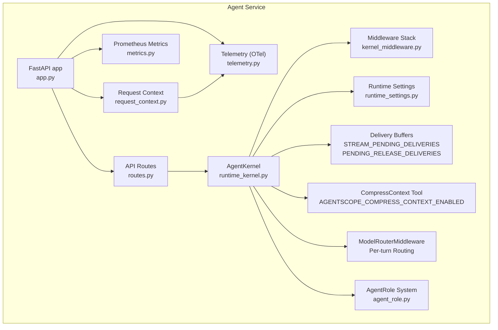

**Diagram sources**
- [app.py:49-76](file://products/agent-platform/src/agent_service/app.py#L49-L76)
- [runtime_kernel.py:212-235](file://products/agent-platform/src/agent_service/runtime_kernel.py#L212-L235)
- [kernel_middleware.py:151-193](file://products/agent-platform/src/agent_service/services/kernel_middleware.py#L151-L193)
- [request_context.py:8-19](file://products/agent-platform/src/agent_service/core/request_context.py#L8-L19)
- [telemetry.py:69-117](file://products/agent-platform/src/agent_service/core/telemetry.py#L69-L117)
- [metrics.py:52-73](file://products/agent-platform/src/agent_service/core/metrics.py#L52-L73)
- [runtime_settings.py:136-184](file://products/agent-platform/src/agent_service/runtime_settings.py#L136-L184)
- [routes.py:358-411](file://products/agent-platform/src/agent_service/api/v2/routes.py#L358-L411)
- [agent_role.py:30-50](file://products/agent-platform/src/agent_service/services/agent_role.py#L30-L50)

**Section sources**
- [app.py:49-76](file://products/agent-platform/src/agent_service/app.py#L49-L76)
- [runtime_kernel.py:212-235](file://products/agent-platform/src/agent_service/runtime_kernel.py#L212-L235)
- [kernel_middleware.py:151-193](file://products/agent-platform/src/agent_service/services/kernel_middleware.py#L151-L193)
- [request_context.py:8-19](file://products/agent-platform/src/agent_service/core/request_context.py#L8-L19)
- [telemetry.py:69-117](file://products/agent-platform/src/agent_service/core/telemetry.py#L69-L117)
- [metrics.py:52-73](file://products/agent-platform/src/agent_service/core/metrics.py#L52-L73)
- [runtime_settings.py:136-184](file://products/agent-platform/src/agent_service/runtime_settings.py#L136-L184)
- [routes.py:358-411](file://products/agent-platform/src/agent_service/api/v2/routes.py#L358-L411)
- [agent_role.py:30-50](file://products/agent-platform/src/agent_service/services/agent_role.py#L30-L50)

## Core Components
- AgentKernel: Builds and caches agents per session, composes the middleware stack, manages toolkit discovery and caching per delegated token, handles model switching, structured output, streaming events, evidence persistence, **per-turn model routing**, and **per-role toolkit narrowing**. **Updated** Now includes per-stream delivery buffers for gated secret delivery workflows, CompressContext tool integration, ModelRouterMiddleware integration with candidate management, and role-scoped toolkit narrowing via `_narrow_for_role()`.
- GatewayPermissionMiddleware: Enforces a platform allow-list for auto-approved read-only tools, always allows kernel-local task tools, and routes other tool invocations to explicit ASK for operator confirmation; supports browser flow unlock for approved mutating flows. **Updated** Outbound HTTP requests now require explicit operator confirmation by default. **Updated** CompressContext tool is registered as kernel-local and always allowed.
- ToolEvidenceMiddleware: Emits tool_call and tool_result evidence frames for gateway-backed tools during streaming, with bounded data summaries and optional full payloads, and redacts sensitive parameters. **Updated** Now intercepts secrets.generate_password calls and implements deferred delivery mechanism using per-stream buffers.
- **TokenUsageMiddleware**: Records provider-reported LLM token usage as a metric via the `on_model_call` hook, always-on with no opt-in knob, streaming-aware, and pure observation without cost calculation.
- **ModelRouterMiddleware**: Provides per-turn model routing capabilities, classifying user input to select from configured candidate models while respecting precedence rules.
- **AgentRole System**: Provides closed vocabulary for role-based authority restriction with three values (diagnostician, executor, orchestrator), process-local context management, and fail-closed validation.
- Request Context: Resolves x-request-id by preferring inbound header, then current OTel trace_id, then generating a UUID.
- Telemetry: Optional OpenTelemetry push pipeline for traces, metrics, and logs; integrates FastAPI and HTTPX instrumentation.
- Metrics: Always-on Prometheus surface with RED middleware and /metrics endpoint; includes counters/gauges for sessions, chat requests, store backends, evidence writes, audit emissions, model discovery, and LLM token usage.
- Runtime Settings: Environment-driven configuration for provider options, kernel tuning, middleware toggles, HITL timeouts, evidence caps, model discovery, signed execution, isolated worker, browser flow TTL, audit/incident/skills clients, authoring-trace bounds, and **model routing configuration**. **Updated** Enhanced default system prompt with operational request handling improvements and CompressContext tool configuration.

**Section sources**
- [runtime_kernel.py:212-235](file://products/agent-platform/src/agent_service/runtime_kernel.py#L212-L235)
- [runtime_kernel.py:462-496](file://products/agent-platform/src/agent_service/runtime_kernel.py#L462-L496)
- [runtime_kernel.py:560-686](file://products/agent-platform/src/agent_service/runtime_kernel.py#L560-L686)
- [runtime_kernel.py:629-660](file://products/agent-platform/src/agent_service/runtime_kernel.py#L629-L660)
- [kernel_middleware.py:151-193](file://products/agent-platform/src/agent_service/services/kernel_middleware.py#L151-L193)
- [kernel_middleware.py:282-398](file://products/agent-platform/src/agent_service/services/kernel_middleware.py#L282-L398)
- [kernel_middleware.py:636-741](file://products/agent-platform/src/agent_service/services/kernel_middleware.py#L636-L741)
- [agent_role.py:30-50](file://products/agent-platform/src/agent_service/services/agent_role.py#L30-L50)
- [agent_role.py:70-120](file://products/agent-platform/src/agent_service/services/agent_role.py#L70-L120)
- [request_context.py:8-19](file://products/agent-platform/src/agent_service/core/request_context.py#L8-L19)
- [telemetry.py:69-117](file://products/agent-platform/src/agent_service/core/telemetry.py#L69-L117)
- [metrics.py:23-73](file://products/agent-platform/src/agent_service/core/metrics.py#L23-L73)
- [metrics.py:284-312](file://products/agent-platform/src/agent_service/core/metrics.py#L284-L312)
- [runtime_settings.py:136-184](file://products/agent-platform/src/agent_service/runtime_settings.py#L136-L184)
- [runtime_settings.py:265-278](file://products/agent-platform/src/agent_service/runtime_settings.py#L265-L278)

## Architecture Overview
The runtime kernel sits at the center of agent execution. Requests enter FastAPI, where logging and metrics are recorded, and request IDs are resolved. The kernel builds or reuses an Agent instance per session, composes middlewares, and executes turns either as blocking replies or streaming events. Middlewares enforce permissions, emit evidence frames, track LLM token usage, handle per-turn model routing, and support per-role toolkit narrowing. Observability is enabled via optional OTel and always-on Prometheus metrics. **Updated** The architecture now includes per-stream delivery buffers that enable gated secret delivery workflows with reveal-on-commit semantics, CompressContext tool integration for optional context compression, TokenUsageMiddleware for streaming-aware LLM token tracking, ModelRouterMiddleware for intelligent model selection based on content classification, and AgentRole system for role-based authority restriction with process-local context management.

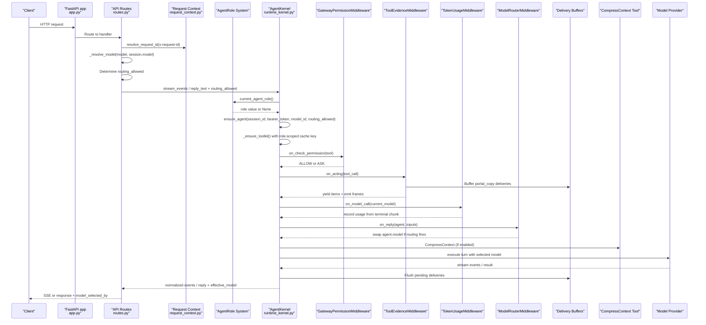

**Diagram sources**
- [app.py:55-71](file://products/agent-platform/src/agent_service/app.py#L55-L71)
- [routes.py:358-411](file://products/agent-platform/src/agent_service/api/v2/routes.py#L358-L411)
- [request_context.py:8-19](file://products/agent-platform/src/agent_service/core/request_context.py#L8-L19)
- [runtime_kernel.py:662-697](file://products/agent-platform/src/agent_service/runtime_kernel.py#L662-L697)
- [runtime_kernel.py:502-580](file://products/agent-platform/src/agent_service/runtime_kernel.py#L502-L580)
- [kernel_middleware.py:195-279](file://products/agent-platform/src/agent_service/services/kernel_middleware.py#L195-L279)
- [kernel_middleware.py:309-388](file://products/agent-platform/src/agent_service/services/kernel_middleware.py#L309-L388)
- [kernel_middleware.py:683-696](file://products/agent-platform/src/agent_service/services/kernel_middleware.py#L683-L696)
- [agent_role.py:88-100](file://products/agent-platform/src/agent_service/services/agent_role.py#L88-L100)

## Detailed Component Analysis

### AgentKernel
Responsibilities:
- Agent lifecycle: build, cache, and reuse per session; LRU-bounded cache; serializes concurrent creation to avoid memory loss.
- Toolkit management: discovers tools from the tool-gateway per delegated token; caches per token; filters mutating tools when HITL bridging is disabled; supports read-only toolkits for automated diagnostics; **narrowing per role** via `_narrow_for_role()`.
- Model switching: resolves model id via catalog; rebuilds agent when bound model changes; restores persisted state.
- **Per-turn model routing**: manages routing configuration, candidate models, and effective model attribution; splits cache keys for routed vs non-routed agents; tracks routed candidate names and maps them back to catalog model ids.
- **Per-role toolkit narrowing**: applies role-based restrictions to discovered toolsets; diagnostician sees only read-level tools; executor sees full set; orchestrator sees no gateway tools; unknown roles fail closed to empty toolkit.
- Streaming and evidence: sets request-scoped evidence sink around streamed turns; persists evidence frames best-effort; flushes streaming prose redactor tails on terminal events. **Updated** Manages per-stream delivery buffers for gated secret delivery workflows and CompressContext tool integration.
- Structured output: passes schema to agent and returns validated structured output when requested.
- Observability integration: records metrics for evidence writes and agent state errors; emits audit events via configured service.

Key behaviors verified by tests:
- Placeholder responses when unconfigured.
- Session isolation and bounded cache.
- Concurrent ensure_agent builds only one agent per session.
- Per-token toolkit caching and recovery when gateway tools become available.
- Task tools appended but not counted as gateway tools.
- Kernel config defaults and overrides.
- Structured output round trip.
- State persistence and snapshot failure tolerance.
- **Updated** Per-stream delivery buffer management for gated secret delivery workflows.
- **Updated** CompressContext tool registration and configuration via ContextConfig.compression_tool_enabled.
- **Updated** Per-turn model routing with candidate management, cache key splitting, and response attribution.
- **Updated** Per-role toolkit narrowing with role-scoped cache keys and subtractive-only semantics.

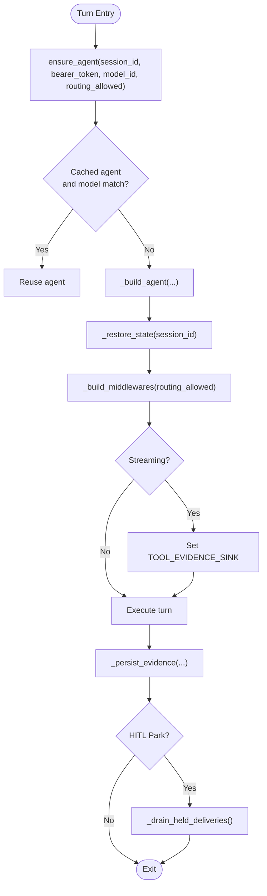

**Diagram sources**
- [runtime_kernel.py:699-774](file://products/agent-platform/src/agent_service/runtime_kernel.py#L699-L774)
- [runtime_kernel.py:539-582](file://products/agent-platform/src/agent_service/runtime_kernel.py#L539-L582)
- [runtime_kernel.py:627-660](file://products/agent-platform/src/agent_service/runtime_kernel.py#L627-660)
- [runtime_kernel.py:462-496](file://products/agent-platform/src/agent_service/runtime_kernel.py#L462-L496)

**Section sources**
- [runtime_kernel.py:699-774](file://products/agent-platform/src/agent_service/runtime_kernel.py#L699-L774)
- [runtime_kernel.py:539-582](file://products/agent-platform/src/agent_service/runtime_kernel.py#L539-L582)
- [runtime_kernel.py:627-660](file://products/agent-platform/src/agent_service/runtime_kernel.py#L627-660)
- [runtime_kernel.py:462-496](file://products/agent-platform/src/agent_service/runtime_kernel.py#L462-L496)
- [runtime_kernel.py:560-686](file://products/agent-platform/src/agent_service/runtime_kernel.py#L560-L686)
- [runtime_kernel.py:629-660](file://products/agent-platform/src/agent_service/runtime_kernel.py#L629-L660)
- [test_runtime_kernel.py:219-298](file://products/agent-platform/tests/test_runtime_kernel.py#L219-L298)
- [test_runtime_kernel.py:301-552](file://products/agent-platform/tests/test_runtime_kernel.py#L301-L552)
- [test_runtime_kernel.py:652-683](file://products/agent-platform/tests/test_runtime_kernel.py#L652-L683)
- [test_runtime_kernel.py:713-749](file://products/agent-platform/tests/test_runtime_kernel.py#L713-L749)
- [test_runtime_kernel.py:757-795](file://products/agent-platform/tests/test_runtime_kernel.py#L757-L795)

### Enhanced Default System Prompt Behavior
**Updated** The runtime kernel's default system prompt has been enhanced to improve operational request handling and prevent anti-fabrication refusals.

Key enhancements include:
- **Skills Search Priority**: Models are instructed to use `skills.search FIRST` for any request to act on named systems, accounts, or targets
- **Operational Request Triggers**: Specific triggers like "resetting a password", "locking or recovering an account", "restarting or scaling a workload" are explicitly covered
- **Anti-Fabrication Prevention**: Reframes absence of offhand grounding as a reason to search rather than to refuse
- **Skill Citation Requirements**: Models must cite skills they rely on by title or skill_id
- **Guidance vs Live Data Separation**: Clear distinction between skill guidance and live cluster data

Behavior verified by tests:
- Operational request triggers are properly defined in the default prompt
- Skills search precedence is enforced before any refusal decisions
- Anti-fabrication safeguards prevent premature conclusions about missing systems or credentials
- Browser authorization discipline is maintained alongside operational improvements

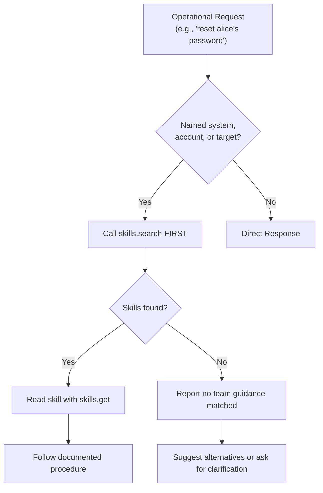

**Diagram sources**
- [runtime_settings.py:8-58](file://products/agent-platform/src/agent_service/runtime_settings.py#L8-L58)
- [test_runtime_settings.py:30-54](file://products/agent-platform/tests/test_runtime_settings.py#L30-L54)

**Section sources**
- [runtime_settings.py:8-58](file://products/agent-platform/src/agent_service/runtime_settings.py#L8-L58)
- [test_runtime_settings.py:30-54](file://products/agent-platform/tests/test_runtime_settings.py#L30-L54)

### GatewayPermissionMiddleware
Responsibilities:
- Auto-approve vetted read-only gateway tools from a static allow-list; environment override supported. **Updated** `http.get` has been removed from the default allow-list due to security hardening.
- Always allow kernel-local tools (task tools, GenerateStructuredOutput, and CompressContext).
- Route all other tools to explicit ASK to park for operator confirmation; avoids delegating to built-in PermissionEngine to prevent bypassing the allow-list.
- Supports browser flow unlock: when a mutating web.* call occurs inside an already-approved flow, an optional flow_signer can return an envelope to ALLOW it once per flow.

Behavior verified by tests:
- Default allow-list normalization and env override behavior.
- Read-only invariant prevents auto-approval of write-tier tools even if forced into allow-list.
- Missing tool delegates to built-in resolution.
- Already-ALLOWED calls on resume bypass re-ASK.
- Task tools and structured-output tool always allowed.
- **Updated** CompressContext tool always allowed as kernel-local operation.
- Browser flow unlock consults signer only for BROWSER_WRITE_TOOLS and fails safe when no authority exists.

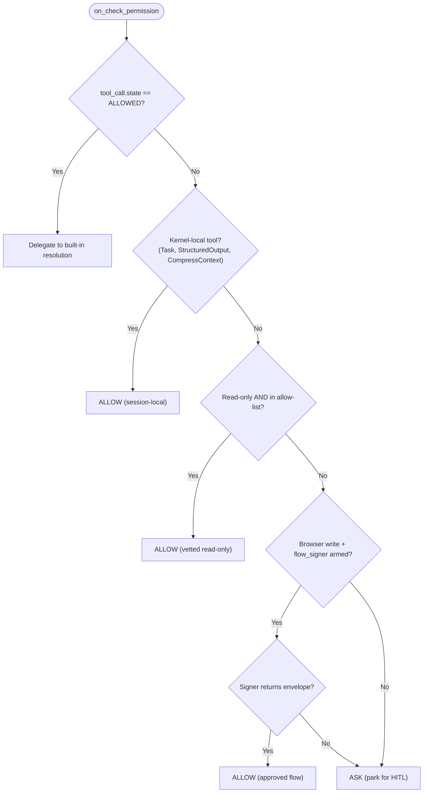

**Diagram sources**
- [kernel_middleware.py:195-279](file://products/agent-platform/src/agent_service/services/kernel_middleware.py#L195-L279)

**Section sources**
- [kernel_middleware.py:151-193](file://products/agent-platform/src/agent_service/services/kernel_middleware.py#L151-L193)
- [kernel_middleware.py:195-279](file://products/agent-platform/src/agent_service/services/kernel_middleware.py#L195-L279)
- [test_kernel_middleware.py:161-360](file://products/agent-platform/tests/test_kernel_middleware.py#L161-L360)
- [test_kernel_middleware.py:365-505](file://products/agent-platform/tests/test_kernel_middleware.py#L365-L505)

### ToolEvidenceMiddleware
Responsibilities:
- Emit tool_call and tool_result frames for gateway-backed tools during streaming.
- Redact sensitive parameters in tool_call frames.
- Include bounded data_summary and optional full data payload within size limits.
- Keep frame schema valid even when gateway result is missing or error.
- **Updated** Intercept secrets.generate_password calls and implement deferred delivery mechanism using per-stream buffers.

Behavior verified by tests:
- Frames conform to agent-stream-event schema.
- Secret masking in parameters while preserving raw input for signing/digest paths.
- Error status and error details included on failures.
- Data truncation markers and omission of oversized full data.
- No frames emitted when sink is unset (blocking turns).
- Non-gateway tools pass through silently.
- **Updated** Deferred delivery mechanism for secrets.generate_password with proper buffer management.

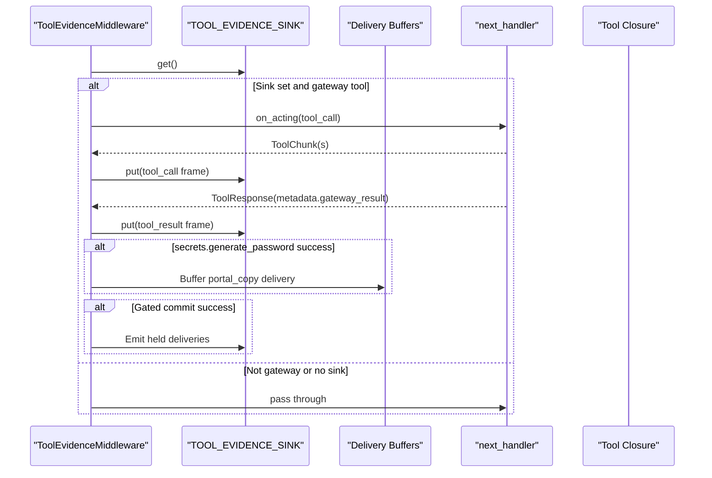

**Diagram sources**
- [kernel_middleware.py:309-388](file://products/agent-platform/src/agent_service/services/kernel_middleware.py#L309-L388)

**Section sources**
- [kernel_middleware.py:282-398](file://products/agent-platform/src/agent_service/services/kernel_middleware.py#L282-L398)
- [kernel_middleware.py:490-544](file://products/agent-platform/src/agent_service/services/kernel_middleware.py#L490-L544)
- [test_kernel_middleware.py:508-736](file://products/agent-platform/tests/test_kernel_middleware.py#L508-L736)
- [test_kernel_middleware.py:738-787](file://products/agent-platform/tests/test_kernel_middleware.py#L738-L787)
- [test_kernel_middleware.py:760-815](file://products/agent-platform/tests/test_kernel_middleware.py#L760-L815)
- [test_kernel_middleware.py:816-888](file://products/agent-platform/tests/test_kernel_middleware.py#L816-L888)

### TokenUsageMiddleware
**New Section** The TokenUsageMiddleware provides streaming-aware LLM token usage tracking via the `on_model_call` hook, recording provider-reported token counts as Prometheus metrics.

Key characteristics:
- **Always-on middleware**: Registered unconditionally in `_build_middlewares()` alongside GatewayPermissionMiddleware and ToolEvidenceMiddleware, with no opt-in knob since reading token counts is pure observation.
- **Streaming-aware**: Wraps AsyncGenerator responses and records usage from the terminal chunk, mirroring the tracing middleware's generator wrapper approach.
- **Bounded labels**: Resolves `{provider, model}` labels from the credential-gated catalog, using "unknown" sentinel for uncatalogued models to maintain bounded cardinality.
- **Direction tracking**: Records four token directions: `input`, `output`, `cache_input`, and `cache_creation`.
- **No cost calculation**: Deliberately omits cost metrics since agentscope 2.0.8 exposes no provider-derived cost and the platform holds no price table.

Implementation details:
- Uses `on_model_call` hook to intercept model interactions
- Resolves provider/model labels via catalog lookup
- Handles both streaming and non-streaming responses
- Records nothing when providers return no usage data
- Integrates with existing metrics infrastructure via `record_llm_tokens`

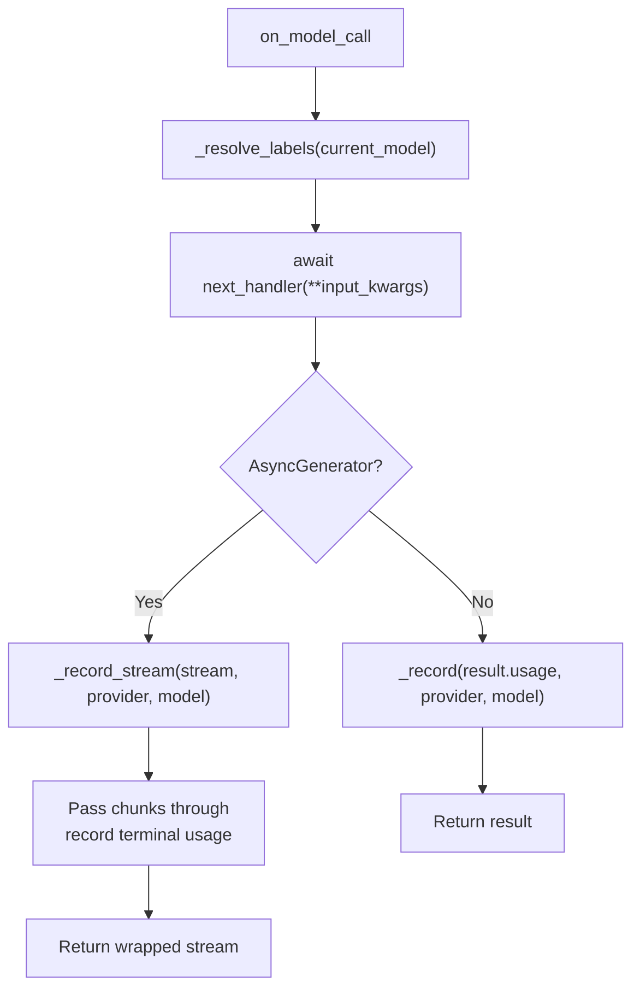

**Diagram sources**
- [kernel_middleware.py:683-696](file://products/agent-platform/src/agent_service/services/kernel_middleware.py#L683-L696)
- [kernel_middleware.py:698-718](file://products/agent-platform/src/agent_service/services/kernel_middleware.py#L698-L718)

**Section sources**
- [kernel_middleware.py:636-741](file://products/agent-platform/src/agent_service/services/kernel_middleware.py#L636-L741)
- [metrics.py:284-312](file://products/agent-platform/src/agent_service/core/metrics.py#L284-L312)
- [test_kernel_middleware.py:1396-1530](file://products/agent-platform/tests/test_kernel_middleware.py#L1396-L1530)

### Per-Stream Delivery Buffers
**New Section** The enhanced runtime kernel introduces per-stream delivery buffers that enable gated secret delivery workflows with reveal-on-commit semantics.

Key components:
- **STREAM_PENDING_DELIVERIES**: Context variable holding deliveries generated in the current stream for deferred reveal
- **PENDING_RELEASE_DELIVERIES**: Context variable carrying deliveries from prior parks that await release on gated commits
- **_flush_pending_deliveries()**: Method to emit buffered portal_copy deliveries as frames at normal stream end
- **_drain_held_deliveries()**: Method to combine both buffer types for parked cards across HITL workflows

Workflow patterns:
- **Standalone generate-and-copy**: Secrets generated without following gates are flushed at stream end
- **Gated reveal-on-commit**: Secrets generated before HITL approval are released only when approved mutations succeed
- **HITL workflow support**: Held deliveries ride across park/resume cycles and are released on successful gated commits

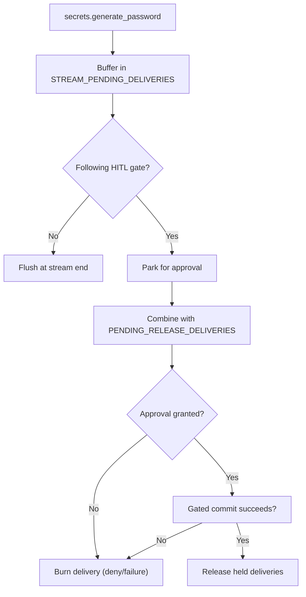

**Diagram sources**
- [runtime_kernel.py:1249-1295](file://products/agent-platform/src/agent_service/runtime_kernel.py#L1249-L1295)
- [kernel_middleware.py:68-75](file://products/agent-platform/src/agent_service/services/kernel_middleware.py#L68-L75)
- [kernel_middleware.py:490-544](file://products/agent-platform/src/agent_service/services/kernel_middleware.py#L490-L544)

**Section sources**
- [runtime_kernel.py:1249-1295](file://products/agent-platform/src/agent_service/runtime_kernel.py#L1249-L1295)
- [kernel_middleware.py:68-75](file://products/agent-platform/src/agent_service/services/kernel_middleware.py#L68-L75)
- [kernel_middleware.py:490-544](file://products/agent-platform/src/agent_service/services/kernel_middleware.py#L490-L544)
- [test_secret_delivery_integration.py:35-152](file://products/agent-platform/tests/test_secret_delivery_integration.py#L35-L152)
- [test_kernel_middleware.py:760-815](file://products/agent-platform/tests/test_kernel_middleware.py#L760-L815)
- [test_kernel_middleware.py:816-888](file://products/agent-platform/tests/test_kernel_middleware.py#L816-L888)

### CompressContext Tool Integration
**New Section** The runtime kernel integrates the CompressContext tool as a kernel-local operation, providing optional agent-driven context compression with strict validation and safety guarantees.

Key components:
- **AGENTSCOPE_COMPRESS_CONTEXT_ENABLED**: Environment variable to opt-in context compression (default: false)
- **AGENTSCOPE_CONTEXT_TRIGGER_RATIO**: Must be greater than 0.2 (agentscope context_buffer_ratio default)
- **KERNEL_LOCAL_TOOL_NAMES**: CompressContext registered as kernel-local tool, always allowed
- **ContextConfig.compression_tool_enabled**: Wires the setting into the agent configuration

Security and safety characteristics:
- **Kernel-local operation**: Never parks on the headless ASK gate, preventing compression from being blocked
- **State-only mutation**: Only summarizes agent's own working context into state.summary/state.context
- **No external access**: Performs no execution or infrastructure access operations
- **Opt-in by default**: Disabled unless explicitly enabled via environment variable
- **Validation guard**: Requires AGENTSCOPE_CONTEXT_TRIGGER_RATIO > 0.2 to prevent configuration conflicts

Configuration behavior:
- When disabled (default): CompressContext tool is not registered, kernel behaves identically to previous versions
- When enabled: CompressContext tool is registered and available for agent-driven context compression
- Startup validation: Rejects invalid configurations where trigger_ratio <= 0.2 to prevent wedge conditions

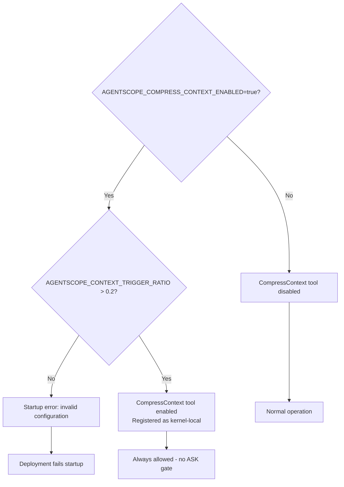

**Diagram sources**
- [runtime_settings.py:185-185](file://products/agent-platform/src/agent_service/runtime_settings.py#L185-L185)
- [runtime_settings.py:319-328](file://products/agent-platform/src/agent_service/runtime_settings.py#L319-L328)
- [runtime_kernel.py:597-610](file://products/agent-platform/src/agent_service/runtime_kernel.py#L597-L610)
- [kernel_middleware.py:105-117](file://products/agent-platform/src/agent_service/services/kernel_middleware.py#L105-L117)

**Section sources**
- [runtime_settings.py:185-185](file://products/agent-platform/src/agent_service/runtime_settings.py#L185-L185)
- [runtime_settings.py:319-328](file://products/agent-platform/src/agent_service/runtime_settings.py#L319-L328)
- [runtime_kernel.py:597-610](file://products/agent-platform/src/agent_service/runtime_kernel.py#L597-L610)
- [kernel_middleware.py:105-117](file://products/agent-platform/src/agent_service/services/kernel_middleware.py#L105-L117)
- [test_runtime_settings.py:637-678](file://products/agent-platform/tests/test_runtime_settings.py#L637-L678)
- [test_kernel_middleware.py:491-513](file://products/agent-platform/tests/test_kernel_middleware.py#L491-L513)

### Per-Turn Model Routing
**New Section** The enhanced runtime kernel implements sophisticated per-turn model routing capabilities through ModelRouterMiddleware integration, enabling intelligent model selection based on content classification while maintaining strict precedence rules.

Key components:
- **ModelRouterMiddleware**: AgentScope middleware that classifies user input and swaps the reply's chat model among configured candidates
- **Classifier Model**: A dedicated model used for classification decisions, built from the configured `model_router_model` catalog id
- **Candidate Models**: Named model options with descriptions that guide the classifier's decision-making process
- **Routing Precedence**: Strict ordering ensuring explicit requests and pins take priority over automatic routing
- **Cache Key Splitting**: Separate agent instances for routed vs non-routed turns to maintain routing state consistency
- **Response Attribution**: Tracking which model actually served each turn for accurate reporting and auditing

Core behaviors:
- **Opt-in gating**: Router is only registered when `model_router_enabled=True`, candidate map is configured, and `routing_allowed=True`
- **Precedence enforcement**: Explicit request model and live pin both suppress routing; only default-resolved turns arm the router
- **Fail-soft operation**: Classifier errors and unknown candidates keep the agent's original model without hard-failing the turn
- **Resume safety**: Routed reply_ids reuse stored choices without re-routing across park/resume cycles
- **Attribution tracking**: Effective model mapping from routed candidate names back to catalog model ids

Configuration requirements:
- `AGENTSCOPE_MODEL_ROUTER_ENABLED`: Enable/disable routing (default: false)
- `AGENTSCOPE_MODEL_ROUTER_MODEL`: Classifier model catalog id (required when candidates are configured)
- `AGENTSCOPE_MODEL_ROUTER_CANDIDATES`: Map of candidate names to catalog model ids and descriptions

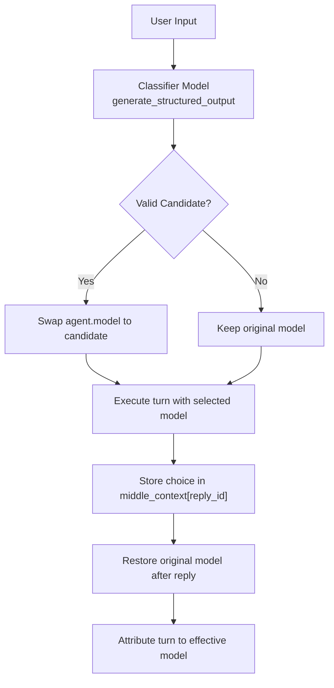

**Diagram sources**
- [runtime_kernel.py:560-686](file://products/agent-platform/src/agent_service/runtime_kernel.py#L560-L686)
- [routes.py:378-384](file://products/agent-platform/src/agent_service/api/v2/routes.py#L378-L384)

**Section sources**
- [runtime_kernel.py:560-686](file://products/agent-platform/src/agent_service/runtime_kernel.py#L560-L686)
- [runtime_kernel.py:927-1012](file://products/agent-platform/src/agent_service/runtime_kernel.py#L927-L1012)
- [runtime_kernel.py:1175-1188](file://products/agent-platform/src/agent_service/runtime_kernel.py#L1175-L1188)
- [runtime_settings.py:265-278](file://products/agent-platform/src/agent_service/runtime_settings.py#L265-L278)
- [routes.py:378-384](file://products/agent-platform/src/agent_service/api/v2/routes.py#L378-L384)
- [test_model_router.py:1-200](file://products/agent-platform/tests/test_model_router.py#L1-L200)
- [test_model_router.py:349-412](file://products/agent-platform/tests/test_model_router.py#L349-L412)

### Per-Role Toolkit Narrowing
**New Section** The enhanced runtime kernel implements sophisticated per-role toolkit narrowing capabilities through the `_narrow_for_role()` method, enabling role-based authority restriction while maintaining strict subtractive-only semantics.

Key components:
- **AgentRole System**: Closed vocabulary with exactly three values: `diagnostician`, `executor`, `orchestrator`
- **Process-Local Context**: Role binding via `AGENT_ROLE` ContextVar, never part of durable snapshots or wire protocols
- **Role-Scoped Cache Keys**: Toolkit caching splits by `(token, role)` tuples while maintaining backward compatibility for unscoped turns
- **Subtractive-Only Semantics**: Role toolkits are always subsets of unscoped toolkits, never widening authority
- **Fail-Closed Enforcement**: Unknown roles result in empty toolkits, never wider postures

Role behaviors:
- **Diagnostician**: Read-level tools only (reuses `_filter_read_only`)
- **Executor**: Full discovered set (mutating tools still park on HITL)
- **Orchestrator**: No direct gateway tools (delegates, invokes nothing)
- **Unknown Roles**: Empty toolkit (fail-closed to most restrictive posture)

Configuration and usage:
- Process-local context via `agent_role_scope()` context manager
- Role binding mirrors `DELEGATED_TOKEN` pattern
- Phase 2 ships inert: no orchestration caller binds a role
- Backward compatible: unscoped turns keep byte-identical behavior

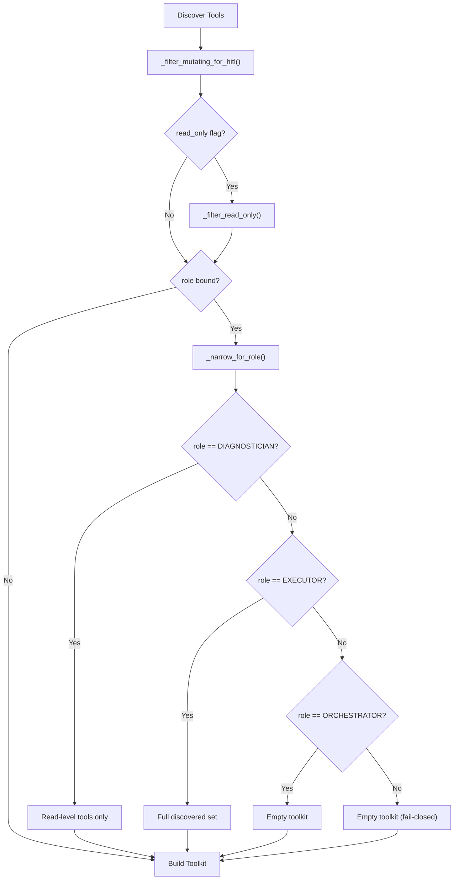

**Diagram sources**
- [runtime_kernel.py:502-580](file://products/agent-platform/src/agent_service/runtime_kernel.py#L502-L580)
- [runtime_kernel.py:629-660](file://products/agent-platform/src/agent_service/runtime_kernel.py#L629-L660)
- [agent_role.py:30-50](file://products/agent-platform/src/agent_service/services/agent_role.py#L30-L50)

**Section sources**
- [runtime_kernel.py:502-580](file://products/agent-platform/src/agent_service/runtime_kernel.py#L502-L580)
- [runtime_kernel.py:629-660](file://products/agent-platform/src/agent_service/runtime_kernel.py#L629-L660)
- [agent_role.py:30-50](file://products/agent-platform/src/agent_service/services/agent_role.py#L30-L50)
- [agent_role.py:70-120](file://products/agent-platform/src/agent_service/services/agent_role.py#L70-L120)
- [test_agent_role.py:129-193](file://products/agent-platform/tests/test_agent_role.py#L129-L193)
- [test_agent_role.py:276-299](file://products/agent-platform/tests/test_agent_role.py#L276-L299)

### Staged-by-Role Provenance Tracking
**New Section** The enhanced runtime kernel implements staged-by-role provenance tracking on parked confirmations for authority attribution while maintaining contract compatibility.

Key components:
- **PendingConfirmation.staged_by_role**: Optional field storing the plain agent-role string that staged this parked mutation
- **Process-Local Capture**: Role provenance captured from `current_agent_role_value()` at park time
- **Kernel-Internal Only**: Never persisted to durable card records, never added to wire schemas, never exposed in phase 2 contracts
- **Backward Compatible**: Defaults to `None` for unscoped single-agent path, maintaining byte-identical behavior

Provenance characteristics:
- **Ephemeral Storage**: Lives only in memory during confirmation lifecycle
- **Plain String Values**: Uses simple strings ("diagnostician", "executor", "orchestrator") rather than enum types
- **Unscoped Default**: Unscoped parks leave `staged_by_role` as `None`
- **Contract Safety**: No changes to `execution-request.schema.json` or `agent-stream-event.schema.json`

Implementation details:
- Field added to `PendingConfirmation` dataclass with `repr=False` to exclude from debug output
- Captured via `current_agent_role_value()` when role is bound
- Never passed to `make_record()` function, keeping durable records unchanged
- Tests verify contract schemas remain unchanged and no role fields appear in JSON serialization

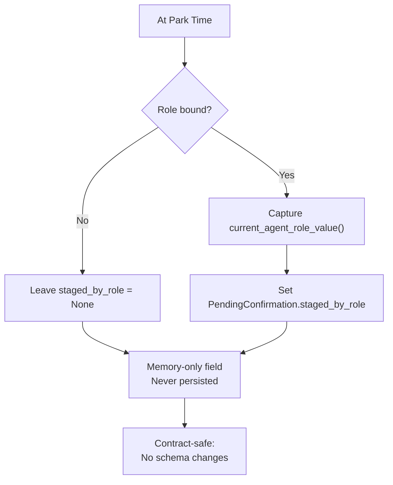

**Diagram sources**
- [hitl_confirmations.py:101-111](file://products/agent-platform/src/agent_service/services/hitl_confirmations.py#L101-L111)
- [agent_role.py:93-100](file://products/agent-platform/src/agent_service/services/agent_role.py#L93-L100)

**Section sources**
- [hitl_confirmations.py:101-111](file://products/agent-platform/src/agent_service/services/hitl_confirmations.py#L101-L111)
- [agent_role.py:93-100](file://products/agent-platform/src/agent_service/services/agent_role.py#L93-L100)
- [test_agent_role.py:234-270](file://products/agent-platform/tests/test_agent_role.py#L234-L270)

### Request Context and Tracing Integration
- Request ID resolution prefers inbound x-request-id, falls back to current OTel trace_id when tracing is enabled, otherwise generates a UUID.
- Telemetry setup initializes providers and instrumentations when OTEL_ENABLED is true; fail-open on setup errors.
- current_trace_id exposes the active span's W3C trace_id for correlation.

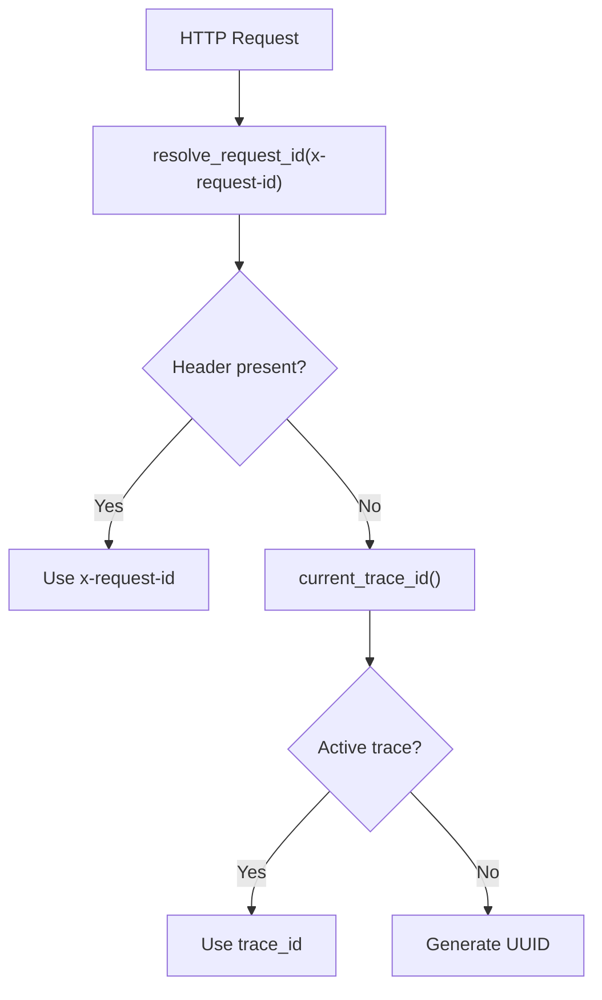

**Diagram sources**
- [request_context.py:8-19](file://products/agent-platform/src/agent_service/core/request_context.py#L8-L19)
- [telemetry.py:120-132](file://products/agent-platform/src/agent_service/core/telemetry.py#L120-L132)

**Section sources**
- [request_context.py:8-19](file://products/agent-platform/src/agent_service/core/request_context.py#L8-L19)
- [telemetry.py:69-117](file://products/agent-platform/src/agent_service/core/telemetry.py#L69-L117)
- [telemetry.py:120-132](file://products/agent-platform/src/agent_service/core/telemetry.py#L120-L132)
- [app.py:55-71](file://products/agent-platform/src/agent_service/app.py#L55-L71)

### Metrics Collection
- Always-on Prometheus metrics via RED middleware and GET /metrics.
- Counters and gauges for HTTP requests/duration, sessions created, chat requests, session/agent state stores, evidence writes, audit emissions, model discovery, and LLM token usage.
- Handlers label metrics by templated route path to keep cardinality bounded.
- **Updated** LLM token usage tracking via `agent_llm_tokens_total{provider,model,direction}` counter with bounded label cardinality.

**Section sources**
- [metrics.py:23-73](file://products/agent-platform/src/agent_service/core/metrics.py#L23-L73)
- [metrics.py:84-185](file://products/agent-platform/src/agent_service/core/metrics.py#L84-L185)
- [metrics.py:188-224](file://products/agent-platform/src/agent_service/core/metrics.py#L188-L224)
- [metrics.py:284-312](file://products/agent-platform/src/agent_service/core/metrics.py#L284-L312)

### Runtime Settings and Configuration
- Environment-driven configuration for provider options, kernel tuning, middleware toggles, HITL timeout, evidence caps, model discovery, signed execution, isolated worker, browser flow approval TTL, audit/incident/skills clients, and authoring-trace bounds.
- Validation ensures sane defaults and rejects invalid values at startup.
- **Updated** Enhanced default system prompt with operational request handling improvements including skills.search-first policy and anti-fabrication prevention.
- **Updated** CompressContext tool configuration with AGENTSCOPE_COMPRESS_CONTEXT_ENABLED and validation requiring AGENTSCOPE_CONTEXT_TRIGGER_RATIO > 0.2.
- **Updated** Model routing configuration with AGENTSCOPE_MODEL_ROUTER_ENABLED, AGENTSCOPE_MODEL_ROUTER_MODEL, and AGENTSCOPE_MODEL_ROUTER_CANDIDATES.

**Section sources**
- [runtime_settings.py:136-184](file://products/agent-platform/src/agent_service/runtime_settings.py#L136-L184)
- [runtime_settings.py:265-341](file://products/agent-platform/src/agent_service/runtime_settings.py#L265-L341)
- [runtime_settings.py:413-517](file://products/agent-platform/src/agent_service/runtime_settings.py#L413-L517)
- [runtime_settings.py:530-532](file://products/agent-platform/src/agent_service/runtime_settings.py#L530-L532)

## Dependency Analysis
The kernel depends on:
- Providers registry to build models and adapt settings.
- Tool-gateway for discovering and invoking tools.
- Stores for agent state, evidence, execution records, confirmations, and approvals.
- Audit emitter for durable audit trail.
- Middleware base classes from AgentScope for permission, acting, model call hooks, and **model routing**.
- **AgentRole system** for process-local role context and closed vocabulary validation.

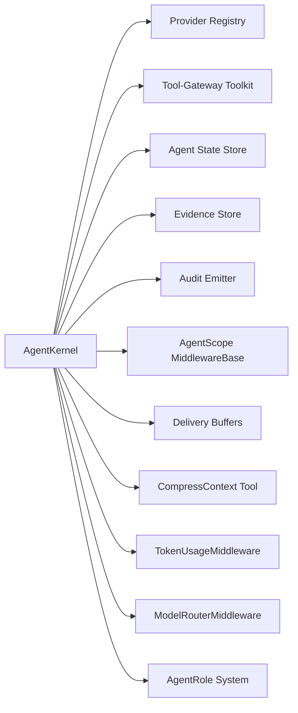

**Diagram sources**
- [runtime_kernel.py:9-67](file://products/agent-platform/src/agent_service/runtime_kernel.py#L9-L67)
- [runtime_kernel.py:340-403](file://products/agent-platform/src/agent_service/runtime_kernel.py#L340-L403)
- [runtime_kernel.py:539-582](file://products/agent-platform/src/agent_service/runtime_kernel.py#L539-L582)
- [runtime_kernel.py:627-660](file://products/agent-platform/src/agent_service/runtime_kernel.py#L627-660)
- [kernel_middleware.py:30-37](file://products/agent-platform/src/agent_service/services/kernel_middleware.py#L30-L37)
- [agent_role.py:30-50](file://products/agent-platform/src/agent_service/services/agent_role.py#L30-L50)

**Section sources**
- [runtime_kernel.py:9-67](file://products/agent-platform/src/agent_service/runtime_kernel.py#L9-L67)
- [runtime_kernel.py:340-403](file://products/agent-platform/src/agent_service/runtime_kernel.py#L340-L403)
- [runtime_kernel.py:539-582](file://products/agent-platform/src/agent_service/runtime_kernel.py#L539-L582)
- [runtime_kernel.py:627-660](file://products/agent-platform/src/agent_service/runtime_kernel.py#L627-660)
- [kernel_middleware.py:30-37](file://products/agent-platform/src/agent_service/services/kernel_middleware.py#L30-L37)
- [agent_role.py:30-50](file://products/agent-platform/src/agent_service/services/agent_role.py#L30-L50)

## Performance Considerations
- Agent cache: LRU-bounded per-session cache reduces rebuild overhead; concurrent access serialized to prevent memory loss.
- Toolkit caching: Per-delegated-token caching avoids repeated discovery; empty discovery results intentionally not cached to recover from transient failures.
- **Role-scoped toolkit caching**: Splits cache by `(token, role)` tuples only when role is bound; unscoped turns maintain single cache entry for byte-identical behavior.
- Evidence framing: Bounded data_summary and optional full data prevent large payloads from degrading streams; oversized payloads omitted from frames.
- Streaming redaction: Terminal event flushing ensures complete text delivery without buffering artifacts.
- Observability overhead: OTel push pipeline is opt-in; Prometheus metrics use bounded labels and lightweight counters/histograms.
- Model switching: Rebuilds occur only when necessary (model id change or toolkit recovery), preserving conversation history via persisted state.
- **Updated** Enhanced system prompt processing: Skills search-first approach may add initial latency but improves overall operational efficiency by reducing failed attempts and improving first-time success rates.
- **Updated** Delivery buffer management: Per-stream buffers minimize memory footprint and provide efficient deferred delivery mechanisms without blocking main execution paths.
- **Updated** CompressContext tool: Optional context compression reduces memory usage for long conversations; disabled by default to maintain backward compatibility; when enabled, operates efficiently without external network calls.
- **Updated** TokenUsageMiddleware: Pure observation middleware with minimal overhead; streaming-aware design ensures accurate token counting without impacting stream performance; bounded label cardinality prevents metric explosion.
- **Updated** Model routing: Opt-in feature with minimal overhead when disabled; classifier calls are separate from agent model calls; cache key splitting prevents unnecessary agent duplication; fail-soft operation ensures routing errors don't impact turn completion.
- **Updated** Role narrowing: Subtractive-only filtering adds minimal overhead; role-scoped cache keys prevent toolkit leakage while maintaining single-entry behavior for unscoped turns; fail-closed unknown roles result in empty toolkits without additional computation.

## Troubleshooting Guide
Common issues and diagnostics:
- Unconfigured runtime: placeholder responses indicate missing provider configuration; check runtime metadata and configuration hint.
- Provider errors: runtime_state shows provider_error; last_error surfaces the latest failure; configuration_hint includes provider attribution.
- Toolkit discovery failures: empty discovery is retried each turn; monitor agent toolkit counts and logs for warnings.
- Evidence persistence failures: best-effort persistence; watch evidence_store_writes_total and related error counters.
- Agent state restore/snapshot failures: degraded durability but turns continue; monitor agent_state_errors_total and fallback counters.
- HITL parking: unexpected ASK indicates tool not in allow-list or flow-unlock not applicable; verify allow-list and flow authority. **Updated** `http.get` now parks by default unless explicitly opted in via `AGENT_GATEWAY_TOOL_AUTO_ALLOW_EXTRA`.
- **Updated** Operational request refusals: If models refuse operational requests without calling skills.search, verify the enhanced default system prompt is being used and that skills.search tool is available.
- **Updated** Secret delivery issues: Monitor delivery buffer states and verify portal_copy handles are properly formatted; check that held deliveries are released only on successful gated commits.
- **Updated** CompressContext configuration issues: Verify AGENTSCOPE_COMPRESS_CONTEXT_ENABLED is set correctly and AGENTSCOPE_CONTEXT_TRIGGER_RATIO > 0.2; check for startup validation errors indicating invalid configuration.
- **Updated** Token usage tracking issues: Verify agent_llm_tokens_total metrics are appearing on /metrics endpoint; check that provider/model labels are bounded and no high-cardinality identifiers are leaking.
- **Updated** Model routing issues: Check AGENTSCOPE_MODEL_ROUTER_ENABLED, AGENTSCOPE_MODEL_ROUTER_MODEL, and AGENTSCOPE_MODEL_ROUTER_CANDIDATES configuration; verify routing precedence (request > pinned > routed > default); monitor effective model attribution in logs.
- **Updated** Role toolkit narrowing issues: Verify role context is properly bound via `agent_role_scope()`; check that role-scoped cache keys are working correctly; monitor that unknown roles result in empty toolkits (fail-closed); ensure subtractive-only semantics are maintained.
- Telemetry misconfiguration: OTel setup failures are logged but do not block requests; verify OTEL_ENABLED and endpoint configuration.

**Section sources**
- [runtime_kernel.py:236-289](file://products/agent-platform/src/agent_service/runtime_kernel.py#L236-L289)
- [runtime_kernel.py:539-582](file://products/agent-platform/src/agent_service/runtime_kernel.py#L539-L582)
- [runtime_kernel.py:627-660](file://products/agent-platform/src/agent_service/runtime_kernel.py#L627-660)
- [runtime_kernel.py:629-660](file://products/agent-platform/src/agent_service/runtime_kernel.py#L629-L660)
- [kernel_middleware.py:195-279](file://products/agent-platform/src/agent_service/services/kernel_middleware.py#L195-L279)
- [kernel_middleware.py:636-741](file://products/agent-platform/src/agent_service/services/kernel_middleware.py#L636-L741)
- [agent_role.py:70-120](file://products/agent-platform/src/agent_service/services/agent_role.py#L70-L120)
- [telemetry.py:69-117](file://products/agent-platform/src/agent_service/core/telemetry.py#L69-L117)
- [metrics.py:156-185](file://products/agent-platform/src/agent_service/core/metrics.py#L156-L185)

## Conclusion
The runtime kernel provides a robust, configurable foundation for agent execution with strong separation of concerns: permission gating, evidence emission, LLM token usage tracking, **per-turn model routing**, **per-role toolkit narrowing**, request context propagation, and observability. Its design emphasizes safety (deny-by-default permissions, bounded payloads, subtractive-only role narrowing), resilience (best-effort persistence, fail-open telemetry, fail-closed role enforcement), and scalability (per-session caching, per-token toolkit caching, streaming). Operators can tune behavior via environment-driven settings and extend the pipeline through supported middleware hooks.

**Updated** The enhanced runtime kernel now includes sophisticated per-stream delivery buffers that enable secure gated secret delivery workflows with reveal-on-commit semantics, integrates the CompressContext tool as a kernel-local operation for optional context compression, incorporates TokenUsageMiddleware as part of the default always-on middlewares for streaming-aware LLM token tracking, adds comprehensive per-turn model routing capabilities through ModelRouterMiddleware integration, and implements per-role toolkit narrowing via the `_narrow_for_role()` method. The model routing system provides intelligent model selection based on content classification while maintaining strict precedence rules (request > pinned > routed > default), fail-soft operation that never hard-fails turns on routing errors, and precise response attribution tracking. The TokenUsageMiddleware provides pure observation of provider-reported token usage via the `on_model_call` hook, recording `agent_llm_tokens_total{provider,model,direction}` metrics with bounded label cardinality and streaming-aware usage extraction from terminal chunks. The CompressContext tool provides agent-driven context summarization while maintaining strict safety guarantees: it never parks on the ASK gate, performs no external access, and requires explicit opt-in via AGENTSCOPE_COMPRESS_CONTEXT_ENABLED with validation ensuring AGENTSCOPE_CONTEXT_TRIGGER_RATIO > 0.2. The per-role toolkit narrowing system provides role-based authority restriction with three closed values (diagnostician, executor, orchestrator), process-local context management, role-scoped cache keys that split by `(token, role)` tuples, staged-by-role provenance tracking on parked confirmations, and fail-closed enforcement that ensures unknown roles result in empty toolkits. The subtractive-only semantics guarantee that role toolkits are always subsets of unscoped toolkits, never widening authority. The enhanced default system prompt significantly improves operational request handling by ensuring models consult skills.search FIRST for any request to act on named systems, accounts, or targets. This prevents anti-fabrication refusals and promotes better operational workflows by prioritizing skill-based guidance over model-generated procedures. The security posture has been strengthened with hardened defaults that require explicit operator confirmation for outbound HTTP requests, providing defense-in-depth against potential SSRF vulnerabilities while maintaining operational flexibility through additive configuration.

## Appendices

### Implementing Custom Middleware
To add cross-cutting behavior:
- Subclass MiddlewareBase and implement on_check_permission to influence tool admission, on_acting to observe/instrument tool execution, or on_model_call to observe model interactions.
- Compose your middleware into the kernel's stack via _build_middlewares or equivalent extension points.
- Ensure your middleware respects request-scoped contexts (e.g., TOOL_EVIDENCE_SINK) and does not introduce unbounded data in frames.

Guidance grounded in existing patterns:
- Permission decisions should explicitly ALLOW or ASK rather than delegating to built-in engines when platform policy requires strict control.
- Evidence emission should produce schema-valid frames with bounded data and redacted parameters.
- **Updated** For secret delivery workflows, leverage the per-stream delivery buffers (STREAM_PENDING_DELIVERIES and PENDING_RELEASE_DELIVERIES) for deferred reveal semantics.
- **Updated** For kernel-local tools like CompressContext, register them in KERNEL_LOCAL_TOOL_NAMES to ensure they're always allowed and don't park on the ASK gate.
- **Updated** For model interaction observation, follow TokenUsageMiddleware pattern using on_model_call hook with streaming-aware response handling.
- **Updated** For model routing, consider ModelRouterMiddleware integration for intelligent model selection based on content classification.
- **Updated** For role-based authority restriction, use the AgentRole system with `agent_role_scope()` context manager and `_narrow_for_role()` method for subtractive-only toolkit narrowing.

**Section sources**
- [kernel_middleware.py:151-193](file://products/agent-platform/src/agent_service/services/kernel_middleware.py#L151-L193)
- [kernel_middleware.py:282-398](file://products/agent-platform/src/agent_service/services/kernel_middleware.py#L282-L398)
- [kernel_middleware.py:490-544](file://products/agent-platform/src/agent_service/services/kernel_middleware.py#L490-L544)
- [kernel_middleware.py:636-741](file://products/agent-platform/src/agent_service/services/kernel_middleware.py#L636-L741)
- [runtime_kernel.py:462-496](file://products/agent-platform/src/agent_service/runtime_kernel.py#L462-L496)
- [agent_role.py:103-120](file://products/agent-platform/src/agent_service/services/agent_role.py#L103-L120)
- [runtime_kernel.py:629-660](file://products/agent-platform/src/agent_service/runtime_kernel.py#L629-L660)

### Extending the Request Pipeline
- Add HTTP-level middleware in the FastAPI app for logging, metrics, or auth before routing.
- Use request context resolution to correlate requests across services using x-request-id or trace_id.
- Enable OTel for distributed tracing and attach log bridge to correlate logs with traces.
- **Updated** Leverage per-stream delivery buffers for implementing custom secret delivery workflows with gated reveal semantics.
- **Updated** Consider kernel-local tool patterns for internal operations that should never park on the ASK gate.
- **Updated** Utilize on_model_call hook for observing model interactions similar to TokenUsageMiddleware implementation.
- **Updated** Integrate ModelRouterMiddleware for intelligent model selection based on content classification while respecting precedence rules.
- **Updated** Use AgentRole system for role-based authority restriction with process-local context management and subtractive-only toolkit narrowing.

**Section sources**
- [app.py:55-76](file://products/agent-platform/src/agent_service/app.py#L55-L76)
- [request_context.py:8-19](file://products/agent-platform/src/agent_service/core/request_context.py#L8-L19)
- [telemetry.py:69-117](file://products/agent-platform/src/agent_service/core/telemetry.py#L69-L117)
- [agent_role.py:103-120](file://products/agent-platform/src/agent_service/services/agent_role.py#L103-L120)

### Debugging Runtime Issues
- Inspect runtime_metadata and configuration_hint to validate provider and model configuration.
- Monitor Prometheus metrics for anomalies in request rates, durations, store errors, evidence writes, and LLM token usage.
- Validate middleware behavior with unit-style checks similar to existing tests for permission, evidence emission, and token usage tracking.
- **Updated** For operational request issues: Verify that the enhanced default system prompt is active and that skills.search tool is properly configured and accessible.
- **Updated** For secret delivery issues: Monitor delivery buffer states, verify portal_copy handle formatting, and ensure held deliveries are properly released on successful gated commits.
- **Updated** For CompressContext issues: Check AGENTSCOPE_COMPRESS_CONTEXT_ENABLED and AGENTSCOPE_CONTEXT_TRIGGER_RATIO configuration, verify startup validation passes, and ensure the tool is registered as kernel-local.
- **Updated** For token usage tracking issues: Verify agent_llm_tokens_total metrics appear on /metrics endpoint, check provider/model label cardinality, and ensure streaming responses are properly handled.
- **Updated** For model routing issues: Check AGENTSCOPE_MODEL_ROUTER_ENABLED, AGENTSCOPE_MODEL_ROUTER_MODEL, and AGENTSCOPE_MODEL_ROUTER_CANDIDATES configuration; verify routing precedence is working correctly; monitor effective model attribution in logs and responses.
- **Updated** For role toolkit narrowing issues: Verify role context is properly bound via `agent_role_scope()`, check role-scoped cache keys are working correctly, monitor that unknown roles result in empty toolkits (fail-closed), and ensure subtractive-only semantics are maintained.

**Section sources**
- [runtime_kernel.py:236-289](file://products/agent-platform/src/agent_service/runtime_kernel.py#L236-L289)
- [metrics.py:23-73](file://products/agent-platform/src/agent_service/core/metrics.py#L23-L73)
- [metrics.py:284-312](file://products/agent-platform/src/agent_service/core/metrics.py#L284-L312)
- [test_kernel_middleware.py:161-360](file://products/agent-platform/tests/test_kernel_middleware.py#L161-L360)
- [test_kernel_middleware.py:508-736](file://products/agent-platform/tests/test_kernel_middleware.py#L508-L736)
- [test_kernel_middleware.py:1396-1530](file://products/agent-platform/tests/test_kernel_middleware.py#L1396-L1530)
- [agent_role.py:70-120](file://products/agent-platform/src/agent_service/services/agent_role.py#L70-L120)
- [test_agent_role.py:129-193](file://products/agent-platform/tests/test_agent_role.py#L129-L193)

### Managing the Auto-Allow List

**Updated** Security hardening in v0.39.1 removed `http.get` from the default auto-allow list, requiring explicit operator confirmation for outbound HTTP requests by default.

`AGENT_GATEWAY_TOOL_AUTO_ALLOW` controls Layer 3 only.

Semantics:

- **Unset** → the built-in vetted list (the read tools shipped with the platform). The authoritative copy is `DEFAULT_AUTO_ALLOWED_TOOLS` in `agent_service/services/kernel_middleware.py`; as shipped it includes `k8s.list_pods`, `k8s.get_pod`, `k8s.get_events`, `k8s.get_pod_logs`, `skills.search`, `skills.get`, `skills.list`, `incidents.list`, `incidents.get`, `secrets.generate_password`, and the read-class browser probes (`web.navigate`, `web.snapshot`, `web.screenshot`, `web.fill_credential`, `web.extract`, `web.wait_for`, `web.hover`, `web.scroll`, `web.switch_frame`). **Note:** `http.get` is no longer included in the default list due to security hardening. Every write-tier tool is absent by construction — including `web.click`/`web.type`/`web.evaluate`, `http.post` and `k8s.delete_pod` — and naming one cannot change that (see the invariant below).
- **Empty string** → auto-approve nothing; every gateway tool parks for confirmation.
- **Comma-separated dotted names** → replaces the default entirely. Names are normalized to AgentScope's sanitized form (`k8s.get_pod` → `k8s_get_pod`). Unknown names are harmless (they simply match nothing).

**New Additive Configuration**: `AGENT_GATEWAY_TOOL_AUTO_ALLOW_EXTRA` provides additive tool approval without restating the entire default list.

- **Additive behavior**: Entries are unioned with the resolved set (built-in default or replacement set when `AGENT_GATEWAY_TOOL_AUTO_ALLOW` is also present).
- **Normalization**: Both variables normalize dots to underscores for AgentScope compatibility.
- **Composition**: The two variables compose together, allowing fine-grained control over auto-approval.

Configuration examples:

```bash
# Opt out http.get from auto-approval (default hardened behavior)
# No configuration needed - http.get parks by default

# Opt in http.get for card-free operation (additive)
AGENT_GATEWAY_TOOL_AUTO_ALLOW_EXTRA=http.get

# Replace default with custom list (replacement semantics)
AGENT_GATEWAY_TOOL_AUTO_ALLOW=k8s.list_pods,k8s.get_pod,elastic.search_logs

# Combine replacement with additive opt-ins
AGENT_GATEWAY_TOOL_AUTO_ALLOW=k8s.get_pod
AGENT_GATEWAY_TOOL_AUTO_ALLOW_EXTRA=http.get
```

**Security Posture**: Outbound HTTP requests now require explicit operator confirmation by default, representing a shift from automatic approval to opt-in behavior for network egress operations. This provides defense-in-depth against potential SSRF vulnerabilities while maintaining operational flexibility through the additive configuration approach.

**Invariant**: Mutating tools are never auto-approved regardless of these settings. If a write/admin tool appears in any auto-allow variable, agent-platform logs a warning at toolkit construction and the tool still parks for confirmation.

**Section sources**
- [kernel_middleware.py:71-115](file://products/agent-platform/src/agent_service/services/kernel_middleware.py#L71-L115)
- [kernel_middleware.py:117-139](file://products/agent-platform/src/agent_service/services/kernel_middleware.py#L117-L139)
- [test_kernel_middleware.py:178-205](file://products/agent-platform/tests/test_kernel_middleware.py#L178-L205)
- [test_kernel_middleware.py:222-233](file://products/agent-platform/tests/test_kernel_middleware.py#L222-L233)

### Enhanced Operational Request Handling
**New Section** The enhanced default system prompt introduces significant improvements to operational request handling:

**Key Improvements:**
- **Skills Search First Policy**: All operational requests to act on named systems, accounts, or targets now trigger skills.search before any other action
- **Anti-Fabrication Prevention**: Models are instructed to treat absence of offhand knowledge as a reason to search rather than refuse
- **Operational Trigger Coverage**: Specific operational scenarios like password resets, account locking/recovery, workload restarts/scaling are explicitly covered
- **Skill Citation Requirements**: Models must cite skills they rely on, improving transparency and auditability

**Implementation Details:**
- The enhanced prompt is defined in `DEFAULT_SYSTEM_PROMPT` in `runtime_settings.py`
- Tests verify proper trigger coverage and skills search precedence
- The prompt maintains existing browser authorization discipline while adding operational capabilities

**Benefits:**
- Reduced operational friction for common administrative tasks
- Improved consistency in following documented procedures
- Better audit trails through skill citation requirements
- Enhanced safety through mandatory skill-based guidance

**Section sources**
- [runtime_settings.py:8-58](file://products/agent-platform/src/agent_service/runtime_settings.py#L8-L58)
- [test_runtime_settings.py:30-54](file://products/agent-platform/tests/test_runtime_settings.py#L30-L54)

### Gated Secret Delivery Workflows
**New Section** The enhanced runtime kernel implements sophisticated gated secret delivery workflows with reveal-on-commit semantics for secure password generation and handoff.

**Core Components:**
- **Per-Stream Delivery Buffers**: STREAM_PENDING_DELIVERIES and PENDING_RELEASE_DELIVERIES context variables manage deferred secret delivery
- **Deferred Reveal Mechanism**: Secrets are buffered during generation and only revealed when appropriate conditions are met
- **HITL Workflow Support**: Held deliveries persist across park/resume cycles and are released only on successful gated commits

**Workflow Patterns:**
- **Standalone Generate-and-Copy**: Secrets generated without following gates are automatically flushed at stream end
- **Gated Reveal-on-Commit**: Secrets generated before HITL approval are released only when approved mutations succeed
- **Failure Safety**: Denied or failed gated calls burn held deliveries silently, preventing secret exposure

**Security Benefits:**
- Secrets are never exposed in evidence frames or stream events until appropriate conditions are met
- Single-use delivery handles prevent replay attacks
- Owner-scoped redemption ensures only authorized users can access secrets
- TTL-based expiration prevents indefinite secret retention

**Section sources**
- [runtime_kernel.py:1249-1295](file://products/agent-platform/src/agent_service/runtime_kernel.py#L1249-L1295)
- [kernel_middleware.py:68-75](file://products/agent-platform/src/agent_service/services/kernel_middleware.py#L68-L75)
- [kernel_middleware.py:490-544](file://products/agent-platform/src/agent_service/services/kernel_middleware.py#L490-L544)
- [test_secret_delivery_integration.py:35-152](file://products/agent-platform/tests/test_secret_delivery_integration.py#L35-L152)
- [test_kernel_middleware.py:760-815](file://products/agent-platform/tests/test_kernel_middleware.py#L760-L815)
- [test_kernel_middleware.py:816-888](file://products/agent-platform/tests/test_kernel_middleware.py#L816-L888)

### CompressContext Configuration Reference
**New Section** Configuration reference for the CompressContext tool integration:

**Environment Variables:**
- `AGENTSCOPE_COMPRESS_CONTEXT_ENABLED`: Enable/disable agent-driven context compression (default: false)
- `AGENTSCOPE_CONTEXT_TRIGGER_RATIO`: Context compression trigger ratio (must be > 0.2, default: 0.8)

**Behavior:**
- When disabled (default): CompressContext tool is not registered, kernel behaves identically to previous versions
- When enabled: CompressContext tool is registered as kernel-local and always allowed
- Startup validation: Fails if AGENTSCOPE_CONTEXT_TRIGGER_RATIO <= 0.2 to prevent configuration conflicts

**Security Characteristics:**
- Kernel-local operation: Never parks on the headless ASK gate
- State-only mutation: Only summarizes agent's own working context
- No external access: Performs no execution or infrastructure access operations
- Opt-in by default: Disabled unless explicitly enabled

**Example Configuration:**
```bash
# Enable context compression with safe trigger ratio
export AGENTSCOPE_COMPRESS_CONTEXT_ENABLED=true
export AGENTSCOPE_CONTEXT_TRIGGER_RATIO=0.8

# Disable context compression (default behavior)
export AGENTSCOPE_COMPRESS_CONTEXT_ENABLED=false
```

**Section sources**
- [runtime_settings.py:185-185](file://products/agent-platform/src/agent_service/runtime_settings.py#L185-L185)
- [runtime_settings.py:319-328](file://products/agent-platform/src/agent_service/runtime_settings.py#L319-L328)
- [runtime_kernel.py:597-610](file://products/agent-platform/src/agent_service/runtime_kernel.py#L597-L610)
- [kernel_middleware.py:105-117](file://products/agent-platform/src/agent_service/services/kernel_middleware.py#L105-L117)
- [test_runtime_settings.py:637-678](file://products/agent-platform/tests/test_runtime_settings.py#L637-L678)
- [test_kernel_middleware.py:491-513](file://products/agent-platform/tests/test_kernel_middleware.py#L491-L513)

### Token Usage Tracking Reference
**New Section** Configuration and behavior reference for the TokenUsageMiddleware:

**Middleware Characteristics:**
- **Always-on**: Registered unconditionally in `_build_middlewares()` with no opt-in knob
- **Pure observation**: No side effects beyond metric recording
- **Streaming-aware**: Properly handles AsyncGenerator responses and extracts usage from terminal chunks
- **Bounded labels**: Uses catalog-resolved provider/model pairs with "unknown" sentinel for uncatalogued models

**Metric Output:**
- Counter family: `agent_llm_tokens_total{provider,model,direction}`
- Direction values: `input`, `output`, `cache_input`, `cache_creation`
- No cost metrics: Cost calculation deferred per SPEC-065 Stage-0 finding
- No high-cardinality labels: Excludes session_id, user_id, request_id

**Behavioral Guarantees:**
- Records nothing when providers return no usage data
- Never synthesizes zero-fill estimates
- Maintains bounded label cardinality
- Preserves original response/stream passthrough behavior

**Example Metric Values:**
```
agent_llm_tokens_total{provider="dashscope",model="qwen-plus",direction="input"} 5352
agent_llm_tokens_total{provider="dashscope",model="qwen-plus",direction="output"} 1
agent_llm_tokens_total{provider="dashscope",model="qwen-plus",direction="cache_input"} 5120
```

**Section sources**
- [kernel_middleware.py:636-741](file://products/agent-platform/src/agent_service/services/kernel_middleware.py#L636-L741)
- [metrics.py:284-312](file://products/agent-platform/src/agent_service/core/metrics.py#L284-L312)
- [test_kernel_middleware.py:1396-1530](file://products/agent-platform/tests/test_kernel_middleware.py#L1396-L1530)

### Model Routing Configuration Reference
**New Section** Configuration and behavior reference for the per-turn model routing system:

**Environment Variables:**
- `AGENTSCOPE_MODEL_ROUTER_ENABLED`: Enable/disable model routing (default: false)
- `AGENTSCOPE_MODEL_ROUTER_MODEL`: Classifier model catalog id (required when candidates are configured)
- `AGENTSCOPE_MODEL_ROUTER_CANDIDATES`: JSON map of candidate names to {model_id, description} objects

**Routing Precedence:**
- **Explicit Request**: Client-specified model takes highest priority
- **Live Pin**: Session-pinned model suppresses routing
- **Automatic Routing**: Content-based model selection (only when above two are absent)
- **Default**: Deploy-time default model

**Behavioral Characteristics:**
- **Opt-in gating**: Router middleware only registered when enabled, candidates configured, and routing_allowed=True
- **Fail-soft operation**: Classifier errors and unknown candidates keep original model without failing the turn
- **Resume safety**: Stored routing choices persist across park/resume cycles
- **Cache isolation**: Separate agent instances for routed vs non-routed turns
- **Attribution tracking**: Effective model identification and model_selected_by field in responses

**Configuration Example:**
```bash
# Enable model routing with fast/deep candidates
export AGENTSCOPE_MODEL_ROUTER_ENABLED=true
export AGENTSCOPE_MODEL_ROUTER_MODEL=openai
export AGENTSCOPE_MODEL_ROUTER_CANDIDATES='{"fast":{"model_id":"deepseek","description":"quick, simple tasks"},"deep":{"model_id":"openai","description":"complex, multi-step reasoning"}}'

# Disable model routing (default behavior)
export AGENTSCOPE_MODEL_ROUTER_ENABLED=false
```

**Section sources**
- [runtime_settings.py:265-278](file://products/agent-platform/src/agent_service/runtime_settings.py#L265-L278)
- [runtime_kernel.py:560-686](file://products/agent-platform/src/agent_service/runtime_kernel.py#L560-L686)
- [routes.py:378-384](file://products/agent-platform/src/agent_service/api/v2/routes.py#L378-L384)
- [test_model_router.py:1-200](file://products/agent-platform/tests/test_model_router.py#L1-L200)
- [test_model_router.py:349-412](file://products/agent-platform/tests/test_model_router.py#L349-L412)

### Per-Role Toolkit Narrowing Configuration Reference
**New Section** Configuration and behavior reference for the per-role toolkit narrowing system:

**Role Vocabulary:**
- **diagnostician**: Read-level tools only (reuses `_filter_read_only`)
- **executor**: Full discovered set (mutating tools still park on HITL)
- **orchestrator**: No direct gateway tools (delegates, invokes nothing)
- **unknown roles**: Empty toolkit (fail-closed to most restrictive posture)

**Process-Local Context Management:**
- **agent_role_scope()**: Context manager for binding roles around turns
- **AGENT_ROLE**: ContextVar holding current role (default: None for unscoped)
- **current_agent_role()**: Returns current role or None
- **current_agent_role_value()**: Returns plain string value or None

**Cache Key Strategy:**
- **Role-scoped keys**: `(token, role)` tuples for separate toolkit caching
- **Backward compatible**: Unscoped turns maintain single cache entry
- **Subtractive-only**: Role toolkits are always subsets of unscoped toolkits

**Behavioral Characteristics:**
- **Subtractive-only semantics**: Role narrowing never widens authority
- **Fail-closed enforcement**: Unknown roles result in empty toolkits
- **Process-local scope**: Role context never part of durable snapshots or wire protocols
- **Phase 2 inertness**: No orchestration caller binds roles in deployed code

**Usage Pattern:**
```python
from agent_service.services.agent_role import agent_role_scope, AgentRole

with agent_role_scope(AgentRole.DIAGNOSTICIAN):
    # Toolkit will contain only read-level tools
    toolkit = await kernel._ensure_toolkit(bearer_token)
    
with agent_role_scope(AgentRole.EXECUTOR):
    # Toolkit will contain full discovered set
    toolkit = await kernel._ensure_toolkit(bearer_token)
```

**Section sources**
- [agent_role.py:30-50](file://products/agent-platform/src/agent_service/services/agent_role.py#L30-L50)
- [agent_role.py:70-120](file://products/agent-platform/src/agent_service/services/agent_role.py#L70-L120)
- [runtime_kernel.py:502-580](file://products/agent-platform/src/agent_service/runtime_kernel.py#L502-L580)
- [runtime_kernel.py:629-660](file://products/agent-platform/src/agent_service/runtime_kernel.py#L629-L660)
- [test_agent_role.py:129-193](file://products/agent-platform/tests/test_agent_role.py#L129-L193)
- [test_agent_role.py:276-299](file://products/agent-platform/tests/test_agent_role.py#L276-L299)

### Staged-by-Role Provenance Reference
**New Section** Configuration and behavior reference for the staged-by-role provenance tracking system:

**Field Characteristics:**
- **PendingConfirmation.staged_by_role**: Optional string field storing role provenance
- **Memory-only storage**: Never persisted to durable card records
- **Kernel-internal only**: Never added to wire schemas or contract definitions
- **Backward compatible**: Defaults to None for unscoped single-agent path

**Provenance Capture:**
- **Capture point**: At park time via `current_agent_role_value()`
- **Value format**: Plain string ("diagnostician", "executor", "orchestrator")
- **Unscoped default**: Unscoped parks leave field as None
- **Contract safety**: No changes to `execution-request.schema.json` or `agent-stream-event.schema.json`

**Behavioral Guarantees:**
- **Ephemeral storage**: Lives only in memory during confirmation lifecycle
- **No persistence**: Never written to database or transmitted over network
- **Schema compatibility**: Existing contract schemas remain unchanged
- **Phase 2 inertness**: No orchestration caller binds roles, so field remains None

**Testing Verification:**
- Field defaults to None and is settable
- Unscoped parks leave staged_by_role as None
- Durable records never carry role provenance
- Contract schemas remain unchanged with no role fields

**Section sources**
- [hitl_confirmations.py:101-111](file://products/agent-platform/src/agent_service/services/hitl_confirmations.py#L101-L111)
- [agent_role.py:93-100](file://products/agent-platform/src/agent_service/services/agent_role.py#L93-L100)
- [test_agent_role.py:234-270](file://products/agent-platform/tests/test_agent_role.py#L234-L270)