# Platform Gateway

<cite>
**Referenced Files in This Document**
- [app.py](file://products/platform-gateway/src/platform_gateway/app.py)
- [main.py](file://products/platform-gateway/src/platform_gateway/main.py)
- [router.py](file://products/platform-gateway/src/platform_gateway/api/router.py)
- [gateway_service.py](file://products/platform-gateway/src/platform_gateway/services/gateway_service.py)
- [policy_engine.py](file://products/platform-gateway/src/platform_gateway/services/policy_engine.py)
- [policy_matrix.py](file://products/platform-gateway/src/platform_gateway/services/policy_matrix.py)
- [token_verifier.py](file://products/platform-gateway/src/platform_gateway/services/token_verifier.py)
- [delegation_client.py](file://products/platform-gateway/src/platform_gateway/services/delegation_client.py)
- [audit_emitter.py](file://products/platform-gateway/src/platform_gateway/services/audit_emitter.py)
- [target_authorization.py](file://products/platform-gateway/src/platform_gateway/services/target_authorization.py)
- [agent_client.py](file://products/platform-gateway/src/platform_gateway/services/agent_client.py)
- [config.py](file://products/platform-gateway/src/platform_gateway/core/config.py)
- [runtime-config.env](file://shared/platform-ops/gitops/dev-k8s/base/platform-gateway/runtime-config.env)
- [policy-default.yaml](file://products/platform-gateway/src/platform_gateway/policies/policy-default.yaml)
- [SPEC-010-platform-gateway-extraction/spec.md](file://docs/specs/SPEC-010-platform-gateway-extraction/spec.md)
</cite>

## Update Summary
**Changes Made**
- Updated development environment diagnosis proxy timeout configuration from 120 to 300 seconds for SPEC-076 bounded read-only diagnosis operations
- Enhanced documentation of diagnosis proxy timeout configuration and its relationship to real LLM provider operations
- Added context about the dev-overlay runtime configuration changes supporting longer-running diagnosis workflows

## Table of Contents
1. Introduction
2. Project Structure
3. Core Components
4. Architecture Overview
5. Detailed Component Analysis
6. Dependency Analysis
7. Performance Considerations
8. Troubleshooting Guide
9. Conclusion

## Introduction
The Platform Gateway is the operator portal's single HTTP entry point and policy enforcement edge. It authenticates requests by verifying platform tokens locally, delegates to the Identity Broker for token exchange when needed, evaluates centralized policies before forwarding requests to backend services (agent-platform, audit-service, tool-gateway, skills-hub), and emits durable audit events. Its design preserves deny-by-default authorization, supports approval workflows for mutating actions, and provides transparency endpoints that render the effective permission matrix from the live policy bundle.

Key responsibilities:
- Single entrypoint for all operator portal API requests
- Local JWT verification via JWKS with audience and issuer checks
- Token delegation to the Identity Broker for downstream tool execution
- Centralized policy evaluation against a YAML bundle with allow/deny/require_approval outcomes
- Request/response proxying to backend services with robust error posture
- Audit event emission for every policy decision and key operations
- Transparency surfaces exposing the effective role-to-action matrix
- **Updated**: Development environment diagnosis proxy timeout increased to 300 seconds to support longer-running SPEC-076 bounded read-only diagnosis operations against real LLM providers

**Section sources**
- [SPEC-010-platform-gateway-extraction/spec.md:13-22](file://docs/specs/SPEC-010-platform-gateway-extraction/spec.md#L13-L22)
- [app.py:16-41](file://products/platform-gateway/src/platform_gateway/app.py#L16-L41)

## Project Structure
The product follows a consistent FastAPI service layout:
- Application bootstrap and middleware in app.py and main.py
- API routes under api/routes grouped by feature (auth, sessions, chat, incidents, documents, models, approvals, tools, policy, runtime, health, identity, authorizations)
- Services layer implementing business logic: gateway orchestration, policy engine, token verification, delegation, audit emission, client helpers, and target authorization
- Policies directory holding the default YAML bundle loaded at runtime
- Core configuration and telemetry/metrics setup

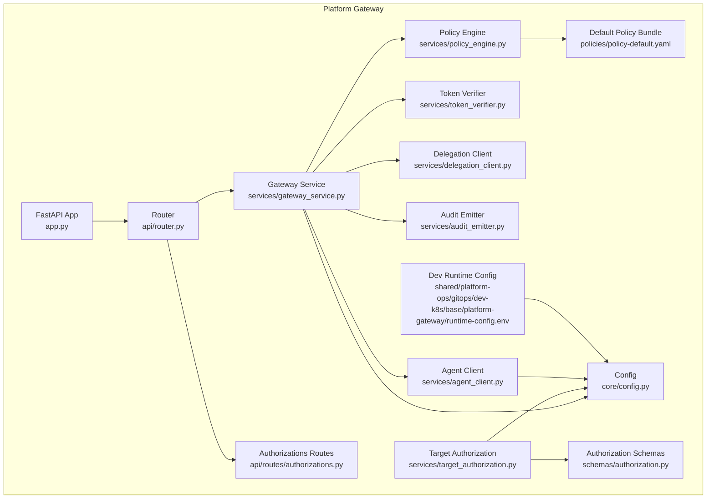

**Diagram sources**
- [app.py:16-41](file://products/platform-gateway/src/platform_gateway/app.py#L16-L41)
- [gateway_service.py:204-300](file://products/platform-gateway/src/platform_gateway/services/gateway_service.py#L204-L300)
- [policy_engine.py:390-443](file://products/platform-gateway/src/platform_gateway/services/policy_engine.py#L390-L443)
- [token_verifier.py:52-89](file://products/platform-gateway/src/platform_gateway/services/token_verifier.py#L52-L89)
- [delegation_client.py:190-229](file://products/platform-gateway/src/platform_gateway/services/delegation_client.py#L190-L229)
- [audit_emitter.py:30-99](file://products/platform-gateway/src/platform_gateway/services/audit_emitter.py#L30-L99)
- [target_authorization.py:1-326](file://products/platform-gateway/src/platform_gateway/services/target_authorization.py#L1-L326)
- [agent_client.py:207-241](file://products/platform-gateway/src/platform_gateway/services/agent_client.py#L207-L241)
- [authorizations.py:1-66](file://products/platform-gateway/src/platform_gateway/api/routes/authorizations.py#L1-L66)
- [authorization.py:1-56](file://products/platform-gateway/src/platform_gateway/schemas/authorization.py#L1-L56)
- [config.py:23-53](file://products/platform-gateway/src/platform_gateway/core/config.py#L23-L53)
- [policy-default.yaml:1-52](file://products/platform-gateway/src/platform_gateway/policies/policy-default.yaml#L1-L52)
- [runtime-config.env:23-29](file://shared/platform-ops/gitops/dev-k8s/base/platform-gateway/runtime-config.env#L23-L29)

**Section sources**
- [app.py:16-41](file://products/platform-gateway/src/platform_gateway/app.py#L16-L41)
- [main.py:6-8](file://products/platform-gateway/src/platform_gateway/main.py#L6-L8)
- [config.py:23-53](file://products/platform-gateway/src/platform_gateway/core/config.py#L23-L53)

## Core Components
- FastAPI application and middleware: request logging, metrics, telemetry setup, router inclusion
- Identity resolution: local JWT verification or synthetic dev identity based on settings
- Policy enforcement: evaluate action against loaded bundle; emit audit; raise 403 on deny
- Delegation: per-user cached delegated tokens exchanged with Identity Broker using workload token or static credentials
- Proxies: session, chat, incident, document, model, skill, tool, and approval endpoints with consistent upstream error mapping
- Diagnosis proxy: operator-invoked bounded read-only diagnosis endpoint with configurable timeout for SPEC-076 operations
- Transparency: live permission matrix derived from the enforced bundle
- **Updated**: Development environment diagnosis proxy timeout increased to 300 seconds to accommodate longer-running bounded read-only diagnosis operations against real LLM providers

**Section sources**
- [app.py:16-41](file://products/platform-gateway/src/platform_gateway/app.py#L16-L41)
- [gateway_service.py:204-300](file://products/platform-gateway/src/platform_gateway/services/gateway_service.py#L204-L300)
- [gateway_service.py:971-993](file://products/platform-gateway/src/platform_gateway/services/gateway_service.py#L971-L993)
- [agent_client.py:207-241](file://products/platform-gateway/src/platform_gateway/services/agent_client.py#L207-L241)
- [delegation_client.py:190-229](file://products/platform-gateway/src/platform_gateway/services/delegation_client.py#L190-L229)
- [policy_matrix.py:31-87](file://products/platform-gateway/src/platform_gateway/services/policy_matrix.py#L31-L87)
- [target_authorization.py:1-326](file://products/platform-gateway/src/platform_gateway/services/target_authorization.py#L1-L326)

## Architecture Overview
The gateway sits between the operator portal and backend services. Every request is logged, authenticated, authorized, proxied, and audited. The diagnosis proxy path specifically handles SPEC-076 bounded read-only diagnosis operations with extended timeouts for real LLM provider interactions.

```mermaid
sequenceDiagram
participant Portal as "Operator Portal"
participant GW as "Platform Gateway"
participant ID as "Identity Broker"
participant AG as "Agent Platform"
participant AUD as "Audit Service"
Note over Portal,AG : Standard Flow
Portal->>GW : HTTP request (Bearer JWT)
GW->>GW : verify_token()
alt Valid token
GW->>GW : enforce_policy(action)
alt Allow
GW->>AG : Proxy request
AG-->>GW : Response
GW->>AUD : Emit audit event
GW-->>Portal : Response
else Require Approval
GW-->>Portal : 403 with approval details
GW->>AUD : Emit audit event
else Deny
GW-->>Portal : 403 denial
GW->>AUD : Emit audit event
end
else Missing/Invalid token
GW-->>Portal : 401
end
Note over Portal,AG : Diagnosis Flow with Extended Timeout
Portal->>GW : POST /api/v1/diagnose (profile, goal)
GW->>GW : verify_token() + enforce_policy("diagnosis : run")
GW->>AG : POST /api/v2/diagnose (bounded read-only orchestration)
Note over AG : Up to AGENT_ORCHESTRATION_MAX_STEPS member turns
AG-->>GW : Synthesized diagnosis (may take >120s with real LLMs)
GW->>AUD : Emit audit event
GW-->>Portal : Diagnosis result
```

**Diagram sources**
- [token_verifier.py:52-89](file://products/platform-gateway/src/platform_gateway/services/token_verifier.py#L52-L89)
- [gateway_service.py:204-300](file://products/platform-gateway/src/platform_gateway/services/gateway_service.py#L204-L300)
- [gateway_service.py:971-993](file://products/platform-gateway/src/platform_gateway/services/gateway_service.py#L971-L993)
- [agent_client.py:207-241](file://products/platform-gateway/src/platform_gateway/services/agent_client.py#L207-L241)
- [audit_emitter.py:30-99](file://products/platform-gateway/src/platform_gateway/services/audit_emitter.py#L30-L99)

## Detailed Component Analysis

### Authentication and Identity Resolution
- Local JWT verification uses JWKS with issuer and audience validation
- Missing or invalid bearer tokens result in 401 unless authentication is disabled in dev mode
- Synthetic dev identity can be used when no token is present and auth is optional

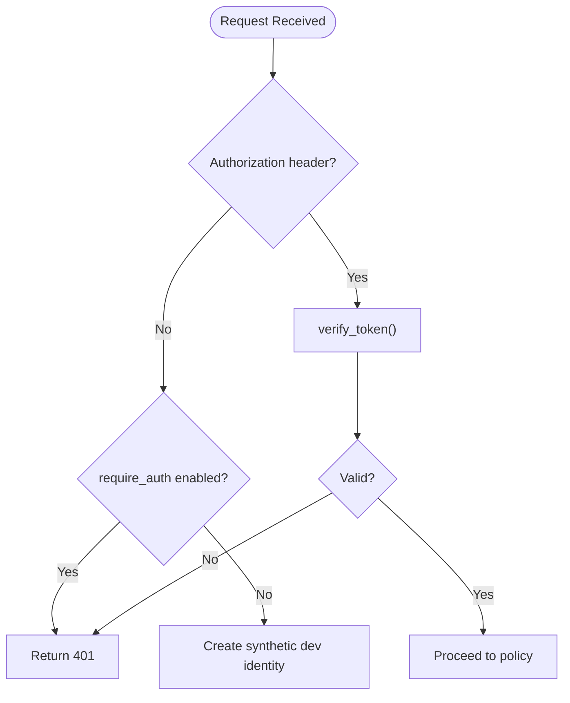

**Diagram sources**
- [gateway_service.py:204-264](file://products/platform-gateway/src/platform_gateway/services/gateway_service.py#L204-L264)
- [token_verifier.py:52-89](file://products/platform-gateway/src/platform_gateway/services/token_verifier.py#L52-L89)
- [config.py:23-53](file://products/platform-gateway/src/platform_gateway/core/config.py#L23-L53)

**Section sources**
- [gateway_service.py:204-264](file://products/platform-gateway/src/platform_gateway/services/gateway_service.py#L204-L264)
- [token_verifier.py:52-89](file://products/platform-gateway/src/platform_gateway/services/token_verifier.py#L52-L89)
- [config.py:23-53](file://products/platform-gateway/src/platform_gateway/core/config.py#L23-L53)

### Policy Engine and Rule Evaluation
- Loads a YAML bundle (packaged default or configured path) and caches it per process
- Evaluates actions against roles with deny-by-default semantics
- Outcomes: allow, deny, require_approval; precedence: deny > require_approval > allow; higher priority wins within an outcome class
- Approval rules carry tier and decider roles; only bridged actions may use require_approval

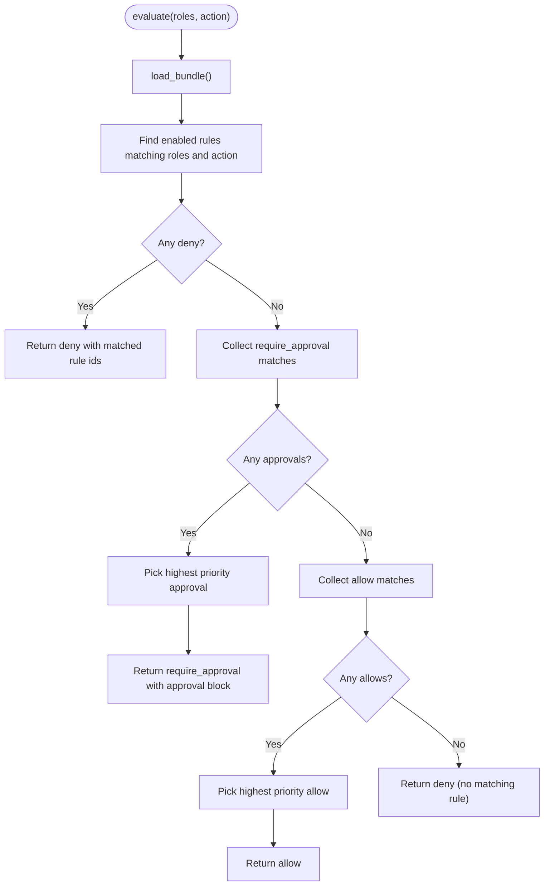

**Diagram sources**
- [policy_engine.py:334-371](file://products/platform-gateway/src/platform_gateway/services/policy_engine.py#L334-L371)
- [policy_engine.py:390-443](file://products/platform-gateway/src/platform_gateway/services/policy_engine.py#L390-L443)
- [policy-default.yaml:53-326](file://products/platform-gateway/src/platform_gateway/policies/policy-default.yaml#L53-L326)

**Section sources**
- [policy_engine.py:334-371](file://products/platform-gateway/src/platform_gateway/services/policy_engine.py#L334-L371)
- [policy_engine.py:390-443](file://products/platform-gateway/src/platform_gateway/services/policy_engine.py#L390-L443)
- [policy-default.yaml:53-326](file://products/platform-gateway/src/platform_gateway/policies/policy-default.yaml#L53-L326)

### Diagnosis Proxy and SPEC-076 Support
**Updated** The diagnosis proxy handles operator-invoked bounded read-only diagnosis operations (SPEC-076 R-7). This proxy mirrors the chat functionality but targets the `/api/v2/diagnose` endpoint and uses the longer `diagnose_response_timeout_seconds` budget to accommodate the bounded fan-out of up to `AGENT_ORCHESTRATION_MAX_STEPS` member read turns plus synthesis.

Key characteristics:
- **Extended Timeout Configuration**: Development environment timeout increased from 120 to 300 seconds to support longer-running operations against real LLM providers
- **Bounded Read-Only Orchestration**: Executes bounded fan-out of diagnostician member turns over the existing `read_only=True` seam
- **Same-Token Identity Preservation**: All member turns ride the same delegated token without additional broker exchanges
- **Real LLM Provider Support**: Accommodates observed ~140s operation times with context compression and multiple member turns
- **Policy Enforcement**: Requires appropriate diagnosis permissions through the policy engine

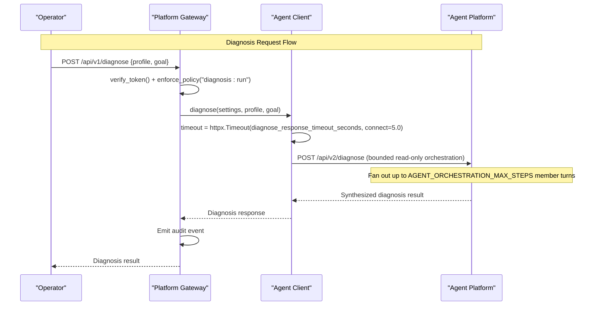

**Diagram sources**
- [gateway_service.py:971-993](file://products/platform-gateway/src/platform_gateway/services/gateway_service.py#L971-L993)
- [agent_client.py:207-241](file://products/platform-gateway/src/platform_gateway/services/agent_client.py#L207-L241)

**Development Environment Configuration:**
- **Timeout Increase**: `PLATFORM_GATEWAY_DIAGNOSE_TIMEOUT_SECONDS=300` in dev-overlay runtime configuration
- **Rationale**: Real LLM provider operations with context compression and multiple member turns can exceed the 120s code default (observed ~140s)
- **Scope**: Development environment only; code default remains 120s as a follow-up finding
- **Purpose**: Prevents ReadTimeout errors during legitimate bounded diagnosis operations

**Section sources**
- [gateway_service.py:971-993](file://products/platform-gateway/src/platform_gateway/services/gateway_service.py#L971-L993)
- [agent_client.py:207-241](file://products/platform-gateway/src/platform_gateway/services/agent_client.py#L207-L241)
- [config.py:39-43](file://products/platform-gateway/src/platform_gateway/core/config.py#L39-L43)
- [config.py:103-105](file://products/platform-gateway/src/platform_gateway/core/config.py#L103-L105)
- [runtime-config.env:23-29](file://shared/platform-ops/gitops/dev-k8s/base/platform-gateway/runtime-config.env#L23-L29)

### Authorization Matrix and Transparency
- Builds a role x action matrix from the enforced bundle
- Admin scope shows full matrix; other identities see only their own roles
- require_approval cells appear as false in boolean matrix plus additive approval_requirements structure

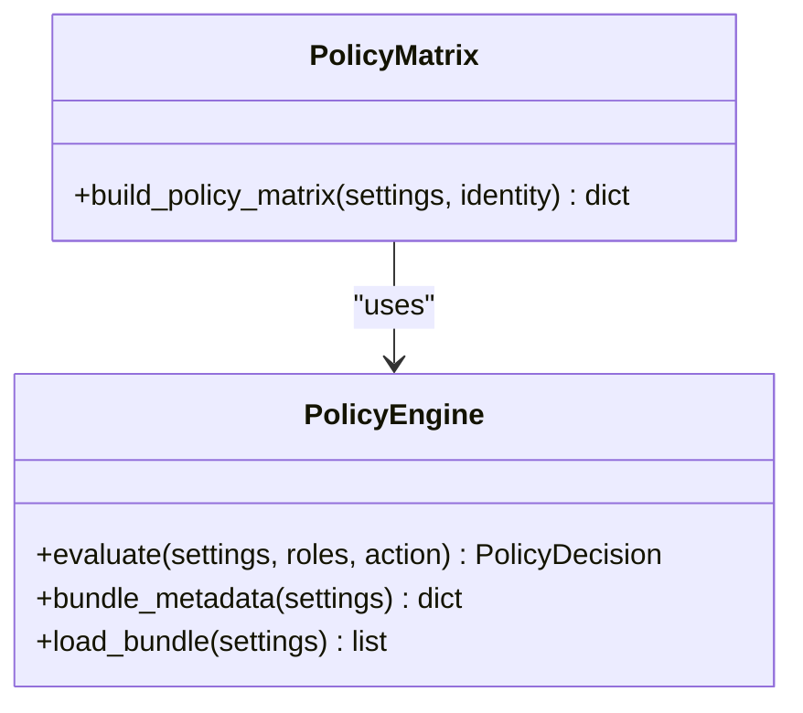

**Diagram sources**
- [policy_matrix.py:31-87](file://products/platform-gateway/src/platform_gateway/services/policy_matrix.py#L31-L87)
- [policy_engine.py:390-443](file://products/platform-gateway/src/platform_gateway/services/policy_engine.py#L390-L443)

**Section sources**
- [policy_matrix.py:31-87](file://products/platform-gateway/src/platform_gateway/services/policy_matrix.py#L31-L87)

### Token Delegation and Tool Execution Path
- Exchanges verified user tokens for short-lived delegated tokens bound to the tool-gateway audience
- Per-user cache avoids repeated exchanges; refreshes near expiry
- Uses projected workload token when available, otherwise falls back to static service credentials
- Failure is non-fatal: proceeds without tools rather than breaking chat

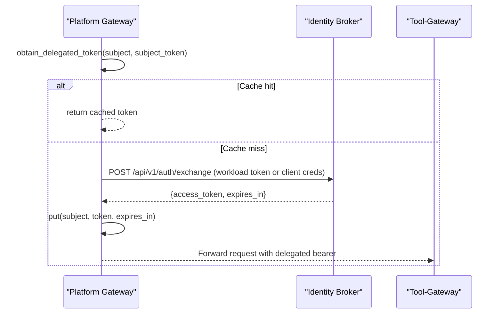

**Diagram sources**
- [delegation_client.py:78-101](file://products/platform-gateway/src/platform_gateway/services/delegation_client.py#L78-L101)
- [delegation_client.py:190-229](file://products/platform-gateway/src/platform_gateway/services/delegation_client.py#L190-L229)

**Section sources**
- [delegation_client.py:78-101](file://products/platform-gateway/src/platform_gateway/services/delegation_client.py#L78-L101)
- [delegation_client.py:190-229](file://products/platform-gateway/src/platform_gateway/services/delegation_client.py#L190-L229)

### Request Routing and Proxy Patterns
- Routes are organized by feature and delegate to gateway_service functions
- Each proxy enforces a consistent error posture: upstream 4xx pass through; transport or upstream 5xx map to 502
- House headers propagate correlation IDs; timeouts and retries are controlled by settings

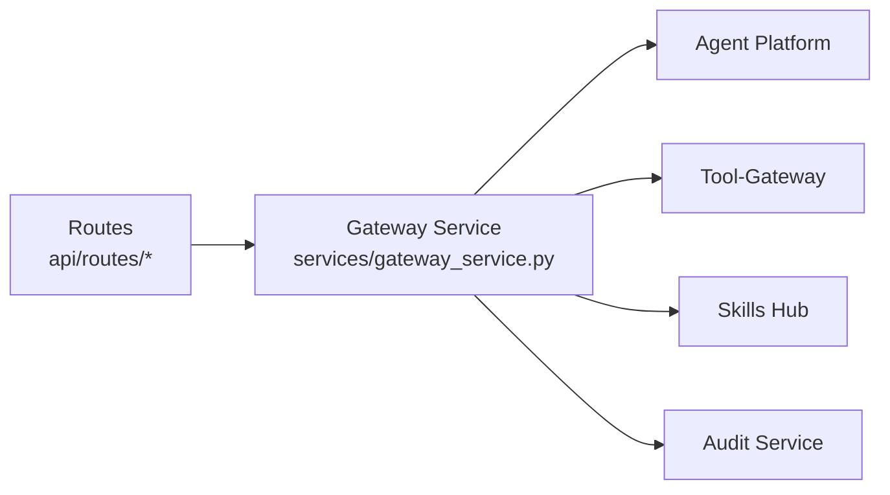

**Diagram sources**
- [gateway_service.py:331-800](file://products/platform-gateway/src/platform_gateway/services/gateway_service.py#L331-L800)

**Section sources**
- [gateway_service.py:331-800](file://products/platform-gateway/src/platform_gateway/services/gateway_service.py#L331-L800)

### Approval Workflow Integration
- Mutating tool execution requires tier_2 approval; the policy engine returns require_approval with an approval block
- The gateway bridges the confirmation flow so designated approvers can approve parked calls
- Approval decisions are scoped to specific roles and cannot self-approve at tier_2

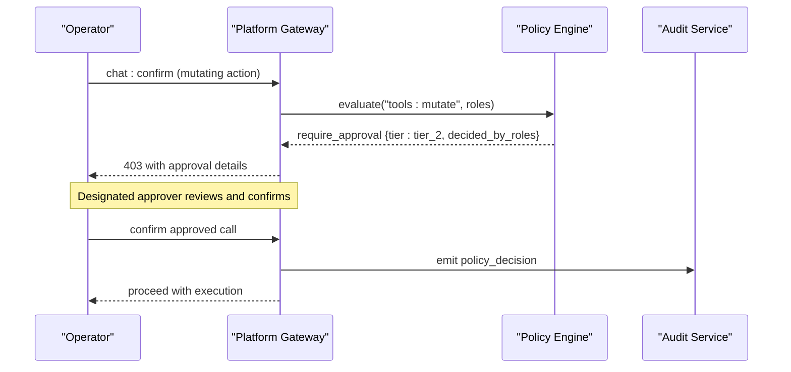

**Diagram sources**
- [policy_engine.py:390-443](file://products/platform-gateway/src/platform_gateway/services/policy_engine.py#L390-L443)
- [policy-default.yaml:130-152](file://products/platform-gateway/src/platform_gateway/policies/policy-default.yaml#L130-L152)
- [audit_emitter.py:30-99](file://products/platform-gateway/src/platform_gateway/services/audit_emitter.py#L30-L99)

**Section sources**
- [policy_engine.py:390-443](file://products/platform-gateway/src/platform_gateway/services/policy_engine.py#L390-L443)
- [policy-default.yaml:130-152](file://products/platform-gateway/src/platform_gateway/policies/policy-default.yaml#L130-L152)

### Audit Event Emission
- Every policy decision is emitted as a durable audit event
- Emission is fire-and-forget on a daemon thread with a short timeout; failures do not degrade the request path
- Events include subject, username, actor, roles, and structured details

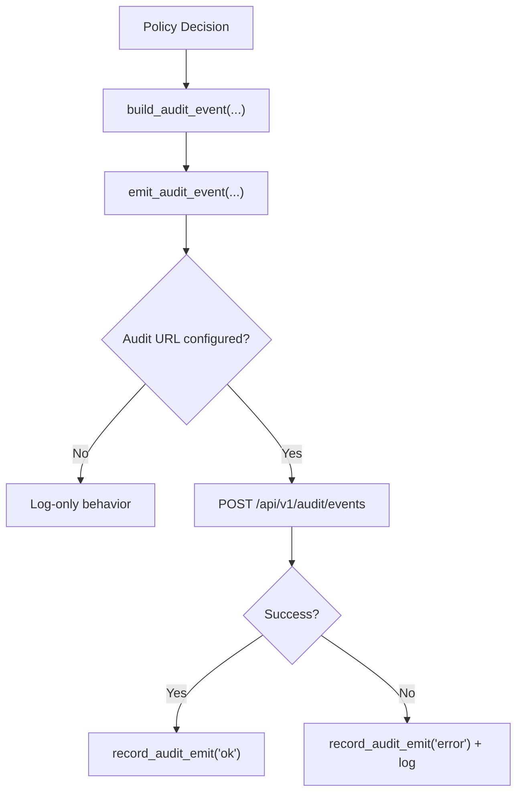

**Diagram sources**
- [gateway_service.py:303-328](file://products/platform-gateway/src/platform_gateway/services/gateway_service.py#L303-L328)
- [audit_emitter.py:30-99](file://products/platform-gateway/src/platform_gateway/services/audit_emitter.py#L30-L99)

**Section sources**
- [gateway_service.py:303-328](file://products/platform-gateway/src/platform_gateway/services/gateway_service.py#L303-L328)
- [audit_emitter.py:30-99](file://products/platform-gateway/src/platform_gateway/services/audit_emitter.py#L30-L99)

### Error Handling for Policy Denials
- Deny results in a structured 403 with action, reason, and matched rule ids
- Metrics record the decision; audit event captures the denial context
- Upstream errors are normalized to 502 to avoid leaking internal failures

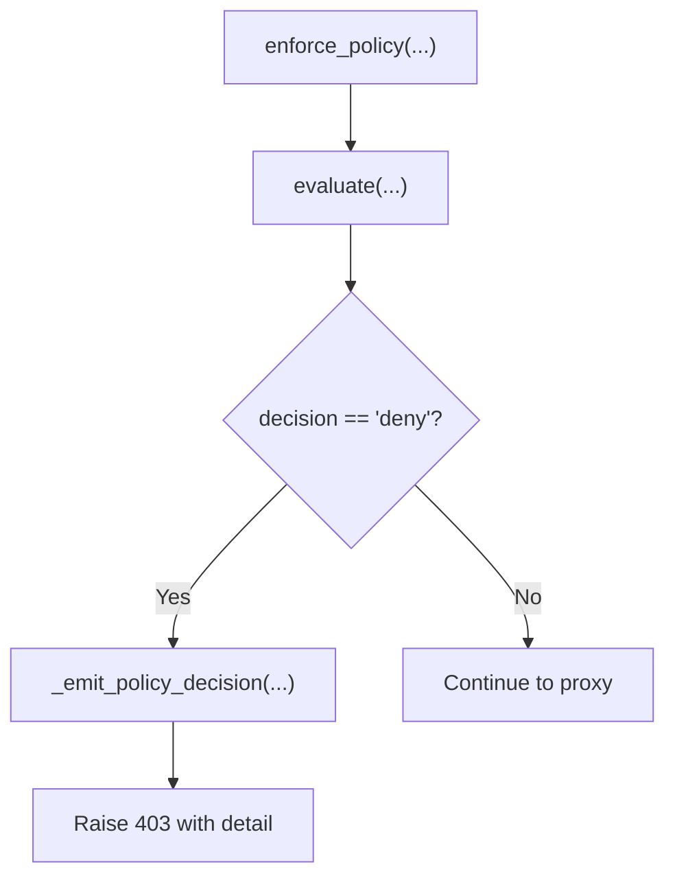

**Diagram sources**
- [gateway_service.py:267-300](file://products/platform-gateway/src/platform_gateway/services/gateway_service.py#L267-L300)

**Section sources**
- [gateway_service.py:267-300](file://products/platform-gateway/src/platform_gateway/services/gateway_service.py#L267-L300)

## Configuration Options
**Updated** The Platform Gateway includes configuration options for diagnosis proxy timeout and enhanced SPEC-076 support:

### Diagnosis Proxy Configuration
- `PLATFORM_GATEWAY_DIAGNOSE_TIMEOUT_SECONDS`: Upstream `/api/v2/diagnose` proxy timeout (SPEC-076 R-7): a bounded read-only diagnosis fans out up to `AGENT_ORCHESTRATION_MAX_STEPS` member turns plus a synthesis, so it needs a longer proxy budget than a single chat turn (mirrors the incident-triage long-read class, not chat's `30`)
- **Development Environment**: Set to `300` seconds to support longer-running operations against real LLM providers
- **Code Default**: `120` seconds (maintained as baseline, dev override applied via runtime config)

### Other Configuration Options
- `CHAT_RESPONSE_TIMEOUT_SECONDS`: Upstream chat timeout (default: `30` seconds)
- `PLATFORM_GATEWAY_INCIDENT_TRIAGE_TIMEOUT_SECONDS`: Triage proxy timeout (default: `120` seconds)
- Target authorization and delegation settings remain unchanged

**Environment Variables:**
```bash
# Diagnosis timeout (development environment)
export PLATFORM_GATEWAY_DIAGNOSE_TIMEOUT_SECONDS=300

# Service URLs
export AGENT_SERVICE_URL=http://agent-service:8000
export IDENTITY_SERVICE_URL=http://identity-service:8000
export PLATFORM_GATEWAY_TOOL_GATEWAY_URL=https://tool-gateway.internal

# Existing configuration variables...
```

**Section sources**
- [config.py:39-43](file://products/platform-gateway/src/platform_gateway/core/config.py#L39-L43)
- [config.py:103-105](file://products/platform-gateway/src/platform_gateway/core/config.py#L103-L105)
- [runtime-config.env:23-29](file://shared/platform-ops/gitops/dev-k8s/base/platform-gateway/runtime-config.env#L23-L29)

## Dependency Analysis
- The gateway depends on:
  - Identity Broker for token exchange and JWKS
  - Agent Platform for sessions, chat, incidents, documents, models, skills, and diagnosis operations
  - Tool-Gateway for tool invocation (via delegated tokens) and target authorization coordination
  - Audit Service for durable audit ingestion
- Configuration drives service URLs, audiences, and feature toggles including diagnosis timeout settings

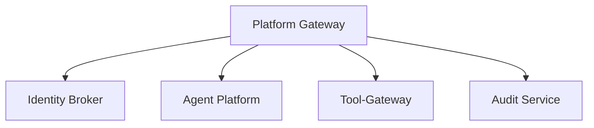

**Diagram sources**
- [config.py:23-53](file://products/platform-gateway/src/platform_gateway/core/config.py#L23-L53)
- [delegation_client.py:78-101](file://products/platform-gateway/src/platform_gateway/services/delegation_client.py#L78-L101)
- [audit_emitter.py:68-99](file://products/platform-gateway/src/platform_gateway/services/audit_emitter.py#L68-L99)

**Section sources**
- [config.py:23-53](file://products/platform-gateway/src/platform_gateway/core/config.py#L23-L53)
- [delegation_client.py:78-101](file://products/platform-gateway/src/platform_gateway/services/delegation_client.py#L78-L101)
- [audit_emitter.py:68-99](file://products/platform-gateway/src/platform_gateway/services/audit_emitter.py#L68-L99)

## Performance Considerations
- Local JWT verification eliminates per-request introspection latency
- JWKS keys are cached with a configurable lifespan
- Delegated tokens are cached per user subject with early refresh near expiry
- Audit emission is asynchronous and non-blocking
- Policy bundle is loaded once and cached per process; metadata includes version and SHA-256 fingerprint
- **Updated**: Diagnosis proxy timeout increased to 300 seconds in development environment to accommodate longer-running bounded read-only diagnosis operations against real LLM providers
- **Updated**: Development environment configuration accounts for observed ~140s operation times with context compression and multiple member turns
- **Updated**: Code default timeout remains 120 seconds as a baseline; development overlay provides necessary extension for real provider testing

## Troubleshooting Guide
Common issues and diagnostics:
- 401 Unauthorized: missing or malformed Authorization header; expired or invalid token; wrong issuer/audience
- 403 Forbidden: explicit deny rule matched; no matching rule; require_approval not yet satisfied; target authorization disabled
- 504 Gateway Timeout: diagnosis operation exceeded timeout threshold (check `PLATFORM_GATEWAY_DIAGNOSE_TIMEOUT_SECONDS` setting)
- 502 Bad Gateway: upstream agent-service unavailable or returned 5xx; identity service unreachable during login flows
- 503 Service Unavailable: target authorization misconfigured; workload token path invalid; required dependencies missing

**Diagnosis-Specific Issues:**
- Diagnosis timeout errors in development: verify `PLATFORM_GATEWAY_DIAGNOSE_TIMEOUT_SECONDS=300` is set in runtime configuration
- Real LLM provider slowness: the 300-second timeout accommodates observed ~140s operation times with context compression
- Bounded diagnosis not completing: check if `AGENT_ORCHESTRATION_MAX_STEPS` budget is sufficient for the diagnosis complexity

Operational checks:
- Readiness endpoint exposes policy rule count and bundle SHA-256
- Live status reports service name and version
- Audit logs capture policy decisions and emit failures
- Diagnosis operations are properly gated and authenticated

**Section sources**
- [gateway_service.py:57-88](file://products/platform-gateway/src/platform_gateway/services/gateway_service.py#L57-L88)
- [gateway_service.py:204-300](file://products/platform-gateway/src/platform_gateway/services/gateway_service.py#L204-L300)
- [audit_emitter.py:68-99](file://products/platform-gateway/src/platform_gateway/services/audit_emitter.py#L68-L99)
- [runtime-config.env:23-29](file://shared/platform-ops/gitops/dev-k8s/base/platform-gateway/runtime-config.env#L23-L29)

## Conclusion
The Platform Gateway centralizes security and policy enforcement for the operator portal. It authenticates via local JWT verification, delegates tokens for tool execution, evaluates a strict deny-by-default policy bundle, integrates approval workflows for mutating actions, proxies requests to backend services with robust error handling, and emits durable audit events. Transparency endpoints expose the effective permission matrix, ensuring operators can understand and validate their access.

**Updated** The addition of extended diagnosis proxy timeout support enhances the gateway's capabilities for SPEC-076 bounded read-only diagnosis operations. The development environment timeout increase from 120 to 300 seconds accommodates longer-running operations against real LLM providers, accounting for context compression overhead and multiple member turns. This configuration change ensures that legitimate bounded diagnosis workflows complete successfully while maintaining the 120-second code default as a baseline for production environments. The implementation demonstrates careful consideration of operational requirements while preserving security boundaries and performance constraints.