# Policy Engine and Authorization

<cite>
**Referenced Files in This Document**
- [policy_engine.py](file://products/platform-gateway/src/platform_gateway/services/policy_engine.py)
- [policy_matrix.py](file://products/platform-gateway/src/platform_gateway/services/policy_matrix.py)
- [policy-default.yaml](file://products/platform-gateway/src/platform_gateway/policies/policy-default.yaml)
- [policy_engine.py](file://products/tool-gateway/src/tool_gateway/services/policy_engine.py)
- [policy-default.yaml](file://products/tool-gateway/src/tool_gateway/policies/policy-default.yaml)
- [policy-rule.schema.json](file://shared/shared-contracts/schemas/policy-rule.schema.json)
- [policy-matrix.schema.json](file://shared/shared-contracts/schemas/policy-matrix.schema.json)
- [authorization-matrix.md](file://docs/agentic-aiops-platform/authorization-matrix.md)
- [policy-specification.md](file://docs/agentic-aiops-platform/policy-specification.md)
- [authorization_transactions.py](file://products/tool-gateway/src/tool_gateway/services/authorization_transactions.py)
- [authorization.py (tool-gateway)](file://products/tool-gateway/src/tool_gateway/schemas/authorization.py)
- [authorization.py (platform-gateway)](file://products/platform-gateway/src/platform_gateway/schemas/authorization.py)
- [test_authorization_contracts.py (tool-gateway)](file://products/tool-gateway/tests/test_authorization_contracts.py)
- [test_authorization_contracts.py (platform-gateway)](file://products/platform-gateway/tests/test_authorization_contracts.py)
- [oq7-first-use-handoff-contract.md](file://docs/specs/SPEC-070-outbound-user-delegated-identity/oq7-first-use-handoff-contract.md)
- [spec.md (SPEC-070)](file://docs/specs/SPEC-070-outbound-user-delegated-identity/spec.md)
- [plan.md (SPEC-070)](file://docs/specs/SPEC-070-outbound-user-delegated-identity/plan.md)
</cite>

## Update Summary
**Changes Made**
- Added documentation for the OQ-7 authorization contract integration, including the authorization transaction store interface and contract validation.
- Documented the inert authorization models and Protocol that define the handoff contract without enabling actual OAuth flows.
- Updated policy engine sections to reflect how authorization-required signals integrate with existing tool execution and approval workflows.
- Added new section on authorization contract architecture showing the separation between contract definitions and runtime implementation.

## Table of Contents
1. [Introduction](#introduction)
2. [Project Structure](#project-structure)
3. [Core Components](#core-components)
4. [Architecture Overview](#architecture-overview)
5. [Authorization Contract Integration](#authorization-contract-integration)
6. [Detailed Component Analysis](#detailed-component-analysis)
7. [Dependency Analysis](#dependency-analysis)
8. [Performance Considerations](#performance-considerations)
9. [Troubleshooting Guide](#troubleshooting-guide)
10. [Conclusion](#conclusion)
11. [Appendices](#appendices)

## Introduction
This document explains the Platform Gateway's policy engine and authorization system. It covers how incoming requests are evaluated against policy rules, how role-based permissions are enforced across endpoints and operations, how approval workflows integrate with policy decisions, and how policies are loaded and cached. It also documents the policy rule format, risk-tier evaluation, tool permission checks, the live policy matrix, conflict resolution, and audit logging. Finally, it describes integration points with the Identity Broker for user context and how decisions are recorded for auditing.

**Updated** This document now includes the OQ-7 authorization contract integration, which adds a protocol for first-use target authorization handoffs without enabling actual OAuth flows. The authorization transaction store interface defines the contract for state management while storage implementations remain pending.

## Project Structure
The policy system spans two gateways:
- Platform Gateway: enforces route-level and action-level authorization, bridges HITL confirmations, and exposes a live policy matrix.
- Tool Gateway: enforces tool invocation admission (read vs write/admin tools) and delegates approval enforcement to the platform gateway.
- Authorization Contracts: define the OQ-7 handoff protocol shapes and transaction store interface without implementing OAuth flows.

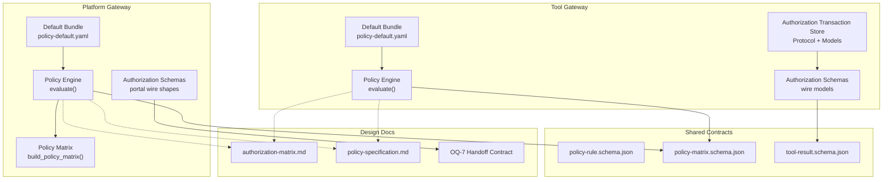

**Diagram sources**
- [policy_engine.py:390-444](file://products/platform-gateway/src/platform_gateway/services/policy_engine.py#L390-L444)
- [policy_matrix.py:31-88](file://products/platform-gateway/src/platform_gateway/services/policy_matrix.py#L31-L88)
- [authorization_transactions.py:65-122](file://products/tool-gateway/src/tool_gateway/services/authorization_transactions.py#L65-L122)
- [authorization.py (tool-gateway):1-74](file://products/tool-gateway/src/tool_gateway/schemas/authorization.py#L1-L74)
- [authorization.py (platform-gateway):1-47](file://products/platform-gateway/src/platform_gateway/schemas/authorization.py#L1-L47)

**Section sources**
- [policy_engine.py:1-136](file://products/platform-gateway/src/platform_gateway/services/policy_engine.py#L1-L136)
- [policy_engine.py:1-60](file://products/tool-gateway/src/tool_gateway/services/policy_engine.py#L1-L60)
- [authorization_transactions.py:1-122](file://products/tool-gateway/src/tool_gateway/services/authorization_transactions.py#L1-L122)
- [authorization.py (tool-gateway):1-74](file://products/tool-gateway/src/tool_gateway/schemas/authorization.py#L1-L74)
- [authorization.py (platform-gateway):1-47](file://products/platform-gateway/src/platform_gateway/schemas/authorization.py#L1-L47)

## Core Components
- Policy bundle loader: loads YAML bundles from a configured path or packaged defaults; caches them per process; computes a SHA-256 fingerprint at load time.
- Rule parser and validator: validates schema, outcomes, and approval blocks; enforces that require_approval is only valid on bridged actions in the platform gateway.
- Evaluator: matches enabled rules by roles and actions, applies precedence deny > require_approval > allow, selects highest priority within an outcome class, and returns a structured decision.
- Live matrix builder: derives a role × action boolean matrix plus an additive approval_requirements structure from the same evaluate() path used for enforcement.
- Default bundles: define the canonical set of actions and grants for both gateways.
- Authorization transaction store: defines the Protocol interface for OQ-7 handoff state management without implementing storage backends.

Key behaviors:
- Deny-by-default when no rule matches.
- Explicit deny overrides require_approval and allow.
- require_approval overrides allow.
- Higher priority wins within an outcome class.
- Disabled rules are ignored.
- Authorization contracts are inert - they define shapes but don't register routes or enable OAuth flows.

**Section sources**
- [policy_engine.py:334-371](file://products/platform-gateway/src/platform_gateway/services/policy_engine.py#L334-L371)
- [policy_engine.py:390-444](file://products/platform-gateway/src/platform_gateway/services/policy_engine.py#L390-L444)
- [policy_matrix.py:31-88](file://products/platform-gateway/src/platform_gateway/services/policy_matrix.py#L31-L88)
- [authorization_transactions.py:65-122](file://products/tool-gateway/src/tool_gateway/services/authorization_transactions.py#L65-L122)
- [test_authorization_contracts.py (tool-gateway):96-117](file://products/tool-gateway/tests/test_authorization_contracts.py#L96-L117)

## Architecture Overview
The platform gateway evaluates every protected action through the policy engine using normalized roles provided by the identity layer. The tool gateway enforces tool invocation admission based on the same rule vocabulary but does not enforce approvals itself; approvals are enforced on the platform gateway's confirmation path.

**Updated** The OQ-7 authorization contract adds a separate flow for first-use target authorization. When tool execution requires user delegation, the system emits an authorization_required signal rather than executing the tool. This signal carries routing metadata that the portal uses to guide users through browser-based authorization without exposing secrets or enabling direct OAuth flows.

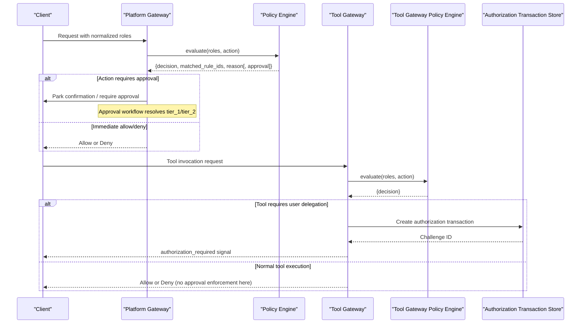

**Diagram sources**
- [policy_engine.py:390-444](file://products/platform-gateway/src/platform_gateway/services/policy_engine.py#L390-L444)
- [policy_engine.py:299-355](file://products/tool-gateway/src/tool_gateway/services/policy_engine.py#L299-L355)
- [authorization_transactions.py:85-117](file://products/tool-gateway/src/tool_gateway/services/authorization_transactions.py#L85-L117)

**Section sources**
- [policy_engine.py:92-127](file://products/platform-gateway/src/platform_gateway/services/policy_engine.py#L92-L127)
- [policy_engine.py:32-52](file://products/tool-gateway/src/tool_gateway/services/policy_engine.py#L32-L52)
- [oq7-first-use-handoff-contract.md:85-141](file://docs/specs/SPEC-070-outbound-user-delegated-identity/oq7-first-use-handoff-contract.md#L85-L141)

## Authorization Contract Integration

### OQ-7 Contract Architecture
The OQ-7 authorization contract defines the protocol for first-use target authorization handoffs. It establishes the contract boundary between components without implementing the actual OAuth flow. The contract includes:

- **Wire Models**: Pydantic models defining request/response shapes for authorization challenges and status queries
- **Transaction Store Protocol**: Interface definition for state persistence without backend implementation
- **Signal Flow**: Tool-result error signaling that triggers the authorization workflow
- **Stream Projection**: SSE frame format for communicating authorization requirements to the portal

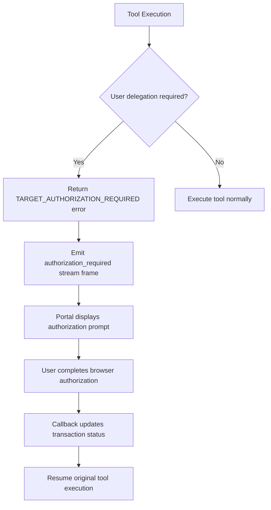

**Diagram sources**
- [oq7-first-use-handoff-contract.md:85-141](file://docs/specs/SPEC-070-outbound-user-delegated-identity/oq7-first-use-handoff-contract.md#L85-L141)
- [authorization_transactions.py:34-63](file://products/tool-gateway/src/tool_gateway/services/authorization_transactions.py#L34-L63)

### Authorization Transaction Store Interface
The `AuthorizationTransactionStore` Protocol defines the required behavior for storing and managing authorization transactions. Key characteristics:

- **Owner-scoped access**: All operations bind namespace AND subject to prevent cross-owner access
- **Atomic operations**: Callback claims and finalization must coordinate with encrypted state/custody
- **Inert implementation**: No backend is registered; future implementations must refuse multi-replica setups without shared Postgres
- **Security boundaries**: Secret values (codes, states, tokens) are never persisted in plain text

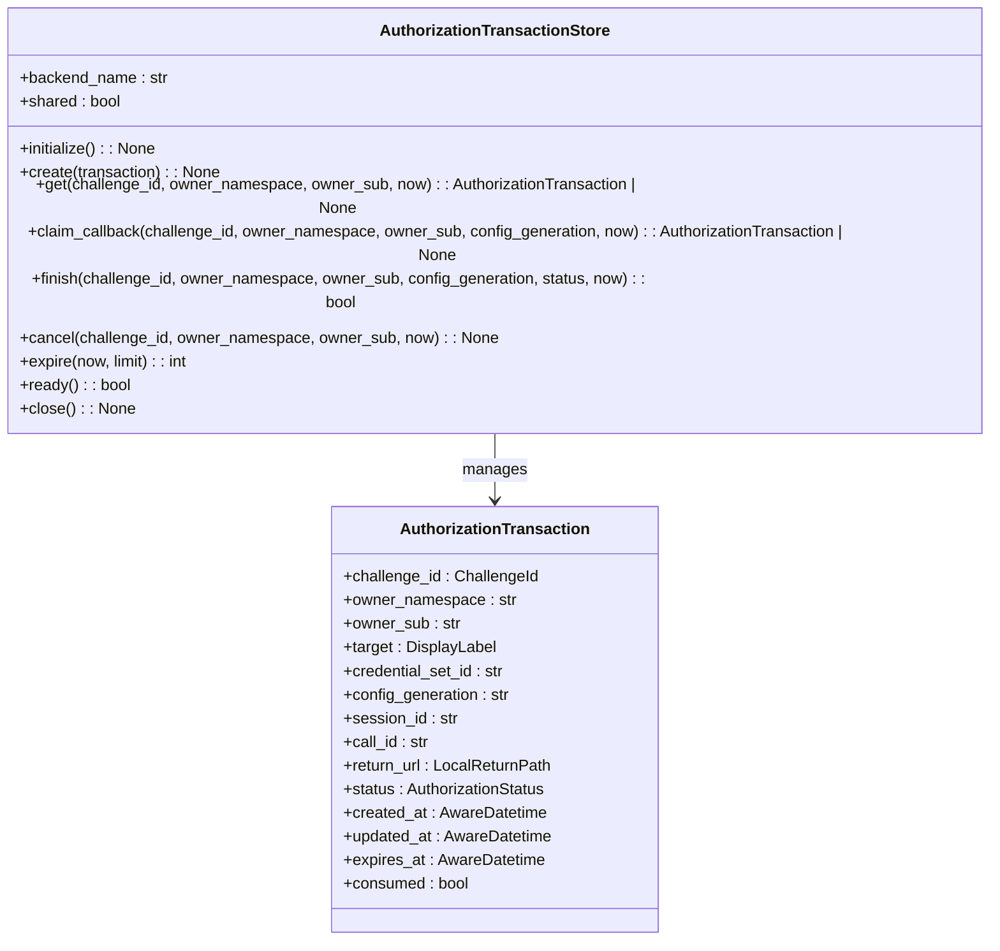

**Diagram sources**
- [authorization_transactions.py:65-122](file://products/tool-gateway/src/tool_gateway/services/authorization_transactions.py#L65-L122)
- [authorization_transactions.py:34-63](file://products/tool-gateway/src/tool_gateway/services/authorization_transactions.py#L34-L63)

**Section sources**
- [authorization_transactions.py:1-122](file://products/tool-gateway/src/tool_gateway/services/authorization_transactions.py#L1-L122)
- [test_authorization_contracts.py (tool-gateway):96-117](file://products/tool-gateway/tests/test_authorization_contracts.py#L96-L117)
- [oq7-first-use-handoff-contract.md:72-84](file://docs/specs/SPEC-070-outbound-user-delegated-identity/oq7-first-use-handoff-contract.md#L72-L84)

### Contract Validation and Security Boundaries
The authorization contracts enforce strict validation and security boundaries:

- **Field validation**: All models use frozen configuration with forbidden extra fields
- **Secret redaction**: Internal values like codes, states, and provider URLs are redacted in representations
- **Route omission**: No authorization routes are registered in the OpenAPI specification
- **Capability validation**: Start URLs are restricted to specific patterns preventing arbitrary redirects
- **State binding**: Challenge IDs are UUID4 patterns bound to owner namespaces and subjects

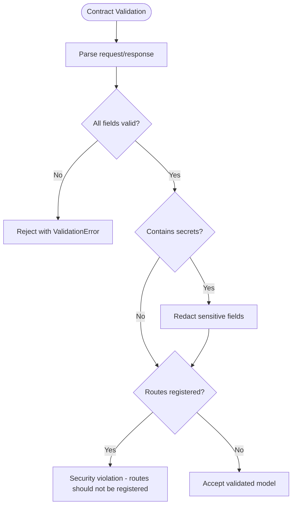

**Diagram sources**
- [authorization.py (tool-gateway):20-22](file://products/tool-gateway/src/tool_gateway/schemas/authorization.py#L20-L22)
- [authorization.py (platform-gateway):26-27](file://products/platform-gateway/src/platform_gateway/schemas/authorization.py#L26-L27)
- [test_authorization_contracts.py (platform-gateway):44-46](file://products/platform-gateway/tests/test_authorization_contracts.py#L44-L46)

**Section sources**
- [authorization.py (tool-gateway):1-74](file://products/tool-gateway/src/tool_gateway/schemas/authorization.py#L1-L74)
- [authorization.py (platform-gateway):1-47](file://products/platform-gateway/src/platform_gateway/schemas/authorization.py#L1-L47)
- [test_authorization_contracts.py (tool-gateway):31-84](file://products/tool-gateway/tests/test_authorization_contracts.py#L31-L84)
- [test_authorization_contracts.py (platform-gateway):17-46](file://products/platform-gateway/tests/test_authorization_contracts.py#L17-L46)

## Detailed Component Analysis

### Policy Rule Format and Validation
- Rules are defined in YAML bundles under each gateway's policies directory.
- Each rule includes id, domain, description, priority, enabled, match (roles_any, actions_any), and decision (outcome, optional approval).
- The shared JSON Schema defines the contract for rules and decisions.
- The platform gateway enforces that require_approval rules apply only to bridged actions (currently tools:mutate). The tool gateway skips require_approval rules entirely because it has no approval substrate.

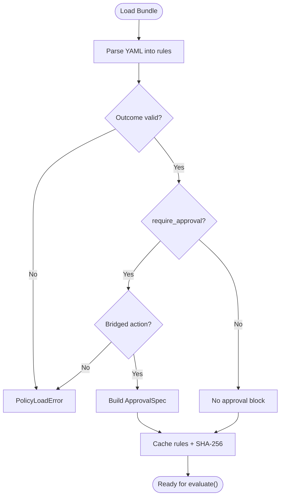

**Diagram sources**
- [policy_engine.py:269-331](file://products/platform-gateway/src/platform_gateway/services/policy_engine.py#L269-L331)
- [policy_engine.py:192-251](file://products/tool-gateway/src/tool_gateway/services/policy_engine.py#L192-L251)
- [policy-rule.schema.json:1-105](file://shared/shared-contracts/schemas/policy-rule.schema.json#L1-L105)

**Section sources**
- [policy_engine.py:229-331](file://products/platform-gateway/src/platform_gateway/services/policy_engine.py#L229-L331)
- [policy_engine.py:152-251](file://products/tool-gateway/src/tool_gateway/services/policy_engine.py#L152-L251)
- [policy-rule.schema.json:1-105](file://shared/shared-contracts/schemas/policy-rule.schema.json#L1-L105)

### Risk Tier Evaluation and Tool Permission Checks
- Risk tiers are part of the broader authorization model and influence default behavior and approval requirements.
- In the platform gateway, mutating tool execution is gated via the tools:mutate action and requires tier_2 approval by designated approvers distinct from the requester.
- In the tool gateway, read-only tool execution requires tools:invoke; write/admin tools additionally require tools:mutate. The tool gateway performs allow/deny admission only; approvals are enforced upstream.

**Updated** Tool execution may now trigger the OQ-7 authorization flow instead of immediate allow/deny. When a tool requires user delegation, the system returns an authorization_required signal rather than executing the tool directly.

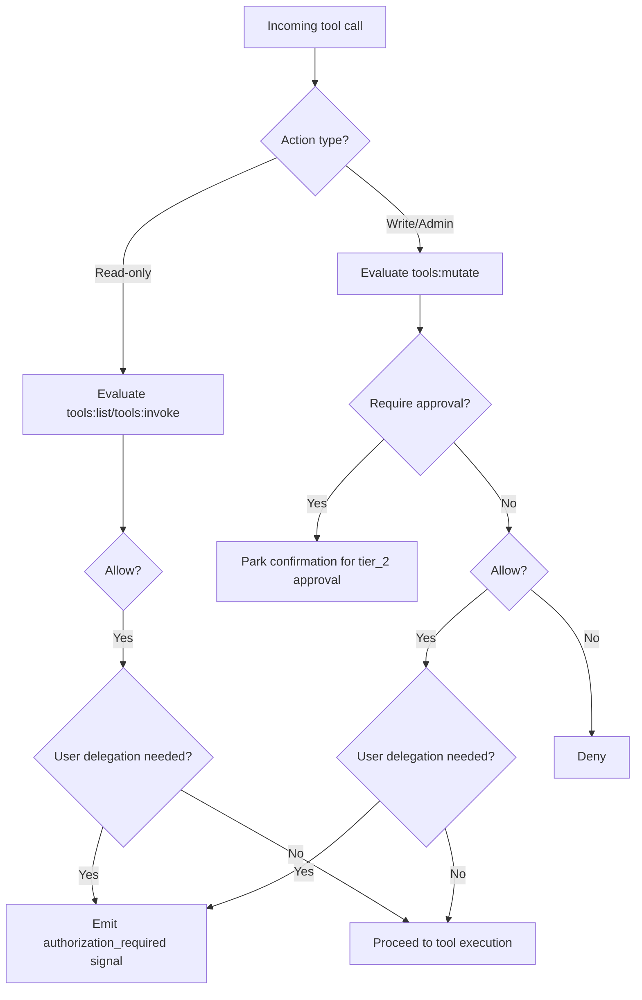

**Diagram sources**
- [policy-default.yaml:90-151](file://products/platform-gateway/src/platform_gateway/policies/policy-default.yaml#L90-L151)
- [policy-default.yaml:90-151](file://products/tool-gateway/src/tool_gateway/policies/policy-default.yaml#L90-L151)
- [oq7-first-use-handoff-contract.md:85-141](file://docs/specs/SPEC-070-outbound-user-delegated-identity/oq7-first-use-handoff-contract.md#L85-L141)

**Section sources**
- [policy-default.yaml:90-151](file://products/platform-gateway/src/platform_gateway/policies/policy-default.yaml#L90-L151)
- [policy-default.yaml:90-151](file://products/tool-gateway/src/tool_gateway/policies/policy-default.yaml#L90-L151)
- [policy_engine.py:32-52](file://products/tool-gateway/src/tool_gateway/services/policy_engine.py#L32-L52)
- [oq7-first-use-handoff-contract.md:85-141](file://docs/specs/SPEC-070-outbound-user-delegated-identity/oq7-first-use-handoff-contract.md#L85-L141)

### Policy Matrix Structure and Live Transparency
- The live matrix is derived by evaluating every role × action pair through the same evaluate() function used for enforcement.
- For platform-admin, the matrix shows all roles; for other identities, only their granted roles are shown.
- Cells evaluating to require_approval appear as false in the boolean matrix and additionally include approval_requirements with tier and decider roles.

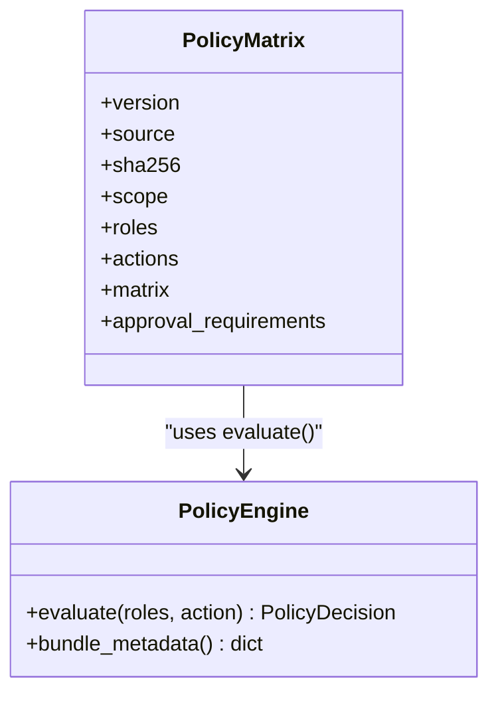

**Diagram sources**
- [policy_matrix.py:31-88](file://products/platform-gateway/src/platform_gateway/services/policy_matrix.py#L31-L88)
- [policy_engine.py:374-387](file://products/platform-gateway/src/platform_gateway/services/policy_engine.py#L374-L387)
- [policy-matrix.schema.json:1-85](file://shared/shared-contracts/schemas/policy-matrix.schema.json#L1-L85)

**Section sources**
- [policy_matrix.py:31-88](file://products/platform-gateway/src/platform_gateway/services/policy_matrix.py#L31-L88)
- [policy-matrix.schema.json:1-85](file://shared/shared-contracts/schemas/policy-matrix.schema.json#L1-L85)

### Integration with Identity Broker and User Context
- The policy engine consumes normalized roles supplied by the identity layer. The platform gateway uses these roles to evaluate protected actions.
- The tool gateway similarly uses normalized roles for tool invocation admission.
- The design documentation outlines normalization and environment scoping expectations consumed by the policy engine.

**Updated** The authorization contract integration extends this pattern by adding owner-scoped identity binding for authorization transactions. Owner namespace and subject are recovered from authenticated server context, never from callback input.

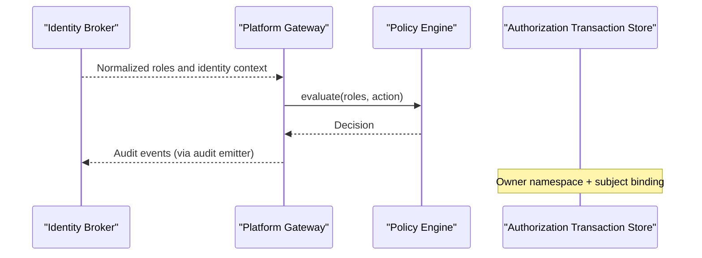

**Diagram sources**
- [policy_engine.py:390-444](file://products/platform-gateway/src/platform_gateway/services/policy_engine.py#L390-L444)
- [policy_engine.py:299-355](file://products/tool-gateway/src/tool_gateway/services/policy_engine.py#L299-L355)
- [authorization_transactions.py:34-63](file://products/tool-gateway/src/tool_gateway/services/authorization_transactions.py#L34-L63)

**Section sources**
- [policy-specification.md:88-120](file://docs/agentic-aiops-platform/policy-specification.md#L88-L120)
- [authorization_transactions.py:34-63](file://products/tool-gateway/src/tool_gateway/services/authorization_transactions.py#L34-L63)

### Approval Workflows and HITL Bridging
- Mutating tool execution triggers a require_approval decision with tier_2 approval by designated approvers distinct from the requester.
- The platform gateway parks the confirmation and coordinates approval; the tool gateway does not enforce approvals.
- The authorization matrix documents the separation of duties and approval boundaries.

**Updated** The authorization contract provides an alternative flow for user delegation that doesn't involve traditional approval workflows. Instead, it guides users through browser-based authorization to obtain delegated credentials.

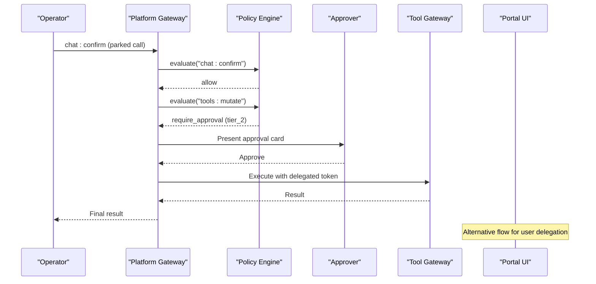

**Diagram sources**
- [policy-default.yaml:130-151](file://products/platform-gateway/src/platform_gateway/policies/policy-default.yaml#L130-L151)
- [policy_engine.py:390-444](file://products/platform-gateway/src/platform_gateway/services/policy_engine.py#L390-L444)
- [authorization-matrix.md:378-397](file://docs/agentic-aiops-platform/authorization-matrix.md#L378-L397)

**Section sources**
- [policy-default.yaml:130-151](file://products/platform-gateway/src/platform_gateway/policies/policy-default.yaml#L130-L151)
- [authorization-matrix.md:378-397](file://docs/agentic-aiops-platform/authorization-matrix.md#L378-L397)
- [oq7-first-use-handoff-contract.md:346-382](file://docs/specs/SPEC-070-outbound-user-delegated-identity/oq7-first-use-handoff-contract.md#L346-L382)

### Policy Conflicts and Overrides
- Precedence: explicit deny > require_approval > allow.
- Within the same outcome class, higher priority wins.
- Disabled rules are ignored.
- These semantics are enforced in the evaluator and documented in the policy specification.

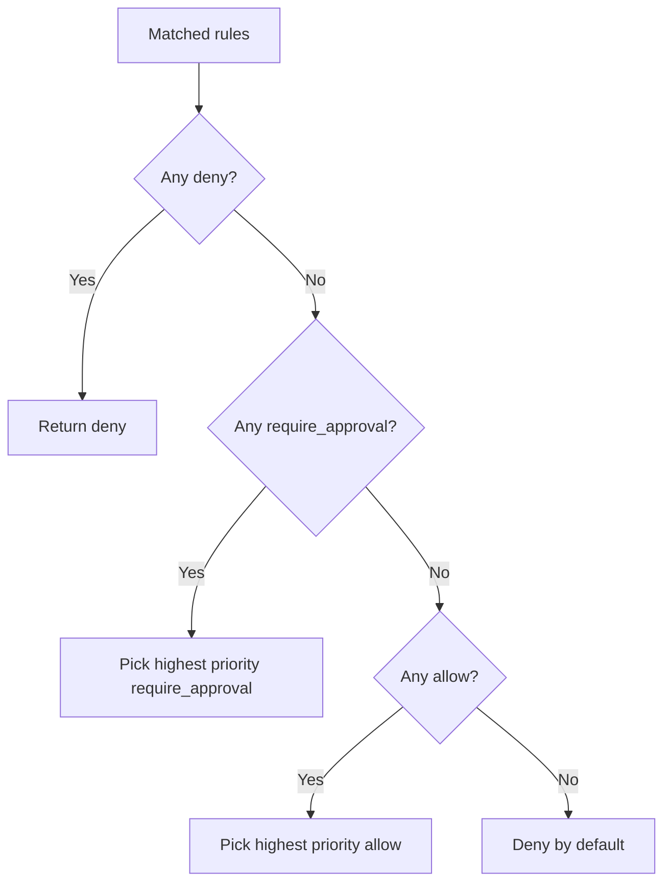

**Diagram sources**
- [policy_engine.py:390-444](file://products/platform-gateway/src/platform_gateway/services/policy_engine.py#L390-L444)
- [policy-specification.md:256-274](file://docs/agentic-aiops-platform/policy-specification.md#L256-L274)

**Section sources**
- [policy_engine.py:390-444](file://products/platform-gateway/src/platform_gateway/services/policy_engine.py#L390-L444)
- [policy-specification.md:256-274](file://docs/agentic-aiops-platform/policy-specification.md#L256-L274)

### Examples of Policy Rules and Decision Outcomes
- Read access: roles holding chat/session actions may use chat and manage sessions.
- Observer access: read-only observers may query via chat and view sessions.
- Tool invocation: operational, developer, approver, and observer roles may invoke read-only tools.
- Mutating tools: require tier_2 approval by approver or platform-admin distinct from requester.
- Audit and transparency: auditors and platform admins may read audit trails; all roles may read policy and skills inventory.

**Updated** New authorization-related outcomes may include authorization_required signals that trigger the OQ-7 handoff flow instead of traditional allow/deny decisions.

These examples are defined in the default bundles and validated by the schemas.

**Section sources**
- [policy-default.yaml:54-151](file://products/platform-gateway/src/platform_gateway/policies/policy-default.yaml#L54-L151)
- [policy-default.yaml:54-151](file://products/tool-gateway/src/tool_gateway/policies/policy-default.yaml#L54-L151)
- [policy-rule.schema.json:1-105](file://shared/shared-contracts/schemas/policy-rule.schema.json#L1-L105)
- [oq7-first-use-handoff-contract.md:85-141](file://docs/specs/SPEC-070-outbound-user-delegated-identity/oq7-first-use-handoff-contract.md#L85-L141)

## Dependency Analysis
- Platform Gateway depends on:
  - Its own policy engine for evaluation and matrix derivation.
  - The default bundle for canonical rules.
  - Shared schemas for validation and transparency surfaces.
  - Authorization schemas for portal wire shapes.
- Tool Gateway depends on:
  - Its own policy engine for admission control.
  - The default bundle for tool-related actions.
  - Shared schemas for validation.
  - Authorization transaction store interface for OQ-7 support.

**Updated** Both gateways now depend on the authorization contract definitions, though only the tool gateway implements the transaction store interface.

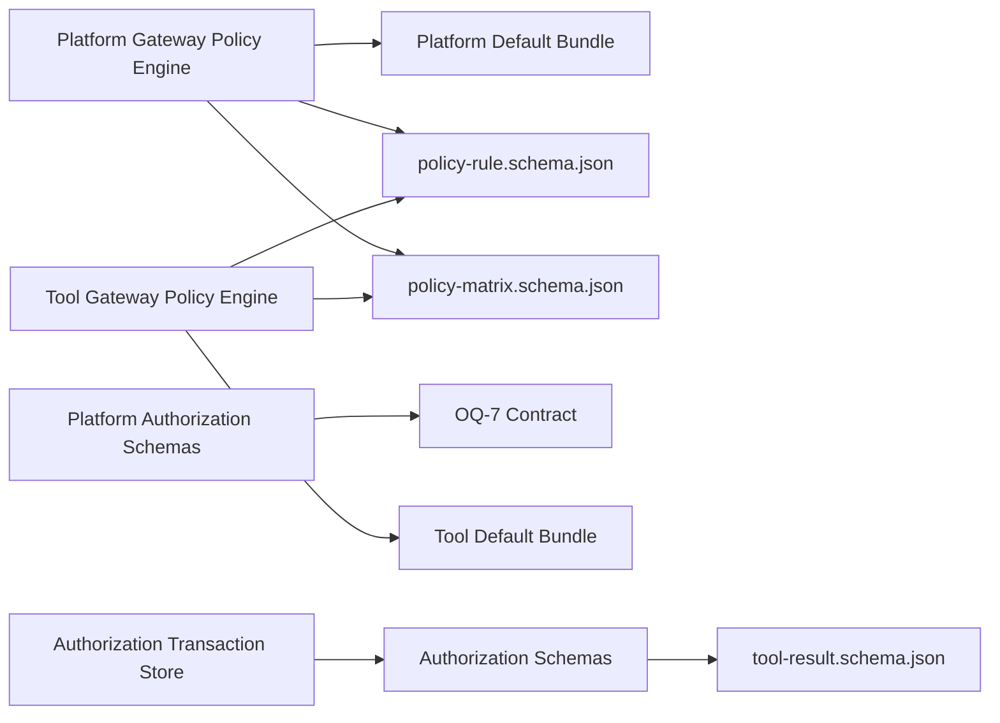

**Diagram sources**
- [policy_engine.py:334-371](file://products/platform-gateway/src/platform_gateway/services/policy_engine.py#L334-L371)
- [policy_engine.py:254-287](file://products/tool-gateway/src/tool_gateway/services/policy_engine.py#L254-L287)
- [authorization_transactions.py:1-122](file://products/tool-gateway/src/tool_gateway/services/authorization_transactions.py#L1-L122)
- [authorization.py (tool-gateway):1-74](file://products/tool-gateway/src/tool_gateway/schemas/authorization.py#L1-L74)
- [authorization.py (platform-gateway):1-47](file://products/platform-gateway/src/platform_gateway/schemas/authorization.py#L1-L47)

**Section sources**
- [policy_engine.py:334-371](file://products/platform-gateway/src/platform_gateway/services/policy_engine.py#L334-L371)
- [policy_engine.py:254-287](file://products/tool-gateway/src/tool_gateway/services/policy_engine.py#L254-L287)
- [authorization_transactions.py:1-122](file://products/tool-gateway/src/tool_gateway/services/authorization_transactions.py#L1-L122)

## Performance Considerations
- Bundles are parsed once and cached per process; subsequent evaluations reuse the in-memory rule list.
- Evaluations scan enabled rules matching the requested action and intersecting caller roles; complexity is linear in the number of enabled rules.
- The live matrix builds rows by evaluating each role × action pair; this is intentionally read-only and can be cached at the API layer if needed.
- Authorization transactions are designed for bounded lifetimes (60 seconds start TTL, 600 seconds transaction TTL) to minimize storage overhead.

**Updated** The authorization transaction store interface is designed to be efficient for transient state management, with atomic operations and bounded cleanup sweeps.

[No sources needed since this section provides general guidance]

## Troubleshooting Guide
Common issues and diagnostics:
- PolicyLoadError during bundle load indicates invalid YAML, missing required fields, unknown outcomes, or invalid approval blocks.
- require_approval on non-bridged actions fails at load time in the platform gateway.
- Missing policy path raises a clear error rather than silently falling back.
- Use the live policy matrix endpoint to verify effective permissions and approval requirements for the current bundle.
- Compare bundle SHA-256 fingerprints to confirm the enforced bundle matches the intended commit.

**Updated** Authorization contract issues:
- Authorization models reject secret fields in public responses
- No authorization routes are registered (by design)
- Transaction store Protocol methods require owner namespace and subject binding
- Invalid challenge IDs or expired transactions return None without revealing failure details

**Section sources**
- [policy_engine.py:229-331](file://products/platform-gateway/src/platform_gateway/services/policy_engine.py#L229-L331)
- [policy_engine.py:334-371](file://products/platform-gateway/src/platform_gateway/services/policy_engine.py#L334-L371)
- [policy_matrix.py:31-88](file://products/platform-gateway/src/platform_gateway/services/policy_matrix.py#L31-L88)
- [test_authorization_contracts.py (tool-gateway):31-84](file://products/tool-gateway/tests/test_authorization_contracts.py#L31-L84)
- [test_authorization_contracts.py (platform-gateway):17-46](file://products/platform-gateway/tests/test_authorization_contracts.py#L17-L46)

## Conclusion
The Platform Gateway's policy engine implements a compact, deterministic authorization model grounded in versioned YAML bundles, strict schema validation, and clear precedence rules. It integrates with the Identity Broker via normalized roles, enforces tool permissions at both gateways, and bridges approval workflows where necessary. The live policy matrix provides transparent, authoritative visibility into effective permissions and approval requirements, while bundle provenance ensures deploy-time verification.

**Updated** The OQ-7 authorization contract integration extends this foundation with a protocol for first-use target authorization handoffs. The contract defines wire models, transaction store interfaces, and signal flows without enabling actual OAuth flows, providing a secure foundation for future user-delegated identity support.

[No sources needed since this section summarizes without analyzing specific files]

## Appendices

### Policy Rule Fields and Semantics
- id: unique stable identifier.
- domain: action_authz for this slice.
- description: human-readable explanation.
- priority: numeric precedence within an outcome class.
- enabled: whether the rule participates in evaluation.
- match.roles_any: principal must hold at least one listed role.
- match.actions_any: rule applies to listed actions.
- decision.outcome: allow, deny, or require_approval.
- decision.approval: required for require_approval; includes tier and decided_by_roles; optional allow_self_approval override.

**Section sources**
- [policy-rule.schema.json:1-105](file://shared/shared-contracts/schemas/policy-rule.schema.json#L1-L105)

### Live Matrix Fields and Semantics
- version, source, sha256: provenance of the loaded bundle.
- scope: full for platform-admin; own for others.
- roles, actions: sorted sets used to render the matrix.
- matrix: boolean cells indicating immediate allow.
- approval_requirements: additive third state for require_approval cells.

**Section sources**
- [policy-matrix.schema.json:1-85](file://shared/shared-contracts/schemas/policy-matrix.schema.json#L1-L85)
- [policy_matrix.py:31-88](file://products/platform-gateway/src/platform_gateway/services/policy_matrix.py#L31-L88)

### Authorization Contract Models
- AuthorizationRequired: Public challenge metadata with challenge_id, target, and expires_at fields
- AuthorizationStatusResponse: Status query response with exact field vocabulary
- AuthorizationTransaction: Routing state with owner binding and lifecycle management
- AuthorizationTransactionStore: Protocol interface for transaction persistence

**Section sources**
- [authorization.py (tool-gateway):24-74](file://products/tool-gateway/src/tool_gateway/schemas/authorization.py#L24-L74)
- [authorization_transactions.py:23-122](file://products/tool-gateway/src/tool_gateway/services/authorization_transactions.py#L23-L122)

### OQ-7 Contract Status
- Ratified 2026-10-19, closing pre-runtime gate
- Additive contract increment implemented 2026-10-23
- No usable OAuth flow enabled
- Contract-only v0.50.0 release approved
- AAP compatibility unverified
- DI-070 deployment integration remains pending

**Section sources**
- [spec.md (SPEC-070):1-95](file://docs/specs/SPEC-070-outbound-user-delegated-identity/spec.md#L1-L95)
- [plan.md (SPEC-070):46-80](file://docs/specs/SPEC-070-outbound-user-delegated-identity/plan.md#L46-L80)
- [oq7-first-use-handoff-contract.md:481-504](file://docs/specs/SPEC-070-outbound-user-delegated-identity/oq7-first-use-handoff-contract.md#L481-L504)