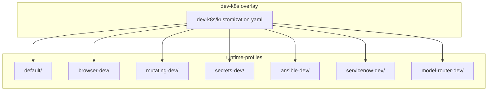
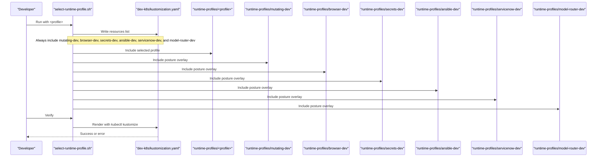
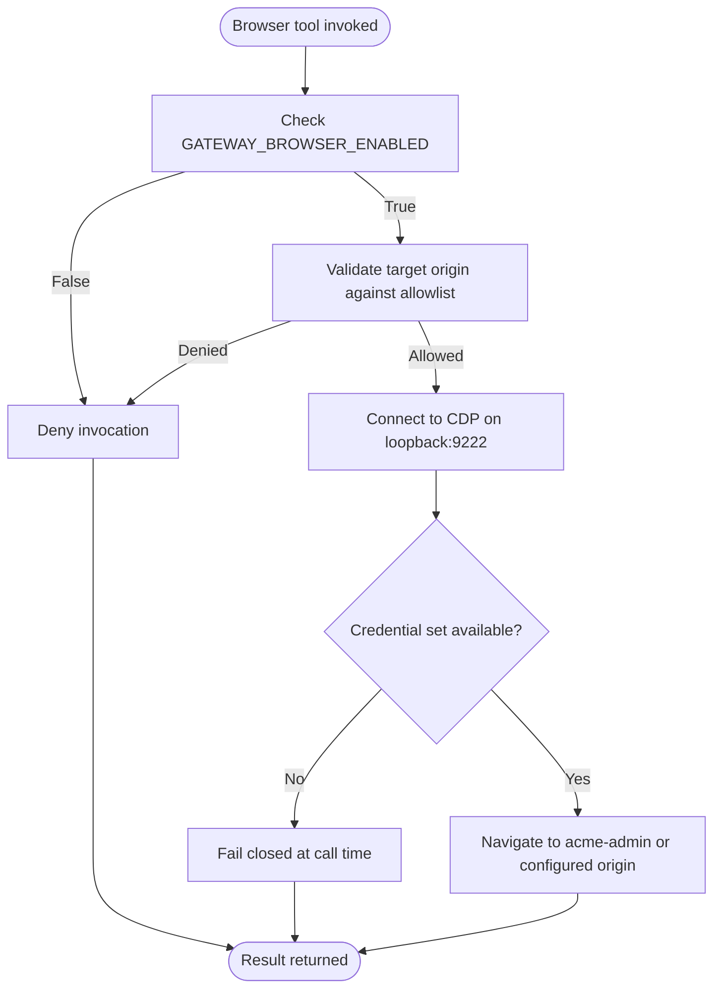
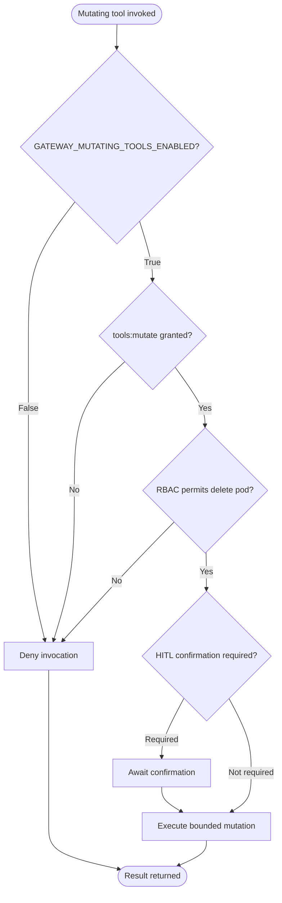
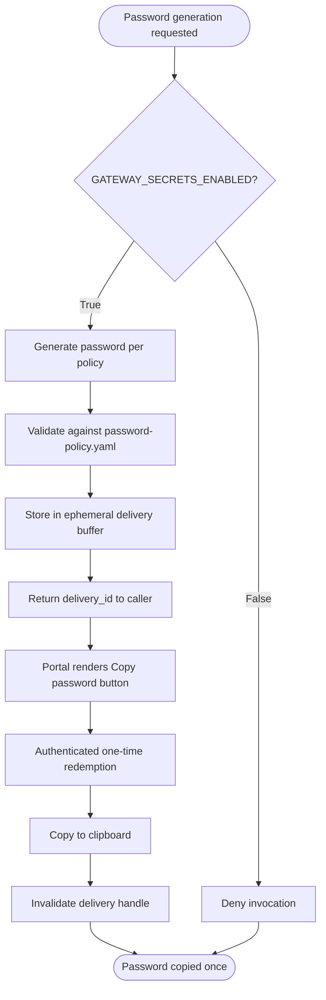
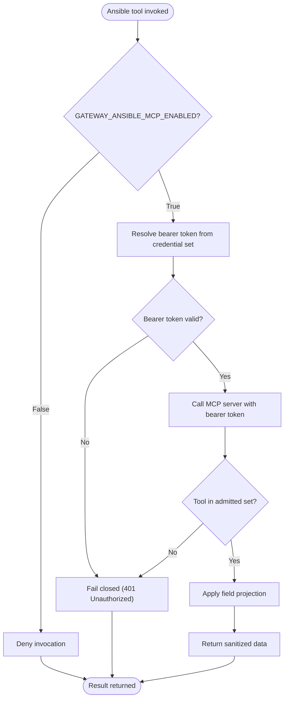
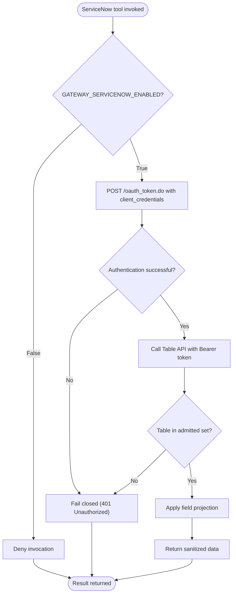
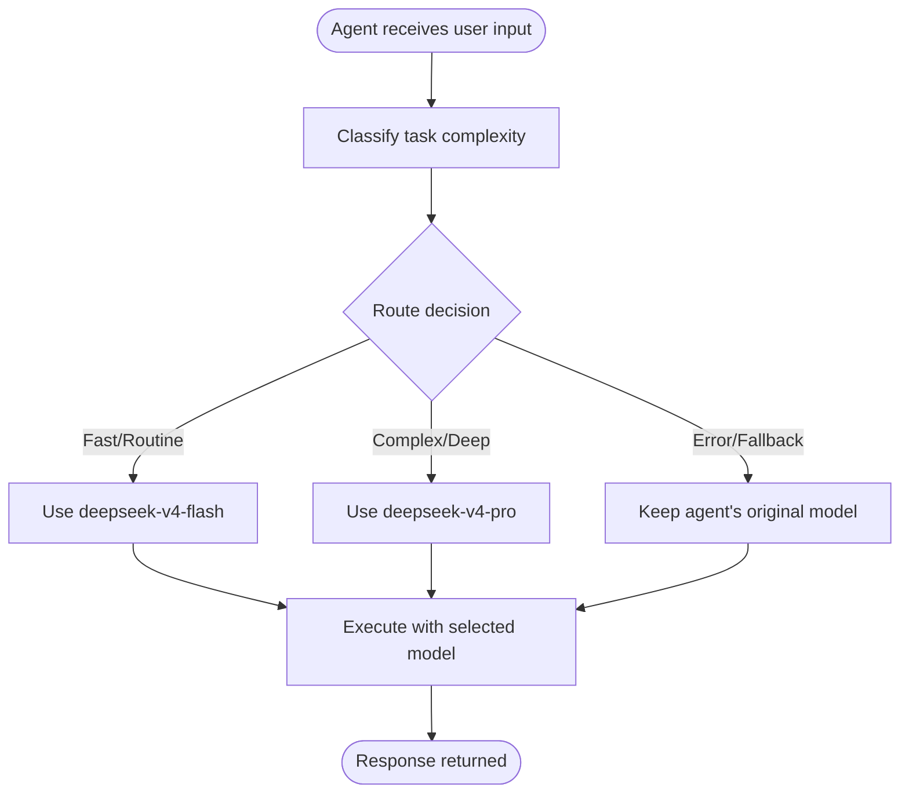
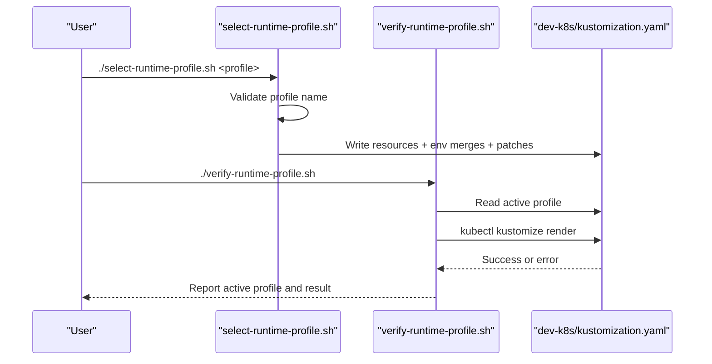
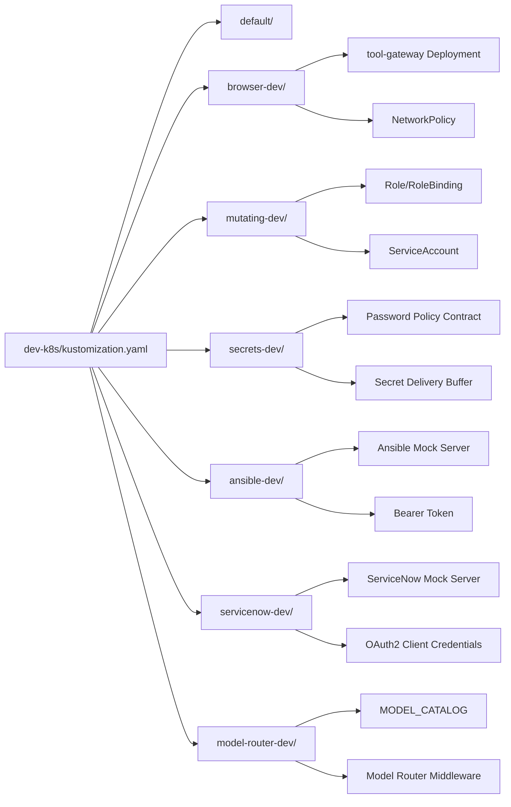

# Runtime Profiles

<cite>
**Referenced Files in This Document**
- [README.md](file://shared/platform-ops/gitops/runtime-profiles/README.md)
- [select-runtime-profile.sh](file://shared/platform-ops/gitops/select-runtime-profile.sh)
- [verify-runtime-profile.sh](file://shared/platform-ops/gitops/verify-runtime-profile.sh)
- [kustomization.yaml (default)](file://shared/platform-ops/gitops/runtime-profiles/default/kustomization.yaml)
- [configmap.yaml (default)](file://shared/platform-ops/gitops/runtime-profiles/default/configmap.yaml)
- [kustomization.yaml (browser-dev)](file://shared/platform-ops/gitops/runtime-profiles/browser-dev/kustomization.yaml)
- [browser.env (browser-dev)](file://shared/platform-ops/gitops/runtime-profiles/browser-dev/browser.env)
- [tool-gateway-browser-sidecar.yaml](file://shared/platform-ops/gitops/runtime-profiles/browser-dev/tool-gateway-browser-sidecar.yaml)
- [browser-sidecar-network-policy.yaml](file://shared/platform-ops/gitops/runtime-profiles/browser-dev/browser-sidecar-network-policy.yaml)
- [kustomization.yaml (mutating-dev)](file://shared/platform-ops/gitops/runtime-profiles/mutating-dev/kustomization.yaml)
- [mutating.env (mutating-dev)](file://shared/platform-ops/gitops/runtime-profiles/mutating-dev/mutating.env)
- [tool-gateway-pod-delete.yaml](file://shared/platform-ops/gitops/runtime-profiles/mutating-dev/tool-gateway-pod-delete.yaml)
- [secrets.env (secrets-dev)](file://shared/platform-ops/gitops/runtime-profiles/secrets-dev/secrets.env)
- [kustomization.yaml (ansible-dev)](file://shared/platform-ops/gitops/runtime-profiles/ansible-dev/kustomization.yaml)
- [ansible.env (ansible-dev)](file://shared/platform-ops/gitops/runtime-profiles/ansible-dev/ansible.env)
- [mock_ansible_mcp_server.py](file://shared/platform-ops/gitops/runtime-profiles/ansible-dev/mock_ansible_mcp_server.py)
- [kustomization.yaml (servicenow-dev)](file://shared/platform-ops/gitops/runtime-profiles/servicenow-dev/kustomization.yaml)
- [servicenow.env (servicenow-dev)](file://shared/platform-ops/gitops/runtime-profiles/servicenow-dev/servicenow.env)
- [mock_servicenow_table_api.py](file://shared/platform-ops/gitops/runtime-profiles/servicenow-dev/mock_servicenow_table_api.py)
- [servicenow-mock-deployment.yaml](file://shared/platform-ops/gitops/runtime-profiles/servicenow-dev/servicenow-mock-deployment.yaml)
- [servicenow-mock-service.yaml](file://shared/platform-ops/gitops/runtime-profiles/servicenow-dev/servicenow-mock-service.yaml)
- [servicenow-mock-network-policy.yaml](file://shared/platform-ops/gitops/runtime-profiles/servicenow-dev/servicenow-mock-network-policy.yaml)
- [tool-gateway-servicenow-credentials.yaml](file://shared/platform-ops/gitops/runtime-profiles/servicenow-dev/tool-gateway-servicenow-credentials.yaml)
- [model-router.env (model-router-dev)](file://shared/platform-ops/gitops/runtime-profiles/model-router-dev/model-router.env)
- [sync-servicenow-credentials.sh](file://shared/platform-ops/gitops/sync-servicenow-credentials.sh)
- [sync-ansible-credentials.sh](file://shared/platform-ops/gitops/sync-ansible-credentials.sh)
- [deploy-overlay.sh](file://shared/platform-ops/gitops/deploy-overlay.sh)
- [kustomization.yaml (dev-k8s)](file://shared/platform-ops/gitops/dev-k8s/kustomization.yaml)
- [config.py (tool-gateway)](file://products/tool-gateway/src/tool_gateway/core/config.py)
- [app.py (tool-gateway)](file://products/tool-gateway/src/tool-gateway/app.py)
- [password-policy.yaml (contract)](file://shared/shared-contracts/policies/password-policy.yaml)
</cite>

## Update Summary
**Changes Made**
- Added new model-router-dev runtime profile alongside existing dev postures (secrets-dev, ansible-dev, servicenow-dev)
- Updated select-runtime-profile.sh to recognize model-router-dev as non-switchable dev posture
- Updated verify-runtime-profile.sh to exclude model-router-dev from active profile reporting
- Enhanced architecture diagrams to reflect all seven profiles including the new model-router-dev posture
- Added comprehensive documentation for the model-router-dev profile enabling per-turn model routing with fail-safe behavior

## Table of Contents
1. [Introduction](#introduction)
2. [Project Structure](#project-structure)
3. [Core Components](#core-components)
4. [Architecture Overview](#architecture-overview)
5. [Detailed Component Analysis](#detailed-component-analysis)
6. [Dependency Analysis](#dependency-analysis)
7. [Performance Considerations](#performance-considerations)
8. [Troubleshooting Guide](#troubleshooting-guide)
9. [Conclusion](#conclusion)
10. [Appendices](#appendices)

## Introduction
This document explains the runtime profiles system that customizes platform behavior for different operational scenarios. It covers:
- The default profile for standard deployments, which sets a generic agent profile and provider configuration.
- The browser-dev profile for web automation testing with a Playwright-compatible sidecar and posture configuration only (sample targets are deployed out-of-band).
- The mutating-dev profile for testing write operations with elevated permissions scoped to bounded actions.
- The secrets-dev profile for enabling development-time password generation capabilities without email delivery, providing secure credential generation through the portal-copy handoff mechanism.
- The ansible-dev profile for Ansible read-tier MCP-ingestion with a mock server and bearer token authentication.
- The servicenow-dev profile for ServiceNow read-tier Table-API ingestion with a mock OAuth2 client_credentials endpoint and bearer token authentication.
- **New**: The model-router-dev profile for per-turn model routing with fail-safe behavior, allowing automatic selection between fast/routine and high-capability models based on task complexity.

It also documents how each profile configures security policies, network policies, resource allocations, and service integrations; how tool execution policies and approval workflows are affected; and how to use the select and verify scripts to switch and validate profiles. Finally, it provides guidance for creating custom profiles and understanding their security implications.

## Project Structure
Runtime profiles are implemented as Kustomize overlays under shared/platform-ops/gitops/runtime-profiles. Each profile directory contributes resources and environment variables that the dev-k8s overlay merges into the running platform. Seven "posture" profiles (mutating-dev, browser-dev, secrets-dev, ansible-dev, servicenow-dev, and model-router-dev) are always wired into dev-k8s alongside the active LLM provider profile. A seventh profile (default) is the current LLM provider profile used by dev-k8s.

**Diagram sources**
- [kustomization.yaml (dev-k8s):5-10](file://shared/platform-ops/gitops/dev-k8s/kustomization.yaml#L5-L10)
- [kustomization.yaml (browser-dev):22-28](file://shared/platform-ops/gitops/runtime-profiles/browser-dev/kustomization.yaml#L22-L28)
- [kustomization.yaml (mutating-dev):18-21](file://shared/platform-ops/gitops/runtime-profiles/mutating-dev/kustomization.yaml#L18-L21)
- [kustomization.yaml (default):1-5](file://shared/platform-ops/gitops/runtime-profiles/default/kustomization.yaml#L1-L5)
- [kustomization.yaml (servicenow-dev):28-42](file://shared/platform-ops/gitops/runtime-profiles/servicenow-dev/kustomization.yaml#L28-L42)

**Section sources**
- [README.md:1-18](file://shared/platform-ops/gitops/runtime-profiles/README.md#L1-L18)
- [select-runtime-profile.sh:14-55](file://shared/platform-ops/gitops/select-runtime-profile.sh#L14-L55)

## Core Components
- Default profile: Provides a ConfigMap that labels the deployment with a generic profile and selects an LLM provider and model.
- Browser-dev posture: Adds a headless browser sidecar to the tool-gateway Deployment, mounts credential sets, and restricts network access to the CDP port. Sample target applications are deployed out-of-band via `make deploy-sample-app`.
- Mutating-dev posture: Grants a minimal RBAC Role/RoleBinding for deleting pods in the dev namespace and enables mutating tools via a ConfigMap flag.
- Secrets-dev posture: Enables secure password generation through the `secrets.generate_password` tool with one-time portal-copy handoff, without email delivery capabilities.
- Ansible-dev posture: Deploys a thin mock Ansible MCP server with streamable-HTTP transport and bearer token authentication, providing read-only inventory and job management capabilities.
- ServiceNow-dev posture: Deploys a thin mock ServiceNow Table-API + OAuth2 client_credentials responder, provides GATEWAY_SERVICENOW_* configuration, and mounts credential sets for read-only ingestion of incident, change_request, sys_user, and cmdb_ci tables.
- **New**: Model-router-dev posture: Enables per-turn model routing with fail-safe behavior, automatically selecting between fast/routine and high-capability models based on task complexity analysis.

These components affect:
- Security policies: Deny-by-default posture unless explicitly enabled by a profile.
- Network policies: Restrict cross-pod access to the browser's debugging port, Ansible MCP endpoints, ServiceNow mock endpoints, and ensure router isolation.
- Resource allocations: Sidecar CPU/memory requests and limits.
- Service integrations: Tool-gateway integration with the browser sidecar, optional credentials, secret delivery buffer, Ansible MCP server, ServiceNow mock server, and model routing middleware.

**Section sources**
- [configmap.yaml (default):1-11](file://shared/platform-ops/gitops/runtime-profiles/default/configmap.yaml#L1-L11)
- [browser.env (browser-dev):1-11](file://shared/platform-ops/gitops/runtime-profiles/browser-dev/browser.env#L1-L11)
- [tool-gateway-browser-sidecar.yaml:1-67](file://shared/platform-ops/gitops/runtime-profiles/browser-dev/tool-gateway-browser-sidecar.yaml#L1-L67)
- [browser-sidecar-network-policy.yaml:1-31](file://shared/platform-ops/gitops/runtime-profiles/browser-dev/browser-sidecar-network-policy.yaml#L1-L31)
- [mutating.env (mutating-dev):1-4](file://shared/platform-ops/gitops/runtime-profiles/mutating-dev/mutating.env#L1-L4)
- [tool-gateway-pod-delete.yaml:1-48](file://shared/platform-ops/gitops/runtime-profiles/mutating-dev/tool-gateway-pod-delete.yaml#L1-L48)
- [secrets.env (secrets-dev):1-15](file://shared/platform-ops/gitops/runtime-profiles/secrets-dev/secrets.env#L1-L15)
- [ansible.env (ansible-dev):1-28](file://shared/platform-ops/gitops/runtime-profiles/ansible-dev/ansible.env#L1-L28)
- [servicenow.env (servicenow-dev):1-27](file://shared/platform-ops/gitops/runtime-profiles/servicenow-dev/servicenow.env#L1-L27)
- [model-router.env (model-router-dev):1-26](file://shared/platform-ops/gitops/runtime-profiles/model-router-dev/model-router.env#L1-L26)

## Architecture Overview
The dev-k8s overlay composes six layers at build time:
- Base platform manifests.
- One active LLM provider profile (currently default).
- Always-on posture overlays: mutating-dev, browser-dev, secrets-dev, ansible-dev, servicenow-dev, and model-router-dev.

The select script writes a new dev-k8s/kustomization.yaml that includes the chosen profile while preserving all posture overlays. The verify script reports the active profile and validates that kustomize can render the overlay without errors.

**Diagram sources**
- [select-runtime-profile.sh:30-52](file://shared/platform-ops/gitops/select-runtime-profile.sh#L30-L52)
- [verify-runtime-profile.sh:8-23](file://shared/platform-ops/gitops/verify-runtime-profile.sh#L8-L23)
- [kustomization.yaml (dev-k8s):5-10](file://shared/platform-ops/gitops/dev-k8s/kustomization.yaml#L5-L10)

**Section sources**
- [select-runtime-profile.sh:14-55](file://shared/platform-ops/gitops/select-runtime-profile.sh#L14-L55)
- [verify-runtime-profile.sh:1-24](file://shared/platform-ops/gitops/verify-runtime-profile.sh#L1-L24)

## Detailed Component Analysis

### Default Profile
Purpose:
- Declares a generic deploy-time profile label and selects an LLM provider and model through a ConfigMap consumed by the agent platform.

Configuration highlights:
- Sets AGENTSCOPE_PROFILE, AGENTSCOPE_PROVIDER, AGENTSCOPE_MODEL_NAME, and base URL.
- Is included as one of exactly one LLM provider profile at a time in dev-k8s.

Security and policy impact:
- Does not enable mutating tools, browser features, or secret generation by itself.
- Provider selection is decoupled from the profile label, allowing any provider mix within the same profile.

**Section sources**
- [README.md:5-18](file://shared/platform-ops/gitops/runtime-profiles/README.md#L5-L18)
- [configmap.yaml (default):1-11](file://shared/platform-ops/gitops/runtime-profiles/default/configmap.yaml#L1-L11)
- [kustomization.yaml (default):1-5](file://shared/platform-ops/gitops/runtime-profiles/default/kustomization.yaml#L1-L5)

### Browser-Dev Profile (Web Automation Testing)
**Updated** The browser-dev profile now functions purely as a posture configuration without shipping sample target applications. Sample targets like `acme-admin` are deployed out-of-band using `make deploy-sample-app`.

Purpose:
- Enables browser-based web checks in dev by adding a headless browser sidecar to the tool-gateway pod and providing posture configuration for secure browser automation.

Key configurations:
- Environment variables merged into platform-runtime-config:
  - Enable browser connector (`GATEWAY_BROWSER_ENABLED=true`).
  - Define CDP endpoint on loopback (`ws://localhost:9222`).
  - Allow only the `acme-admin` origin (`http://acme-admin:8080`).
  - Mount named credential sets for web logins.
- Strategic merge patch adds:
  - Chromium headless sidecar bound to loopback on a fixed port.
  - Credential secret volume mount on the gateway container.
  - Resource requests/limits for the sidecar.
- Network policy:
  - Explicitly allows HTTP ingress to the gateway.
  - Denies ingress to the CDP port from other pods (defense-in-depth).

Sample targets:
- Deployed out-of-band via `make deploy-sample-app` (SPEC-059).
- The `acme-admin` application serves as the primary test target.
- No longer ships static mock applications like `browser-check-target` (retired by SPEC-061).

Tool execution and approvals:
- Browser tools are gated by feature enablement and allowlist.
- Named credential sets are mounted but optional; missing credentials fail closed at call time.
- Only configured origins (currently just `acme-admin`) are allowed for navigation.

Security boundaries:
- CDP is bound to loopback and protected by a NetworkPolicy.
- Only configured origins are allowed for navigation.
- Sample targets must be deployed separately and are not part of the profile's scope.

**Diagram sources**
- [browser.env (browser-dev):1-11](file://shared/platform-ops/gitops/runtime-profiles/browser-dev/browser.env#L1-L11)
- [tool-gateway-browser-sidecar.yaml:1-67](file://shared/platform-ops/gitops/runtime-profiles/browser-dev/tool-gateway-browser-sidecar.yaml#L1-L67)
- [browser-sidecar-network-policy.yaml:1-31](file://shared/platform-ops/gitops/runtime-profiles/browser-dev/browser-sidecar-network-policy.yaml#L1-L31)

**Section sources**
- [README.md:41-56](file://shared/platform-ops/gitops/runtime-profiles/README.md#L41-L56)
- [kustomization.yaml (browser-dev):1-29](file://shared/platform-ops/gitops/runtime-profiles/browser-dev/kustomization.yaml#L1-L29)
- [browser.env (browser-dev):1-11](file://shared/platform-ops/gitops/runtime-profiles/browser-dev/browser.env#L1-L11)
- [tool-gateway-browser-sidecar.yaml:1-67](file://shared/platform-ops/gitops/runtime-profiles/browser-dev/tool-gateway-browser-sidecar.yaml#L1-L67)
- [browser-sidecar-network-policy.yaml:1-31](file://shared/platform-ops/gitops/runtime-profiles/browser-dev/browser-sidecar-network-policy.yaml#L1-L31)

### Mutating-Dev Profile (Write Operations)
Purpose:
- Enables bounded mutating tools in dev by granting minimal RBAC and enabling the mutating tools flag.

Key configurations:
- Environment variable merged into platform-runtime-config to enable mutating tools.
- Role/RoleBinding limited to delete verb on pods in the dev namespace, scoped to the tool-gateway ServiceAccount.

Tool execution and approvals:
- Mutating invokes remain triple-gated: risk-tier admission, policy grant, and HITL confirmation.
- Activation requires the profile's environment variable, policy grants, RBAC applied, and HITL timeout configured.

Security boundaries:
- Minimal surface: only delete on pods in the dev namespace.
- No create/update/patch or access to other resources/namespaces.

**Diagram sources**
- [mutating.env (mutating-dev):1-4](file://shared/platform-ops/gitops/runtime-profiles/mutating-dev/mutating.env#L1-L4)
- [tool-gateway-pod-delete.yaml:1-48](file://shared/platform-ops/gitops/runtime-profiles/mutating-dev/tool-gateway-pod-delete.yaml#L1-L48)
- [kustomization.yaml (mutating-dev):1-22](file://shared/platform-ops/gitops/runtime-profiles/mutating-dev/kustomization.yaml#L1-L22)

**Section sources**
- [README.md:29-39](file://shared/platform-ops/gitops/runtime-profiles/README.md#L29-L39)
- [kustomization.yaml (mutating-dev):1-22](file://shared/platform-ops/gitops/runtime-profiles/mutating-dev/kustomization.yaml#L1-L22)
- [mutating.env (mutating-dev):1-4](file://shared/platform-ops/gitops/runtime-profiles/mutating-dev/mutating.env#L1-L4)
- [tool-gateway-pod-delete.yaml:1-48](file://shared/platform-ops/gitops/runtime-profiles/mutating-dev/tool-gateway-pod-delete.yaml#L1-L48)

### Secrets-Dev Profile (Secure Password Generation)
**Updated** The secrets-dev profile enables development-time password generation capabilities without email delivery, providing secure credential generation through the portal-copy handoff mechanism.

Purpose:
- Enables secure password generation in development environments through the `secrets.generate_password` tool, with values delivered via one-time portal-copy handoff rather than email.

Key configurations:
- Environment variable merged into platform-runtime-config:
  - Enable secrets connector (`GATEWAY_SECRETS_ENABLED=true`).
  - Password policy contract is already mounted via base platform-policy ConfigMap.
  - Email delivery remains disabled (no SMTP configuration).

Tool execution and approvals:
- Password generation is read-tier and does not require HITL confirmation.
- Generated passwords are stored in an ephemeral, single-use buffer with TTL expiration.
- Portal-copy handoff provides authenticated, one-time redemption without value exposure in transcripts.
- Email delivery fails closed with `EMAIL_NOT_CONFIGURED` until SMTP is provisioned out-of-band.

Security boundaries:
- Password policy enforcement ensures cryptographically secure generation meeting minimum requirements.
- One-time delivery prevents value persistence in conversation history or logs.
- Email channel remains disabled by default, requiring explicit SMTP configuration for delivery.
- Secret delivery buffer uses memory backend by default (single-replica, ephemeral).

**Diagram sources**
- [secrets.env (secrets-dev):1-15](file://shared/platform-ops/gitops/runtime-profiles/secrets-dev/secrets.env#L1-L15)
- [config.py (tool-gateway):118-136](file://products/tool-gateway/src/tool_gateway/core/config.py#L118-L136)
- [app.py (tool-gateway):119-164](file://products/tool-gateway/src/tool-gateway/app.py#L119-L164)
- [password-policy.yaml (contract):1-48](file://shared/shared-contracts/policies/password-policy.yaml#L1-L48)

**Section sources**
- [secrets.env (secrets-dev):1-15](file://shared/platform-ops/gitops/runtime-profiles/secrets-dev/secrets.env#L1-L15)
- [kustomization.yaml (dev-k8s):15](file://shared/platform-ops/gitops/dev-k8s/kustomization.yaml#L15)
- [config.py (tool-gateway):118-136](file://products/tool-gateway/src/tool_gateway/core/config.py#L118-L136)
- [app.py (tool-gateway):119-164](file://products/tool-gateway/src/tool-gateway/app.py#L119-L164)
- [password-policy.yaml (contract):1-48](file://shared/shared-contracts/policies/password-policy.yaml#L1-L48)

### Ansible-Dev Profile (Read-Tier MCP Ingestion)
**Updated** The ansible-dev profile enables Ansible read-tier MCP-ingestion with a mock server and bearer token authentication.

Purpose:
- Provides a complete Ansible development environment with a thin mock MCP server implementing streamable-HTTP transport, enabling end-to-end testing of the ansible.* tools without requiring a licensed AAP instance.

Key configurations:
- Environment variables merged into platform-runtime-config:
  - Enable Ansible MCP connector (`GATEWAY_ANSIBLE_MCP_ENABLED=true`).
  - Configure streamable-HTTP transport (`GATEWAY_ANSIBLE_MCP_TRANSPORT=streamable_http`).
  - Point to mock MCP endpoint (`GATEWAY_ANSIBLE_MCP_URL=http://ansible-mock-mcp:8000/mcp`).
  - Configure timeout and credential set mounting.
- Mock Ansible MCP deployment:
  - Thin Starlette/uvicorn server implementing the real `.py` source pattern.
  - Streamable-HTTP transport compatible with production `ansible/aap-mcp-server`.
  - Bearer token gate for all MCP requests.
  - Canned data for inventories, job templates, and completed jobs.
- Network policy:
  - Restricts access to port 8000 only from tool-gateway pods.
  - Defense-in-depth complementing the bearer token authentication.

Tool execution and approvals:
- Six read-tier tools: controller.inventories_list, controller.inventories_read, controller.job_templates_list, controller.jobs_read, controller.jobs_stdout_retrieve, controller.ping_list.
- All tools operate at read tier with no write capabilities.
- Authentication handled automatically via bearer token from credential sets.
- Field projection enforced by gateway to exclude sensitive information.

Security boundaries:
- Read-only posture with no mutation capabilities.
- Bearer token authentication for all MCP requests.
- NetworkPolicy restricts access to tool-gateway pods only.
- Mock credentials fail closed when not provisioned (unguessable random values).

**Diagram sources**
- [ansible.env (ansible-dev):1-28](file://shared/platform-ops/gitops/runtime-profiles/ansible-dev/ansible.env#L1-L28)
- [mock_ansible_mcp_server.py:180-200](file://shared/platform-ops/gitops/runtime-profiles/ansible-dev/mock_ansible_mcp_server.py#L180-L200)

**Section sources**
- [kustomization.yaml (ansible-dev):1-43](file://shared/platform-ops/gitops/runtime-profiles/ansible-dev/kustomization.yaml#L1-L43)
- [ansible.env (ansible-dev):1-28](file://shared/platform-ops/gitops/runtime-profiles/ansible-dev/ansible.env#L1-L28)
- [mock_ansible_mcp_server.py:1-200](file://shared/platform-ops/gitops/runtime-profiles/ansible-dev/mock_ansible_mcp_server.py#L1-L200)
- [sync-ansible-credentials.sh:1-153](file://shared/platform-ops/gitops/sync-ansible-credentials.sh#L1-L153)

### ServiceNow-Dev Profile (Read-Tier Table-API Ingestion)
**Updated** The servicenow-dev profile enables ServiceNow read-tier Table-API ingestion with a mock OAuth2 client_credentials endpoint and bearer token authentication.

Purpose:
- Provides a complete ServiceNow development environment with a thin mock Table-API + OAuth2 responder, enabling end-to-end testing of the servicenow.* tools without requiring a licensed ServiceNow instance.

Key configurations:
- Environment variables merged into platform-runtime-config:
  - Enable ServiceNow connector (`GATEWAY_SERVICENOW_ENABLED=true`).
  - Point to mock Table-API endpoint (`GATEWAY_SERVICENOW_BASE_URL=http://servicenow-mock-table-api:8000`).
  - Configure timeout and credential set mounting.
- Mock ServiceNow deployment:
  - Thin Starlette/uvicorn server implementing `/api/now/table/{table}` and `/oauth_token.do` endpoints.
  - OAuth2 client_credentials grant with Basic authentication.
  - Bearer token gate for Table API requests.
  - Canned data for incident, change_request, sys_user, and cmdb_ci tables.
- Network policy:
  - Restricts access to port 8000 only from tool-gateway pods.
  - Defense-in-depth complementing the bearer token authentication.

Tool execution and approvals:
- Six read-tier tools: servicenow.incident.list, servicenow.incident.get, servicenow.change_request.list, servicenow.change_request.get, servicenow.user.get, servicenow.cmdb_ci.get.
- All tools operate at read tier with no write capabilities.
- Authentication handled automatically via OAuth2 client_credentials flow.
- Field projection enforced by gateway to exclude sensitive columns.

Security boundaries:
- Read-only posture with no mutation capabilities.
- OAuth2 client_credentials with Basic authentication for token acquisition.
- Bearer token required for all Table API requests.
- NetworkPolicy restricts access to tool-gateway pods only.
- Mock credentials fail closed when not provisioned (unguessable random values).

**Diagram sources**
- [servicenow.env (servicenow-dev):1-27](file://shared/platform-ops/gitops/runtime-profiles/servicenow-dev/servicenow.env#L1-L27)
- [mock_servicenow_table_api.py:180-256](file://shared/platform-ops/gitops/runtime-profiles/servicenow-dev/mock_servicenow_table_api.py#L180-L256)
- [servicenow-mock-network-policy.yaml:1-36](file://shared/platform-ops/gitops/runtime-profiles/servicenow-dev/servicenow-mock-network-policy.yaml#L1-L36)

**Section sources**
- [kustomization.yaml (servicenow-dev):1-43](file://shared/platform-ops/gitops/runtime-profiles/servicenow-dev/kustomization.yaml#L1-L43)
- [servicenow.env (servicenow-dev):1-27](file://shared/platform-ops/gitops/runtime-profiles/servicenow-dev/servicenow.env#L1-L27)
- [mock_servicenow_table_api.py:1-267](file://shared/platform-ops/gitops/runtime-profiles/servicenow-dev/mock_servicenow_table_api.py#L1-L267)
- [servicenow-mock-deployment.yaml:1-95](file://shared/platform-ops/gitops/runtime-profiles/servicenow-dev/servicenow-mock-deployment.yaml#L1-L95)
- [servicenow-mock-service.yaml:1-22](file://shared/platform-ops/gitops/runtime-profiles/servicenow-dev/servicenow-mock-service.yaml#L1-L22)
- [servicenow-mock-network-policy.yaml:1-36](file://shared/platform-ops/gitops/runtime-profiles/servicenow-dev/servicenow-mock-network-policy.yaml#L1-L36)
- [tool-gateway-servicenow-credentials.yaml:1-36](file://shared/platform-ops/gitops/runtime-profiles/servicenow-dev/tool-gateway-servicenow-credentials.yaml#L1-L36)

### Model-Router-Dev Profile (Per-Turn Model Routing)
**New** The model-router-dev profile enables per-turn model routing with fail-safe behavior, automatically selecting between fast/routine and high-capability models based on task complexity analysis.

Purpose:
- Enables intelligent model selection for each turn in a conversation, automatically routing routine tasks to fast/cheap models and complex tasks to high-capability models, with fail-safe behavior that preserves the agent's own model if routing fails.

Key configurations:
- Environment variables merged into platform-runtime-config:
  - Enable model router (`AGENTSCOPE_MODEL_ROUTER_ENABLED=true`).
  - Set classifier model (`AGENTSCOPE_MODEL_ROUTER_MODEL=deepseek-v4-flash`).
  - Define candidate models with descriptions (`AGENTSCOPE_MODEL_ROUTER_CANDIDATES`).
- Candidate model definitions:
  - Fast tier (`deepseek-v4-flash`): For routine operator work, status checks, short factual lookups, simple summaries, and single-step questions where speed and low cost matter most.
  - Deep tier (`deepseek-v4-pro`): For complex work, multi-step reasoning, incident diagnosis and root-cause analysis, code or architecture review, planning, and nuanced judgment where capability matters most.

Model routing behavior:
- Per-turn classification: Each reply's model is selected independently based on the user input analysis.
- Fail-safe operation: If routing fails or encounters an unknown candidate, the agent keeps its own model.
- Resume safety: The routed model survives park/resume operations via middle_context preservation.
- Classification overhead: ~0.5-0.8s latency per reply with ~330-440 input + 10-34 output tokens for classification.
- Audit attribution: Routed model selections are tracked with `model_selected_by` audit metadata.

Security boundaries:
- Candidates resolve against the credential-gated MODEL_CATALOG only, preventing routing to unknown/revoked models.
- Router operates as a model-selection middleware with no execution/identity edge.
- Read-only posture maintained with no agentscope type on the v2 contract.
- Classifier uses existing catalog models via generate_structured_output, avoiding new dependencies.

**Diagram sources**
- [model-router.env (model-router-dev):1-26](file://shared/platform-ops/gitops/runtime-profiles/model-router-dev/model-router.env#L1-L26)

**Section sources**
- [model-router.env (model-router-dev):1-26](file://shared/platform-ops/gitops/runtime-profiles/model-router-dev/model-router.env#L1-L26)
- [kustomization.yaml (dev-k8s):20](file://shared/platform-ops/gitops/dev-k8s/kustomization.yaml#L20)

### Select and Verify Scripts
- select-runtime-profile.sh:
  - Validates input and rejects mutating-dev, browser-dev, secrets-dev, ansible-dev, servicenow-dev, and model-router-dev as switchable LLM profiles.
  - Writes dev-k8s/kustomization.yaml to include the selected profile plus all six posture overlays.
  - Merges environment files from all posture overlays into the runtime ConfigMap.
  - Applies strategic merge patches for browser sidecar, Ansible credentials, and ServiceNow credentials.
- verify-runtime-profile.sh:
  - Extracts the currently active LLM profile from dev-k8s/kustomization.yaml.
  - Renders the overlay with kustomize to validate integrity.

**Diagram sources**
- [select-runtime-profile.sh:1-55](file://shared/platform-ops/gitops/select-runtime-profile.sh#L1-L55)
- [verify-runtime-profile.sh:1-24](file://shared/platform-ops/gitops/verify-runtime-profile.sh#L1-L24)

**Section sources**
- [select-runtime-profile.sh:1-55](file://shared/platform-ops/gitops/select-runtime-profile.sh#L1-L55)
- [verify-runtime-profile.sh:1-24](file://shared/platform-ops/gitops/verify-runtime-profile.sh#L1-L24)

## Dependency Analysis
Profiles compose through Kustomize:
- dev-k8s includes the active LLM profile and all six posture overlays.
- browser-dev depends on:
  - tool-gateway Deployment (patched by dev-k8s).
  - NetworkPolicy restricting CDP ingress.
  - Out-of-band sample applications (deployed via `make deploy-sample-app`).
- mutating-dev depends on:
  - tool-gateway ServiceAccount in the dev namespace.
  - RBAC Role/RoleBinding for bounded pod deletion.
- secrets-dev depends on:
  - tool-gateway ServiceAccount in the dev namespace.
  - Password policy contract mounted via base platform-policy ConfigMap.
  - Ephemeral secret delivery buffer (memory backend by default).
- ansible-dev depends on:
  - tool-gateway ServiceAccount in the dev namespace.
  - Mock Ansible MCP Server Deployment/Service/NetworkPolicy.
  - Bearer token setup via sync-ansible-credentials.sh.
  - Credential set mounted at GATEWAY_ANSIBLE_MCP_CREDENTIAL_SETS path.
- servicenow-dev depends on:
  - tool-gateway ServiceAccount in the dev namespace.
  - Mock ServiceNow Table-API Deployment/Service/NetworkPolicy.
  - OAuth2 client_credentials setup via sync-servicenow-credentials.sh.
  - Credential set mounted at GATEWAY_SERVICENOW_CREDENTIAL_SETS path.
- **New**: model-router-dev depends on:
  - Agent platform runtime settings for model routing middleware.
  - MODEL_CATALOG containing both fast and deep tier models.
  - Existing provider credentials (no new secrets required).
  - Token usage tracking (classification calls excluded from metering).

**Diagram sources**
- [kustomization.yaml (dev-k8s):5-10](file://shared/platform-ops/gitops/dev-k8s/kustomization.yaml#L5-L10)
- [kustomization.yaml (browser-dev):22-28](file://shared/platform-ops/gitops/runtime-profiles/browser-dev/kustomization.yaml#L22-L28)
- [kustomization.yaml (mutating-dev):18-21](file://shared/platform-ops/gitops/runtime-profiles/mutating-dev/kustomization.yaml#L18-L21)
- [kustomization.yaml (servicenow-dev):28-42](file://shared/platform-ops/gitops/runtime-profiles/servicenow-dev/kustomization.yaml#L28-L42)
- [servicenow-mock-deployment.yaml:1-95](file://shared/platform-ops/gitops/runtime-profiles/servicenow-dev/servicenow-mock-deployment.yaml#L1-L95)
- [servicenow-mock-network-policy.yaml:1-36](file://shared/platform-ops/gitops/runtime-profiles/servicenow-dev/servicenow-mock-network-policy.yaml#L1-L36)

**Section sources**
- [kustomization.yaml (dev-k8s):5-10](file://shared/platform-ops/gitops/dev-k8s/kustomization.yaml#L5-L10)
- [kustomization.yaml (browser-dev):1-29](file://shared/platform-ops/gitops/runtime-profiles/browser-dev/kustomization.yaml#L1-L29)
- [kustomization.yaml (mutating-dev):1-22](file://shared/platform-ops/gitops/runtime-profiles/mutating-dev/kustomization.yaml#L1-L22)
- [kustomization.yaml (servicenow-dev):1-43](file://shared/platform-ops/gitops/runtime-profiles/servicenow-dev/kustomization.yaml#L1-L43)

## Performance Considerations
- Browser sidecar resources:
  - Requests and limits are defined to prevent unbounded CPU/memory usage.
  - Shared memory volume is mounted for browser stability.
- Network policy:
  - Limits exposure of the CDP port to loopback and denies cross-pod access.
- Mutating tools:
  - Keep scope minimal (delete pods only in dev namespace) to reduce blast radius.
- Secret delivery buffer:
  - Memory backend provides single-replica ephemeral storage with TTL expiration.
  - Redis backend available for multi-replica deployments with proper TTL support.
  - Password generation follows cryptographic standards with entropy floor validation.
- Ansible mock server:
  - Lightweight Starlette/uvicorn server with minimal resource footprint.
  - Single replica deployment with TCP readiness probe.
  - No external dependencies beyond tool-gateway image runtime.
  - Mock data is static and in-memory, providing fast response times.
- ServiceNow mock server:
  - Lightweight Starlette/uvicorn server with minimal resource footprint (50m CPU, 64Mi memory requests).
  - Single replica deployment with TCP readiness probe.
  - No external dependencies beyond tool-gateway image runtime.
  - Mock data is static and in-memory, providing fast response times.
- **New**: Model router performance:
  - Adds ~0.5-0.8s latency per reply due to classification overhead.
  - Classification calls (~330-440 input + 10-34 output tokens) are not metered in token usage metrics.
  - Fail-safe behavior prevents routing failures from impacting core functionality.
  - Classification occurs once per reply and is preserved across park/resume operations.

[No sources needed since this section provides general guidance derived from the referenced files]

## Troubleshooting Guide
Common issues and resolutions:
- Wrong profile selected:
  - Use verify-runtime-profile.sh to confirm the active LLM profile and ensure kustomize renders successfully.
- Browser tools failing:
  - Ensure GATEWAY_BROWSER_ENABLED is true and the allowlist includes the target origin.
  - Confirm the sidecar is running and reachable on loopback.
  - Check that credential sets are synced to the expected secret and mounted.
  - Verify that sample applications (like `acme-admin`) are deployed out-of-band using `make deploy-sample-app`.
- Mutating tools denied:
  - Verify GATEWAY_MUTATING_TOOLS_ENABLED is true.
  - Confirm RBAC Role/RoleBinding exists and matches the tool-gateway ServiceAccount.
  - Ensure policy grants and HITL configuration are in place.
- Secret generation failing:
  - Verify GATEWAY_SECRETS_ENABLED is true in the secrets-dev profile.
  - Check that password policy contract is properly mounted and readable.
  - Ensure secret delivery buffer is initialized and accessible.
  - For email delivery failures, confirm SMTP configuration is provisioned via sync-email-secrets.sh.
  - Validate password policy compliance if generation requests are rejected.
- Ansible tools failing:
  - Verify GATEWAY_ANSIBLE_MCP_ENABLED is true in the ansible-dev profile.
  - Check that the ansible-mock-mcp deployment is running and healthy.
  - Ensure sync-ansible-credentials.sh has been executed to provision both secrets.
  - Verify the mock Service is reachable from tool-gateway pods.
  - Check NetworkPolicy allows traffic from tool-gateway to the mock on port 8000.
  - Validate bearer tokens are correctly synchronized between tool-gateway and mock.
- ServiceNow tools failing:
  - Verify GATEWAY_SERVICENOW_ENABLED is true in the servicenow-dev profile.
  - Check that the servicenow-mock-table-api deployment is running and healthy.
  - Ensure sync-servicenow-credentials.sh has been executed to provision both secrets.
  - Verify the mock Service is reachable from tool-gateway pods.
  - Check NetworkPolicy allows traffic from tool-gateway to the mock on port 8000.
  - Validate OAuth2 client_credentials are correctly synchronized between tool-gateway and mock.
- **New**: Model routing issues:
  - Verify AGENTSCOPE_MODEL_ROUTER_ENABLED is true in the model-router-dev profile.
  - Check that MODEL_CATALOG contains both fast and deep tier models.
  - Ensure the classifier model (deepseek-v4-flash) is accessible and authenticated.
  - Monitor for routing classification errors that fall back to the agent's original model.
  - Check for increased latency (~0.5-0.8s per reply) due to classification overhead.
  - Verify that routing decisions align with task complexity expectations.

Operational steps:
- Re-run select-runtime-profile.sh with the desired profile.
- Re-run verify-runtime-profile.sh to validate overlay rendering.
- Deploy sample applications using `make deploy-sample-app` if browser tools cannot connect to targets.
- Inspect logs of tool-gateway and browser sidecar if connectivity issues persist.
- Run sync-ansible-credentials.sh to provision Ansible mock credentials and restart deployments.
- Run sync-servicenow-credentials.sh to provision ServiceNow mock credentials and restart deployments.
- Check tool-gateway logs for secret delivery buffer initialization and password policy validation errors.
- Verify mock service health with `kubectl get pods -l app=<service-name>` and check readiness probe status.
- **New**: Monitor model routing performance and classification accuracy through platform observability dashboards.

**Section sources**
- [verify-runtime-profile.sh:8-23](file://shared/platform-ops/gitops/verify-runtime-profile.sh#L8-L23)
- [browser.env (browser-dev):1-11](file://shared/platform-ops/gitops/runtime-profiles/browser-dev/browser.env#L1-L11)
- [tool-gateway-browser-sidecar.yaml:1-67](file://shared/platform-ops/gitops/runtime-profiles/browser-dev/tool-gateway-browser-sidecar.yaml#L1-L67)
- [mutating.env (mutating-dev):1-4](file://shared/platform-ops/gitops/runtime-profiles/mutating-dev/mutating.env#L1-L4)
- [tool-gateway-pod-delete.yaml:1-48](file://shared/platform-ops/gitops/runtime-profiles/mutating-dev/tool-gateway-pod-delete.yaml#L1-L48)
- [secrets.env (secrets-dev):1-15](file://shared/platform-ops/gitops/runtime-profiles/secrets-dev/secrets.env#L1-L15)
- [ansible.env (ansible-dev):1-28](file://shared/platform-ops/gitops/runtime-profiles/ansible-dev/ansible.env#L1-L28)
- [servicenow.env (servicenow-dev):1-27](file://shared/platform-ops/gitops/runtime-profiles/servicenow-dev/servicenow.env#L1-L27)
- [model-router.env (model-router-dev):1-26](file://shared/platform-ops/gitops/runtime-profiles/model-router-dev/model-router.env#L1-L26)
- [sync-ansible-credentials.sh:1-153](file://shared/platform-ops/gitops/sync-ansible-credentials.sh#L1-L153)
- [sync-servicenow-credentials.sh:1-192](file://shared/platform-ops/gitops/sync-servicenow-credentials.sh#L1-L192)
- [config.py (tool-gateway):118-136](file://products/tool-gateway/src/tool_gateway/core/config.py#L118-L136)

## Conclusion
Runtime profiles provide a layered, deny-by-default approach to configuring platform behavior:
- The default profile sets a generic agent profile and provider selection.
- The browser-dev posture enables safe, scoped browser automation with strict network and credential controls, relying on out-of-band sample applications.
- The mutating-dev posture enables bounded write operations with minimal RBAC and enforced approvals.
- The secrets-dev posture enables secure password generation with one-time portal-copy handoff, maintaining strong security boundaries while providing development-time credential generation capabilities.
- The ansible-dev posture enables read-only Ansible MCP ingestion with a complete mock server and bearer token authentication, allowing end-to-end testing without requiring a licensed AAP instance.
- The servicenow-dev posture enables read-only ServiceNow Table-API ingestion with a complete mock OAuth2 client_credentials endpoint, allowing end-to-end testing without requiring a licensed ServiceNow instance.
- **New**: The model-router-dev posture enables intelligent per-turn model routing with fail-safe behavior, automatically selecting between fast/routine and high-capability models based on task complexity while maintaining security boundaries and operational resilience.

Use the select script to switch the active LLM profile while keeping all posture overlays permanently enabled. Use the verify script to validate the overlay before deploying. Follow the security boundaries and approval workflows described above to maintain safe operations across environments. Remember that sample applications must be deployed separately using `make deploy-sample-app` when testing browser functionality, email delivery requires additional SMTP configuration beyond the secrets-dev profile scope, Ansible mock credentials must be provisioned using sync-ansible-credentials.sh, ServiceNow mock credentials must be provisioned using sync-servicenow-credentials.sh, and model routing adds measurable latency and classification overhead that should be monitored in production environments.

[No sources needed since this section summarizes without analyzing specific files]

## Appendices

### Creating Custom Profiles
Guidance:
- Create a new directory under runtime-profiles with a kustomization.yaml listing resources to include.
- If you need environment variables, add an env file and merge it via the dev-k8s overlay's configMapGenerator.
- For posture-like features (sidecars, network policies, RBAC), follow the patterns in browser-dev, mutating-dev, secrets-dev, ansible-dev, servicenow-dev, and model-router-dev.
- Keep defaults deny-by-default; only enable capabilities explicitly through your profile.
- Update dev-k8s to include your profile if it replaces the active LLM profile, or keep it as an additional posture overlay if appropriate.

Security considerations:
- Scope RBAC to the minimum necessary resources and verbs.
- Bind sensitive services (like CDP) to loopback and protect with NetworkPolicy.
- Use allowlists for external access (origins, endpoints).
- Ensure secrets are provisioned out-of-band and mounted as optional where possible to avoid blocking startup.
- For browser-related profiles, remember that sample applications should be deployed out-of-band rather than included in the profile resources.
- For secret-related profiles, ensure password policy compliance and consider whether email delivery capabilities should be enabled based on security requirements.
- For MCP-like profiles (ansible-dev), implement proper bearer token authentication flows and network isolation for mock servers.
- For ServiceNow-like profiles, implement proper OAuth2 authentication flows, bearer token validation, and network isolation for mock services.
- **New**: For model-routing profiles, ensure fail-safe behavior is implemented, classification overhead is measured and documented, and routing decisions are properly audited with model_selected_by attribution.

[No sources needed since this section provides general guidance]

### Model Router Development Workflow
**New** Complete workflow for model router development profile:

1. Select the model-router-dev profile (it's always included as a posture overlay).
2. Verify overlay rendering: `./shared/platform-ops/gitops/verify-runtime-profile.sh`
3. Deploy the overlay: `make deploy`
4. Test model routing through the platform interface.

The model router provides:
- Automatic classification of task complexity per turn
- Fast tier routing for routine tasks (deepseek-v4-flash)
- Deep tier routing for complex tasks (deepseek-v4-pro)
- Fail-safe behavior preserving original model on routing errors
- ~0.5-0.8s latency overhead per reply for classification
- Audit attribution with model_selected_by metadata

**Section sources**
- [model-router.env (model-router-dev):1-26](file://shared/platform-ops/gitops/runtime-profiles/model-router-dev/model-router.env#L1-L26)
- [kustomization.yaml (dev-k8s):20](file://shared/platform-ops/gitops/dev-k8s/kustomization.yaml#L20)

### ServiceNow Development Workflow
Complete workflow for ServiceNow development profile:

1. Select the servicenow-dev profile (it's always included as a posture overlay).
2. Provision credentials: `./shared/platform-ops/gitops/sync-servicenow-credentials.sh`
3. Verify overlay rendering: `./shared/platform-ops/gitops/verify-runtime-profile.sh`
4. Deploy the overlay: `make deploy`
5. Test ServiceNow tools through the platform interface.

The mock ServiceNow instance provides:
- OAuth2 client_credentials endpoint at `/oauth_token.do`
- Table API endpoints at `/api/now/table/{table}` and `/api/now/table/{table}/{sys_id}`
- Canned data for incident, change_request, sys_user, and cmdb_ci tables
- Bearer token authentication for all Table API requests
- NetworkPolicy restricting access to tool-gateway pods only

**Section sources**
- [sync-servicenow-credentials.sh:1-192](file://shared/platform-ops/gitops/sync-servicenow-credentials.sh#L1-L192)
- [servicenow-mock-deployment.yaml:1-95](file://shared/platform-ops/gitops/runtime-profiles/servicenow-dev/servicenow-mock-deployment.yaml#L1-L95)
- [mock_servicenow_table_api.py:180-256](file://shared/platform-ops/gitops/runtime-profiles/servicenow-dev/mock_servicenow_table_api.py#L180-L256)

### Ansible Development Workflow
Complete workflow for Ansible development profile:

1. Select the ansible-dev profile (it's always included as a posture overlay).
2. Provision credentials: `./shared/platform-ops/gitops/sync-ansible-credentials.sh`
3. Verify overlay rendering: `./shared/platform-ops/gitops/verify-runtime-profile.sh`
4. Deploy the overlay: `make deploy`
5. Test Ansible tools through the platform interface.

The mock Ansible MCP server provides:
- Streamable-HTTP transport at `/mcp`
- Bearer token authentication for all MCP requests
- Canned data for inventories, job templates, and completed jobs
- NetworkPolicy restricting access to tool-gateway pods only

**Section sources**
- [sync-ansible-credentials.sh:1-153](file://shared/platform-ops/gitops/sync-ansible-credentials.sh#L1-L153)
- [mock_ansible_mcp_server.py:180-200](file://shared/platform-ops/gitops/runtime-profiles/ansible-dev/mock_ansible_mcp_server.py#L180-L200)