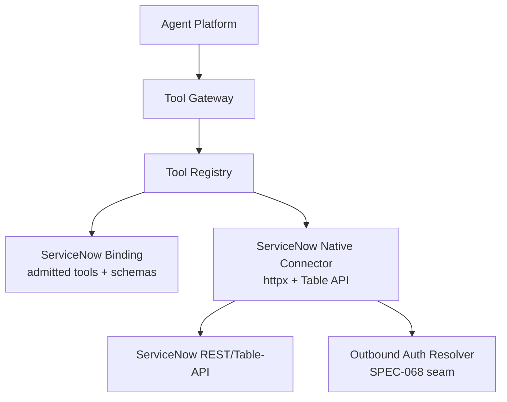
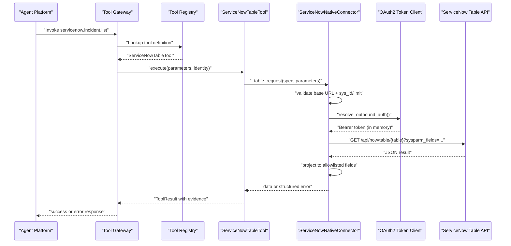
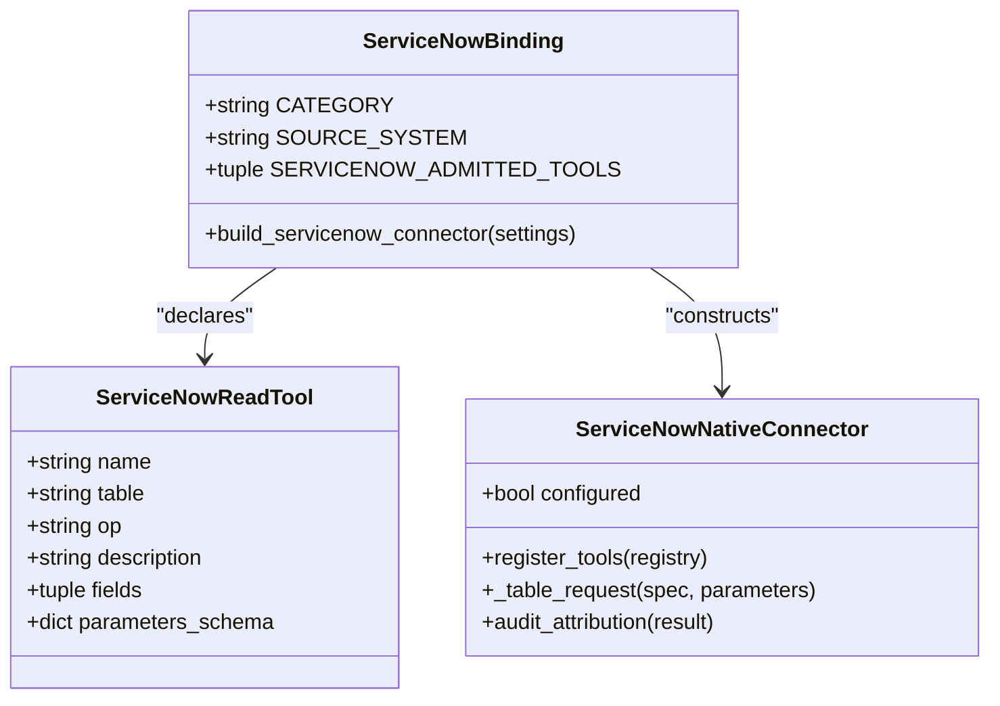
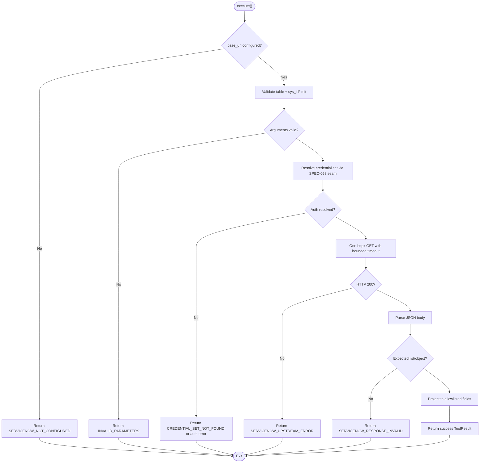
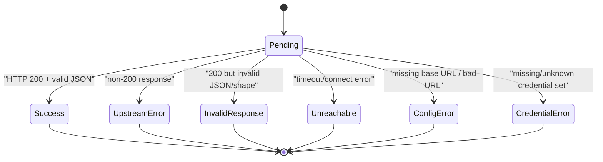
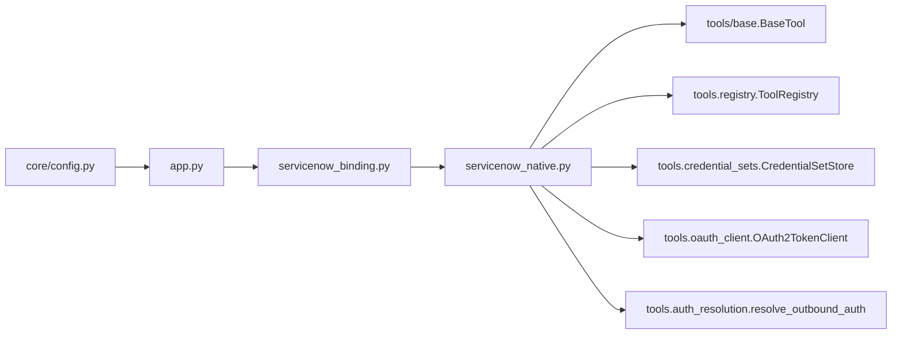

# ServiceNow Integration Guide

<cite>
**Referenced Files in This Document**   
- [README.md](file://README.md)
- [servicenow-integration.md](file://docs/guides/servicenow-integration.md)
- [SPEC-067 spec.md](file://docs/specs/SPEC-067-servicenow-mcp-ingestion-pilot/spec.md)
- [app.py](file://products/tool-gateway/src/tool_gateway/app.py)
- [config.py](file://products/tool-gateway/src/tool_gateway/core/config.py)
- [servicenow_binding.py](file://products/tool-gateway/src/tool_gateway/ingestion/servicenow_binding.py)
- [servicenow_native.py](file://products/tool-gateway/src/tool_gateway/ingestion/servicenow_native.py)
- [test_servicenow_native.py](file://products/tool-gateway/tests/test_servicenow_native.py)
</cite>

## Table of Contents
1. [Introduction](#introduction)
2. [Project Structure](#project-structure)
3. [Core Components](#core-components)
4. [Architecture Overview](#architecture-overview)
5. [Detailed Component Analysis](#detailed-component-analysis)
6. [Dependency Analysis](#dependency-analysis)
7. [Performance Considerations](#performance-considerations)
8. [Troubleshooting Guide](#troubleshooting-guide)
9. [Conclusion](#conclusion)

## Introduction
This guide documents the ServiceNow integration delivered by SPEC-067: a read-only ingestion surface that exposes six `servicenow.*` tools through the platform’s existing tool-gateway and agent-platform execution path. The integration is intentionally narrow — it reads incidents, change requests, users, and CMDB configuration items from ServiceNow’s global REST/Table-API endpoint using an acting-service OAuth2 client-credentials identity. It does not write, update, delete, or fetch attachments; those capabilities are deferred to future specs.

The repository root describes the workspace as a modular platform with product-oriented boundaries, shared contracts, and explicit integration points. The ServiceNow capability lives under `products/tool-gateway`, consumes the outbound credential substrate defined by SPEC-068, and registers its tools into the same registry used by native tools.

**Section sources**
- [README.md:1-46](file://README.md#L1-L46)
- [SPEC-067 spec.md:1-80](file://docs/specs/SPEC-067-servicenow-mcp-ingestion-pilot/spec.md#L1-L80)

## Project Structure
The ServiceNow integration spans four layers inside `tool-gateway`:

| Layer | Responsibility | Key file(s) |
|---|---|---|
| Operator wiring | Feature flag, base URL, timeout, and credential-set name | `core/config.py` |
| Connector bootstrap | Conditional registration when `GATEWAY_SERVICENOW_ENABLED=true` | `app.py` |
| Binding config | Admitted tool names, fixed tables, field projections, parameter schemas, and tier | `ingestion/servicenow_binding.py` |
| Transport implementation | HTTP calls, validation, projection, error mapping, audit attribution | `ingestion/servicenow_native.py` |
| Tests | Registration, projection, fail-closed behaviour, credential handling, deny-by-default, audit fidelity | `tests/test_servicenow_native.py` |

**Diagram sources**
- [app.py:195-209](file://products/tool-gateway/src/tool_gateway/app.py#L195-L209)
- [servicenow_binding.py:110-175](file://products/tool-gateway/src/tool_gateway/ingestion/servicenow_binding.py#L110-L175)
- [servicenow_native.py:135-174](file://products/tool-gateway/src/tool_gateway/ingestion/servicenow_native.py#L135-L174)

**Section sources**
- [app.py:195-209](file://products/tool-gateway/src/tool_gateway/app.py#L195-L209)
- [config.py:202-216](file://products/tool-gateway/src/tool_gateway/core/config.py#L202-L216)
- [servicenow_binding.py:1-37](file://products/tool-gateway/src/tool_gateway/ingestion/servicenow_binding.py#L1-L37)
- [servicenow_native.py:1-47](file://products/tool-gateway/src/tool_gateway/ingestion/servicenow_native.py#L1-L47)

## Core Components
The integration exposes exactly six read-tier tools:

| Tool | ServiceNow table | Operation | Parameters |
|---|---:|---|---|
| `servicenow.incident.list` | `incident` | list | `limit` (1–100, default 20) |
| `servicenow.incident.get` | `incident` | get | `sys_id` (32-hex, required) |
| `servicenow.change_request.list` | `change_request` | list | `limit` (1–100, default 20) |
| `servicenow.change_request.get` | `change_request` | get | `sys_id` (32-hex, required) |
| `servicenow.user.get` | `sys_user` | get | `sys_id` (32-hex, required) |
| `servicenow.cmdb_ci.get` | `cmdb_ci` | get | `sys_id` (32-hex, required) |

Every admitted tool has `risk_level="read"`. No write, update, delete, attachment, or free-form query filter is admitted. Deferred capabilities (`problem`, `attachment`) are absent from the allowlist and therefore denied by absence.

The binding module owns the complete operator-declared surface: canonical names, fixed tables, field-projection allowlists, JSON-Schema argument shapes, and tier. Nothing a ServiceNow instance returns can widen these boundaries.

**Section sources**
- [servicenow-integration.md:25-56](file://docs/guides/servicenow-integration.md#L25-L56)
- [servicenow_binding.py:110-175](file://products/tool-gateway/src/tool_gateway/ingestion/servicenow_binding.py#L110-L175)
- [SPEC-067 spec.md:357-369](file://docs/specs/SPEC-067-servicenow-mcp-ingestion-pilot/spec.md#L357-L369)

## Architecture Overview
At runtime, the gateway conditionally registers the ServiceNow connector only when enabled. Each registered tool wraps one `ServiceNowReadTool` declaration and executes through a single transport call site that validates arguments, resolves credentials, issues one HTTP GET, projects the response, and maps failures to structured errors.

**Diagram sources**
- [app.py:195-209](file://products/tool-gateway/src/tool_gateway/app.py#L195-L209)
- [servicenow_native.py:313-408](file://products/tool-gateway/src/tool_gateway/ingestion/servicenow_native.py#L313-L408)
- [servicenow_native.py:411-471](file://products/tool-gateway/src/tool_gateway/ingestion/servicenow_native.py#L411-L471)

## Detailed Component Analysis

### Connector Bootstrap and Configuration
The ServiceNow connector is disabled by default. Its feature gate, base URL, timeout, and credential-set name live in `GatewaySettings`. When `settings.servicenow_enabled` is true, `app.py` imports the binding, builds the connector, and registers its tools into the gateway registry.

Key configuration fields:

| Field | Purpose | Default |
|---|---|---|
| `servicenow_enabled` | Register the six read tools | `False` |
| `servicenow_base_url` | Table-API base origin | `""` |
| `servicenow_timeout_ms` | HTTP client timeout | `10000` |
| `servicenow_credential_set` | Named credential set for OAuth2 client-credentials | `""` |
| `servicenow_credential_sets_path` | Path to mounted `credential-sets.json` | `""` |

The connector is inert until both the feature flag is true and a base URL is wired; this mirrors the pattern used by other connectors so rollback needs no code revert.

**Section sources**
- [config.py:61-69](file://products/tool-gateway/src/tool_gateway/core/config.py#L61-L69)
- [config.py:202-216](file://products/tool-gateway/src/tool_gateway/core/config.py#L202-L216)
- [app.py:195-209](file://products/tool-gateway/src/tool_gateway/app.py#L195-L209)

### Binding Configuration
`servicenow_binding.py` defines the operator-controlled contract:

- `CATEGORY = "servicenow"`
- `SOURCE_SYSTEM = "servicenow"`
- Fixed field tuples per table
- `_LIST_SCHEMA` and `_GET_SCHEMA`
- `SERVICENOW_ADMITTED_TOOLS`, a tuple of `ServiceNowReadTool` declarations
- `build_servicenow_connector(settings)`, which wires operator settings into the native connector

The binding is deliberately separate from transport logic. Adding a new table or column is a binding-config change, not a connector-code change.

**Diagram sources**
- [servicenow_binding.py:53-175](file://products/tool-gateway/src/tool_gateway/ingestion/servicenow_binding.py#L53-L175)
- [servicenow_binding.py:178-196](file://products/tool-gateway/src/tool_gateway/ingestion/servicenow_binding.py#L178-L196)
- [servicenow_native.py:106-174](file://products/tool-gateway/src/tool_gateway/ingestion/servicenow_native.py#L106-L174)

**Section sources**
- [servicenow_binding.py:1-37](file://products/tool-gateway/src/tool_gateway/ingestion/servicenow_binding.py#L1-L37)
- [servicenow_binding.py:53-175](file://products/tool-gateway/src/tool_gateway/ingestion/servicenow_binding.py#L53-L175)
- [servicenow_binding.py:178-196](file://products/tool-gateway/src/tool_gateway/ingestion/servicenow_binding.py#L178-L196)

### Transport Implementation
`servicenow_native.py` implements the REST/Table-API fallback chosen at Stage-0 because the operator PDI did not expose ServiceNow’s own MCP server. The connector:

1. Validates the base URL scheme and host.
2. Builds a target URL from the gateway-owned table constant.
3. Validates `sys_id` as a 32-character hex string before any network call.
4. Clamps `limit` to `[1, MAX_LIMIT]`.
5. Resolves credentials through the SPEC-068 seam.
6. Issues exactly one `httpx.AsyncClient.get` with `follow_redirects=False`.
7. Rejects non-200 responses as upstream errors.
8. Parses JSON and asserts the expected shape.
9. Projects every record down to the allowlisted fields.
10. Returns structured errors rather than fabricated successes.

**Diagram sources**
- [servicenow_native.py:214-311](file://products/tool-gateway/src/tool_gateway/ingestion/servicenow_native.py#L214-L311)
- [servicenow_native.py:313-408](file://products/tool-gateway/src/tool_gateway/ingestion/servicenow_native.py#L313-L408)
- [servicenow_native.py:430-456](file://products/tool-gateway/src/tool_gateway/ingestion/servicenow_native.py#L430-L456)

**Section sources**
- [servicenow_native.py:1-47](file://products/tool-gateway/src/tool_gateway/ingestion/servicenow_native.py#L1-L47)
- [servicenow_native.py:76-103](file://products/tool-gateway/src/tool_gateway/ingestion/servicenow_native.py#L76-L103)
- [servicenow_native.py:214-408](file://products/tool-gateway/src/tool_gateway/ingestion/servicenow_native.py#L214-L408)

### Audit Attribution and Identity Mode
The connector addresses ServiceNow with the acting service’s credential, not the requesting user’s delegated identity. Every call records requester identity and acting-service identity separately, and marks `target_identity_mode=acting_service`. Timeout and unreachable faults are attributed `failure_class=target_unavailable`; policy denials and upstream errors are distinct outcomes.

**Diagram sources**
- [servicenow_native.py:430-471](file://products/tool-gateway/src/tool_gateway/ingestion/servicenow_native.py#L430-L471)
- [test_servicenow_native.py:428-470](file://products/tool-gateway/tests/test_servicenow_native.py#L428-L470)

**Section sources**
- [servicenow_native.py:90-103](file://products/tool-gateway/src/tool_gateway/ingestion/servicenow_native.py#L90-L103)
- [servicenow_native.py:458-471](file://products/tool-gateway/src/tool_gateway/ingestion/servicenow_native.py#L458-L471)
- [test_servicenow_native.py:428-470](file://products/tool-gateway/tests/test_servicenow_native.py#L428-L470)

### Test Coverage Summary
The test suite covers:

- Exactly six read-tier tools register with category `servicenow`.
- `change_request` is in scope; `problem` and `attachment` are absent.
- Read-tier tools register even when mutating tools are disabled.
- Missing base URL fails closed with `SERVICENOW_NOT_CONFIGURED`.
- The registered tool set comes from binding config, not target discovery.
- List results are projected and bounded; unknown columns are dropped.
- `get` builds the correct `sys_id` path.
- `limit` above `MAX_LIMIT` is clamped.
- Missing or malformed `sys_id` is rejected before transport.
- Non-integer `limit` is rejected before transport.
- Invalid base URL schemes and userinfo-bearing URLs fail closed.
- Upstream 4xx/5xx return `SERVICENOW_UPSTREAM_ERROR`.
- Timeouts return `SERVICENOW_TIMEOUT`.
- Connect errors return `SERVICENOW_UNREACHABLE`.
- Non-JSON bodies and missing `result` keys return `SERVICENOW_RESPONSE_INVALID`.
- OAuth2 tokens reach the target but never appear in results or logs.
- Unknown credential sets return `CREDENTIAL_SET_NOT_FOUND`.
- A bound credential set without a store fails closed.
- No credential set allows unauthenticated calls against loopback mocks.
- Deny-by-default is enforced by absence: unlisted tools return `TOOL_NOT_FOUND`.
- Audit events carry requester + acting-service identity, target system, tool name, outcome, and `target_identity_mode=acting_service`.
- Secrets and tokens do not leak into audit or logs.
- Fail-closed failures are attributed `target_unavailable` only for timeouts/unreachable faults.

**Section sources**
- [test_servicenow_native.py:1-13](file://products/tool-gateway/tests/test_servicenow_native.py#L1-L13)
- [test_servicenow_native.py:151-189](file://products/tool-gateway/tests/test_servicenow_native.py#L151-L189)
- [test_servicenow_native.py:194-241](file://products/tool-gateway/tests/test_servicenow_native.py#L194-L241)
- [test_servicenow_native.py:246-287](file://products/tool-gateway/tests/test_servicenow_native.py#L246-L287)
- [test_servicenow_native.py:293-344](file://products/tool-gateway/tests/test_servicenow_native.py#L293-L344)
- [test_servicenow_native.py:349-423](file://products/tool-gateway/tests/test_servicenow_native.py#L349-L423)
- [test_servicenow_native.py:428-470](file://products/tool-gateway/tests/test_servicenow_native.py#L428-L470)
- [test_servicenow_native.py:475-510](file://products/tool-gateway/tests/test_servicenow_native.py#L475-L510)
- [test_servicenow_native.py:517-563](file://products/tool-gateway/tests/test_servicenow_native.py#L517-L563)
- [test_servicenow_native.py:568-637](file://products/tool-gateway/tests/test_servicenow_native.py#L568-L637)
- [test_servicenow_native.py:642-698](file://products/tool-gateway/tests/test_servicenow_native.py#L642-L698)

## Dependency Analysis
The ServiceNow integration depends on several platform seams without introducing new external dependencies for the REST path:

| Dependency | Role | Boundary |
|---|---|---|
| `httpx` | HTTP client for Table-API calls | Already present in tool-gateway |
| `BaseTool` / `ToolDefinition` / `ToolRegistry` | Tool contract reuse | SPEC-007 seam |
| `CredentialSetStore` | Reads named credential sets from mounted JSON | SPEC-068 seam |
| `OAuth2TokenClient` | In-memory token cache and refresh | SPEC-068 seam |
| `resolve_outbound_auth` | Dispatches among `basic` / `bearer` / `oauth2_client_credentials` | SPEC-068 seam |
| `audit_attribution` hook | Opt-in audit enrichment | Gateway service invocation path |
| `GatewaySettings` | Operator configuration | Environment-driven |

**Diagram sources**
- [servicenow_native.py:59-69](file://products/tool-gateway/src/tool_gateway/ingestion/servicenow_native.py#L59-L69)
- [servicenow_binding.py:43-48](file://products/tool-gateway/src/tool_gateway/ingestion/servicenow_binding.py#L43-L48)
- [app.py:195-209](file://products/tool-gateway/src/tool_gateway/app.py#L195-L209)
- [config.py:202-216](file://products/tool-gateway/src/tool_gateway/core/config.py#L202-L216)

**Section sources**
- [servicenow_native.py:59-69](file://products/tool-gateway/src/tool_gateway/ingestion/servicenow_native.py#L59-L69)
- [servicenow_binding.py:43-48](file://products/tool-gateway/src/tool_gateway/ingestion/servicenow_binding.py#L43-L48)
- [app.py:195-209](file://products/tool-gateway/src/tool_gateway/app.py#L195-L209)
- [config.py:202-216](file://products/tool-gateway/src/tool_gateway/core/config.py#L202-L216)

## Performance Considerations
- **Single request per tool call.** There is no retry loop, no exponential backoff, and no redirect following. A transient fault surfaces immediately rather than being silently absorbed.
- **Bounded page size.** `sysparm_limit` defaults to 20 and is clamped to 100. This prevents large evidence frames from carrying thousands of rows.
- **Timeout cap.** The connector clamps `timeout_ms` to `[1, MAX_TIMEOUT_MS]`, where `MAX_TIMEOUT_MS = 30000`.
- **In-memory token cache.** One `OAuth2TokenClient` per connector instance persists cached tokens across calls, reducing repeated token acquisition.
- **Projection cost.** Every returned record is reduced to the allowlisted fields after the response arrives. This adds CPU work but is the safety mechanism preventing secret-bearing columns from leaking.
- **No model-selected paths.** Tables, operations, and filters are gateway-owned constants; the model cannot inject arbitrary queries or endpoints.

[No sources needed since this section provides general guidance derived from already-analyzed files]

## Troubleshooting Guide
The operational guide documents the full end-to-end runbook, including ServiceNow-side provisioning, Luban-side wiring, validation, restore, day-2 operations, and symptom diagnostics. The most common failure modes are:

| Symptom | Likely cause | Resolution |
|---|---|---|
| `TOOL_NOT_FOUND` on every `servicenow.*` call | Connector disabled or name outside admission allowlist | Enable `GATEWAY_SERVICENOW_ENABLED`; confirm tool name against the admitted set |
| `SERVICENOW_NOT_CONFIGURED` / `SERVICENOW_INVALID_BASE_URL` | Missing or malformed base URL | Set `GATEWAY_SERVICENOW_BASE_URL` to the instance origin |
| `CREDENTIAL_SET_NOT_FOUND` | Secret not written, mount missing, set-name mismatch, or unknown scheme | Re-run the sync script; verify the JSON key and `scheme` value |
| `CREDENTIAL_ACQUISITION_FAILED` | Wrong/expired secret, grant type disabled, or token URL unreachable | Smoke-test locally against the instance |
| `SERVICENOW_UPSTREAM_ERROR` (401/403) | Bound user’s ACLs do not cover the table | Re-check the integration user and role posture |
| `SERVICENOW_UPSTREAM_ERROR` (404) on `get` | `sys_id` does not exist on this tenant | Use a `sys_id` returned by a live `list` |
| `SERVICENOW_UPSTREAM_ERROR` (3xx) | Redirects are not followed | Usually a proxy, wrong base URL, or mis-scoped endpoint |
| `SERVICENOW_TIMEOUT` / `SERVICENOW_UNREACHABLE` | Egress blocked, DNS failure, TLS trust failure, or instance maintenance | Probe from inside the pod; check NetworkPolicy and CA bundle |
| `SERVICENOW_RESPONSE_INVALID` | HTTP 200 with non-JSON body or unexpected shape | Confirm the endpoint is the global Table API, not an interstitial |
| `INVALID_PARAMETERS` before any request | Missing/malformed `sys_id` or invalid `limit` | Fix arguments; values above 100 are clamped, not rejected |

For live validation, the shipped e2e script is mock-bound for its final legs; operators must manually exercise real `sys_id`s and assert field projection, log hygiene, and audit attribution. After validation, the cluster should be restored to the committed dev state so the running overlay matches the repository.

**Section sources**
- [servicenow-integration.md:633-649](file://docs/guides/servicenow-integration.md#L633-L649)
- [servicenow-integration.md:432-479](file://docs/guides/servicenow-integration.md#L432-L479)
- [servicenow-integration.md:570-592](file://docs/guides/servicenow-integration.md#L570-L592)

## Conclusion
The ServiceNow integration is a narrowly scoped, operator-declared read surface built on established platform seams. Its security posture is defined by five hard rules: fixed tables, allowlisted field projection, read tier only, fail-closed no-fabrication, and acting-service identity. The binding layer is the authoritative boundary — adding a new table or column is a configuration change reviewed like any other operator-facing surface, not a dynamic capability advertised by the target.

For operators, the critical path is: provision a dedicated integration user and OAuth client-credentials application in ServiceNow, mount a named credential set, enable the connector, validate against a real instance out-of-band, and record the result in the living documentation. For contributors, the extension point is `servicenow_binding.py`; for consumers, the surface is the same governed tool path used by all other read-tier tools.

[No sources needed since this section summarizes without analyzing specific files]