# Operator Portal

<cite>
**Referenced Files in This Document**
- [README.md](file://products/operator-portal/README.md)
- [package.json](file://products/operator-portal/web-ui/app/package.json)
- [main.tsx](file://products/operator-portal/web-ui/app/src/main.tsx)
- [App.tsx](file://products/operator-portal/web-ui/app/src/App.tsx)
- [AuthContext.tsx](file://products/operator-portal/web-ui/app/src/auth/AuthContext.tsx)
- [oidc.ts](file://products/operator-portal/web-ui/app/src/auth/oidc.ts)
- [useChatStream.ts](file://products/operator-portal/web-ui/app/src/stream/useChatStream.ts)
- [transport.ts](file://products/operator-portal/web-ui/app/src/stream/transport.ts)
- [ChatView.tsx](file://products/operator-portal/web-ui/app/src/chat/ChatView.tsx)
- [ApprovalsView.tsx](file://products/operator-portal/web-ui/app/src/views/control/ApprovalsView.tsx)
- [AuditView.tsx](file://products/operator-portal/web-ui/app/src/views/audit/AuditView.tsx)
- [IncidentsView.tsx](file://products/operator-portal/web-ui/app/src/views/incidents/IncidentsView.tsx)
- [SettingsView.tsx](file://products/operator-portal/web-ui/app/src/views/control/SettingsView.tsx)
- [roles.ts](file://products/operator-portal/web-ui/app/src/roles.ts)
- [authorizations.ts](file://products/operator-portal/web-ui/app/src/api/authorizations.ts)
- [useAuthorizationStatusPoll.ts](file://products/operator-portal/web-ui/app/src/chat/useAuthorizationStatusPoll.ts)
- [useAuthorizationReturn.ts](file://products/operator-portal/web-ui/app/src/sessions/useAuthorizationReturn.ts)
- [PermissionsView.tsx](file://products/operator-portal/web-ui/app/src/views/control/PermissionsView.tsx)
- [usePendingDecisionPoll.ts](file://products/operator-portal/web-ui/app/src/chat/usePendingDecisionPoll.ts)
</cite>

## Update Summary
**Changes Made**
- Added comprehensive authorization management UI components including target authorization status polling and session return handling
- Integrated user delegation workflows with chat interface through AuthorizationCardView component
- Added Permissions matrix view for policy visualization and role-action governance
- Enhanced session management with authorization-aware navigation and workspace selection
- Updated streaming chat interface to support authorization-required frames and continuation workflows

## Table of Contents
1. Introduction
2. Project Structure
3. Core Components
4. Architecture Overview
5. Detailed Component Analysis
6. Authorization Management System
7. Dependency Analysis
8. Performance Considerations
9. Troubleshooting Guide
10. Conclusion
11. Appendices

## Introduction
The Operator Portal is the React-based web interface for operators, approvers, auditors, skill authors, and platform administrators. It provides:
- Chat sessions for agent interactions with streaming responses, human-in-the-loop confirmations, and target authorization workflows
- A dedicated Studio workspace for skill authoring and development
- An approvals inbox for reviewing and deciding on pending actions
- A durable audit trail view for compliance review
- An incidents panel for alert triage and collaboration
- Settings for inspecting identity, session state, and platform health
- A permissions matrix view for policy visualization and governance oversight

It runs as a single-page application built with Vite, TypeScript, and Ant Design (including Ant Design X), served by nginx and proxied to the platform gateway. Authentication uses OIDC via the platform gateway and identity broker, with silent token refresh and role-based UI gating. The portal now includes comprehensive authorization management for user delegation workflows and target authorization challenges.

**Section sources**
- [README.md:1-137](file://products/operator-portal/README.md#L1-L137)

## Project Structure
At a high level:
- The SPA entry mounts React under StrictMode, applies an Ant Design theme, and wraps the app with authentication context.
- App.tsx owns navigation, role-gated menu items, and maintains two workspace instances (operation and development) for separate Chat and Studio modes.
- Feature modules are organized by capability: chat, stream transport, auth, views (approvals, audit, incidents, settings, permissions), and utilities.
- New authorization management components provide target authorization status polling, session return handling, and integration with the chat interface.

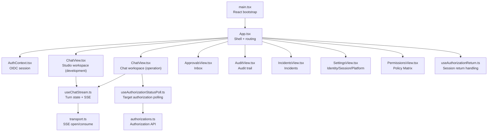

**Diagram sources**
- [main.tsx:1-18](file://products/operator-portal/web-ui/app/src/main.tsx#L1-L18)
- [App.tsx:304-461](file://products/operator-portal/web-ui/app/src/App.tsx#L304-L461)
- [AuthContext.tsx:31-110](file://products/operator-portal/web-ui/app/src/auth/AuthContext.tsx#L31-L110)
- [ChatView.tsx:1-800](file://products/operator-portal/web-ui/app/src/chat/ChatView.tsx#L1-L800)
- [useChatStream.ts:135-501](file://products/operator-portal/web-ui/app/src/stream/useChatStream.ts#L135-L501)
- [transport.ts:1-165](file://products/operator-portal/web-ui/app/src/stream/transport.ts#L1-L165)
- [useAuthorizationStatusPoll.ts:1-159](file://products/operator-portal/web-ui/app/src/chat/useAuthorizationStatusPoll.ts#L1-L159)
- [authorizations.ts:1-88](file://products/operator-portal/web-ui/app/src/api/authorizations.ts#L1-L88)
- [useAuthorizationReturn.ts:1-68](file://products/operator-portal/web-ui/app/src/sessions/useAuthorizationReturn.ts#L1-L68)

**Section sources**
- [main.tsx:1-18](file://products/operator-portal/web-ui/app/src/main.tsx#L1-L18)
- [App.tsx:53-461](file://products/operator-portal/web-ui/app/src/App.tsx#L53-L461)
- [package.json:1-36](file://products/operator-portal/web-ui/app/package.json#L1-L36)

## Core Components
- Authentication provider: manages OIDC login, callback completion, silent refresh, logout, and exposes username/roles to the app.
- Dual workspace architecture: maintains separate operation and development session workspaces; operation backs Chat, Incidents, Documents, and Settings, while development backs Studio.
- Streaming chat adapter: accumulates turns, tool evidence frames, and HITL confirmation cards; supports session switching and re-seeding from transcripts.
- Authorization management system: provides target authorization status polling, session return handling, and integration with chat interface for user delegation workflows.
- Views:
  - Chat workspace operates in either operation or development mode using the same ChatView component, now with authorization card support.
  - Studio workspace provides skill authoring capabilities with development-specific features.
  - Approvals inbox polls pending confirmations and history, renders shared confirmation cards, and drives decisions over the same confirm stream.
  - Audit trail loads events with cursor pagination, summary aggregation, CSV export, and drill-down filters.
  - Incidents list/detail with auto-refresh, triage run, report form, connector dispatches, and deep-link into chat.
  - Settings shows identity claims, current session, and platform component health.
  - Permissions matrix displays live role × action matrix from gateway's policy endpoint with approval requirements visualization.

**Section sources**
- [AuthContext.tsx:31-110](file://products/operator-portal/web-ui/app/src/auth/AuthContext.tsx#L31-L110)
- [useChatStream.ts:135-501](file://products/operator-portal/web-ui/app/src/stream/useChatStream.ts#L135-L501)
- [ApprovalsView.tsx:69-441](file://products/operator-portal/web-ui/app/src/views/control/ApprovalsView.tsx#L69-L441)
- [AuditView.tsx:101-484](file://products/operator-portal/web-ui/app/src/views/audit/AuditView.tsx#L101-L484)
- [IncidentsView.tsx:103-699](file://products/operator-portal/web-ui/app/src/views/incidents/IncidentsView.tsx#L103-L699)
- [SettingsView.tsx:30-405](file://products/operator-portal/web-ui/app/src/views/control/SettingsView.tsx#L30-L405)
- [PermissionsView.tsx:1-128](file://products/operator-portal/web-ui/app/src/views/control/PermissionsView.tsx#L1-L128)

## Architecture Overview
The portal communicates exclusively through the platform gateway. Authentication flows through OIDC endpoints managed by the gateway and identity broker. Chat and confirmations use Server-Sent Events for real-time updates. Role checks gate UI elements; the gateway enforces authorization server-side. The new authorization management system adds target authorization challenge handling and user delegation workflows.

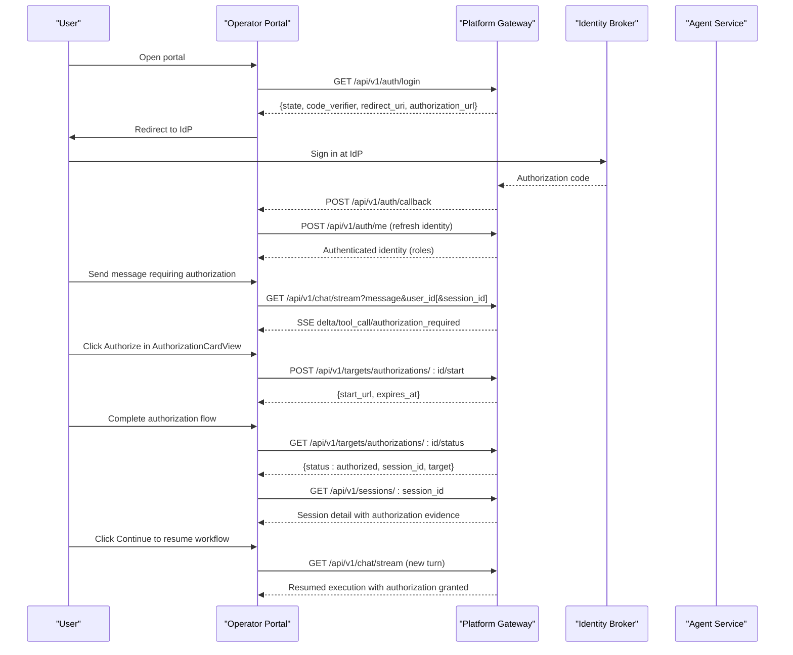

**Diagram sources**
- [oidc.ts:75-156](file://products/operator-portal/web-ui/app/src/auth/oidc.ts#L75-L156)
- [oidc.ts:183-205](file://products/operator-portal/web-ui/app/src/auth/oidc.ts#L183-L205)
- [transport.ts:61-86](file://products/operator-portal/web-ui/app/src/stream/transport.ts#L61-L86)
- [transport.ts:111-148](file://products/operator-portal/web-ui/app/src/stream/transport.ts#L111-L148)
- [useChatStream.ts:240-328](file://products/operator-portal/web-ui/app/src/stream/useChatStream.ts#L240-L328)
- [useChatStream.ts:330-454](file://products/operator-portal/web-ui/app/src/stream/useChatStream.ts#L330-L454)
- [authorizations.ts:52-87](file://products/operator-portal/web-ui/app/src/api/authorizations.ts#L52-L87)
- [ChatView.tsx:1005-1137](file://products/operator-portal/web-ui/app/src/chat/ChatView.tsx#L1005-L1137)

## Detailed Component Analysis

### Authentication and Session Management
- Login starts via gateway `/api/v1/auth/login`, redirects to IdP, and completes via `/api/v1/auth/callback` using PKCE state and code verifier stored in sessionStorage.
- On load, the provider attempts callback completion, then restores any existing session and schedules silent refresh before token expiry.
- Identity is refreshed via `/api/v1/auth/me`; failures clear the session and prompt re-authentication.
- Logout calls `/api/v1/auth/logout-url` and clears local state.

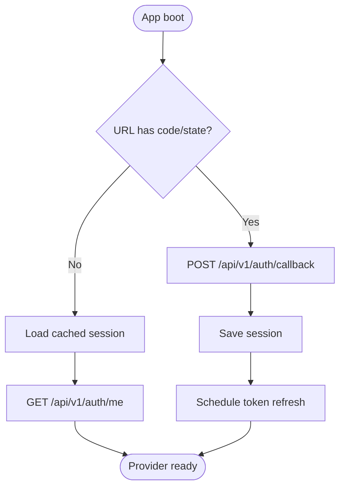

**Diagram sources**
- [AuthContext.tsx:40-71](file://products/operator-portal/web-ui/app/src/auth/AuthContext.tsx#L40-L71)
- [oidc.ts:75-156](file://products/operator-portal/web-ui/app/src/auth/oidc.ts#L75-L156)
- [oidc.ts:183-205](file://products/operator-portal/web-ui/app/src/auth/oidc.ts#L183-L205)

**Section sources**
- [AuthContext.tsx:31-110](file://products/operator-portal/web-ui/app/src/auth/AuthContext.tsx#L31-L110)
- [oidc.ts:15-73](file://products/operator-portal/web-ui/app/src/auth/oidc.ts#L15-L73)
- [oidc.ts:75-156](file://products/operator-portal/web-ui/app/src/auth/oidc.ts#L75-L156)
- [oidc.ts:158-205](file://products/operator-portal/web-ui/app/src/auth/oidc.ts#L158-L205)

### Navigation and Workspace Architecture
The portal implements a dual-workspace architecture with separate operation and development environments:

- **Operation Workspace**: Backs Chat, Incidents, Documents, and Settings views for day-to-day operations
- **Development Workspace**: Backs Studio for skill authoring and development activities
- **Role-Based Access**: Studio is gated by `STUDIO_ROLES` (equivalent to `SKILL_GRADUATE_ROLES`), requiring `session:skill_graduate` permission
- **Navigation Structure**: Top-level menu includes Chat, Studio (for authorized users), Control section (Incidents, Approvals, Audit, Permissions), and Workspace section (Documents, Tools, Skills, Settings)

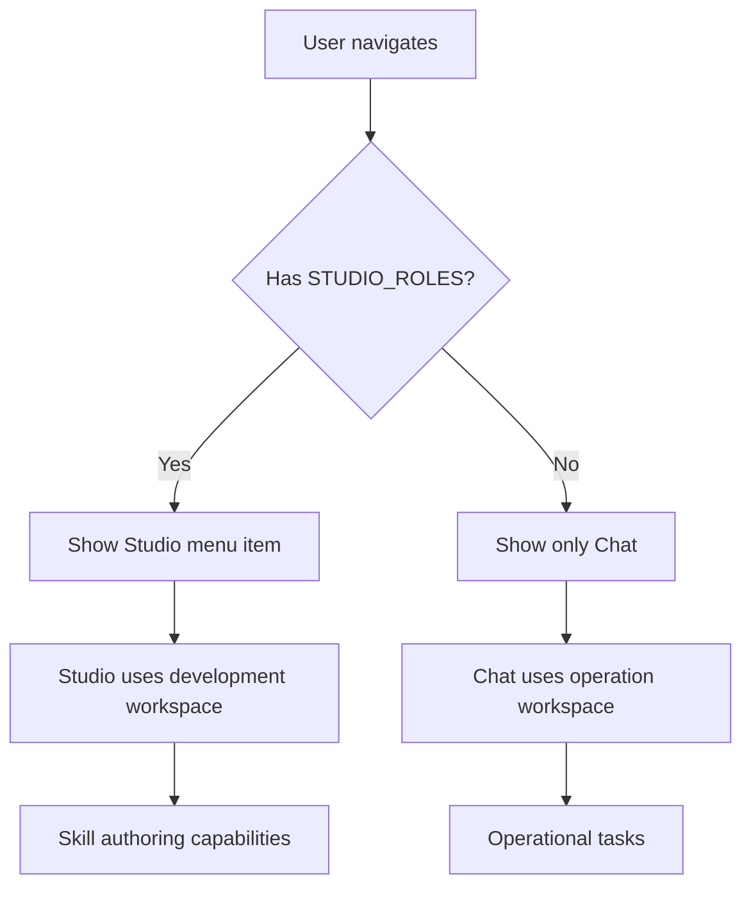

**Diagram sources**
- [App.tsx:105-143](file://products/operator-portal/web-ui/app/src/App.tsx#L105-L143)
- [App.tsx:312-324](file://products/operator-portal/web-ui/app/src/App.tsx#L312-L324)
- [roles.ts:83-90](file://products/operator-portal/web-ui/app/src/roles.ts#L83-L90)

**Section sources**
- [App.tsx:105-143](file://products/operator-portal/web-ui/app/src/App.tsx#L105-L143)
- [App.tsx:312-324](file://products/operator-portal/web-ui/app/src/App.tsx#L312-L324)
- [roles.ts:83-90](file://products/operator-portal/web-ui/app/src/roles.ts#L83-L90)

### Streaming Chat Interface
- useChatStream owns turn state, tool evidence accumulation, and HITL confirmation cards.
- Sends messages via GET /api/v1/chat/stream with query parameters for user, optional session, modality, and model selection.
- Decodes SSE frames into deltas, tool calls/results, terminal markers, and confirmation requests/results.
- Supports session switching by aborting streams, caching turns per session, and restoring or seeding from transcript history.
- Confirmation decisions POST to /api/v1/chat/confirm; the response is the resumed SSE stream that continues rendering in place.

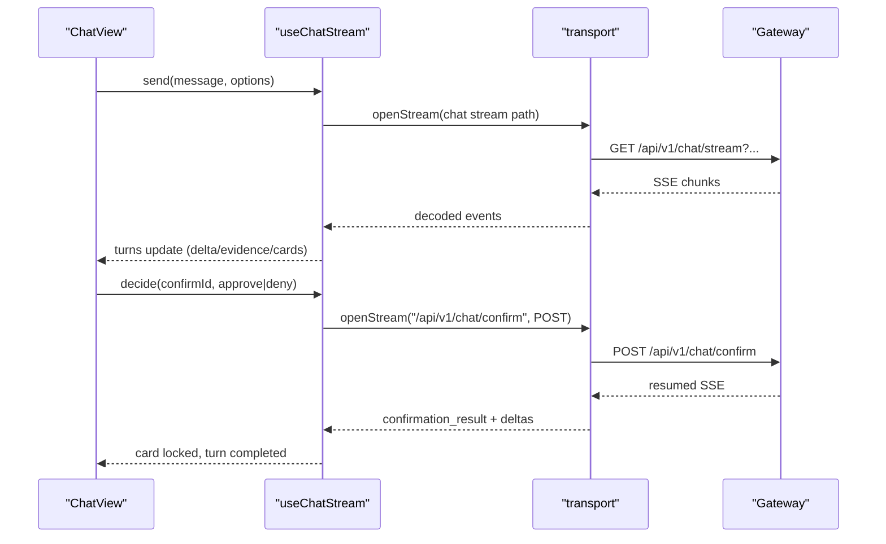

**Diagram sources**
- [useChatStream.ts:240-328](file://products/operator-portal/web-ui/app/src/stream/useChatStream.ts#L240-L328)
- [useChatStream.ts:330-454](file://products/operator-portal/web-ui/app/src/stream/useChatStream.ts#L330-L454)
- [transport.ts:61-86](file://products/operator-portal/web-ui/app/src/stream/transport.ts#L61-L86)
- [transport.ts:111-165](file://products/operator-portal/web-ui/app/src/stream/transport.ts#L111-L165)

**Section sources**
- [useChatStream.ts:135-501](file://products/operator-portal/web-ui/app/src/stream/useChatStream.ts#L135-L501)
- [transport.ts:1-165](file://products/operator-portal/web-ui/app/src/stream/transport.ts#L1-L165)
- [ChatView.tsx:1-800](file://products/operator-portal/web-ui/app/src/chat/ChatView.tsx#L1-L800)

### Authorization Management System

#### Target Authorization Status Polling
The authorization management system provides comprehensive target authorization handling through bounded, visibility-aware status polling. While inline authorization controls are mounted and challenges remain pending, the system refreshes owner-scoped status every two seconds, stopping when terminal states are reached or expiry lapses.

Key features include:
- **Bounded Polling**: Only polls the specific challenge ID it was given, preventing cross-owner access
- **Visibility Awareness**: Stops polling when tabs become backgrounded, resumes immediately on foreground
- **Safety Boundaries**: Transient errors maintain last-good status without flipping controls
- **Stale Read Protection**: Uses AbortController and captured-id guards to prevent late responses from overwriting current state

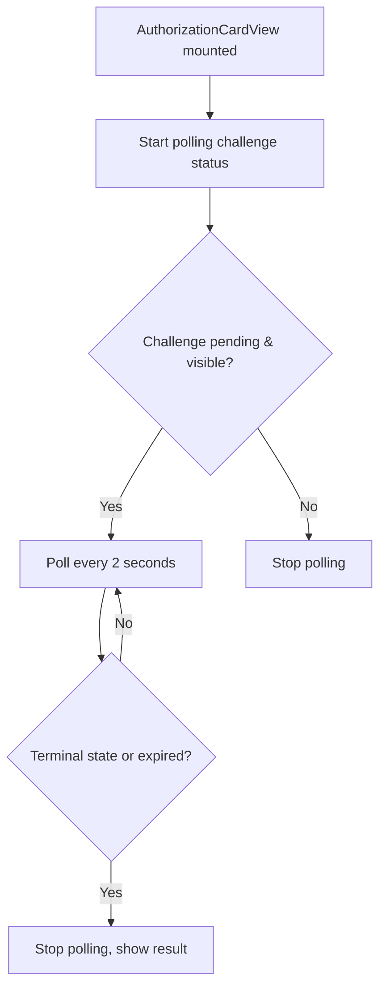

**Diagram sources**
- [useAuthorizationStatusPoll.ts:1-159](file://products/operator-portal/web-ui/app/src/chat/useAuthorizationStatusPoll.ts#L1-L159)
- [authorizations.ts:52-61](file://products/operator-portal/web-ui/app/src/api/authorizations.ts#L52-L61)

#### Session Authorization Return Handling
The session authorization return handler processes authorization completion flows by validating return URLs, checking authorization status, and navigating users back to their originating conversations. It ensures security by validating session ownership, user identity, and authorization evidence before allowing navigation.

Security validations include:
- URL format validation for UUID challenge IDs
- User identity verification against session data
- Authorization evidence chain validation
- Workspace type and permission checks
- Clean URL state after processing

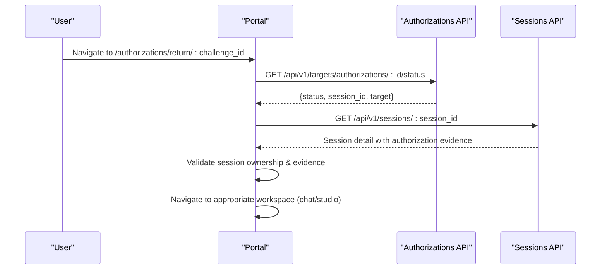

**Diagram sources**
- [useAuthorizationReturn.ts:1-68](file://products/operator-portal/web-ui/app/src/sessions/useAuthorizationReturn.ts#L1-L68)
- [authorizations.ts:85-87](file://products/operator-portal/web-ui/app/src/api/authorizations.ts#L85-L87)

#### Chat Interface Integration
The AuthorizationCardView component integrates authorization workflows directly into the chat interface, providing inline controls for target authorization challenges. It handles the complete lifecycle from authorization initiation through continuation of the original workflow.

Features include:
- **Inline Controls**: Authorize, Cancel, and Continue buttons within chat messages
- **Real-time Status**: Live polling of authorization status with visual indicators
- **State Management**: Handles pending, authorized, canceled, expired, and failed states
- **Workflow Continuation**: Continue button triggers fresh explicit user turns after authorization

**Section sources**
- [useAuthorizationStatusPoll.ts:1-159](file://products/operator-portal/web-ui/app/src/chat/useAuthorizationStatusPoll.ts#L1-L159)
- [useAuthorizationReturn.ts:1-68](file://products/operator-portal/web-ui/app/src/sessions/useAuthorizationReturn.ts#L1-L68)
- [ChatView.tsx:1005-1137](file://products/operator-portal/web-ui/app/src/chat/ChatView.tsx#L1005-L1137)
- [authorizations.ts:1-88](file://products/operator-portal/web-ui/app/src/api/authorizations.ts#L1-L88)

### Approvals Panel
- Polls pending confirmations and decision history every 30 seconds and on focus.
- Renders shared confirmation cards identical to those in chat, enabling consistent UX.
- Decisions reuse POST /api/v1/chat/confirm and consume the resumed stream to capture outcomes.
- Handles race conditions (409 already resolved) and expiration (410) gracefully, flipping cards to the winner's outcome with attribution.
- Integrated with sidebar badge showing pending count and triggers immediate workspace refresh when decisions are made.

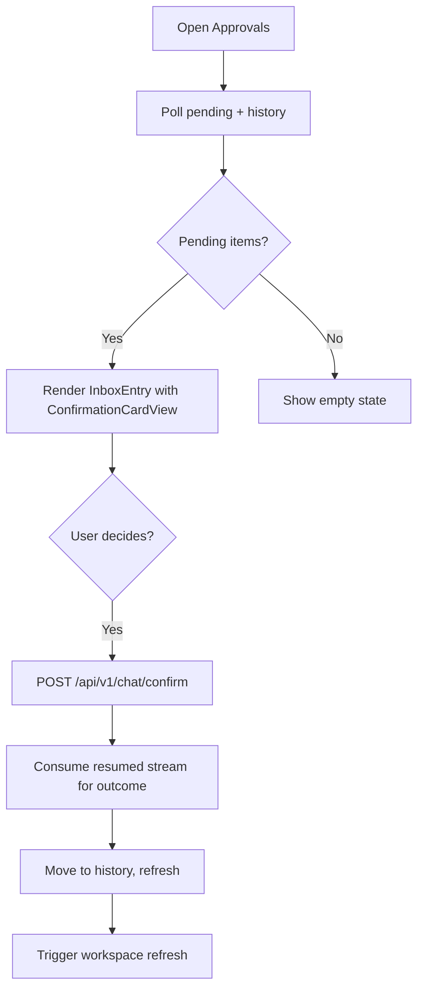

**Diagram sources**
- [ApprovalsView.tsx:69-241](file://products/operator-portal/web-ui/app/src/views/control/ApprovalsView.tsx#L69-L241)
- [ApprovalsView.tsx:243-441](file://products/operator-portal/web-ui/app/src/views/control/ApprovalsView.tsx#L243-L441)
- [App.tsx:333-341](file://products/operator-portal/web-ui/app/src/App.tsx#L333-L341)

**Section sources**
- [ApprovalsView.tsx:69-441](file://products/operator-portal/web-ui/app/src/views/control/ApprovalsView.tsx#L69-L441)
- [App.tsx:333-341](file://products/operator-portal/web-ui/app/src/App.tsx#L333-L341)

### Audit Trail
- Role-gated view for auditors/platform-admins.
- Loads events with cursor pagination and expandable verbatim envelopes.
- Provides a Summary tab with aggregates and drill-down that merges filters and reloads events.
- Exports CSV via blob download with truncation warnings when limits are hit.

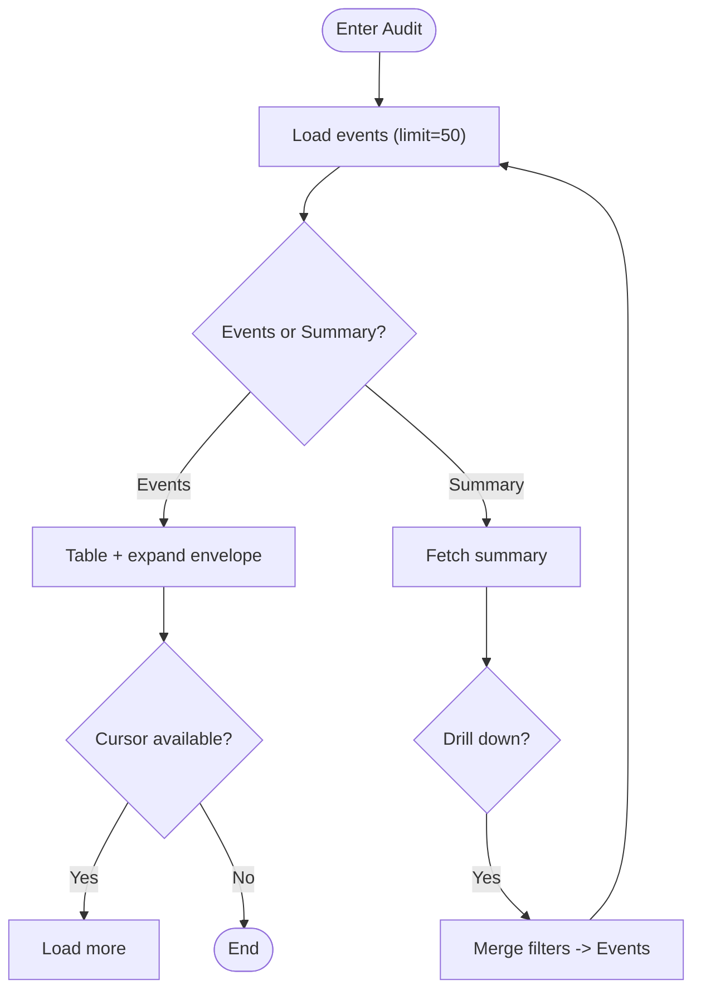

**Diagram sources**
- [AuditView.tsx:101-240](file://products/operator-portal/web-ui/app/src/views/audit/AuditView.tsx#L101-L240)
- [AuditView.tsx:241-484](file://products/operator-portal/web-ui/app/src/views/audit/AuditView.tsx#L241-L484)

**Section sources**
- [AuditView.tsx:101-484](file://products/operator-portal/web-ui/app/src/views/audit/AuditView.tsx#L101-L484)

### Incidents Panel
- Role-gated incident list with filters and 15-second auto-refresh.
- Detail view includes triage report, connector dispatches, and "Continue in chat" deep link that pins the incident's session into the chat workspace.
- Supports manual incident reporting and running triage; failed triage exposes raw agent output.

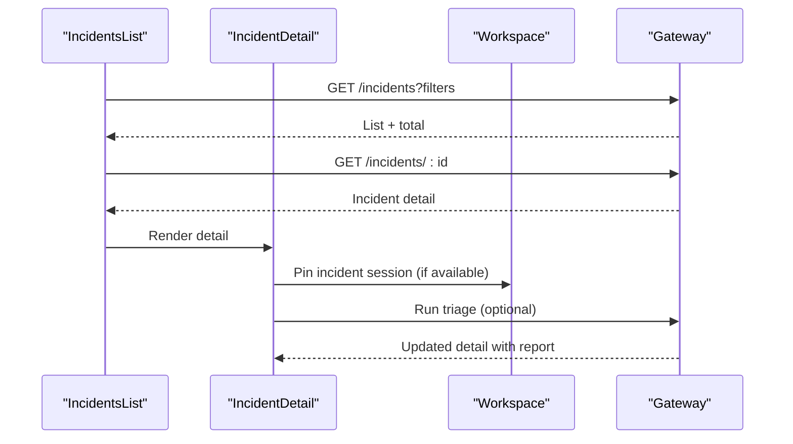

**Diagram sources**
- [IncidentsView.tsx:103-260](file://products/operator-portal/web-ui/app/src/views/incidents/IncidentsView.tsx#L103-L260)
- [IncidentsView.tsx:261-699](file://products/operator-portal/web-ui/app/src/views/incidents/IncidentsView.tsx#L261-L699)

**Section sources**
- [IncidentsView.tsx:103-699](file://products/operator-portal/web-ui/app/src/views/incidents/IncidentsView.tsx#L103-L699)

### Settings
- Read-only panes for Identity, Session, and Platform.
- Identity pane shows signed-in state, username, roles, subject, and groups.
- Session pane shows selected session and workspace session count.
- Platform pane probes gateway health and runtime metadata to display component status and versions.

**Section sources**
- [SettingsView.tsx:30-405](file://products/operator-portal/web-ui/app/src/views/control/SettingsView.tsx#L30-L405)

### Permissions Matrix View
The Permissions view provides a comprehensive matrix visualization of the platform's policy enforcement, displaying the live role × action matrix from the gateway's policy matrix endpoint. It shows both allow/deny decisions and approval requirements with distinct visual indicators.

Key features include:
- **Live Policy Data**: Fetches current policy bundle version, source, and scope from gateway
- **Approval Requirements**: Displays third-cell state for require_approval scenarios with tier information and designated deciders
- **Visual Indicators**: Uses color-coded tags for allow (success), deny (error), self-approval (warning), and approver required (warning)
- **Governance Transparency**: Shows evaluated policy bundle details and role/action counts

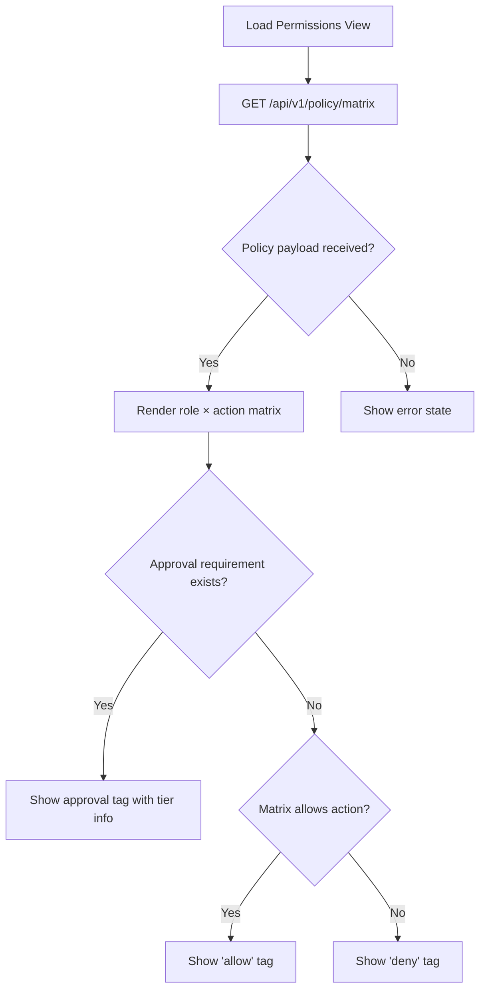

**Diagram sources**
- [PermissionsView.tsx:1-128](file://products/operator-portal/web-ui/app/src/views/control/PermissionsView.tsx#L1-L128)

**Section sources**
- [PermissionsView.tsx:1-128](file://products/operator-portal/web-ui/app/src/views/control/PermissionsView.tsx#L1-L128)

## Authorization Management System

### Target Authorization API
The authorization management system provides a comprehensive API for handling target authorization challenges and user delegation workflows:

- **Authorization Status**: Retrieves current status of authorization challenges with validation and error handling
- **Start Authorization**: Initiates authorization flow with same-origin start URLs and cookie-bound sessions
- **Cancel Authorization**: Retires authorization challenges without side effects
- **Browser Reset**: Clears authorization browser state for cleanup operations
- **Authorization Session**: Retrieves session details for authorization-related navigation

Security features include:
- UUID validation for challenge IDs
- Same-origin request enforcement
- Authentication header validation
- Error handling with consistent API error responses
- Timeout protection for long-running operations

**Section sources**
- [authorizations.ts:1-88](file://products/operator-portal/web-ui/app/src/api/authorizations.ts#L1-L88)

### Pending Decision Polling
The pending decision polling system provides real-time synchronization of approval decisions across multiple browser sessions and interfaces. It polls session details on short intervals while confirmation cards are pending, ensuring consistent state across the approvals inbox and chat interface.

Key characteristics:
- **Bounded Polling**: Only active while confirmation cards are pending plus a settle window
- **Settle Window**: Five-minute deadline-based polling after decisions are applied
- **Conflict Resolution**: Handles concurrent decisions with proper conflict detection
- **Performance Optimization**: Avoids polling during active streaming to prevent interference

**Section sources**
- [usePendingDecisionPoll.ts:1-250](file://products/operator-portal/web-ui/app/src/chat/usePendingDecisionPoll.ts#L1-L250)

## Dependency Analysis
- The app shell composes feature views based on role visibility.
- AuthContext supplies identity and roles consumed by all views and components.
- Chat depends on the stream adapter and transport layer for SSE.
- Studio shares the same ChatView component but uses a separate development workspace instance.
- Approvals reuses the same confirmation card and decision flow as Chat.
- Audit and Incidents fetch data via the gateway and render read-only surfaces.
- Settings reads health/runtime endpoints directly.
- Authorization management components integrate with chat interface and session management.
- Permissions view fetches policy matrix data from gateway endpoints.

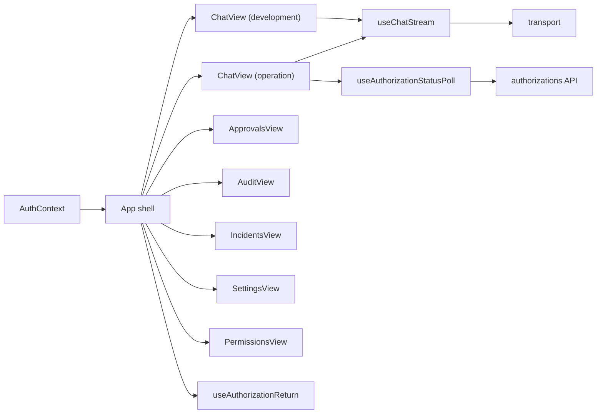

**Diagram sources**
- [App.tsx:304-461](file://products/operator-portal/web-ui/app/src/App.tsx#L304-L461)
- [AuthContext.tsx:31-110](file://products/operator-portal/web-ui/app/src/auth/AuthContext.tsx#L31-L110)
- [useChatStream.ts:135-501](file://products/operator-portal/web-ui/app/src/stream/useChatStream.ts#L135-L501)
- [transport.ts:1-165](file://products/operator-portal/web-ui/app/src/stream/transport.ts#L1-L165)
- [useAuthorizationStatusPoll.ts:1-159](file://products/operator-portal/web-ui/app/src/chat/useAuthorizationStatusPoll.ts#L1-L159)
- [authorizations.ts:1-88](file://products/operator-portal/web-ui/app/src/api/authorizations.ts#L1-L88)
- [useAuthorizationReturn.ts:1-68](file://products/operator-portal/web-ui/app/src/sessions/useAuthorizationReturn.ts#L1-L68)

**Section sources**
- [App.tsx:53-461](file://products/operator-portal/web-ui/app/src/App.tsx#L53-L461)
- [AuthContext.tsx:31-110](file://products/operator-portal/web-ui/app/src/auth/AuthContext.tsx#L31-L110)

## Performance Considerations
- SSE streaming minimizes latency by pushing deltas and tool results incrementally.
- Per-session turn caching avoids re-fetching transcripts on session switches.
- Inbox polling interval balances freshness with network load; decisions trigger immediate refresh to keep UI consistent.
- Audit export uses blob downloads to avoid large JSON payloads in memory.
- Auto-refresh intervals are conservative (incidents 15s, approvals 30s) to reduce unnecessary requests.
- Dual workspace architecture ensures operation and development sessions don't interfere with each other.
- Authorization status polling uses bounded intervals (2 seconds) with visibility awareness to minimize network overhead.
- Pending decision polling is scoped to active confirmation cards with settle windows to prevent excessive requests.

## Troubleshooting Guide
- Authentication errors:
  - If sign-in fails or token refresh fails, the session is cleared and the sidebar prompts re-authentication.
  - Stream requests returning 401 show a friendly message prompting sign-in.
- Confirmation races:
  - 409 responses indicate another approver decided first; the UI flips the card to the winner's outcome with attribution.
  - 410 indicates the confirmation expired; the card locks and the turn completes.
- Studio access:
  - Missing `STUDIO_ROLES` prevents Studio menu item from appearing; requires `session:skill_graduate` permission.
- Audit access:
  - 403 indicates missing audit:read; 503/502 indicate service configuration or availability issues.
- Incidents:
  - "Continue in chat" is disabled if the incident's triage session is not currently owned/visible in the workspace.
- Authorization challenges:
  - Authorization status polling stops on terminal states or expiry; check challenge validity and session ownership.
  - Authorization return URLs must be properly formatted UUID paths without query parameters or fragments.
  - Browser reset may be needed if authorization cookies become stale or corrupted.
- Permissions view:
  - 403 indicates missing policy:read permission; ensure user has appropriate roles for policy inspection.

**Section sources**
- [oidc.ts:52-73](file://products/operator-portal/web-ui/app/src/auth/oidc.ts#L52-L73)
- [useChatStream.ts:283-328](file://products/operator-portal/web-ui/app/src/stream/useChatStream.ts#L283-L328)
- [useChatStream.ts:392-454](file://products/operator-portal/web-ui/app/src/stream/useChatStream.ts#L392-L454)
- [ApprovalsView.tsx:156-225](file://products/operator-portal/web-ui/app/src/views/control/ApprovalsView.tsx#L156-L225)
- [AuditView.tsx:72-88](file://products/operator-portal/web-ui/app/src/views/audit/AuditView.tsx#L72-L88)
- [IncidentsView.tsx:238-259](file://products/operator-portal/web-ui/app/src/views/incidents/IncidentsView.tsx#L238-L259)
- [roles.ts:83-90](file://products/operator-portal/web-ui/app/src/roles.ts#L83-L90)
- [useAuthorizationReturn.ts:23-32](file://products/operator-portal/web-ui/app/src/sessions/useAuthorizationReturn.ts#L23-L32)
- [authorizations.ts:24-41](file://products/operator-portal/web-ui/app/src/api/authorizations.ts#L24-L41)

## Conclusion
The Operator Portal delivers a secure, role-aware, real-time operator workspace with dual-environment support and comprehensive authorization management. It integrates OIDC authentication, streams agent activity via SSE, and centralizes human-in-the-loop decisions in both chat and a dedicated approvals inbox. The addition of Studio provides skill authoring capabilities for authorized users, while maintaining separation between operational and development workflows. The new authorization management system enables sophisticated user delegation workflows with target authorization challenges, real-time status polling, and seamless integration into the chat interface. Compliance and observability are supported through a durable audit trail, incidents triage workflow, and a permissions matrix view for policy transparency. The modular architecture and role-based UI make it extensible for future features while keeping the gateway as the authority for authorization.

## Appendices

### Technology Stack and Browser Baseline
- Frontend: React, TypeScript, Vite, Ant Design and Ant Design X.
- Runtime: Node engine specified for development; production image builds static assets and serves them via nginx.
- Browser capabilities include multi-session workspace, voice input via Web Speech API, responsive layouts with collapsible sidebar, and advanced authorization workflow support.

**Section sources**
- [package.json:1-36](file://products/operator-portal/web-ui/app/package.json#L1-L36)
- [README.md:37-88](file://products/operator-portal/README.md#L37-L88)

### Role-Based Access Control Matrix
- **Auditor/Platform Admin**: Full audit access, incident viewing and action capabilities, policy matrix inspection
- **Approver/Platform Admin**: All operational capabilities plus approval decision rights and policy inspection
- **Operator/Developer**: Operational task execution, incident management, skill drafting, and basic authorization workflows
- **Read-only Observer**: Limited viewing capabilities without write access
- **Studio Authors**: Specialized skill authoring and graduation permissions (subset of operator capabilities)
- **Authorization Users**: Target authorization challenge handling and user delegation workflows

**Section sources**
- [roles.ts:4-90](file://products/operator-portal/web-ui/app/src/roles.ts#L4-L90)
- [PermissionsView.tsx:1-128](file://products/operator-portal/web-ui/app/src/views/control/PermissionsView.tsx#L1-L128)