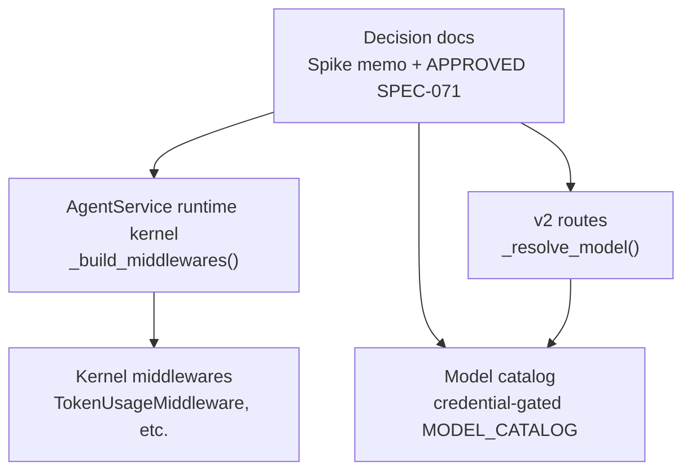
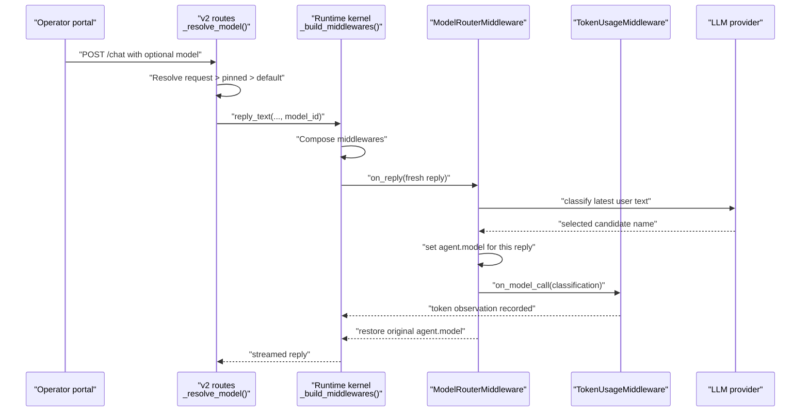
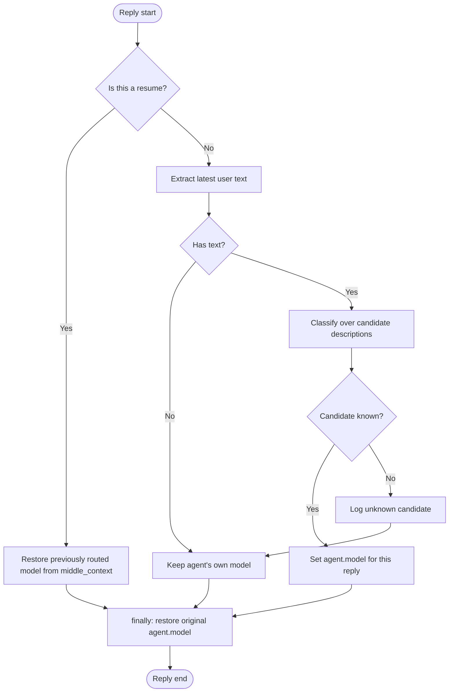
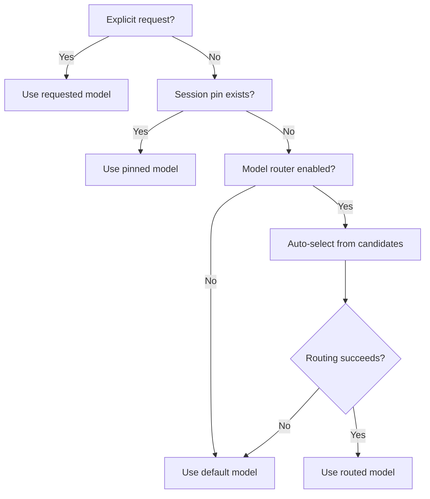
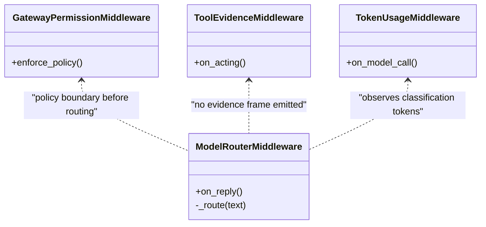
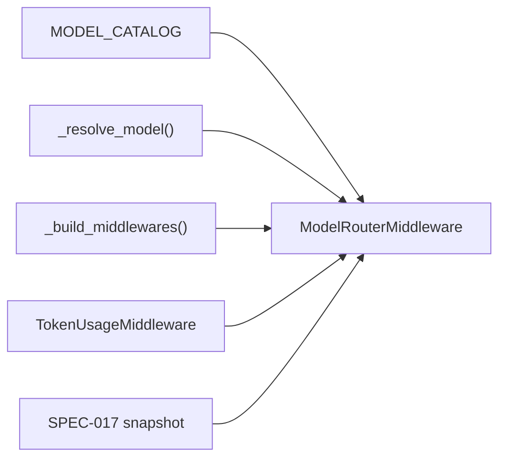

# AgentScope Model Router Spike Assessment

<cite>
**Referenced Files in This Document**   
- [agentscope-model-router-spike.md](file://docs/workspace/agentscope-model-router-spike.md)
- [SPEC-071-agentscope-model-router/spec.md](file://docs/specs/SPEC-071-agentscope-model-router/spec.md)
- [SPEC-071-agentscope-model-router/plan.md](file://docs/specs/SPEC-071-agentscope-model-router/plan.md)
- [SPEC-071-agentscope-model-router/tasks.md](file://docs/specs/SPEC-071-agentscope-model-router/tasks.md)
- [agentscope-utilization-audit.md](file://docs/workspace/agentscope-utilization-audit.md)
- [delivery-roadmap.md](file://docs/agentic-aiops-platform/delivery-roadmap.md)
- [runtime_kernel.py](file://products/agent-platform/src/agent_service/runtime_kernel.py)
- [routes.py](file://products/agent-platform/src/agent_service/api/v2/routes.py)
- [model_catalog.py](file://products/agent-platform/src/agent_service/services/model_catalog.py)
- [kernel_middleware.py](file://products/agent-platform/src/agent_service/services/kernel_middleware.py)
</cite>

## Update Summary
**Changes Made**   
- Updated SPEC-071 status from "draft" to "approved" throughout the document
- Changed language from "assessment-only" to "implementation authorized to begin"
- Updated references to reflect the approved formal specification
- Revised conclusion to reflect that the spike assessment is now complete and the formal spec authorizes implementation
- Updated all sections to reference the approved SPEC-071 rather than treating it as pending approval

## Table of Contents
1. [Introduction](#introduction)
2. [Project Structure](#project-structure)
3. [Core Components](#core-components)
4. [Architecture Overview](#architecture-overview)
5. [Detailed Component Analysis](#detailed-component-analysis)
6. [Dependency Analysis](#dependency-analysis)
7. [Performance Considerations](#performance-considerations)
8. [Troubleshooting Guide](#troubleshooting-guide)
9. [Conclusion](#conclusion)

## Introduction
This document assesses the AgentScope 2.0.9/2.0.10 `ModelRouterMiddleware` and its `classifier` package as a candidate kernel feature for the Luban agent platform. The assessment is grounded in the completed spike memo, the **approved** SPEC-071 formal specification, and the current agent-platform runtime integration at v0.51.1 (agentscope 2.0.11). 

**Updated**: SPEC-071 was approved on 2026-11-01 with all five Open Questions ratified exactly as proposed by the operator. The spike assessment is now complete, and the formal specification authorizes implementation to begin — though it does not authorize merge, commit/push, deployment, version bump, or move to default-on. The critical unresolved items remain precedence reconciliation (`request > pinned > routed > default`), audit attribution of the routed model, routing-accuracy measurement, and operator ratification of the five open questions.

The spike concludes that `ModelRouterMiddleware` clears SPEC-018's four-point adoption gate and recommends opt-in, default-off adoption under SPEC-071. The remaining work is an integration design: reconciling auto-routing precedence with SPEC-024's audited `request > pinned > default` path, ensuring the routed model is attributed in audit, and measuring routing accuracy before enabling by default.

**Section sources**
- [agentscope-model-router-spike.md:1-15](file://docs/workspace/agentscope-model-router-spike.md#L1-L15)
- [SPEC-071-agentscope-model-router/spec.md:1-32](file://docs/specs/SPEC-071-agentscope-model-router/spec.md#L1-L32)

## Project Structure
The assessment spans three layers:

| Layer | Repository location | Role in this assessment |
|---|---|---|
| Decision documentation | `docs/workspace/agentscope-model-router-spike.md`, `docs/specs/SPEC-071-agentscope-model-router/spec.md` | R-1 evaluation, proposed defaults, requirements, and non-goals |
| Formal specification | `docs/specs/SPEC-071-agentscope-model-router/spec.md`, `plan.md`, `tasks.md` | Approved binding requirements for implementation |
| Runtime integration points | `products/agent-platform/src/agent_service/runtime_kernel.py`, `api/v2/routes.py`, `services/model_catalog.py` | Where per-turn model selection, catalog gating, and middleware composition live today |
| Existing middlewares | `products/agent-platform/src/agent_service/services/kernel_middleware.py` | The always-on `TokenUsageMiddleware` and other kernel middlewares against which the router composes |

**Diagram sources**
- [agentscope-model-router-spike.md:11-15](file://docs/workspace/agentscope-model-router-spike.md#L11-L15)
- [SPEC-071-agentscope-model-router/spec.md:46-71](file://docs/specs/SPEC-071-agentscope-model-router/spec.md#L46-L71)
- [runtime_kernel.py:551-590](file://products/agent-platform/src/agent_service/runtime_kernel.py#L551-L590)
- [routes.py:261-285](file://products/agent-platform/src/agent_service/api/v2/routes.py#L261-L285)
- [model_catalog.py:1-29](file://products/agent-platform/src/agent_service/services/model_catalog.py#L1-L29)

**Section sources**
- [agentscope-model-router-spike.md:11-15](file://docs/workspace/agentscope-model-router-spike.md#L11-L15)
- [SPEC-071-agentscope-model-router/spec.md:46-71](file://docs/specs/SPEC-071-agentscope-model-router/spec.md#L46-L71)
- [runtime_kernel.py:551-590](file://products/agent-platform/src/agent_service/runtime_kernel.py#L551-L590)
- [routes.py:261-285](file://products/agent-platform/src/agent_service/api/v2/routes.py#L261-L285)
- [model_catalog.py:1-29](file://products/agent-platform/src/agent_service/services/model_catalog.py#L1-L29)

## Core Components
This section summarizes the components relevant to the model-router assessment without quoting source code.

### AgentScope `ModelRouterMiddleware`
- A kernel `on_reply` middleware that selects one chat model from named candidates for the duration of a single reply.
- Stores the selected candidate in `agent.state.middle_context[reply_id]`, making the decision resume-safe across confirmation park/resume.
- Fails soft: routing exceptions or unknown candidate names log a warning and keep the agent's original model rather than hard-failing the turn.
- Accepts either a dedicated classifier model or a plain `ChatModelBase`. The platform's recommended path uses `generate_structured_output` on an existing catalog model, avoiding new provider dependencies.

### Platform model-selection surface
- `_resolve_model(requested, pinned)` in the v2 routes resolves a turn's model as `request > pinned > default`, failing closed on unknown requested ids.
- `_build_model(model_id)` in the runtime kernel builds an AgentScope model from the credential-gated `MODEL_CATALOG`, preserving deploy-time settings when the active provider matches.
- `_build_middlewares()` composes the kernel middleware stack, including the always-on `TokenUsageMiddleware` and optional middlewares such as tracing and reply budget control.

### Credential-gated model catalog
- `MODEL_CATALOG` derives selectable models from environment-resolved provider credentials.
- Providers without a resolvable API key are dropped; entries are model-name ids.
- Live discovery can swap catalog contents in place while keeping the imported object reference valid.

**Section sources**
- [agentscope-model-router-spike.md:52-107](file://docs/workspace/agentscope-model-router-spike.md#L52-L107)
- [routes.py:261-285](file://products/agent-platform/src/agent_service/api/v2/routes.py#L261-L285)
- [runtime_kernel.py:382-412](file://products/agent-platform/src/agent_service/runtime_kernel.py#L382-L412)
- [runtime_kernel.py:551-590](file://products/agent-platform/src/agent_service/runtime_kernel.py#L551-L590)
- [model_catalog.py:1-29](file://products/agent-platform/src/agent_service/services/model_catalog.py#L1-L29)

## Architecture Overview
At a high level, the model router sits inside the AgentScope runtime kernel as another opt-in middleware. It does not replace the platform's v2 route-level model resolution; instead, it augments the per-reply model selection after an explicit request or pin has been considered.

**Diagram sources**
- [routes.py:291-336](file://products/agent-platform/src/agent_service/api/v2/routes.py#L291-L336)
- [runtime_kernel.py:551-590](file://products/agent-platform/src/agent_service/runtime_kernel.py#L551-L590)
- [agentscope-model-router-spike.md:64-90](file://docs/workspace/agentscope-model-router-spike.md#L64-L90)
- [kernel_middleware.py:829-868](file://products/agent-platform/src/agent_service/services/kernel_middleware.py#L829-L868)

**Section sources**
- [agentscope-model-router-spike.md:64-90](file://docs/workspace/agentscope-model-router-spike.md#L64-L90)
- [routes.py:291-336](file://products/agent-platform/src/agent_service/api/v2/routes.py#L291-L336)
- [runtime_kernel.py:551-590](file://products/agent-platform/src/agent_service/runtime_kernel.py#L551-L590)
- [kernel_middleware.py:829-868](file://products/agent-platform/src/agent_service/services/kernel_middleware.py#L829-L868)

## Detailed Component Analysis

### Four-point adoption-gate scoring
The spike evaluates `ModelRouterMiddleware` against SPEC-018's four adoption gates:

| Gate point | Verdict | Reasoning |
|---|---|---|
| Policy + audit preserved; tool-gateway is the only execution surface | Pass | The middleware selects among configured chat models and executes no tool. It has no gateway tool name, so evidence emission is unaffected. |
| Identity via the delegated token only | Pass | Routing makes no gateway call and introduces no identity edge. The classifier authenticates through the same catalog entry used by the kernel. |
| Read-only operational posture | Pass | It performs model inference but adds no filesystem, sandbox, workspace, mutation, or infrastructure access. |
| No agentscope types leak through the v2 contract | Pass | The routed choice reduces to a model id/name string; no agentscope type crosses the SSE boundary. |

The utilization audit records the same conclusion and promotes the row to "adopt candidate; spike done."

**Section sources**
- [agentscope-model-router-spike.md:47-50](file://docs/workspace/agentscope-model-router-spike.md#L47-L50)
- [agentscope-model-router-spike.md:109-120](file://docs/workspace/agentscope-model-router-spike.md#L109-L120)
- [agentscope-utilization-audit.md:23-45](file://docs/workspace/agentscope-utilization-audit.md#L23-L45)

### Routing mechanism and failure behavior
The middleware operates around a reply lifecycle:

**Diagram sources**
- [agentscope-model-router-spike.md:64-90](file://docs/workspace/agentscope-model-router-spike.md#L64-L90)

Key properties:
- Resume safety: the selected candidate is stored in `middle_context[reply_id]`, covered by the SPEC-017 snapshot.
- Fail soft: classification errors and unknown candidates do not hard-fail the turn.
- Reply-scoped mutation: `agent.model` is restored in a `finally` block.

**Section sources**
- [agentscope-model-router-spike.md:64-90](file://docs/workspace/agentscope-model-router-spike.md#L64-L90)

### Classifier backend and dependency implications
Two classifier backends exist in AgentScope:
- Dedicated classifiers (`OpenAIClassifierModel`, `JevClassifierModel`) tied to specific providers.
- A generic path using a plain `ChatModelBase` with `generate_structured_output`.

The assessment recommends reusing an existing catalog `ChatModelBase` because:
- It avoids adding OpenAI or TypeSafe provider dependencies.
- It uses the same structured-output call already exercised by the threshold compression path.
- It keeps the router aligned with the platform's existing model construction and credential model.

**Section sources**
- [agentscope-model-router-spike.md:92-107](file://docs/workspace/agentscope-model-router-spike.md#L92-L107)
- [SPEC-071-agentscope-model-router/spec.md:65-68](file://docs/specs/SPEC-071-agentscope-model-router/spec.md#L65-L68)

### Precedence reconciliation with SPEC-024
Today, `_resolve_model` implements `request > pinned > default`. The approved SPEC-071 proposes inserting auto-routing between pin and default:

`request > pinned > routed > default`

This preserves human authority:
- An explicit request wins.
- A session pin wins over automatic routing.
- Auto-routing chooses only when neither is present.
- The default remains the fallback.

The routed model must also be attributed in audit as the model actually used, with a `model_selected_by` dimension indicating whether the choice came from request, pin, router, or default.

**Diagram sources**
- [routes.py:261-285](file://products/agent-platform/src/agent_service/api/v2/routes.py#L261-L285)
- [SPEC-071-agentscope-model-router/spec.md:114-117](file://docs/specs/SPEC-071-agentscope-model-router/spec.md#L114-L117)

**Section sources**
- [routes.py:261-285](file://products/agent-platform/src/agent_service/api/v2/routes.py#L261-L285)
- [SPEC-071-agentscope-model-router/spec.md:124-143](file://docs/specs/SPEC-071-agentscope-model-router/spec.md#L124-L143)

### Wiring plan
The approved SPEC-071 mirrors existing opt-in kernel features:
- A default-off knob such as `AGENTSCOPE_MODEL_ROUTER_ENABLED`.
- A router-model id and a candidate map mapping stable names to catalog model ids and selection criteria.
- Registration of `ModelRouterMiddleware` in `_build_middlewares()` only when enabled.
- Reuse of the kernel's existing per-entry model construction for candidates.
- Ordering independence: the router is an `on_reply` middleware and does not change the behavior of permission, evidence, or token-usage middlewares.

**Section sources**
- [agentscope-model-router-spike.md:144-156](file://docs/workspace/agentscope-model-router-spike.md#L144-L156)
- [SPEC-071-agentscope-model-router/spec.md:101-143](file://docs/specs/SPEC-071-agentscope-model-router/spec.md#L101-L143)
- [runtime_kernel.py:551-590](file://products/agent-platform/src/agent_service/runtime_kernel.py#L551-L590)

### Relationship to existing middlewares
The router composes with the existing kernel middleware stack:

**Diagram sources**
- [runtime_kernel.py:551-590](file://products/agent-platform/src/agent_service/runtime_kernel.py#L551-L590)
- [kernel_middleware.py:829-868](file://products/agent-platform/src/agent_service/services/kernel_middleware.py#L829-L868)
- [agentscope-model-router-spike.md:154-165](file://docs/workspace/agentscope-model-router-spike.md#L154-L165)

**Section sources**
- [runtime_kernel.py:551-590](file://products/agent-platform/src/agent_service/runtime_kernel.py#L551-L590)
- [kernel_middleware.py:829-868](file://products/agent-platform/src/agent_service/services/kernel_middleware.py#L829-L868)
- [agentscope-model-router-spike.md:154-165](file://docs/workspace/agentscope-model-router-spike.md#L154-L165)

## Dependency Analysis
The model router depends on existing platform surfaces rather than introducing new ones:

| Dependency | Current role | Impact if router is adopted |
|---|---|---|
| `MODEL_CATALOG` | Provides credential-gated, discoverable model entries | Candidates are drawn from the same gated set; unknown or revoked models cannot be routed to |
| `_resolve_model` | Resolves per-turn model selection | Extended to insert `routed` between `pinned` and `default` |
| `_build_middlewares` | Composes kernel middlewares | Adds one conditional entry when the router knob is enabled |
| `TokenUsageMiddleware` | Observes LLM token usage | Already observes the extra classification call; no new instrumentation needed |
| SPEC-017 snapshot | Persists agent state | Keeps the routed model across confirmation park/resume |

**Diagram sources**
- [model_catalog.py:1-29](file://products/agent-platform/src/agent_service/services/model_catalog.py#L1-L29)
- [routes.py:261-285](file://products/agent-platform/src/agent_service/api/v2/routes.py#L261-L285)
- [runtime_kernel.py:551-590](file://products/agent-platform/src/agent_service/runtime_kernel.py#L551-L590)
- [agentscope-model-router-spike.md:167-171](file://docs/workspace/agentscope-model-router-spike.md#L167-L171)

**Section sources**
- [model_catalog.py:1-29](file://products/agent-platform/src/agent_service/services/model_catalog.py#L1-L29)
- [routes.py:261-285](file://products/agent-platform/src/agent_service/api/v2/routes.py#L261-L285)
- [runtime_kernel.py:551-590](file://products/agent-platform/src/agent_service/runtime_kernel.py#L551-L590)
- [agentscope-model-router-spike.md:167-171](file://docs/workspace/agentscope-model-router-spike.md#L167-L171)

## Performance Considerations
The router adds one extra model call per reply for classification. Its cost characteristics are:

- **Latency:** One additional provider call per reply. The spec recommends measuring added latency against interactive portal expectations.
- **Cost:** Classification tokens are observed by `TokenUsageMiddleware`, so they are measurable through existing metrics rather than hidden.
- **Accuracy:** Routing quality depends on the candidate descriptions provided to the classifier. The spec requires measurement before default-on enablement.
- **Backstop:** Fail-soft behavior bounds worst-case impact to a suboptimal model choice, not a safety breach.

The spec explicitly treats these as measurement-driven, not assumed optimizations.

**Section sources**
- [agentscope-model-router-spike.md:158-165](file://docs/workspace/agentscope-model-router-spike.md#L158-L165)
- [SPEC-071-agentscope-model-router/spec.md:145-159](file://docs/specs/SPEC-071-agentscope-model-router/spec.md#L145-L159)

## Troubleshooting Guide
When evaluating or implementing the model router, the following issues should be checked:

| Symptom | Likely cause | Recommended check |
|---|---|---|
| Router appears inactive | Knob disabled or no candidate map configured | Verify `AGENTSCOPE_MODEL_ROUTER_ENABLED` and candidate configuration |
| Turn falls back to default model | Explicit request or pin present | Confirm precedence is `request > pinned > routed > default` |
| Turn falls back to default model | Routing error or unknown candidate | Inspect warnings logged by the fail-soft path |
| Resume uses a different model than the pre-park turn | `middle_context` not persisted or reply id mismatch | Verify SPEC-017 snapshot persistence and `reply_id` continuity |
| Classification cost is unexpected | Router model is too large or candidate descriptions are misleading | Measure classification tokens and tune candidate descriptions |
| Operator sees a silent downgrade | Routed model is weaker than expected | Surface `model_selected_by` and the routed model in portal and audit |

**Section sources**
- [agentscope-model-router-spike.md:36-38](file://docs/workspace/agentscope-model-router-spike.md#L36-L38)
- [agentscope-model-router-spike.md:173-183](file://docs/workspace/agentscope-model-router-spike.md#L173-L183)
- [SPEC-071-agentscope-model-router/spec.md:124-143](file://docs/specs/SPEC-071-agentscope-model-router/spec.md#L124-L143)

## Conclusion
The AgentScope `ModelRouterMiddleware` is assessed as a low-risk, opt-in kernel extension that fills a gap the platform does not currently cover: automatic per-turn model selection. It clears SPEC-018's four-point adoption gate because it is a model-selection middleware, not a tool-execution surface, and it composes cleanly with the existing credential-gated catalog, audit, and middleware stack.

**Updated**: The spike assessment is now complete, and SPEC-071 has been **approved** (2026-11-01) with all five Open Questions ratified exactly as proposed by the operator. The formal specification authorizes implementation to begin — though it does not authorize merge, commit/push, deployment, version bump, or move to default-on. The critical unresolved items remain precedence reconciliation (`request > pinned > routed > default`), audit attribution of the routed model, routing-accuracy measurement, and operator ratification of the five open questions.

The approved SPEC-071 recommends adoption behind a default-off knob, with target version v0.52.0. The plan and tasks are written and binding, authorizing implementation to begin. Until those requirements are fully implemented and R-3's measurement gate clears, the repository state reflects an approved specification awaiting delivery — not merely assessment-only status.

**Section sources**
- [agentscope-model-router-spike.md:17-25](file://docs/workspace/agentscope-model-router-spike.md#L17-L25)
- [agentscope-model-router-spike.md:184-198](file://docs/workspace/agentscope-model-router-spike.md#L184-L198)
- [SPEC-071-agentscope-model-router/spec.md:175-204](file://docs/specs/SPEC-071-agentscope-model-router/spec.md#L175-L204)
- [SPEC-071-agentscope-model-router/spec.md:232-250](file://docs/specs/SPEC-071-agentscope-model-router/spec.md#L232-L250)
- [SPEC-071-agentscope-model-router/plan.md:1-8](file://docs/specs/SPEC-071-agentscope-model-router/plan.md#L1-L8)
- [SPEC-071-agentscope-model-router/tasks.md:1-9](file://docs/specs/SPEC-071-agentscope-model-router/tasks.md#L1-L9)