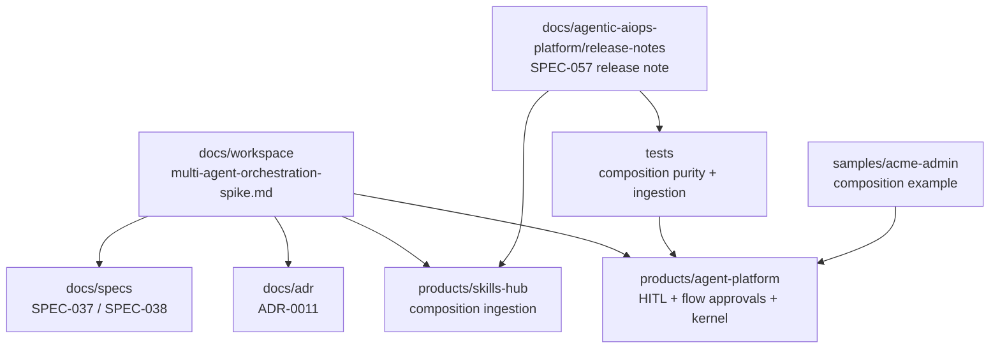
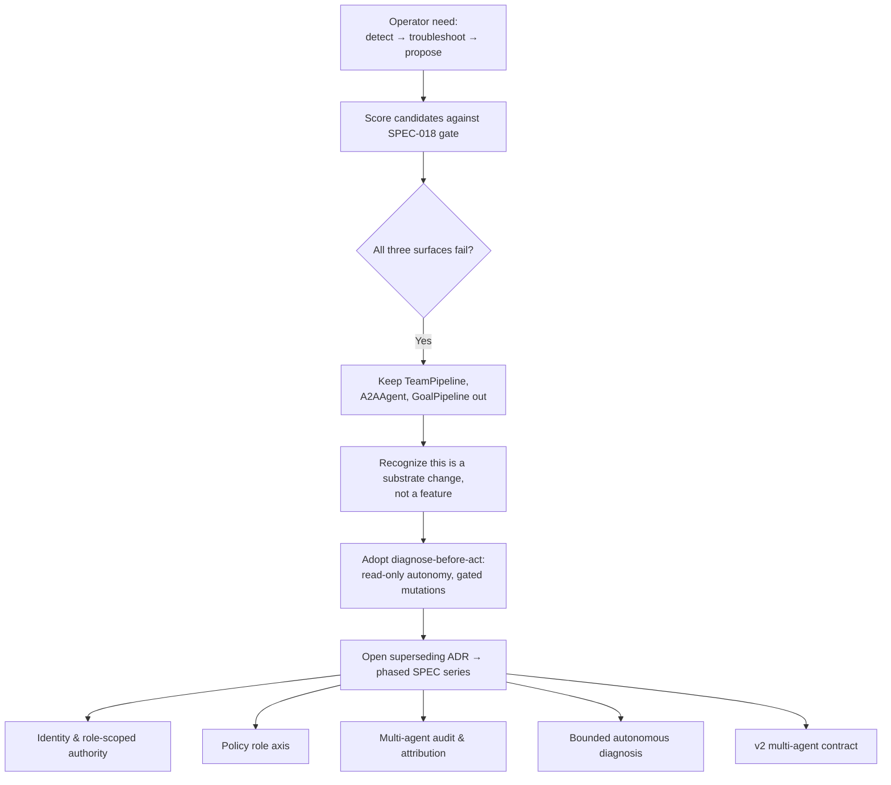
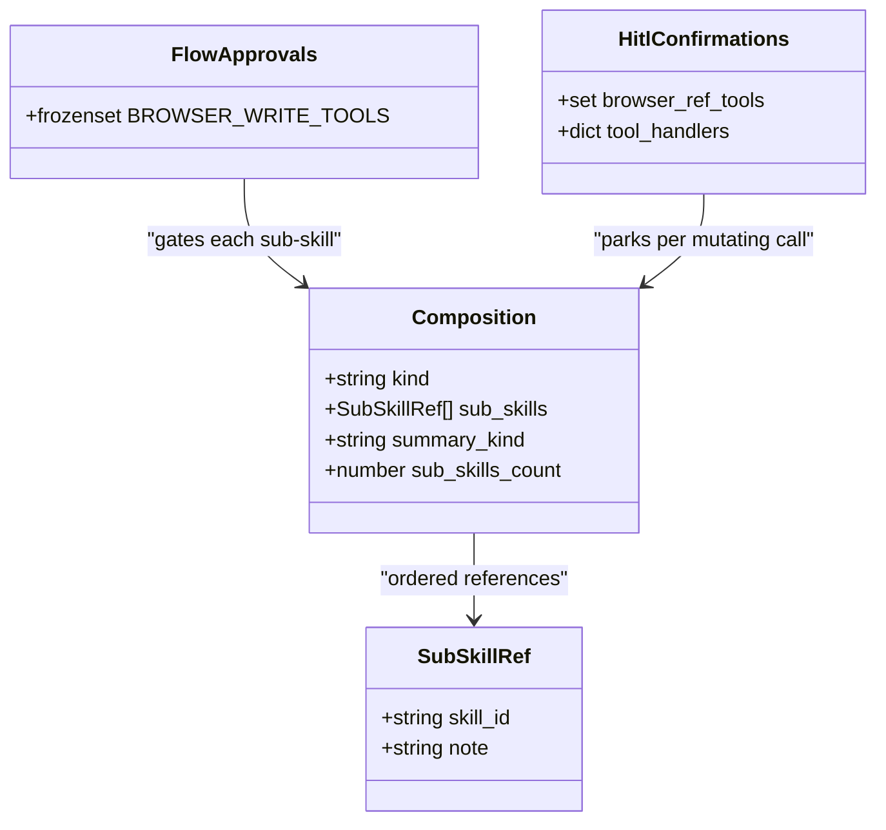
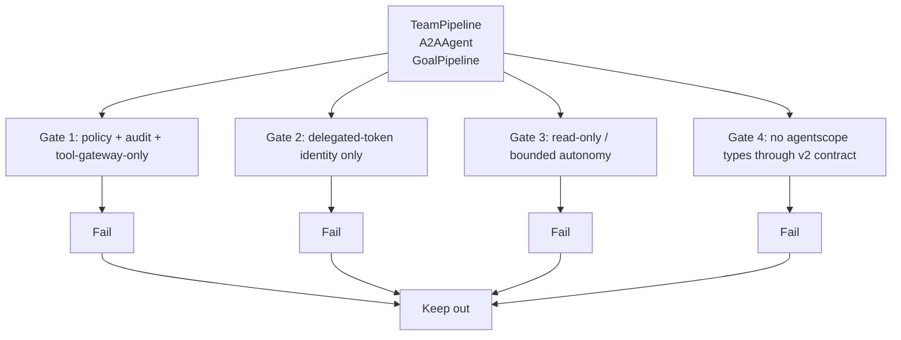
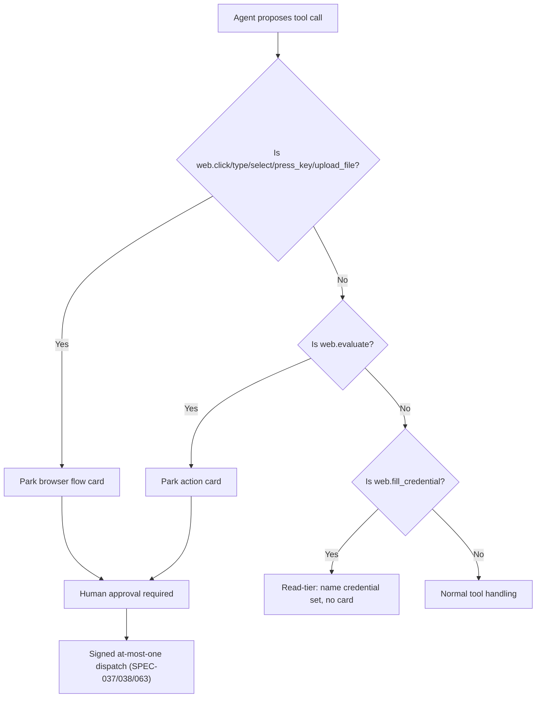
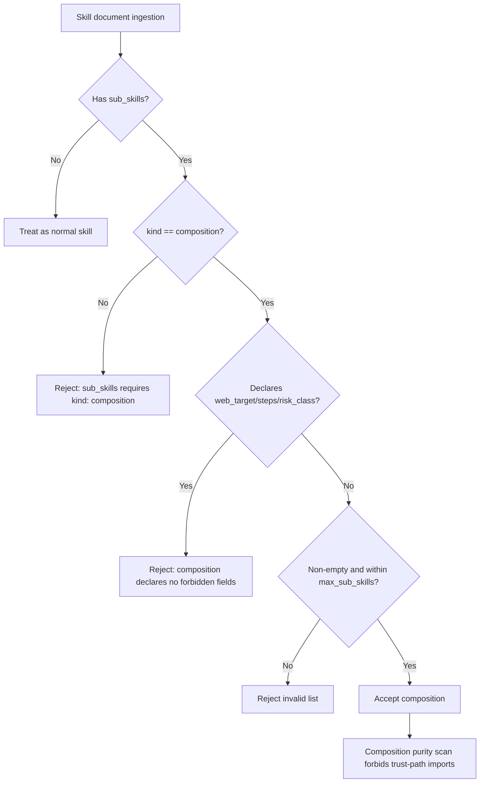
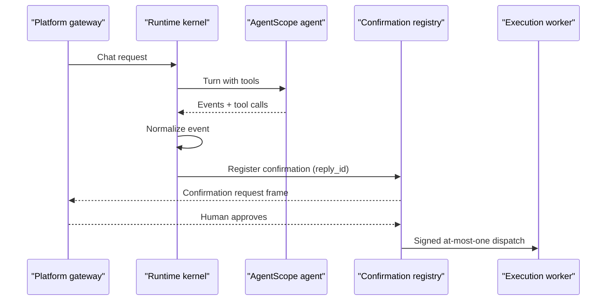
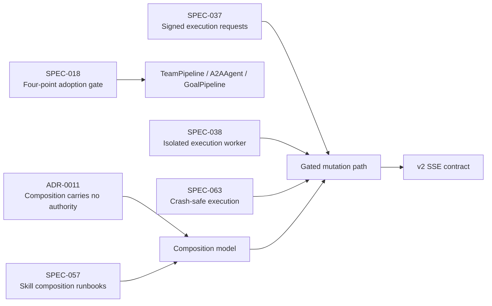

# Multi-Agent Orchestration Spike Assessment

<cite>
**Referenced Files in This Document**   
- [multi-agent-orchestration-spike.md](file://docs/workspace/multi-agent-orchestration-spike.md)
- [0011-composition-carries-no-authority.md](file://docs/adr/0011-composition-carries-no-authority.md)
- [2026-09-20-spec-057-skill-composition-runbooks.md](file://docs/agentic-aiops-platform/release-notes/2026-09-20-spec-057-skill-composition-runbooks.md)
- [flow_approvals.py](file://products/agent-platform/src/agent_service/services/flow_approvals.py)
- [hitl_confirmations.py](file://products/agent-platform/src/agent_service/services/hitl_confirmations.py)
- [runtime_kernel.py](file://products/agent-platform/src/agent_service/runtime_kernel.py)
- [ingestion.py](file://products/skills-hub/src/skills_hub/services/ingestion.py)
- [test_ingestion.py](file://products/skills-hub/tests/test_ingestion.py)
- [test_skill_composition_purity.py](file://products/agent-platform/tests/test_skill_composition_purity.py)
- [RecoverAcmeAccount.md](file://samples/acme-admin/composition/skill/RecoverAcmeAccount.md)
- [SPEC-037-signed-execution-requests/spec.md](file://docs/specs/SPEC-037-signed-execution-requests/spec.md)
- [SPEC-038-isolated-execution-worker/spec.md](file://docs/specs/SPEC-038-isolated-execution-worker/spec.md)
</cite>

## Table of Contents
1. [Introduction](#introduction)
2. [Project Structure](#project-structure)
3. [Core Components](#core-components)
4. [Architecture Overview](#architecture-overview)
5. [Detailed Component Analysis](#detailed-component-analysis)
6. [Dependency Analysis](#dependency-analysis)
7. [Performance Considerations](#performance-considerations)
8. [Troubleshooting Guide](#troubleshooting-guide)
9. [Conclusion](#conclusion)

## Introduction
This document assesses the repository's current state against the operator's named need for multi-agent orchestration and bounded autonomy. It is grounded in a single exploration memo that explicitly frames the problem, scores candidate agentscope surfaces against SPEC-018's four-point adoption gate, and recommends a phased ADR → SPEC path rather than immediate library adoption.

The assessment concludes that:
- The need is legitimate and now named, reopening the `GoalPipeline` condition recorded in SPEC-064 R-1 §3.4.
- None of the three candidate surfaces (`TeamPipeline`, `A2AAgent`, `GoalPipeline`) may be adopted as shipped because all fail every gate point.
- The correct first increment is **diagnose-before-act**: allow read-only autonomous orchestration while keeping every mutation behind the existing HITL confirmation and signed at-most-one-dispatch path.
- Autonomous resolve without a human approver is deferred to a later trust-model decision.

## Project Structure
The relevant material spans documentation, product services, tests, and samples:

**Diagram sources**
- [multi-agent-orchestration-spike.md:1-19](file://docs/workspace/multi-agent-orchestration-spike.md#L1-L19)
- [0011-composition-carries-no-authority.md:1-119](file://docs/adr/0011-composition-carries-no-authority.md#L1-L119)
- [2026-09-20-spec-057-skill-composition-runbooks.md:1-25](file://docs/agentic-aiops-platform/release-notes/2026-09-20-spec-057-skill-composition-runbooks.md#L1-L25)
- [flow_approvals.py:43-53](file://products/agent-platform/src/agent_service/services/flow_approvals.py#L43-L53)
- [hitl_confirmations.py:123-144](file://products/agent-platform/src/agent_service/services/hitl_confirmations.py#L123-L144)
- [runtime_kernel.py:1251-1617](file://products/agent-platform/src/agent_service/runtime_kernel.py#L1251-L1617)
- [ingestion.py:511-545](file://products/skills-hub/src/skills_hub/services/ingestion.py#L511-L545)
- [test_ingestion.py:810-937](file://products/skills-hub/tests/test_ingestion.py#L810-L937)
- [test_skill_composition_purity.py:26-65](file://products/agent-platform/tests/test_skill_composition_purity.py#L26-L65)
- [RecoverAcmeAccount.md:45-74](file://samples/acme-admin/composition/skill/RecoverAcmeAccount.md#L45-L74)
- [SPEC-037-signed-execution-requests/spec.md:24-48](file://docs/specs/SPEC-037-signed-execution-requests/spec.md#L24-L48)
- [SPEC-038-isolated-execution-worker/spec.md:27-56](file://docs/specs/SPEC-038-isolated-execution-worker/spec.md#L27-L56)

**Section sources**
- [multi-agent-orchestration-spike.md:1-19](file://docs/workspace/multi-agent-orchestration-spike.md#L1-L19)

## Core Components
The spike assessment centers on five areas:

| Area | Current state | Relevance to multi-agent orchestration |
|---|---|---|
| Composition model | `kind: composition` with an ordered `sub_skills[]` list; no control flow, no authority, per-sub-skill gates | Shows how Luban currently sequences skills without an interpreter — the baseline any multi-agent design must reconcile with |
| HITL and browser flows | Five ref-taking browser tools plus `web.evaluate`; `web.fill_credential` is read-tier and parks no card | Establishes the exact mutating surface that autonomous orchestration must not bypass |
| Kernel event normalization | One agent turn per v2 SSE frame; confirmation parking uses `reply_id` | Defines the contract boundary that concurrent per-participant parking would break |
| Signed execution path | SPEC-037 signed envelopes and SPEC-038 isolated worker | Provides the only governed mutation dispatch path that autonomous orchestration must reuse |
| Composition purity test | Scans for forbidden vocabulary and trust-path imports | Demonstrates the enforcement discipline any new orchestration substrate must satisfy |

**Section sources**
- [multi-agent-orchestration-spike.md:21-62](file://docs/workspace/multi-agent-orchestration-spike.md#L21-L62)
- [0011-composition-carries-no-authority.md:51-71](file://docs/adr/0011-composition-carries-no-authority.md#L51-L71)
- [flow_approvals.py:43-53](file://products/agent-platform/src/agent_service/services/flow_approvals.py#L43-L53)
- [hitl_confirmations.py:123-144](file://products/agent-platform/src/agent_service/services/hitl_confirmations.py#L123-L144)
- [runtime_kernel.py:1251-1617](file://products/agent-platform/src/agent_service/runtime_kernel.py#L1251-L1617)
- [SPEC-037-signed-execution-requests/spec.md:24-48](file://docs/specs/SPEC-037-signed-execution-requests/spec.md#L24-L48)
- [SPEC-038-isolated-execution-worker/spec.md:27-56](file://docs/specs/SPEC-038-isolated-execution-worker/spec.md#L27-L56)
- [test_skill_composition_purity.py:26-65](file://products/agent-platform/tests/test_skill_composition_purity.py#L26-L65)

## Architecture Overview
The spike frames multi-agent orchestration as a substrate change because it conflicts with ADR-0011's "no control flow" invariant and expands the platform's identity/toolkit surface beyond one session-scoped agent.

**Diagram sources**
- [multi-agent-orchestration-spike.md:32-57](file://docs/workspace/multi-agent-orchestration-spike.md#L32-L57)
- [multi-agent-orchestration-spike.md:64-92](file://docs/workspace/multi-agent-orchestration-spike.md#L64-L92)
- [multi-agent-orchestration-spike.md:153-164](file://docs/workspace/multi-agent-orchestration-spike.md#L153-L164)
- [multi-agent-orchestration-spike.md:227-249](file://docs/workspace/multi-agent-orchestration-spike.md#L227-L249)
- [multi-agent-orchestration-spike.md:271-288](file://docs/workspace/multi-agent-orchestration-spike.md#L271-L288)

## Detailed Component Analysis

### ADR-0011 and the Composition Baseline
ADR-0011 is the pivot for this assessment. Its Decision 3 rejects an interpreter executing composition, noting that loops require an interpreter substrate that does not exist today. A composition is therefore a declarative, ordered list of sub-skill references with no branch, loop, conditional, or early exit. Each sub-skill keeps its own gate.

The release note for SPEC-057 confirms that `kind: composition` was delivered additively: a third skill kind carrying an ordered `sub_skills[]` list, with no new policy action, audit event type, stream-contract change, or database migration beyond one idempotent column addition. The sample composition document reinforces that a composition carries no authority, declares no `web_target` or `steps`, has derived `risk_class`, and has no control flow.

**Diagram sources**
- [0011-composition-carries-no-authority.md:51-71](file://docs/adr/0011-composition-carries-no-authority.md#L51-L71)
- [2026-09-20-spec-057-skill-composition-runbooks.md:1-25](file://docs/agentic-aiops-platform/release-notes/2026-09-20-spec-057-skill-composition-runbooks.md#L1-L25)
- [flow_approvals.py:43-53](file://products/agent-platform/src/agent_service/services/flow_approvals.py#L43-L53)
- [hitl_confirmations.py:123-144](file://products/agent-platform/src/agent_service/services/hitl_confirmations.py#L123-L144)
- [RecoverAcmeAccount.md:45-74](file://samples/acme-admin/composition/skill/RecoverAcmeAccount.md#L45-L74)

**Section sources**
- [0011-composition-carries-no-authority.md:1-119](file://docs/adr/0011-composition-carries-no-authority.md#L1-L119)
- [2026-09-20-spec-057-skill-composition-runbooks.md:1-25](file://docs/agentic-aiops-platform/release-notes/2026-09-20-spec-057-skill-composition-runbooks.md#L1-L25)
- [RecoverAcmeAccount.md:45-74](file://samples/acme-admin/composition/skill/RecoverAcmeAccount.md#L45-L74)

### Candidate Surfaces and Gate Scoring
The spike evaluates three agentscope surfaces:

| Surface | Mechanism | Why it fails the gate |
|---|---|---|
| `TeamPipeline` | Leader agent assigns tasks to member agents; members run concurrently and return summaries | Creates a second orchestration edge; `TeamAssign` is not read-only; member tool calls fall outside the leader transcript unless re-attributed; per-participant parking breaks the single-turn v2 frame |
| `A2AAgent` | Client-side adapter for a remote A2A 1.0 agent | Remote peer owns toolkit/reasoning; Luban cannot enforce deny-by-default policy, delegated-token identity, or read-only posture; introduces an outbound trust edge beside SPEC-070 |
| `GoalPipeline` | Executor runs until verifier passes in a retry loop | Purest form of the ADR-0011-rejected interpreter; autonomous retry loop is a second orchestration edge |

The memo states that all three fail all four gate points as shipped and that none has a governed platform caller today.

**Diagram sources**
- [multi-agent-orchestration-spike.md:94-164](file://docs/workspace/multi-agent-orchestration-spike.md#L94-L164)

**Section sources**
- [multi-agent-orchestration-spike.md:94-164](file://docs/workspace/multi-agent-orchestration-spike.md#L94-L164)

### Browser Tools and Mutation Boundaries
The project-wide author guidelines specify the exact mutation sets:

- `browser_ref_tools` in `hitl_confirmations.py` has exactly five members: `web.click`, `web.type`, `web.select`, `web.press_key`, `web.upload_file`.
- `BROWSER_WRITE_TOOLS` in `flow_approvals.py` has those five plus `web.evaluate`.
- `web.fill_credential` is in neither set and is read-tier; it parks no card and names its credential set.
- `web.evaluate` takes only `expression` and no element `ref`, so it is not a ref-taking tool.

These facts are important because multi-agent orchestration must not create a backdoor around these boundaries. Any autonomous orchestrator may propose mutations, but they must still park on the existing HITL confirmation and dispatch through the signed at-most-one path.

**Diagram sources**
- [flow_approvals.py:43-53](file://products/agent-platform/src/agent_service/services/flow_approvals.py#L43-L53)
- [hitl_confirmations.py:123-144](file://products/agent-platform/src/agent_service/services/hitl_confirmations.py#L123-L144)
- [hitl_confirmations.py:236-236](file://products/agent-platform/src/agent_service/services/hitl_confirmations.py#L236-L236)
- [hitl_confirmations.py:447-453](file://products/agent-platform/src/agent_service/services/hitl_confirmations.py#L447-L453)
- [SPEC-037-signed-execution-requests/spec.md:24-48](file://docs/specs/SPEC-037-signed-execution-requests/spec.md#L24-L48)
- [SPEC-038-isolated-execution-worker/spec.md:27-56](file://docs/specs/SPEC-038-isolated-execution-worker/spec.md#L27-L56)

**Section sources**
- [flow_approvals.py:43-53](file://products/agent-platform/src/agent_service/services/flow_approvals.py#L43-L53)
- [hitl_confirmations.py:123-144](file://products/agent-platform/src/agent_service/services/hitl_confirmations.py#L123-L144)
- [hitl_confirmations.py:236-236](file://products/agent-platform/src/agent_service/services/hitl_confirmations.py#L236-L236)
- [hitl_confirmations.py:447-453](file://products/agent-platform/src/agent_service/services/hitl_confirmations.py#L447-L453)

### Composition Ingestion and Purity Enforcement
Composition validation lives in the skills hub ingestion service. A document with `sub_skills` must declare `kind: composition`; otherwise it is rejected. A composition declares no `web_target`, `steps`, or `risk_class`; its scope is the union of its sub-skills' scopes, and its display risk class is derived at sync. Validation enforces a non-empty list and a maximum size.

The agent-platform composition purity test asserts that compositions must never reach the trust path (`runtime_kernel`, `flow_approvals`, `execution_signing`) and must not import composition vocabulary such as `sub_skills`, `sub_skill`, or `SubSkillRef`. It also forbids progress-store vocabulary, ensuring completed prefixes remain derivable from receipts rather than aggregated composite state.

**Diagram sources**
- [ingestion.py:511-545](file://products/skills-hub/src/skills_hub/services/ingestion.py#L511-L545)
- [test_ingestion.py:810-937](file://products/skills-hub/tests/test_ingestion.py#L810-L937)
- [test_skill_composition_purity.py:26-65](file://products/agent-platform/tests/test_skill_composition_purity.py#L26-L65)

**Section sources**
- [ingestion.py:511-545](file://products/skills-hub/src/skills_hub/services/ingestion.py#L511-L545)
- [test_ingestion.py:810-937](file://products/skills-hub/tests/test_ingestion.py#L810-L937)
- [test_skill_composition_purity.py:26-65](file://products/agent-platform/tests/test_skill_composition_purity.py#L26-L65)

### Kernel Event Normalization and the Single-Turn Contract
The runtime kernel normalizes AgentScope events into normalized stream frames. For mutation paths, it resolves durable run identity, binds the shared in-process guard, and bridges HITL confirmations using `reply_id`. The v2 SSE contract models one agent's turn and one parked confirmation.

The spike notes that `TeamPipeline`'s per-participant parking and streaming would mean multiple agents emit concurrently, which conflicts with the single-turn v2 frame. Any multi-agent framing must either serialize member activity into one voice or introduce a genuine multi-agent frame model, while preserving byte-stability for `agent-stream-event.schema.json`.

**Diagram sources**
- [runtime_kernel.py:1090-1096](file://products/agent-platform/src/agent_service/runtime_kernel.py#L1090-L1096)
- [runtime_kernel.py:1251-1617](file://products/agent-platform/src/agent_service/runtime_kernel.py#L1251-L1617)
- [multi-agent-orchestration-spike.md:217-225](file://docs/workspace/multi-agent-orchestration-spike.md#L217-L225)
- [SPEC-037-signed-execution-requests/spec.md:24-48](file://docs/specs/SPEC-037-signed-execution-requests/spec.md#L24-L48)
- [SPEC-038-isolated-execution-worker/spec.md:27-56](file://docs/specs/SPEC-038-isolated-execution-worker/spec.md#L27-L56)

**Section sources**
- [runtime_kernel.py:1090-1096](file://products/agent-platform/src/agent_service/runtime_kernel.py#L1090-L1096)
- [runtime_kernel.py:1251-1617](file://products/agent-platform/src/agent_service/runtime_kernel.py#L1251-L1617)
- [multi-agent-orchestration-spike.md:217-225](file://docs/workspace/multi-agent-orchestration-spike.md#L217-L225)

## Dependency Analysis
The spike assessment depends on several architectural contracts:

**Diagram sources**
- [0011-composition-carries-no-authority.md:51-71](file://docs/adr/0011-composition-carries-no-authority.md#L51-L71)
- [2026-09-20-spec-057-skill-composition-runbooks.md:1-25](file://docs/agentic-aiops-platform/release-notes/2026-09-20-spec-057-skill-composition-runbooks.md#L1-L25)
- [multi-agent-orchestration-spike.md:59-62](file://docs/workspace/multi-agent-orchestration-spike.md#L59-L62)
- [multi-agent-orchestration-spike.md:84-92](file://docs/workspace/multi-agent-orchestration-spike.md#L84-L92)
- [SPEC-037-signed-execution-requests/spec.md:24-48](file://docs/specs/SPEC-037-signed-execution-requests/spec.md#L24-L48)
- [SPEC-038-isolated-execution-worker/spec.md:27-56](file://docs/specs/SPEC-038-isolated-execution-worker/spec.md#L27-L56)

**Section sources**
- [multi-agent-orchestration-spike.md:59-92](file://docs/workspace/multi-agent-orchestration-spike.md#L59-L92)
- [multi-agent-orchestration-spike.md:271-288](file://docs/workspace/multi-agent-orchestration-spike.md#L271-L288)

## Performance Considerations
This assessment is primarily architectural and contractual rather than performance-oriented. The key performance-related implications are:

- Concurrent member execution in `TeamPipeline` could increase load on downstream systems and complicate audit reconstruction.
- Streaming multiple agents simultaneously risks breaking the single-turn v2 contract, requiring serialization or schema evolution.
- Composition ingestion already bounds `sub_skills` count, providing a natural limit on composition fan-out.
- The isolated execution worker (SPEC-038) separates mutation blast radius from the agent process, improving isolation even if it adds inter-service latency.

[No sources needed since this section provides general guidance]

## Troubleshooting Guide
When evaluating whether a proposed multi-agent pattern violates the current architecture, use these checks:

1. **Does it introduce platform-owned control flow?** If yes, it conflicts with ADR-0011 and requires a superseding ADR.
2. **Does it expand the identity/toolkit surface beyond one session-scoped agent?** If yes, it fails gate point 2.
3. **Does it execute mutations autonomously without a human approver?** If yes, it conflicts with the diagnose-before-act scoping.
4. **Does it leak agentscope types through the v2 contract?** If yes, it fails gate point 4.
5. **Can member activity be reconstructed from evidence/transcript?** If no, it fails audit attribution requirements.

For composition-related issues:
- Verify that `sub_skills` appears only with `kind: composition`.
- Verify that a composition does not declare `web_target`, `steps`, or `risk_class`.
- Verify that composition code does not import `runtime_kernel`, `flow_approvals`, or `execution_signing`.
- Verify that composition progress is not stored as aggregate state.

**Section sources**
- [multi-agent-orchestration-spike.md:94-164](file://docs/workspace/multi-agent-orchestration-spike.md#L94-L164)
- [multi-agent-orchestration-spike.md:196-225](file://docs/workspace/multi-agent-orchestration-spike.md#L196-L225)
- [ingestion.py:511-545](file://products/skills-hub/src/skills_hub/services/ingestion.py#L511-L545)
- [test_skill_composition_purity.py:26-65](file://products/agent-platform/tests/test_skill_composition_purity.py#L26-L65)

## Conclusion
The multi-agent orchestration need is real, named, and worth pursuing, but it is a substrate change rather than a feature. The three candidate agentscope surfaces are kept out because they fail every gate point as shipped. The recommended path is:

1. Open a superseding ADR to ADR-0011 deciding what platform-side control flow is admissible.
2. Deliver phased specs for role-scoped identity, policy role axis, multi-agent audit/attribution, bounded autonomous diagnosis, and the v2 multi-agent contract.
3. Start with diagnose-before-act: autonomous read-only orchestration with every mutation behind the existing HITL and signed dispatch path.
4. Defer autonomous resolve without a human approver to a later trust-model decision.

Until the superseding ADR is accepted, no code wiring, deployment, or library adoption is authorized.

[No sources needed since this section summarizes without analyzing specific files]