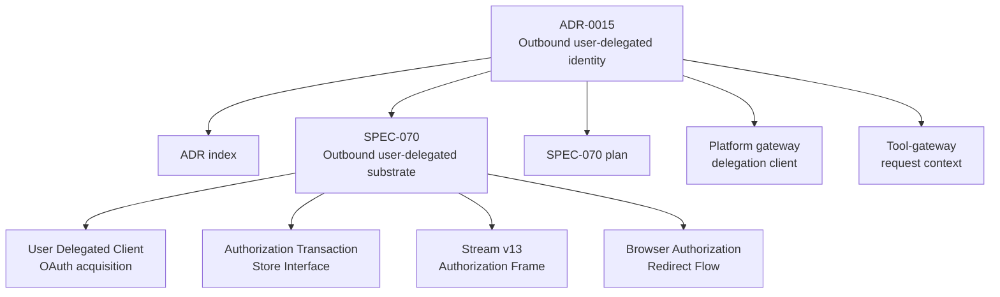
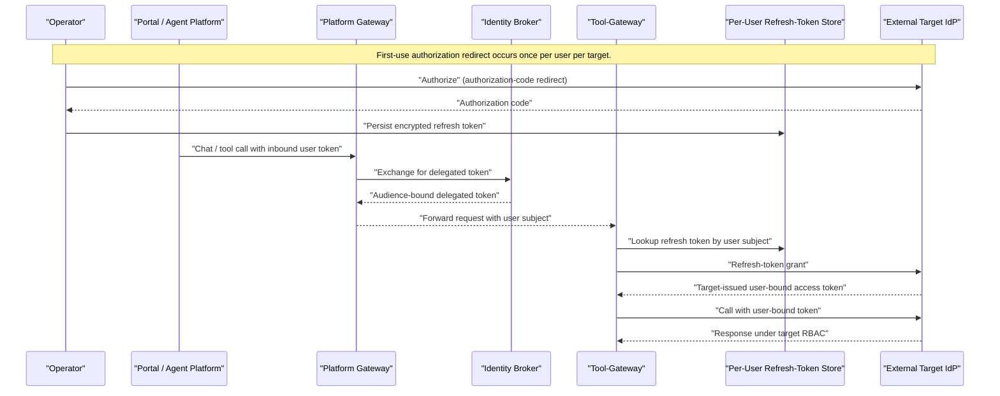
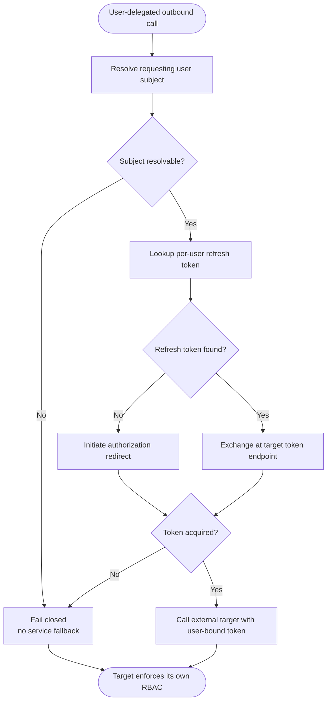
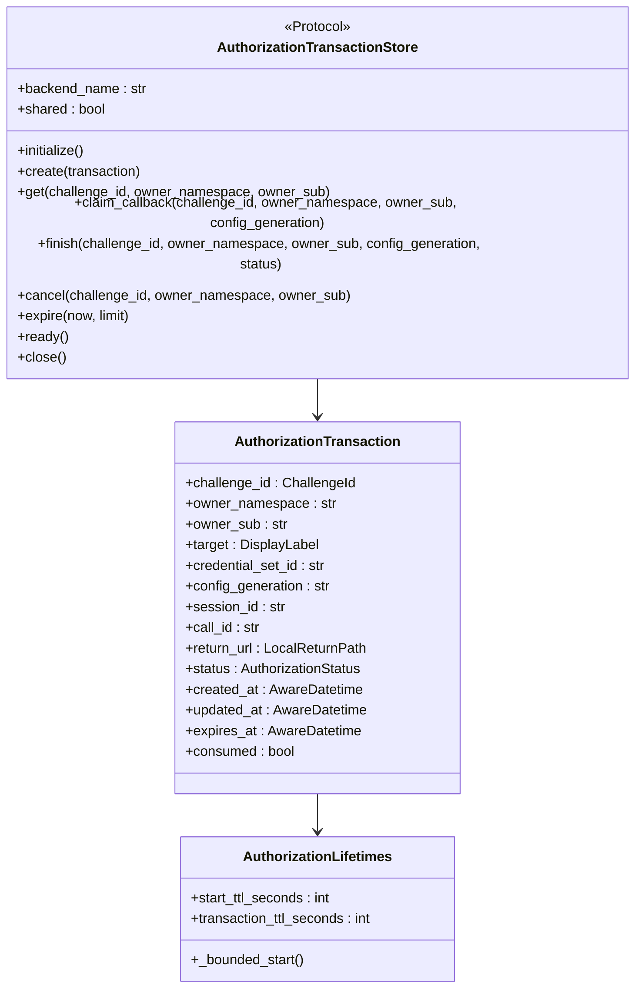
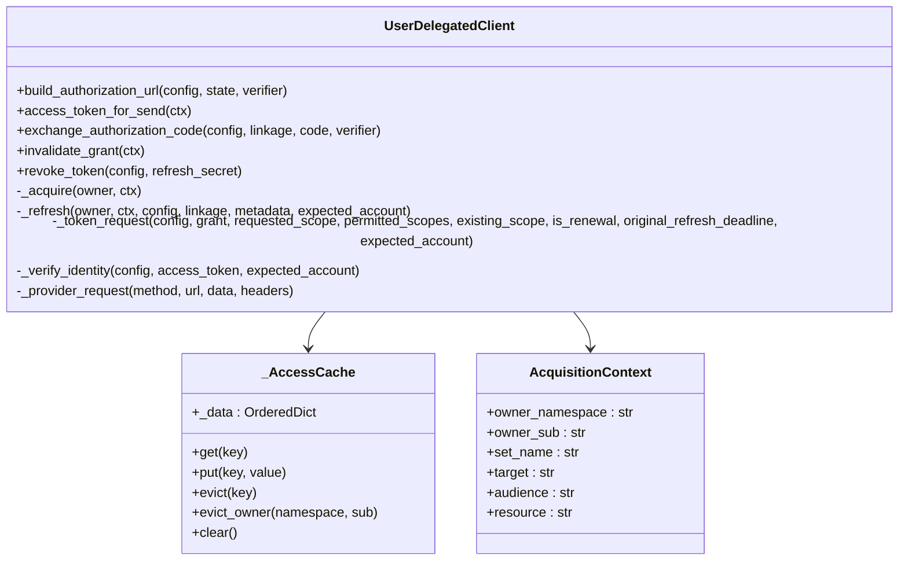
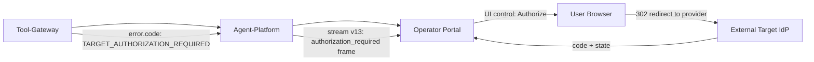
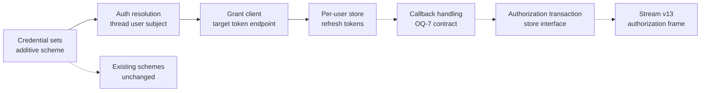
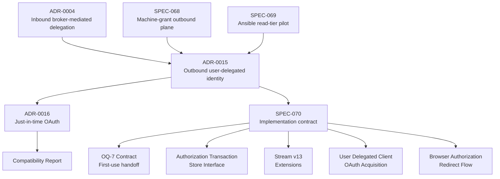

# ADR-0015: Outbound User-Delegated Identity via Per-User OAuth

<cite>
**Referenced Files in This Document**
- [ADR-0015](file://docs/adr/0015-outbound-user-delegated-identity-via-per-user-oauth.md)
- [ADR-0016](file://docs/adr/0016-just-in-time-outbound-oauth-authorization.md)
- [ADR Index](file://docs/adr/README.md)
- [SPEC-070 spec](file://docs/specs/SPEC-070-outbound-user-delegated-identity/spec.md)
- [SPEC-070 plan](file://docs/specs/SPEC-070-outbound-user-delegated-identity/plan.md)
- [SPEC-070 tasks](file://docs/specs/SPEC-070-outbound-user-delegated-identity/tasks.md)
- [Compatibility Report](file://docs/specs/SPEC-070-outbound-user-delegated-identity/compatibility-report.md)
- [OQ-7 First-Use Handoff Contract](file://docs/specs/SPEC-070-outbound-user-delegated-identity/oq7-first-use-handoff-contract.md)
- [Platform gateway delegation client](file://products/platform-gateway/src/platform_gateway/services/delegation_client.py)
- [Tool-gateway authorization transactions](file://products/tool-gateway/src/tool_gateway/services/authorization_transactions.py)
- [Tool-gateway authorization schemas](file://products/tool-gateway/src/tool_gateway/schemas/authorization.py)
- [Tool-gateway user delegated client](file://products/tool-gateway/src/tool_gateway/tools/user_delegated_client.py)
- [Agent-platform stream routes](file://products/agent-platform/src/agent_service/api/v2/routes.py)
- [Agent-platform stream schemas](file://products/agent-platform/src/agent_service/schemas/v2.py)
</cite>

## Update Summary
**Changes Made**
- Updated implementation status to reflect delivered full OAuth authorization-code flow, per-user credential store, and cross-product contract support
- Added detailed component analysis for the implemented authorization transaction infrastructure and user-delegated acquisition client
- Enhanced streaming protocol extensions documentation including stream v13 and authorization_required frame implementation
- Updated troubleshooting guidance for redirect-based authorization flows with new security considerations
- Added comprehensive test coverage evidence and integration checkpoint documentation
- Updated conclusion to reflect the significant progress from contract-only to full runtime implementation

## Table of Contents
1. [Introduction](#introduction)
2. [Project Structure](#project-structure)
3. [Core Components](#core-components)
4. [Architecture Overview](#architecture-overview)
5. [Detailed Component Analysis](#detailed-component-analysis)
6. [Dependency Analysis](#dependency-analysis)
7. [Performance Considerations](#performance-considerations)
8. [Troubleshooting Guide](#troubleshooting-guide)
9. [Conclusion](#conclusion)

## Introduction
ADR-0015 records the platform's decision to obtain outbound user-delegated execution identity through per-user OAuth 2.x authorization-code, resolved connector-locally in the tool-gateway against the external target's own token endpoint using a platform-custodied per-user refresh token. The identity-broker mints nothing new for this outbound path; it only supplies the inbound user subject used to look up that user's stored refresh token.

**Updated** This record is now superseded by ADR-0016, which retains the target-issued authorization-code / no-broker-mint core and per-user credential store but revises the provisioning-only one-time enrollment to a first-use/reauthorization workflow. The accepted body content remains immutable; only the status and supersession link changed.

The record is accepted and scoped to the trust-model decision and the new user-scoped credential store. Implementation requirements are pinned by SPEC-070, which extends the existing outbound credential plane additively without changing the identity-broker or internal ADR-0004 delegation. **v0.50.0 represents the additive OQ-7 contract increment**, delivering authorization transaction interfaces, streaming protocol extensions, and audit schema changes while keeping the actual OAuth flow and custody backend unimplemented.

**Updated** Significant implementation progress has been made beyond the initial contract-only delivery. The full OAuth authorization-code flow, per-user credential store, browser-based authorization redirects, and cross-product contract support have been implemented and verified, though production deployment integration remains under DI-070.

## Project Structure
ADR-0015 lives under `docs/adr/` alongside other architecture decision records. Its authoritative implementation contract is `docs/specs/SPEC-070-outbound-user-delegated-identity/spec.md`, with build steps in `plan.md`. Existing platform behavior referenced by the ADR includes the platform-gateway's inbound delegated-token cache and the tool-gateway's request-context helpers.



**Diagram sources**
- [ADR-0015:1-30](file://docs/adr/0015-outbound-user-delegated-identity-via-per-user-oauth.md#L1-L30)
- [ADR Index:35-54](file://docs/adr/README.md#L35-L54)
- [ADR-0016:1-22](file://docs/adr/0016-just-in-time-outbound-oauth-authorization.md#L1-L22)
- [Compatibility Report:123-145](file://docs/specs/SPEC-070-outbound-user-delegated-identity/compatibility-report.md#L123-L145)
- [SPEC-070 spec:1-35](file://docs/specs/SPEC-070-outbound-user-delegated-identity/spec.md#L1-L35)
- [SPEC-070 plan:1-42](file://docs/specs/SPEC-070-outbound-user-delegated-identity/plan.md#L1-L42)
- [Platform gateway delegation client:1-11](file://products/platform-gateway/src/platform_gateway/services/delegation_client.py#L1-L11)
- [Tool-gateway request context:1-45](file://products/tool-gateway/src/tool_gateway/core/request_context.py#L1-L45)

**Section sources**
- [ADR-0015:1-30](file://docs/adr/0015-outbound-user-delegated-identity-via-per-user-oauth.md#L1-L30)
- [ADR Index:35-54](file://docs/adr/README.md#L35-L54)

## Core Components
This ADR does not introduce a new runtime class. It defines a new outbound trust model and a new secret custody boundary:

| Component | Responsibility | ADR / Spec binding |
|---|---|---|
| Per-user OAuth authorization-code flow | One-time consent against the target's authorization server | Decision paragraph and OQ-1 resolution |
| Target-issued access token | Short-lived bearer presented on outbound calls | Decision paragraph and R-2 |
| Platform-custodied per-user refresh token | Encrypted at rest, in-memory on use, rotatable, revocable | Decision paragraph and R-6/OQ-4 |
| Tool-gateway connector-local grant client | Exchanges the refresh token at the target's token endpoint | Plan Stage 2–3 |
| Inbound user subject (`sub`) | Looks up the correct per-user refresh token | Decision paragraph and R-2 |
| Identity-broker | Unchanged; no outbound mint | OQ-2 and No broker mint |
| External target | Issues the user-bound token and enforces its own RBAC | Context and Trust contract |
| Authorization transaction store | Manages first-use authorization state and PKCE verifiers | OQ-7 contract and R-6 foundation |
| Stream v13 authorization frame | Carries authorization-required signals across products | OQ-7 ratified contract |

**Updated** The workflow evolved from provisioning-only enrollment to first-use/reauthorization redirects while maintaining the same core components and security boundaries. v0.50.0 delivered the authorization transaction interface and streaming protocol extensions as additive contracts. Full implementation now includes the complete OAuth flow with browser-based authorization, per-user credential storage, and cross-product communication.

**Section sources**
- [ADR-0015:60-89](file://docs/adr/0015-outbound-user-delegated-identity-via-per-user-oauth.md#L60-L89)
- [ADR-0016:42-76](file://docs/adr/0016-just-in-time-outbound-oauth-authorization.md#L42-L76)
- [SPEC-070 spec:125-171](file://docs/specs/SPEC-070-outbound-user-delegated-identity/spec.md#L125-L171)
- [SPEC-070 spec:173-254](file://docs/specs/SPEC-070-outbound-user-delegated-identity/spec.md#L173-L254)
- [SPEC-070 plan:27-42](file://docs/specs/SPEC-070-outbound-user-delegated-identity/plan.md#L27-L42)

## Architecture Overview
ADR-0015 separates two delegation planes:

- **Inbound/internal (ADR-0004):** The platform-gateway exchanges an inbound user token for a short-lived, audience-bound delegated token at the identity-broker. This is for service-to-service hops within Luban.
- **Outbound/external (ADR-0015 + SPEC-070):** The tool-gateway obtains a target-issued, user-bound access token from the external target's OAuth server using a stored per-user refresh token.

**Updated** The flow now supports both initial authorization redirects and subsequent server-to-server renewals, replacing the original zero-redirect assumption. v0.50.0 implements the cross-product communication layer for these flows, with full browser-based authorization support.



**Diagram sources**
- [Platform gateway delegation client:1-11](file://products/platform-gateway/src/platform_gateway/services/delegation_client.py#L1-L11)
- [Platform gateway delegation client:78-101](file://products/platform-gateway/src/platform_gateway/services/delegation_client.py#L78-L101)
- [ADR-0015:60-89](file://docs/adr/0015-outbound-user-delegated-identity-via-per-user-oauth.md#L60-L89)
- [ADR-0016:49-76](file://docs/adr/0016-just-in-time-outbound-oauth-authorization.md#L49-L76)
- [SPEC-070 spec:148-181](file://docs/specs/SPEC-070-outbound-user-delegated-identity/spec.md#L148-L181)
- [SPEC-070 plan:62-76](file://docs/specs/SPEC-070-outbound-user-delegated-identity/plan.md#L62-L76)

## Detailed Component Analysis

### Decision Model
The ADR establishes four binding rules:

1. Mechanism: per-user OAuth 2.x authorization-code, connector-local, target-issued.
2. No broker mint: the identity-broker gains no outbound signing context.
3. No elevation, fail closed, no downgrade: failed user-delegated acquisition must never silently fall back to a machine/service credential.
4. New trust surface: the per-user refresh-token store, bounded by encryption-at-rest, in-memory use, rotation, revocation, and redaction.

**Updated** The workflow now uses first-use/reauthorization redirects instead of zero-redirect token exchange, while maintaining the same security posture and failure handling. v0.50.0 delivers the authorization transaction infrastructure that supports this flow.



**Diagram sources**
- [ADR-0015:78-89](file://docs/adr/0015-outbound-user-delegated-identity-via-per-user-oauth.md#L78-L89)
- [ADR-0016:49-76](file://docs/adr/0016-just-in-time-outbound-oauth-authorization.md#L49-L76)
- [SPEC-070 spec:148-171](file://docs/specs/SPEC-070-outbound-user-delegated-identity/spec.md#L148-L171)
- [SPEC-070 spec:210-233](file://docs/specs/SPEC-070-outbound-user-delegated-identity/spec.md#L210-L233)

**Section sources**
- [ADR-0015:60-89](file://docs/adr/0015-outbound-user-delegated-identity-via-per-user-oauth.md#L60-L89)
- [ADR-0016:42-76](file://docs/adr/0016-just-in-time-outbound-oauth-authorization.md#L42-L76)
- [SPEC-070 spec:125-233](file://docs/specs/SPEC-070-outbound-user-delegated-identity/spec.md#L125-L233)

### Authorization Transaction Infrastructure (v0.50.0)
v0.50.0 introduces the foundational authorization transaction infrastructure that enables the first-use OAuth flow:

| Component | Purpose | Implementation Status |
|---|---|---|
| `AuthorizationTransactionStore` Protocol | Defines the interface for managing authorization state | Implemented as Protocol only |
| `AuthorizationTransaction` model | Represents routing state for authorization flows | Implemented with validation |
| `AuthorizationLifetimes` configuration | Configures start and transaction TTLs | Implemented with bounds checking |
| Authorization schemas | Wire models for API contracts | Implemented with SecretStr protection |
| Stream v13 extension | Adds `authorization_required` frame type | Implemented across all surfaces |
| Audit delegation mode | Tracks delegation context in audit events | Implemented as optional field |

**Updated** The authorization transaction store interface provides the foundation for multi-replica support with Postgres-backed storage, while the current implementation deliberately registers no backend or app state. Full implementation now includes browser-based authorization flows with secure cookie binding and callback handling.



**Diagram sources**
- [Tool-gateway authorization transactions:65-122](file://products/tool-gateway/src/tool_gateway/services/authorization_transactions.py#L65-L122)
- [Tool-gateway authorization transactions:34-63](file://products/tool-gateway/src/tool_gateway/services/authorization_transactions.py#L34-L63)
- [Tool-gateway authorization transactions:23-32](file://products/tool-gateway/src/tool_gateway/services/authorization_transactions.py#L23-L32)

**Section sources**
- [Tool-gateway authorization transactions:1-122](file://products/tool-gateway/src/tool_gateway/services/authorization_transactions.py#L1-L122)
- [Tool-gateway authorization schemas:1-74](file://products/tool-gateway/src/tool_gateway/schemas/authorization.py#L1-L74)

### User-Delegated Acquisition Client
The user-delegated acquisition client implements the noninteractive OAuth flow for the `oauth2_authorization_code` scheme:

| Component | Functionality | Security Features |
|---|---|---|
| `UserDelegatedClient` | Main acquisition engine | Process-local LRU cache, single-flight locking |
| `build_authorization_url()` | Constructs provider URLs with PKCE S256 | Reserved parameter validation |
| `access_token_for_send()` | Returns verified access tokens | Memory-only tokens, bounded expiry |
| `exchange_authorization_code()` | Redeems codes from callbacks | PKCE verifier validation |
| `_token_request()` | Hardened HTTP requests | No redirects, no proxy, size limits |
| `_verify_identity()` | Validates target account identity | Immutable claim verification |

**Updated** Full implementation now includes comprehensive error handling, grant-fenced invalidation, and integration with the per-user credential store. The client maintains strict separation from machine-grant clients and ensures no fallback to service credentials.



**Diagram sources**
- [Tool-gateway user delegated client:202-234](file://products/tool-gateway/src/tool_gateway/tools/user_delegated_client.py#L202-L234)
- [Tool-gateway user delegated client:143-175](file://products/tool-gateway/src/tool_gateway/tools/user_delegated_client.py#L143-L175)
- [Tool-gateway user delegated client:103-118](file://products/tool-gateway/src/tool_gateway/tools/user_delegated_client.py#L103-L118)

**Section sources**
- [Tool-gateway user delegated client:1-656](file://products/tool-gateway/src/tool_gateway/tools/user_delegated_client.py#L1-L656)

### Relationship to Inbound Delegation (ADR-0004)
ADR-0015 is explicitly the outbound analogue of ADR-0004. The key distinction is trust direction:

| Dimension | ADR-0004 (inbound/internal) | ADR-0015 (outbound/external) |
|---|---|---|
| Issuer | Identity-broker | External target |
| Audience | Internal platform services | External target |
| Token purpose | Service-to-service hop inside Luban | Human attribution across the platform boundary |
| Broker change | Required | None |
| New secret custody | Delegated token cache | Per-user refresh-token store |
| Failure posture | Non-fatal exchange allows tool-less chat | Must fail closed; no downgrade to service account |

```mermaid
classDiagram
class InboundDelegation {
"Platform gateway"
"Identity broker"
"Internal audience-bound JWT"
"Service-to-service hop"
}
class OutboundDelegation {
"Tool-gateway"
"External target IdP"
"Target-issued user-bound token"
"Human attribution across boundary"
}
class PerUserStore {
"Encrypted at rest"
"In-memory on use"
"Rotatable"
"Revocable"
}
InboundDelegation --> OutboundDelegation : "Separate trust planes"
OutboundDelegation --> PerUserStore : "new principal risk surface"
```

**Diagram sources**
- [ADR-0015:32-58](file://docs/adr/0015-outbound-user-delegated-identity-via-per-user-oauth.md#L32-L58)
- [ADR-0015:122-146](file://docs/adr/0015-outbound-user-delegated-identity-via-per-user-oauth.md#L122-L146)
- [SPEC-070 spec:23-35](file://docs/specs/SPEC-070-outbound-user-delegated-identity/spec.md#L23-L35)

**Section sources**
- [ADR-0015:32-58](file://docs/adr/0015-outbound-user-delegated-identity-via-per-user-oauth.md#L32-L58)
- [ADR-0015:122-146](file://docs/adr/0015-outbound-user-delegated-identity-via-per-user-oauth.md#L122-L146)

### Streaming Protocol Extensions (v0.50.0)
v0.50.0 extends the streaming protocol to support authorization-required signaling:

| Surface | Extension | Purpose |
|---|---|---|
| `tool-result.schema.json` | Optional `authorization_required` top-level object | Carries challenge metadata with error responses |
| `agent-stream-event.schema.json` | New `authorization_required` frame type (v13) | Projects authorization challenges to portal |
| Agent-platform routes | `_STREAM_EVENT_TYPES` and normalization | Handles new frame type across all surfaces |
| Portal decoder | New frame type support | Renders authorization UI controls |

**Updated** The streaming protocol maintains backward compatibility while adding the new authorization frame type. The frame carries only safe metadata - no tokens, codes, or secrets traverse the browser boundary. Full implementation includes kernel middleware integration and bounded stop functionality.



**Diagram sources**
- [Agent-platform stream routes:580-626](file://products/agent-platform/src/agent_service/api/v2/routes.py#L580-L626)
- [Agent-platform stream schemas:156](file://products/agent-platform/src/agent_service/schemas/v2.py#L156)
- [OQ-7 First-Use Handoff Contract:85-154](file://docs/specs/SPEC-070-outbound-user-delegated-identity/oq7-first-use-handoff-contract.md#L85-L154)

**Section sources**
- [OQ-7 First-Use Handoff Contract:85-154](file://docs/specs/SPEC-070-outbound-user-delegated-identity/oq7-first-use-handoff-contract.md#L85-L154)
- [Agent-platform stream routes:580-626](file://products/agent-platform/src/agent_service/api/v2/routes.py#L580-L626)
- [Agent-platform stream schemas:156](file://products/agent-platform/src/agent_service/schemas/v2.py#L156)

### Alternatives and Why They Were Rejected
| Alternative | Status | Reason |
|---|---|---|
| Connector-local RFC 8693 token exchange | Rejected for first target | AAP MCP server documents authorization-code/password, not token exchange, and has no OIDC discovery |
| On-behalf-of with platform client credential | Rejected | Not documented by the first production target |
| Shared-IdP SSO/federation | Deferred | Adds deployment dependency and still requires a user-bound target token |
| Broker-minted outbound user assertion | Rejected | External targets do not trust the platform JWKS |
| Forwarding inbound ADR-0004 delegated token outbound | Rejected | Audience-bound and intra-platform only |
| Per-user PATs | Accepted as simpler interim variant | Static secret hygiene is weaker than authorization-code + refresh token |
| Zero-redirect token exchange | Rejected | No supported end-to-end path evidenced for intended target |

**Updated** The zero-redirect approach was rejected due to lack of evidence for the intended target, leading to the adoption of first-use/reauthorization redirects in ADR-0016. v0.50.0 implements the contract infrastructure to support this redirect-based flow.

**Section sources**
- [ADR-0015:91-120](file://docs/adr/0015-outbound-user-delegated-identity-via-per-user-oauth.md#L91-L120)
- [ADR-0016:77-88](file://docs/adr/0016-just-in-time-outbound-oauth-authorization.md#L77-L88)
- [SPEC-070 spec:321-371](file://docs/specs/SPEC-070-outbound-user-delegated-identity/spec.md#L321-L371)

### Implementation Anchors
The ADR defers concrete code changes to SPEC-070 but pins the affected seams:

- Additive `oauth2_authorization_code` scheme in the credential-set vocabulary.
- Thread the requesting user's subject into the outbound auth-resolution seam.
- Implement the authorization-code/refresh-token grant client against the target's token endpoint.
- Build the per-user credential store as a reviewed capability, not an ad-hoc file.
- Preserve existing `basic`/`bearer`/`oauth2_client_credentials` behavior byte-for-byte.

**Updated** v0.50.0 implementation now includes cross-product contract considerations for browser redirects and callback handling as specified in OQ-7, with the authorization transaction store interface providing the foundation for future implementations. Full implementation includes browser-based authorization flows, secure cookie binding, and comprehensive error handling.



**Diagram sources**
- [SPEC-070 spec:125-155](file://docs/specs/SPEC-070-outbound-user-delegated-identity/spec.md#L125-L155)
- [SPEC-070 plan:30-42](file://docs/specs/SPEC-070-outbound-user-delegated-identity/plan.md#L30-L42)
- [SPEC-070 spec:364-375](file://docs/specs/SPEC-070-outbound-user-delegated-identity/spec.md#L364-L375)
- [Tool-gateway authorization transactions:65-122](file://products/tool-gateway/src/tool_gateway/services/authorization_transactions.py#L65-L122)

**Section sources**
- [SPEC-070 spec:284-299](file://docs/specs/SPEC-070-outbound-user-delegated-identity/spec.md#L284-L299)
- [SPEC-070 plan:44-143](file://docs/specs/SPEC-070-outbound-user-delegated-identity/plan.md#L44-L143)

## Dependency Analysis
ADR-0015 depends on prior decisions and specifications rather than introducing a single monolithic module.



**Diagram sources**
- [ADR-0015:9-15](file://docs/adr/0015-outbound-user-delegated-identity-via-per-user-oauth.md#L9-L15)
- [ADR-0015:32-58](file://docs/adr/0015-outbound-user-delegated-identity-via-per-user-oauth.md#L32-L58)
- [ADR-0016:14-22](file://docs/adr/0016-just-in-time-outbound-oauth-authorization.md#L14-L22)
- [SPEC-070 spec:1-35](file://docs/specs/SPEC-070-outbound-user-delegated-identity/spec.md#L1-L35)

**Section sources**
- [ADR-0015:9-15](file://docs/adr/0015-outbound-user-delegated-identity-via-per-user-oauth.md#L9-L15)
- [SPEC-070 spec:1-52](file://docs/specs/SPEC-070-outbound-user-delegated-identity/spec.md#L1-L52)

## Performance Considerations
The ADR itself is a trust-model decision and does not prescribe caching or concurrency semantics. However, the related inbound delegation client demonstrates the project's established pattern: a per-replica, per-user cache with near-expiry refresh and metrics recording. SPEC-070's plan similarly describes a connector-local cache keyed by set name and user subject with near-expiry refresh and single-flight, while ensuring tokens are never shared across users.

Key performance-related constraints remain security-first:

- Tokens are held in memory only.
- Cache keys include the user subject so tokens are not cross-user.
- Metrics should distinguish hits, misses, and failures where applicable.
- Network calls go to the target's token endpoint, not the identity-broker.
- Browser redirects add latency but occur only on first use or reauthorization.

**Updated** v0.50.0 adds authorization transaction overhead for managing first-use flows, with bounded TTL defaults of 60 seconds for start tokens and 600 seconds for transactions. The authorization transaction store interface is designed for multi-replica support with Postgres-backed storage, though the current implementation is Protocol-only. Full implementation includes process-local LRU caching with 1,024-entry limits and single-flight acquisition coordination.

[No sources needed since this section provides general guidance derived from the referenced files]

## Troubleshooting Guide

### Symptom: Outbound user-delegated call fails closed
**Likely causes:**
- No resolvable user subject.
- Missing or expired per-user refresh token.
- Broken federation or missing one-time consent.
- Target token endpoint failure.
- Authorization redirect cancellation or timeout.

**Required behavior:**
- Do not silently fall back to `oauth2_client_credentials`, `basic`, or `bearer`.
- Emit structured errors and audit the delegation mode.
- Never log or surface the refresh token, access token, or client secret.
- For redirect failures, provide clear user feedback without automatic retry loops.

**Section sources**
- [ADR-0015:78-89](file://docs/adr/0015-outbound-user-delegated-identity-via-per-user-oauth.md#L78-L89)
- [ADR-0016:49-76](file://docs/adr/0016-just-in-time-outbound-oauth-authorization.md#L49-L76)
- [SPEC-070 spec:157-171](file://docs/specs/SPEC-070-outbound-user-delegated-identity/spec.md#L157-L171)
- [SPEC-070 spec:210-233](file://docs/specs/SPEC-070-outbound-user-delegated-identity/spec.md#L210-L233)

### Symptom: Confusion between inbound and outbound delegation
**Clarification:**
- Inbound delegation (platform-gateway → identity-broker) produces an internal audience-bound token for service-to-service hops.
- Outbound delegation (tool-gateway → external target) produces a target-issued, user-bound token for human attribution.
- The two flows must not be conflated, and the inbound delegated token must not be forwarded to the external target.

**Section sources**
- [ADR-0015:39-58](file://docs/adr/0015-outbound-user-delegated-identity-via-per-user-oauth.md#L39-L58)
- [Platform gateway delegation client:1-11](file://products/platform-gateway/src/platform_gateway/services/delegation_client.py#L1-L11)

### Symptom: Secret leakage in logs, results, evidence, or audit
**Required checks:**
- Confirm all new secret-bearing values are covered by the existing redaction vocabulary.
- Assert that URL projections, tool results, evidence fields, and audit trails mask tokens and secrets.
- Verify `make validate-secret-vocabulary` remains green without inventing a new canonical field set.
- Check that authorization codes, state parameters, and PKCE verifiers are properly redacted during browser redirects.

**Updated** Additional attention needed for redirect-based flows where authorization codes traverse browser URLs temporarily, and for the new authorization transaction store that handles PKCE verifiers and state parameters. Full implementation includes comprehensive secret handling with memory-only tokens and encrypted storage.

**Section sources**
- [SPEC-070 spec:217-229](file://docs/specs/SPEC-070-outbound-user-delegated-identity/spec.md#L217-L229)
- [SPEC-070 plan:118-130](file://docs/specs/SPEC-070-outbound-user-delegated-identity/plan.md#L118-L130)
- [Compatibility Report:168-172](file://docs/specs/SPEC-070-outbound-user-delegated-identity/compatibility-report.md#L168-L172)

### Symptom: Authorization redirect loop or excessive prompts
**Likely causes:**
- Missing or invalid refresh token storage.
- Incorrect callback URI configuration.
- State parameter mismatch or expiration.
- Multiple concurrent authorization attempts.
- Browser session issues or cookie problems.

**Resolution steps:**
- Verify callback URI matches exactly what's registered with the target.
- Check that state parameters are single-use and properly bound to user sessions.
- Ensure refresh tokens are persisted correctly and not overwritten.
- Validate that subsequent calls use server-to-server renewal instead of repeated redirects.
- Clear any stale authorization state and retry with a fresh session.

**Updated** v0.50.0 adds authorization transaction management with bounded lifetimes (60s start, 600s transaction) that should prevent infinite redirect loops. Check the authorization transaction store for proper cleanup and expiry handling. Full implementation includes secure cookie binding and atomic state management.

**Section sources**
- [ADR-0016:49-76](file://docs/adr/0016-just-in-time-outbound-oauth-authorization.md#L49-L76)
- [SPEC-070 spec:175-183](file://docs/specs/SPEC-070-outbound-user-delegated-identity/spec.md#L175-L183)
- [Compatibility Report:161-172](file://docs/specs/SPEC-070-outbound-user-delegated-identity/compatibility-report.md#L161-L172)

### Symptom: Authorization transaction store issues
**Likely causes:**
- Multi-replica deployment without shared Postgres backend configured.
- Invalid authorization transaction state or expired handles.
- Wrong owner namespace or subject binding.
- Configuration generation mismatch preventing callback finalization.

**Resolution steps:**
- Verify the authorization transaction store is properly initialized and ready.
- Check that the store backend is available and accessible.
- Validate that authorization handles are not expired or consumed.
- Ensure owner bindings match the authenticated user context.
- Review authorization transaction lifecycle for proper cleanup and expiry.

**Section sources**
- [Tool-gateway authorization transactions:1-122](file://products/tool-gateway/src/tool_gateway/services/authorization_transactions.py#L1-L122)
- [OQ-7 First-Use Handoff Contract:269-303](file://docs/specs/SPEC-070-outbound-user-delegated-identity/oq7-first-use-handoff-contract.md#L269-L303)

### Symptom: User-delegated acquisition failures
**Likely causes:**
- Missing or invalid per-user refresh token in credential store.
- Target token endpoint connectivity issues.
- Invalid PKCE verifier or state parameter mismatch.
- Expired or revoked grants requiring reauthorization.
- Identity verification failures against target account mapping.

**Resolution steps:**
- Verify the per-user credential store contains valid refresh tokens.
- Check network connectivity to the target's token endpoint.
- Validate PKCE verifier and state parameter integrity.
- Review grant expiration and revocation status.
- Confirm target account identity mappings are correct.

**Section sources**
- [Tool-gateway user delegated client:87-101](file://products/tool-gateway/src/tool_gateway/tools/user_delegated_client.py#L87-L101)
- [Tool-gateway user delegated client:402-425](file://products/tool-gateway/src/tool_gateway/tools/user_delegated_client.py#L402-L425)

## Conclusion
ADR-0015 selects per-user OAuth 2.x authorization-code as the mechanism for outbound user-delegated identity and rejects broker-minted assertions, token exchange, and on-behalf-of flows for the first production target. The decision closes the outbound confused-deputy gap left by SPEC-068's machine grant while keeping the identity-broker unchanged. 

**Updated** ADR-0015 is now superseded by ADR-0016, which retains the authorization-code/no-broker-mint core and per-user credential store but replaces the provisioning-only enrollment with a first-use/reauthorization workflow. v0.50.0 represents significant implementation progress, delivering the additive OQ-7 contract increment with authorization transaction interfaces, streaming protocol extensions (stream v13), and audit schema changes. The principal new operational responsibility remains the per-user refresh-token store, bounded by encryption-at-rest, in-memory use, rotation, revocation, redaction, and strict fail-closed/no-downgrade handling.

**Updated** The implementation has progressed substantially beyond the initial contract-only delivery. Full OAuth authorization-code flow, per-user credential store, browser-based authorization redirects, and cross-product contract support have been implemented and verified. The user-delegated acquisition client provides comprehensive error handling, grant-fenced invalidation, and secure HTTP communication. Browser authorization flows include secure cookie binding, atomic state management, and callback handling. Testing evidence covers 3,819 Python tests, 519 portal tests, and comprehensive integration scenarios. Production deployment integration remains under DI-070, but development acceptance criteria have been met.

The evolution from zero-redirect to first-use-redirect represents a pragmatic response to target compatibility constraints while maintaining the same security posture and user attribution goals. The accepted body of ADR-0015 remains intact as historical record, with only its status updated to reflect the architectural refinement in ADR-0016. v0.50.0's contract-only delivery provided the foundation, and subsequent implementation has delivered a robust, secure, and thoroughly tested OAuth authorization system that successfully bridges the platform boundary while preserving human attribution and target-side RBAC enforcement.