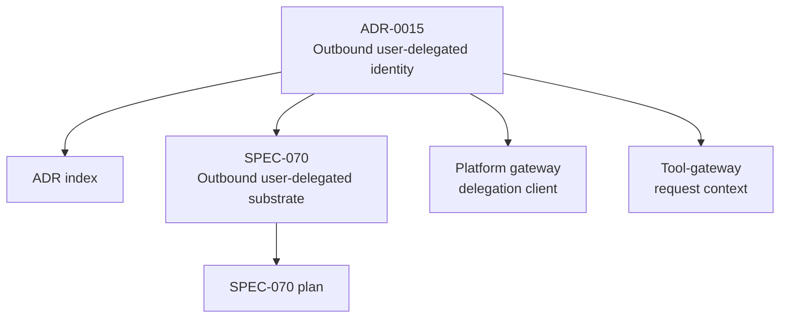
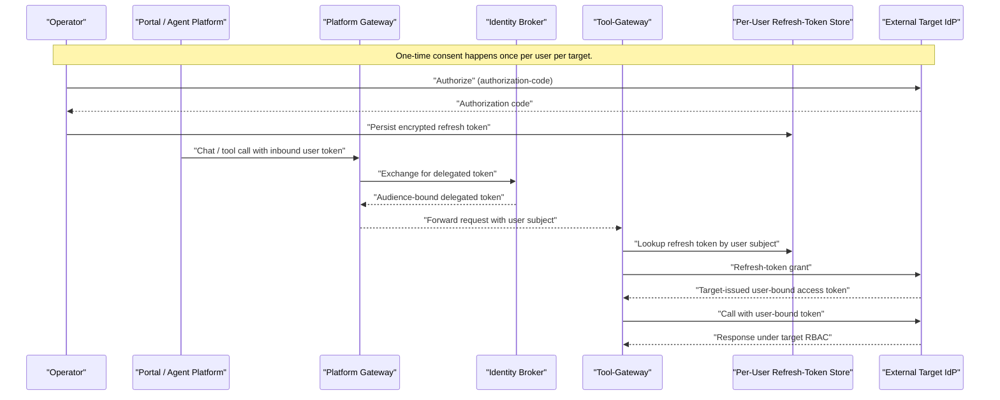
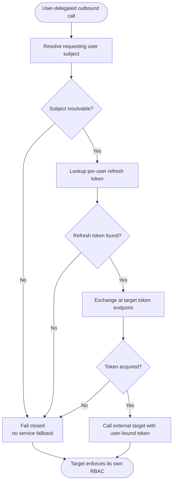
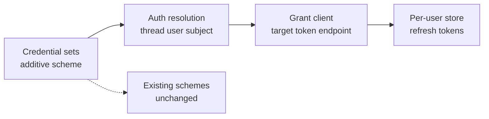
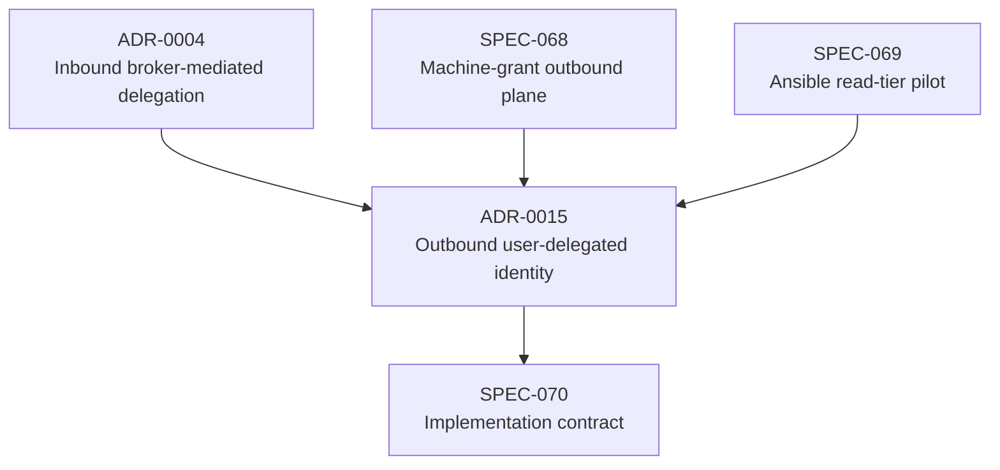

# ADR-0015: Outbound User-Delegated Identity via Per-User OAuth

<cite>
**Referenced Files in This Document**
- [ADR-0015](file://docs/adr/0015-outbound-user-delegated-identity-via-per-user-oauth.md)
- [ADR Index](file://docs/adr/README.md)
- [SPEC-070 spec](file://docs/specs/SPEC-070-outbound-user-delegated-identity/spec.md)
- [SPEC-070 plan](file://docs/specs/SPEC-070-outbound-user-delegated-identity/plan.md)
- [Platform gateway delegation client](file://products/platform-gateway/src/platform_gateway/services/delegation_client.py)
- [Tool-gateway request context](file://products/tool-gateway/src/tool_gateway/core/request_context.py)
</cite>

## Table of Contents
1. [Introduction](#introduction)
2. [Project Structure](#project-structure)
3. [Core Components](#core-components)
4. [Architecture Overview](#architecture-overview)
5. [Detailed Component Analysis](#detailed-component-analysis)
6. [Dependency Analysis](#dependency-analysis)
7. [Performance Considerations](#performance-considerations)
8. [Troubleshooting Guide](#troubleshooting-guide)
9. [Conclusion](#conclusion)

## Introduction
ADR-0015 records the platform's decision to obtain outbound user-delegated execution identity through per-user OAuth 2.x authorization-code, resolved connector-locally in the tool-gateway against the external target's own token endpoint using a platform-custodied per-user refresh token. The identity-broker mints nothing new for this outbound path; it only supplies the inbound user subject used to look up that user's stored refresh token.

The record is accepted and scoped to the trust-model decision and the new user-scoped credential store. Implementation requirements are pinned by SPEC-070, which extends the existing outbound credential plane additively without changing the identity-broker or internal ADR-0004 delegation.

## Project Structure
ADR-0015 lives under `docs/adr/` alongside other architecture decision records. Its authoritative implementation contract is `docs/specs/SPEC-070-outbound-user-delegated-identity/spec.md`, with build steps in `plan.md`. Existing platform behavior referenced by the ADR includes the platform-gateway's inbound delegated-token cache and the tool-gateway's request-context helpers.



**Diagram sources**
- [ADR-0015:1-30](file://docs/adr/0015-outbound-user-delegated-identity-via-per-user-oauth.md#L1-L30)
- [ADR Index:35-54](file://docs/adr/README.md#L35-L54)
- [SPEC-070 spec:1-35](file://docs/specs/SPEC-070-outbound-user-delegated-identity/spec.md#L1-L35)
- [SPEC-070 plan:1-42](file://docs/specs/SPEC-070-outbound-user-delegated-identity/plan.md#L1-L42)
- [Platform gateway delegation client:1-11](file://products/platform-gateway/src/platform_gateway/services/delegation_client.py#L1-L11)
- [Tool-gateway request context:1-45](file://products/tool-gateway/src/tool_gateway/core/request_context.py#L1-L45)

**Section sources**
- [ADR-0015:1-30](file://docs/adr/0015-outbound-user-delegated-identity-via-per-user-oauth.md#L1-L30)
- [ADR Index:35-54](file://docs/adr/README.md#L35-L54)

## Core Components
This ADR does not introduce a new runtime class. It defines a new outbound trust model and a new secret custody boundary:

| Component | Responsibility | ADR / Spec binding |
|---|---|---|
| Per-user OAuth authorization-code flow | One-time consent against the target's authorization server | Decision paragraph and OQ-1 resolution |
| Target-issued access token | Short-lived bearer presented on outbound calls | Decision paragraph and R-2 |
| Platform-custodied per-user refresh token | Encrypted at rest, in-memory on use, rotatable, revocable | Decision paragraph and R-6/OQ-4 |
| Tool-gateway connector-local grant client | Exchanges the refresh token at the target's token endpoint | Plan Stage 2–3 |
| Inbound user subject (`sub`) | Looks up the correct per-user refresh token | Decision paragraph and R-2 |
| Identity-broker | Unchanged; no outbound mint | OQ-2 and No broker mint |
| External target | Issues the user-bound token and enforces its own RBAC | Context and Trust contract |

**Section sources**
- [ADR-0015:60-89](file://docs/adr/0015-outbound-user-delegated-identity-via-per-user-oauth.md#L60-L89)
- [SPEC-070 spec:125-171](file://docs/specs/SPEC-070-outbound-user-delegated-identity/spec.md#L125-L171)
- [SPEC-070 spec:173-254](file://docs/specs/SPEC-070-outbound-user-delegated-identity/spec.md#L173-L254)
- [SPEC-070 plan:27-42](file://docs/specs/SPEC-070-outbound-user-delegated-identity/plan.md#L27-L42)

## Architecture Overview
ADR-0015 separates two delegation planes:

- **Inbound/internal (ADR-0004):** The platform-gateway exchanges an inbound user token for a short-lived, audience-bound delegated token at the identity-broker. This is for service-to-service hops within Luban.
- **Outbound/external (ADR-0015 + SPEC-070):** The tool-gateway obtains a target-issued, user-bound access token from the external target's OAuth server using a stored per-user refresh token.



**Diagram sources**
- [Platform gateway delegation client:1-11](file://products/platform-gateway/src/platform_gateway/services/delegation_client.py#L1-L11)
- [Platform gateway delegation client:78-101](file://products/platform-gateway/src/platform_gateway/services/delegation_client.py#L78-L101)
- [ADR-0015:60-89](file://docs/adr/0015-outbound-user-delegated-identity-via-per-user-oauth.md#L60-L89)
- [SPEC-070 spec:148-181](file://docs/specs/SPEC-070-outbound-user-delegated-identity/spec.md#L148-L181)
- [SPEC-070 plan:62-76](file://docs/specs/SPEC-070-outbound-user-delegated-identity/plan.md#L62-L76)

## Detailed Component Analysis

### Decision Model
The ADR establishes four binding rules:

1. Mechanism: per-user OAuth 2.x authorization-code, connector-local, target-issued.
2. No broker mint: the identity-broker gains no outbound signing context.
3. No elevation, fail closed, no downgrade: failed user-delegated acquisition must never silently fall back to a machine/service credential.
4. New trust surface: the per-user refresh-token store, bounded by encryption-at-rest, in-memory use, rotation, revocation, and redaction.



**Diagram sources**
- [ADR-0015:78-89](file://docs/adr/0015-outbound-user-delegated-identity-via-per-user-oauth.md#L78-L89)
- [SPEC-070 spec:148-171](file://docs/specs/SPEC-070-outbound-user-delegated-identity/spec.md#L148-L171)
- [SPEC-070 spec:210-233](file://docs/specs/SPEC-070-outbound-user-delegated-identity/spec.md#L210-L233)

**Section sources**
- [ADR-0015:60-89](file://docs/adr/0015-outbound-user-delegated-identity-via-per-user-oauth.md#L60-L89)
- [SPEC-070 spec:125-233](file://docs/specs/SPEC-070-outbound-user-delegated-identity/spec.md#L125-L233)

### Relationship to Inbound Delegation (ADR-0004)
ADR-0015 is explicitly the outbound analogue of ADR-0004. The key distinction is trust direction:

| Dimension | ADR-0004 (inbound/internal) | ADR-0015 (outbound/external) |
|---|---|---|
| Issuer | Identity-broker | External target |
| Audience | Internal platform services | External target |
| Token purpose | Service-to-service hop inside Luban | Human attribution across the platform boundary |
| Broker change | Required | None |
| New secret custody | Delegated token cache | Per-user refresh-token store |
| Failure posture | Non-fatal exchange allows tool-less chat | Must fail closed; no downgrade to service account |

```mermaid
classDiagram
class InboundDelegation {
"Platform gateway"
"Identity broker"
"Internal audience-bound JWT"
"Service-to-service hop"
}
class OutboundDelegation {
"Tool-gateway"
"External target IdP"
"Target-issued user-bound token"
"Human attribution across boundary"
}
class PerUserStore {
"Encrypted at rest"
"In-memory on use"
"Rotatable"
"Revocable"
}
InboundDelegation --> OutboundDelegation : "Separate trust planes"
OutboundDelegation --> PerUserStore : "new principal risk surface"
```

**Diagram sources**
- [ADR-0015:32-58](file://docs/adr/0015-outbound-user-delegated-identity-via-per-user-oauth.md#L32-L58)
- [ADR-0015:122-146](file://docs/adr/0015-outbound-user-delegated-identity-via-per-user-oauth.md#L122-L146)
- [SPEC-070 spec:23-35](file://docs/specs/SPEC-070-outbound-user-delegated-identity/spec.md#L23-L35)

**Section sources**
- [ADR-0015:32-58](file://docs/adr/0015-outbound-user-delegated-identity-via-per-user-oauth.md#L32-L58)
- [ADR-0015:122-146](file://docs/adr/0015-outbound-user-delegated-identity-via-per-user-oauth.md#L122-L146)

### Alternatives and Why They Were Rejected
| Alternative | Status | Reason |
|---|---|---|
| Connector-local RFC 8693 token exchange | Rejected for first target | AAP MCP server documents authorization-code/password, not token exchange, and has no OIDC discovery |
| On-behalf-of with platform client credential | Rejected | Not documented by the first production target |
| Shared-IdP SSO/federation | Deferred | Adds deployment dependency and still requires a user-bound target token |
| Broker-minted outbound user assertion | Rejected | External targets do not trust the platform JWKS |
| Forwarding inbound ADR-0004 delegated token outbound | Rejected | Audience-bound and intra-platform only |
| Per-user PATs | Accepted as simpler interim variant | Static secret hygiene is weaker than authorization-code + refresh token |

**Section sources**
- [ADR-0015:91-120](file://docs/adr/0015-outbound-user-delegated-identity-via-per-user-oauth.md#L91-L120)
- [SPEC-070 spec:321-371](file://docs/specs/SPEC-070-outbound-user-delegated-identity/spec.md#L321-L371)

### Implementation Anchors
The ADR defers concrete code changes to SPEC-070 but pins the affected seams:

- Additive `oauth2_authorization_code` scheme in the credential-set vocabulary.
- Thread the requesting user's subject into the outbound auth-resolution seam.
- Implement the authorization-code/refresh-token grant client against the target's token endpoint.
- Build the per-user credential store as a reviewed capability, not an ad-hoc file.
- Preserve existing `basic`/`bearer`/`oauth2_client_credentials` behavior byte-for-byte.



**Diagram sources**
- [SPEC-070 spec:125-155](file://docs/specs/SPEC-070-outbound-user-delegated-identity/spec.md#L125-L155)
- [SPEC-070 plan:30-42](file://docs/specs/SPEC-070-outbound-user-delegated-identity/plan.md#L30-L42)

**Section sources**
- [SPEC-070 spec:284-299](file://docs/specs/SPEC-070-outbound-user-delegated-identity/spec.md#L284-L299)
- [SPEC-070 plan:44-143](file://docs/specs/SPEC-070-outbound-user-delegated-identity/plan.md#L44-L143)

## Dependency Analysis
ADR-0015 depends on prior decisions and specifications rather than introducing a single monolithic module.



**Diagram sources**
- [ADR-0015:9-15](file://docs/adr/0015-outbound-user-delegated-identity-via-per-user-oauth.md#L9-L15)
- [ADR-0015:32-58](file://docs/adr/0015-outbound-user-delegated-identity-via-per-user-oauth.md#L32-L58)
- [SPEC-070 spec:1-35](file://docs/specs/SPEC-070-outbound-user-delegated-identity/spec.md#L1-L35)

**Section sources**
- [ADR-0015:9-15](file://docs/adr/0015-outbound-user-delegated-identity-via-per-user-oauth.md#L9-L15)
- [SPEC-070 spec:1-52](file://docs/specs/SPEC-070-outbound-user-delegated-identity/spec.md#L1-L52)

## Performance Considerations
The ADR itself is a trust-model decision and does not prescribe caching or concurrency semantics. However, the related inbound delegation client demonstrates the project's established pattern: a per-replica, per-user cache with near-expiry refresh and metrics recording. SPEC-070's plan similarly describes a connector-local cache keyed by set name and user subject with near-expiry refresh and single-flight, while ensuring tokens are never shared across users.

Key performance-related constraints remain security-first:

- Tokens are held in memory only.
- Cache keys include the user subject so tokens are not cross-user.
- Metrics should distinguish hits, misses, and failures where applicable.
- Network calls go to the target's token endpoint, not the identity-broker.

[No sources needed since this section provides general guidance derived from the referenced files]

## Troubleshooting Guide

### Symptom: Outbound user-delegated call fails closed
**Likely causes:**
- No resolvable user subject.
- Missing or expired per-user refresh token.
- Broken federation or missing one-time consent.
- Target token endpoint failure.

**Required behavior:**
- Do not silently fall back to `oauth2_client_credentials`, `basic`, or `bearer`.
- Emit structured errors and audit the delegation mode.
- Never log or surface the refresh token, access token, or client secret.

**Section sources**
- [ADR-0015:78-89](file://docs/adr/0015-outbound-user-delegated-identity-via-per-user-oauth.md#L78-L89)
- [SPEC-070 spec:157-171](file://docs/specs/SPEC-070-outbound-user-delegated-identity/spec.md#L157-L171)
- [SPEC-070 spec:210-233](file://docs/specs/SPEC-070-outbound-user-delegated-identity/spec.md#L210-L233)

### Symptom: Confusion between inbound and outbound delegation
**Clarification:**
- Inbound delegation (platform-gateway → identity-broker) produces an internal audience-bound token for service-to-service hops.
- Outbound delegation (tool-gateway → external target) produces a target-issued, user-bound token for human attribution.
- The two flows must not be conflated, and the inbound delegated token must not be forwarded to the external target.

**Section sources**
- [ADR-0015:39-58](file://docs/adr/0015-outbound-user-delegated-identity-via-per-user-oauth.md#L39-L58)
- [Platform gateway delegation client:1-11](file://products/platform-gateway/src/platform_gateway/services/delegation_client.py#L1-L11)

### Symptom: Secret leakage in logs, results, evidence, or audit
**Required checks:**
- Confirm all new secret-bearing values are covered by the existing redaction vocabulary.
- Assert that URL projections, tool results, evidence fields, and audit trails mask tokens and secrets.
- Verify `make validate-secret-vocabulary` remains green without inventing a new canonical field set.

**Section sources**
- [SPEC-070 spec:217-229](file://docs/specs/SPEC-070-outbound-user-delegated-identity/spec.md#L217-L229)
- [SPEC-070 plan:118-130](file://docs/specs/SPEC-070-outbound-user-delegated-identity/plan.md#L118-L130)

## Conclusion
ADR-0015 selects per-user OAuth 2.x authorization-code as the mechanism for outbound user-delegated identity and rejects broker-minted assertions, token exchange, and on-behalf-of flows for the first production target. The decision closes the outbound confused-deputy gap left by SPEC-068's machine grant while keeping the identity-broker unchanged. The principal new operational responsibility is the per-user refresh-token store, bounded by encryption-at-rest, in-memory use, rotation, revocation, redaction, and strict fail-closed/no-downgrade handling. SPEC-070 is the approved implementation contract that turns this decision into testable requirements.

[No sources needed since this section summarizes without analyzing specific files]