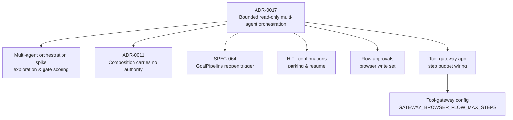
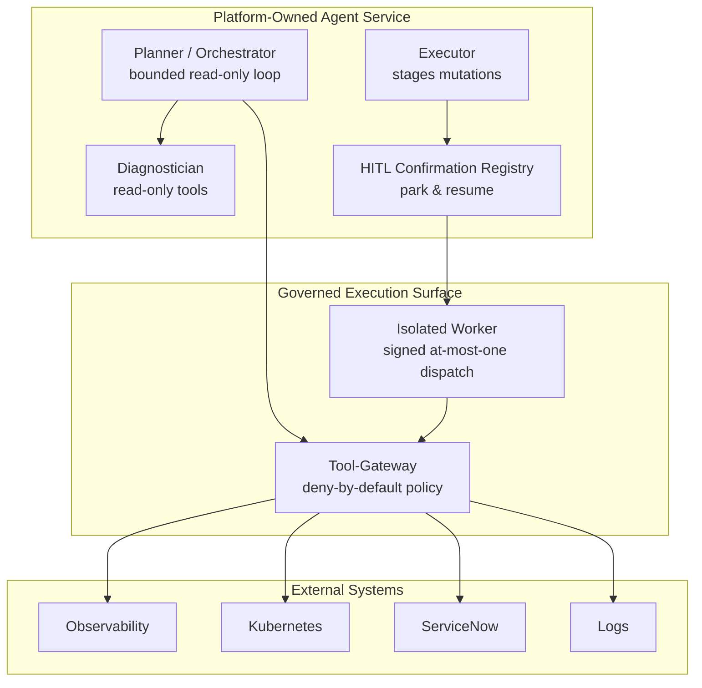
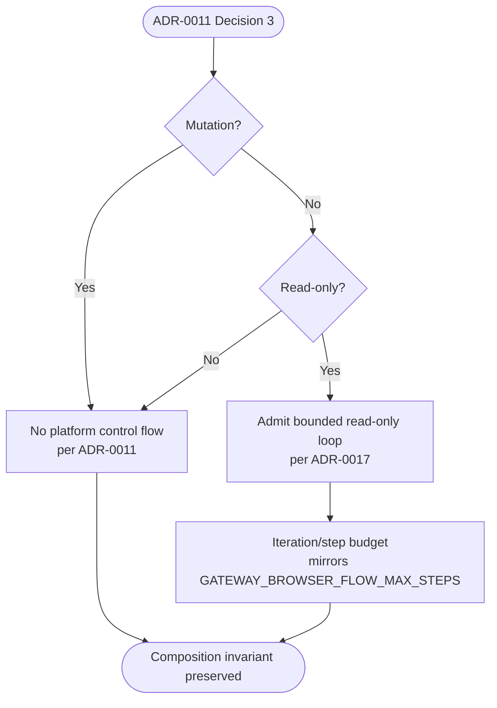
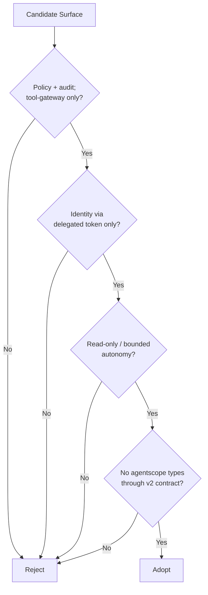
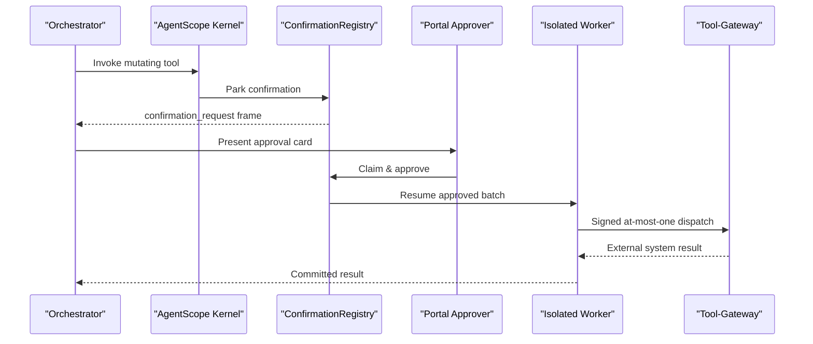
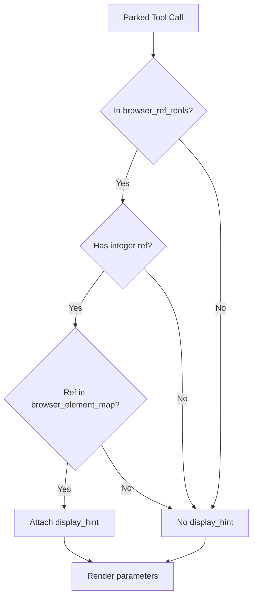
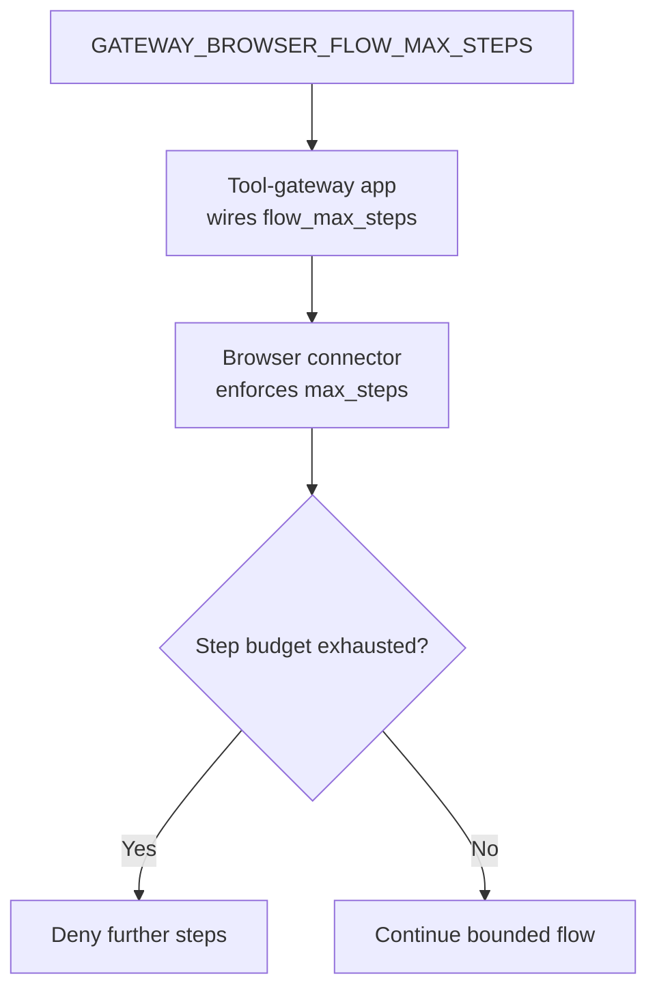
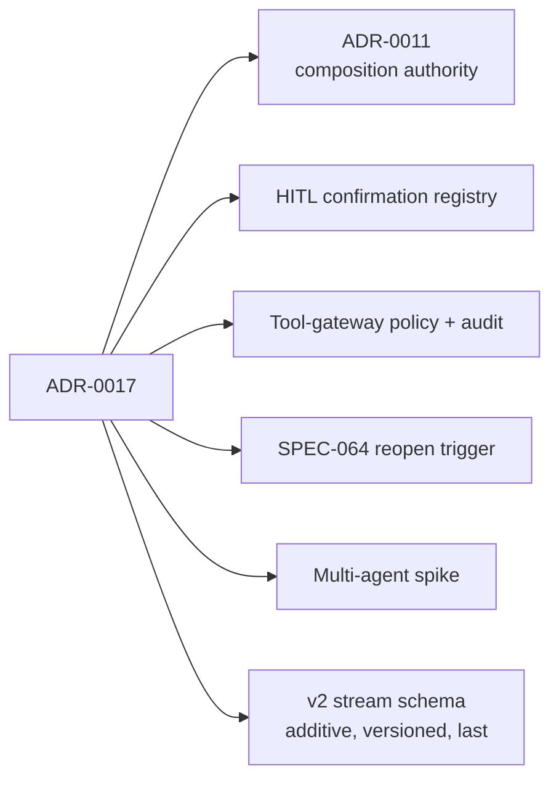

# ADR-0017: Bounded Read-Only Multi-Agent Orchestration

<cite>
**Referenced Files in This Document**   
- [ADR-0017](file://docs/adr/0017-bounded-read-only-multi-agent-orchestration.md)
- [multi-agent-orchestration-spike.md](file://docs/workspace/multi-agent-orchestration-spike.md)
- [ADR-0011](file://docs/adr/0011-composition-carries-no-authority.md)
- [SPEC-064 spec](file://docs/specs/SPEC-064-agentscope-compression-and-goal-pipeline/spec.md)
- [agentscope compression goal pipeline spike](file://docs/workspace/agentscope-compression-goal-pipeline-spike.md)
- [hitl_confirmations.py](file://products/agent-platform/src/agent_service/services/hitl_confirmations.py)
- [flow_approvals.py](file://products/agent-platform/src/agent_service/services/flow_approvals.py)
- [kernel_middleware.py](file://products/agent-platform/src/agent_service/services/kernel_middleware.py)
- [secret_params.py](file://products/agent-platform/src/agent_service/services/secret_params.py)
- [tool-gateway app.py](file://products/tool-gateway/src/tool_gateway/app.py)
- [tool-gateway config.py](file://products/tool-gateway/src/tool_gateway/core/config.py)
</cite>

## Table of Contents
1. [Introduction](#introduction)
2. [Project Structure](#project-structure)
3. [Core Components](#core-components)
4. [Architecture Overview](#architecture-overview)
5. [Detailed Component Analysis](#detailed-component-analysis)
6. [Dependency Analysis](#dependency-analysis)
7. [Performance Considerations](#performance-considerations)
8. [Troubleshooting Guide](#troubleshooting-guide)
9. [Conclusion](#conclusion)

## Introduction
ADR-0017 is a proposed architecture decision that opens the platform to **bounded, read-only multi-agent orchestration** while preserving every existing mutation gate. It does not adopt an agentscope orchestration surface as shipped; instead, it defines the control-flow model the platform may admit and the identity, policy, audit, and contract boundaries any downstream implementation must respect.

The record’s status is `proposed`. The three load-bearing decisions — bounded read-only loop, diagnose-before-act autonomy ceiling, and role-scoped agents on the same delegated token narrowed per role — were ratified by the workspace operator on 2026-11-01, but acceptance awaits the operator’s review pass before promotion to `accepted`. Acceptance would authorize drafting the phased SPEC series described in the related memo; it authorizes no runtime code, deployment, commit/push, version bump, or SPEC number.

## Project Structure
This document is primarily an architectural decision record supported by a prior exploration memo and several existing platform components that define the mutation gates, HITL bridging, browser tool sets, and step-budget discipline the ADR references.

**Diagram sources**
- [ADR-0017:1-134](file://docs/adr/0017-bounded-read-only-multi-agent-orchestration.md#L1-L134)
- [multi-agent-orchestration-spike.md:1-329](file://docs/workspace/multi-agent-orchestration-spike.md#L1-L329)
- [ADR-0011:1-119](file://docs/adr/0011-composition-carries-no-authority.md#L1-L119)
- [SPEC-064 spec:31-41](file://docs/specs/SPEC-064-agentscope-compression-and-goal-pipeline/spec.md#L31-L41)
- [hitl_confirmations.py:1-12](file://products/agent-platform/src/agent_service/services/hitl_confirmations.py#L1-L12)
- [flow_approvals.py:43-53](file://products/agent-platform/src/agent_service/services/flow_approvals.py#L43-L53)
- [tool-gateway app.py:200-210](file://products/tool-gateway/src/tool_gateway/app.py#L200-L210)
- [tool-gateway config.py:140-150](file://products/tool-gateway/src/tool_gateway/core/config.py#L140-L150)

**Section sources**
- [ADR-0017:1-27](file://docs/adr/0017-bounded-read-only-multi-agent-orchestration.md#L1-L27)
- [multi-agent-orchestration-spike.md:1-20](file://docs/workspace/multi-agent-orchestration-spike.md#L1-L20)

## Core Components
ADR-0017 centers on six interlocking decisions rather than one feature:

| Decision | Meaning | Boundary |
|---|---|---|
| Bounded read-only orchestration loop | An orchestrator may fan out read-only sub-agents and synthesize diagnosis autonomously under an iteration/step budget. | Control flow |
| Diagnose-before-act autonomy ceiling | Every mutation parks on the existing HITL confirmation and dispatches through the signed at-most-one-dispatch worker after human approval. | Mutation path |
| Composition keeps no mutation authority | ADR-0011 Decisions 1, 2, 4, and 6 remain unchanged; only Decision 3 is relaxed for read-only loops. | Composition trust model |
| Role-scoped agents on the same delegated token | Authority is narrowed per role at toolkit + policy; roles are diagnostician, planner/orchestrator, and executor. | Identity & policy |
| No agentscope orchestration surface adopted | TeamPipeline, GoalPipeline, and A2A external federation are kept out or parked. | Substrate adoption |
| Additive, versioned v2 contract change last | Stream/schema extensions come only after identity, policy, audit, and orchestration semantics are fixed. | Contract evolution |

The role model is intentionally narrow:

| Role | Autonomy | Mutation authority |
|---|---|---|
| `diagnostician` | May run autonomously | None; read-only toolkit |
| `planner` / `orchestrator` | May decompose incidents and delegate read-only roles | None; proposes remediation only |
| `executor` | May stage a mutation as a confirmation card | Cannot self-approve; human approves, isolated worker dispatches |

**Section sources**
- [ADR-0017:46-88](file://docs/adr/0017-bounded-read-only-multi-agent-orchestration.md#L46-L88)
- [multi-agent-orchestration-spike.md:251-269](file://docs/workspace/multi-agent-orchestration-spike.md#L251-L269)

## Architecture Overview
ADR-0017 does not introduce a new runtime component; it constrains how future bounded-autonomy work must fit into the existing platform-owned agent service, tool-gateway, HITL bridge, and governed mutation path.

**Diagram sources**
- [ADR-0017:48-88](file://docs/adr/0017-bounded-read-only-multi-agent-orchestration.md#L48-L88)
- [multi-agent-orchestration-spike.md:227-249](file://docs/workspace/multi-agent-orchestration-spike.md#L227-L249)
- [hitl_confirmations.py:1-12](file://products/agent-platform/src/agent_service/services/hitl_confirmations.py#L1-L12)

## Detailed Component Analysis

### Relationship to ADR-0011: Controlled Relaxation of Decision 3
ADR-0011 established that compositions carry no authority and contain no control flow. Its rationale rejected an interpreter executing a composition because an interpreter needs loops, and a loop defeats the only bound on an unlocked mutating flow. ADR-0017 amends Decision 3 only: it admits a bounded platform loop where **every step is read-only**. All other ADR-0011 decisions remain authoritative.

**Diagram sources**
- [ADR-0011:61-87](file://docs/adr/0011-composition-carries-no-authority.md#L61-L87)
- [ADR-0017:52-58](file://docs/adr/0017-bounded-read-only-multi-agent-orchestration.md#L52-L58)

**Section sources**
- [ADR-0011:51-87](file://docs/adr/0011-composition-carries-no-authority.md#L51-L87)
- [ADR-0017:65-69](file://docs/adr/0017-bounded-read-only-multi-agent-orchestration.md#L65-L69)

### Gate Scoring and Rejected Alternatives
The exploration memo scored three agentscope surfaces against SPEC-018’s four-point adoption gate and found all three failing as shipped:

| Surface | Primary failure |
|---|---|
| `TeamPipeline` | Platform-owned leader loop is a second orchestration edge; `TeamAssign` is not read-only; member activity falls outside the leader’s transcript unless re-attributed; per-participant parking conflicts with the single-turn v2 frame. |
| `A2AAgent` | Remote peer owns its own toolkit and reasoning loop; Luban cannot enforce deny-by-default policy, delegated-token identity, or read-only posture. |
| `GoalPipeline` | Executor-until-verifier retry loop is autonomous multi-step execution beside the governed dispatch path. |

ADR-0017 explicitly rejects adopting these surfaces as shipped and parks A2A external federation until a concrete outbound-identity use case justifies it.

**Diagram sources**
- [multi-agent-orchestration-spike.md:153-164](file://docs/workspace/multi-agent-orchestration-spike.md#L153-L164)
- [ADR-0017:79-88](file://docs/adr/0017-bounded-read-only-multi-agent-orchestration.md#L79-L88)

**Section sources**
- [multi-agent-orchestration-spike.md:94-164](file://docs/workspace/multi-agent-orchestration-spike.md#L94-L164)
- [ADR-0017:92-107](file://docs/adr/0017-bounded-read-only-multi-agent-orchestration.md#L92-L107)

### HITL Bridge and Mutation Boundary
Every mutation remains behind the existing HITL confirmation and signed at-most-one-dispatch path. The in-memory `ConfirmationRegistry` registers parked kernel confirmations, exposes them as SSE frames, claims decisions atomically, and resolves entries without silently evicting expired state. This is the boundary ADR-0017 preserves: autonomous diagnosis may proceed without a human, but autonomous resolve (self-approving mutation) is deferred.

**Diagram sources**
- [hitl_confirmations.py:1-12](file://products/agent-platform/src/agent_service/services/hitl_confirmations.py#L1-L12)
- [hitl_confirmations.py:573-718](file://products/agent-platform/src/agent_service/services/hitl_confirmations.py#L573-L718)
- [ADR-0017:59-64](file://docs/adr/0017-bounded-read-only-multi-agent-orchestration.md#L59-L64)

**Section sources**
- [hitl_confirmations.py:50-118](file://products/agent-platform/src/agent_service/services/hitl_confirmations.py#L50-L118)
- [hitl_confirmations.py:573-718](file://products/agent-platform/src/agent_service/services/hitl_confirmations.py#L573-L718)
- [ADR-0017:59-64](file://docs/adr/0017-bounded-read-only-multi-agent-orchestration.md#L59-L64)

### Browser Tool Sets and Operator Guidelines
The project-wide author guidelines require transcribing tool, permission, and risk-tier sets from source literal. The relevant sets are:

| Set | Members | Purpose |
|---|---|---|
| `browser_ref_tools` in `hitl_confirmations.py` | `web.click`, `web.type`, `web.select`, `web.press_key`, `web.upload_file` | Tools that reference snapshot elements and may receive a display hint when a ref is supplied. |
| `BROWSER_WRITE_TOOLS` in `flow_approvals.py` | The five members above plus `web.evaluate` | Used to detect browser-write flows and bind flow-level approval semantics. |
| `web.fill_credential` | Not in either set | Read-tier tool; parks no card and names its credential set. |
| `web.evaluate` | Only takes `expression`; no element `ref` | Not a ref-taking tool; arbitrary JS expression is masked in change-request projection. |

Important clarifications enforced by the source:

- `web.fill_credential` is read-tier and does not park a card.
- `web.evaluate` takes only `expression` and has no element `ref`; projecting element context for it is incorrect.
- `web.fill_credential` does not already project element context; its display formatter shows credential set, field, and element label when available, but this is rendering behavior, not proof that the tool itself projects element context.

**Diagram sources**
- [hitl_confirmations.py:120-168](file://products/agent-platform/src/agent_service/services/hitl_confirmations.py#L120-L168)
- [flow_approvals.py:43-53](file://products/agent-platform/src/agent_service/services/flow_approvals.py#L43-L53)

**Section sources**
- [hitl_confirmations.py:120-168](file://products/agent-platform/src/agent_service/services/hitl_confirmations.py#L120-L168)
- [flow_approvals.py:43-53](file://products/agent-platform/src/agent_service/services/flow_approvals.py#L43-L53)
- [secret_params.py:77-142](file://products/agent-platform/src/agent_service/services/secret_params.py#L77-L142)

### Step Budget Discipline and Bounded Autonomy
ADR-0017 ties the bounded read-only loop to the same discipline used for browser flows: an iteration/step budget mirroring `GATEWAY_BROWSER_FLOW_MAX_STEPS`. The tool-gateway reads this setting and wires it into the browser connector’s flow budget. Any bounded autonomous diagnosis must therefore establish its own equivalent guard rather than relying on unbounded model-driven delegation.

**Diagram sources**
- [tool-gateway app.py:200-210](file://products/tool-gateway/src/tool_gateway/app.py#L200-L210)
- [tool-gateway config.py:140-150](file://products/tool-gateway/src/tool_gateway/core/config.py#L140-L150)
- [ADR-0017:52-58](file://docs/adr/0017-bounded-read-only-multi-agent-orchestration.md#L52-L58)

**Section sources**
- [tool-gateway app.py:200-210](file://products/tool-gateway/src/tool_gateway/app.py#L200-L210)
- [tool-gateway config.py:140-150](file://products/tool-gateway/src/tool_gateway/core/config.py#L140-L150)
- [ADR-0017:52-58](file://docs/adr/0017-bounded-read-only-multi-agent-orchestration.md#L52-L58)

### SPEC-064 Reopen Trigger and Kept-Out Surfaces
SPEC-064 recorded the `GoalPipeline` reopen condition as “a concrete autonomous-remediation product need.” ADR-0017 acknowledges that the need is now live, but the reopening belongs to the ADR decision about admissible control flow, not to wiring `GoalPipeline`. The compression surface (`CompressContext`) was assessed separately and recommended for opt-in adoption if it clears the four-point gate; `GoalPipeline` remains kept out.

**Section sources**
- [SPEC-064 spec:31-41](file://docs/specs/SPEC-064-agentscope-compression-and-goal-pipeline/spec.md#L31-L41)
- [agentscope compression goal pipeline spike:1-6](file://docs/workspace/agentscope-compression-goal-pipeline-spike.md#L1-L6)
- [ADR-0017:30-44](file://docs/adr/0017-bounded-read-only-multi-agent-orchestration.md#L30-L44)

## Dependency Analysis
ADR-0017 depends on existing platform invariants more than it introduces new runtime dependencies.

**Diagram sources**
- [ADR-0017:15-23](file://docs/adr/0017-bounded-read-only-multi-agent-orchestration.md#L15-L23)
- [ADR-0017:85-88](file://docs/adr/0017-bounded-read-only-multi-agent-orchestration.md#L85-L88)

Key dependency relationships:

| Dependency | Relationship |
|---|---|
| ADR-0011 | Amended at Decision 3 only; other decisions remain authoritative. |
| SPEC-020/030/031 | HITL confirmation path remains the sole mutation gate. |
| SPEC-037/038/063 | Signed at-most-one dispatch remains the sole mutation execution path. |
| SPEC-064 | Provides the reopened `GoalPipeline` trigger but does not authorize adoption. |
| Tool-gateway | Supplies deny-by-default policy, redaction, evidence, audit, and step-budget discipline. |
| v2 stream schema | Must remain additive and versioned; no agentscope types leak through. |

**Section sources**
- [ADR-0017:15-23](file://docs/adr/0017-bounded-read-only-multi-agent-orchestration.md#L15-L23)
- [ADR-0017:109-133](file://docs/adr/0017-bounded-read-only-multi-agent-orchestration.md#L109-L133)

## Performance Considerations
ADR-0017 accepts two explicit trade-offs:

1. **New machinery cost.** A bounded read-only loop requires its own iteration/step budget and a per-role toolkit + policy narrowing mechanism. These are subjects of the downstream SPEC series and are not free.
2. **Unattended read spend.** Autonomous read-only diagnosis consumes model and tool budget without a human in the loop. Safety comes from the step bound and read-only posture; each read still rides policy, redaction, evidence, and audit.

The bounded-loop design is intended to prevent the kind of unbounded interpreter loop that ADR-0011 rejected for mutating flows. It does not claim performance optimization beyond safety and governance constraints.

[No sources needed since this section provides general guidance]

## Troubleshooting Guide
When implementing bounded autonomous diagnosis under ADR-0017, verify the following boundaries:

| Check | Expected Behavior | Failure Mode |
|---|---|---|
| Every loop step is read-only | No mutation, execute, or remediate call proceeds autonomously. | Violates diagnose-before-act ceiling. |
| Mutation parks on HITL | Approval card is presented to a distinct human. | Autonomous resolve attempted prematurely. |
| Mutation dispatches through signed worker | At-most-one dispatch is enforced. | Second mutation driver created. |
| Step budget is bounded | Loop terminates after the configured iteration limit. | Unbounded autonomous loop. |
| Role-scoped toolkit is narrowed | Diagnostician sees only read tools; executor cannot self-approve. | Super-agent or missing segregation of duty. |
| Audit attributes role and delegation | Member activity is reconstructable. | Lost attribution across sub-agents. |
| v2 contract extension is additive and versioned | Existing schema consumers remain compatible. | Breaking stream event shape. |

Common pitfalls grounded in the source:

- Do not treat `web.fill_credential` as a mutating browser tool; it is read-tier and does not park a card.
- Do not assume `web.evaluate` targets an element; it takes only `expression`.
- Do not project element context merely because a ref parameter exists elsewhere; rendering conditions are not capability guarantees.
- Do not adopt `TeamPipeline`, `GoalPipeline`, or `A2AAgent` as shipped; they fail the four-point gate.
- Do not infer role membership from symmetry; transcribe literal sets from `hitl_confirmations.py` and `flow_approvals.py`.

**Section sources**
- [hitl_confirmations.py:120-168](file://products/agent-platform/src/agent_service/services/hitl_confirmations.py#L120-L168)
- [flow_approvals.py:43-53](file://products/agent-platform/src/agent_service/services/flow_approvals.py#L43-L53)
- [multi-agent-orchestration-spike.md:153-164](file://docs/workspace/multi-agent-orchestration-spike.md#L153-L164)
- [ADR-0017:92-107](file://docs/adr/0017-bounded-read-only-multi-agent-orchestration.md#L92-L107)

## Conclusion
ADR-0017 is a controlled relaxation of ADR-0011’s no-control-flow rule, limited to a bounded read-only orchestration loop. It preserves the platform’s governed mutation path, denies adoption of agentscope orchestration surfaces as shipped, and defers autonomous resolve and external A2A federation until later, evidence-backed decisions. On acceptance, it unblocks a phased SPEC series covering role-scoped identity and authority, policy role axis, multi-agent audit and attribution, bounded autonomous diagnosis, and finally an additive, versioned v2 multi-agent contract.

[No sources needed since this section summarizes without analyzing specific files]