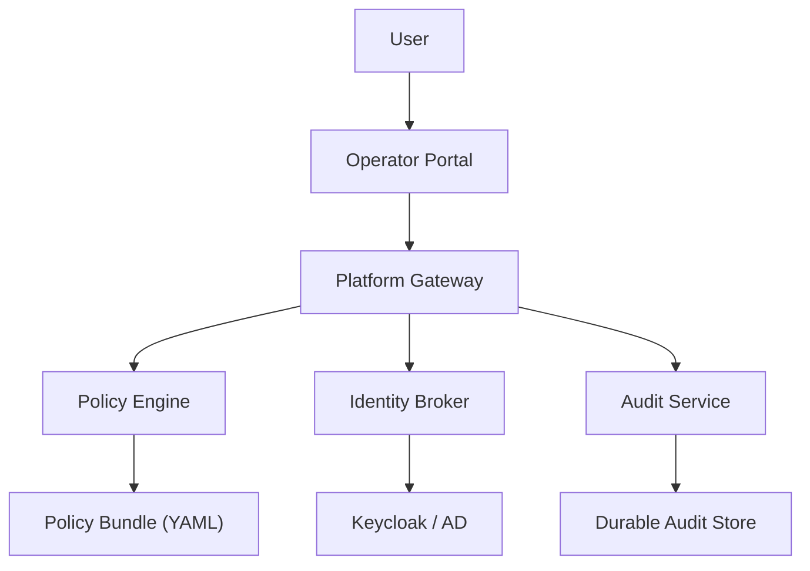
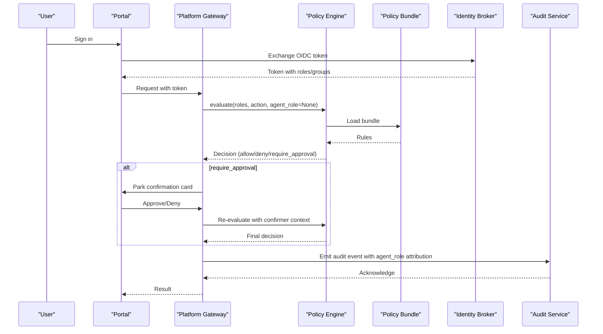
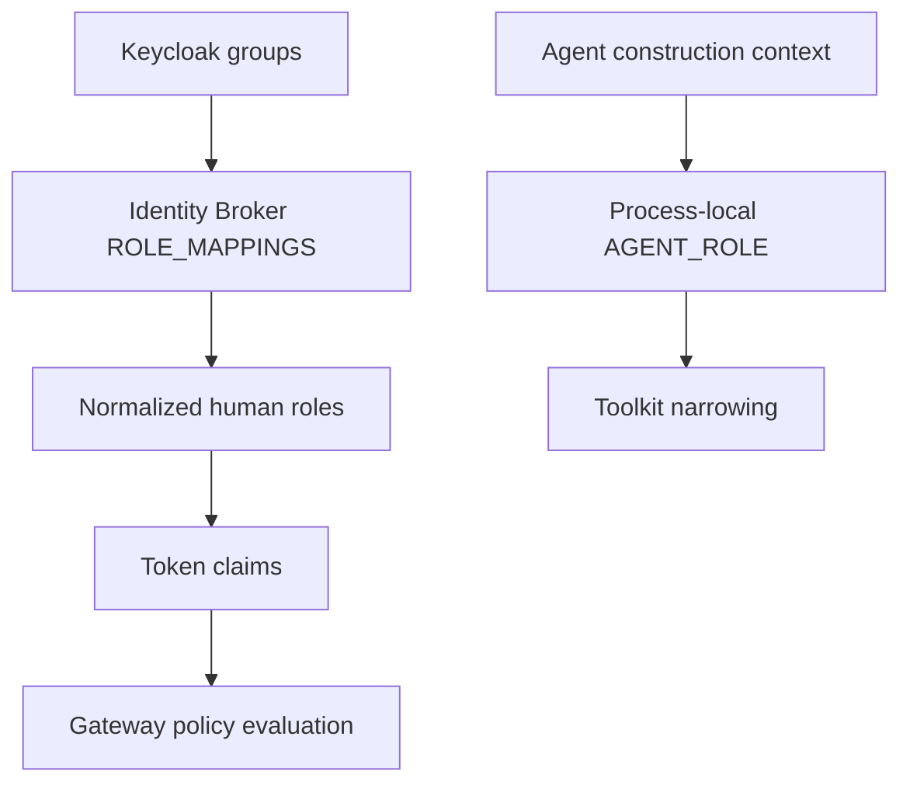
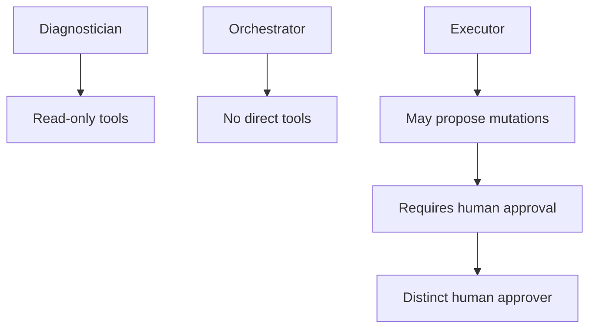
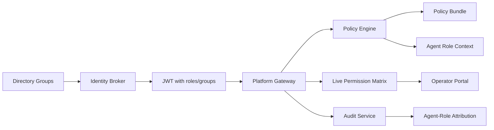

# Authorization Matrix

<cite>
**Referenced Files in This Document**
- [authorization-matrix.md](file://docs/agentic-aiops-platform/authorization-matrix.md)
- [identity-and-authorization-design.md](file://docs/agentic-aiops-platform/identity-and-authorization-design.md)
- [policy-default.yaml](file://shared/shared-contracts/policies/policy-default.yaml)
- [policy-rule.schema.json](file://shared/shared-contracts/schemas/policy-rule.schema.json)
- [audit-event.schema.json](file://shared/shared-contracts/schemas/audit-event.schema.json)
- [policy_engine.py](file://products/platform-gateway/src/platform_gateway/services/policy_engine.py)
- [agent_role.py](file://products/agent-platform/src/agent_service/services/agent_role.py)
- [api.py](file://products/platform-gateway/src/platform_gateway/schemas/api.py)
- [identity_service.py](file://products/identity-broker/src/identity_service/services/identity_service.py)
- [token_service.py](file://products/identity-broker/src/identity_service/services/token_service.py)
- [user-and-role-administration.md](file://docs/guides/user-and-role-administration.md)
- [PermissionsView.tsx](file://products/operator-portal/web-ui/app/src/views/control/PermissionsView.tsx)
- [test_policy_matrix.py](file://products/platform-gateway/tests/test_policy_matrix.py)
- [runtime.py](file://products/platform-gateway/src/platform_gateway/api/routes/runtime.py)
- [spec.md](file://docs/specs/SPEC-075-multi-agent-audit-attribution/spec.md)
- [plan.md](file://docs/specs/SPEC-075-multi-agent-audit-attribution/plan.md)
</cite>

## Update Summary
**Changes Made**
- Enhanced Agent-Role Attribution section with complete attribution triple documentation reflecting SPEC-075 delivery
- Updated Audit Access section to include agent_role filtering capabilities
- Added comprehensive documentation for the agent-role provenance tracking alongside existing subject/username and delegation_mode fields
- Expanded troubleshooting guidance to cover agent-role attribution failures and audit trail verification

## Table of Contents
1. [Introduction](#introduction)
2. [Project Structure](#project-structure)
3. [Core Components](#core-components)
4. [Architecture Overview](#architecture-overview)
5. [Detailed Component Analysis](#detailed-component-analysis)
6. [Dependency Analysis](#dependency-analysis)
7. [Performance Considerations](#performance-considerations)
8. [Troubleshooting Guide](#troubleshooting-guide)
9. [Conclusion](#conclusion)
10. [Appendices](#appendices)

## Introduction
This document defines the platform's authorization matrix: the role hierarchy, environment scoping, feature and action permissions, approval model, and how the policy engine enforces decisions. It consolidates design intent from the authorization matrix document with the implemented policy bundle, gateway enforcement, identity mapping, and portal transparency surfaces.

The platform uses a deny-by-default model. Roles are normalized from directory groups into a fixed vocabulary. Actions are granted by explicit rules in a versioned policy bundle. Risk tiers gate approvals, and production actions require stronger controls than development or test environments.

**Section sources**
- [authorization-matrix.md:1-60](file://docs/agentic-aiops-platform/authorization-matrix.md#L1-L60)
- [identity-and-authorization-design.md:1-60](file://docs/agentic-aiops-platform/identity-and-authorization-design.md#L1-L60)

## Project Structure
Authorization spans several components:
- Identity broker maps directory groups to platform roles and issues tokens carrying roles and groups.
- Platform gateway enforces policies on protected actions and exposes a live permission matrix.
- Policy bundle defines role-to-action grants and approval requirements.
- Operator portal renders the effective permissions for the current user.
- Audit service records decisions and execution events with complete attribution tracking.

**Diagram sources**
- [policy_engine.py:390-444](file://products/platform-gateway/src/platform_gateway/services/policy_engine.py#L390-L444)
- [identity_service.py:24-38](file://products/identity-broker/src/identity_service/services/identity_service.py#L24-L38)
- [policy-default.yaml:1-52](file://shared/shared-contracts/policies/policy-default.yaml#L1-L52)
- [PermissionsView.tsx:96-127](file://products/operator-portal/web-ui/app/src/views/control/PermissionsView.tsx#L96-L127)

**Section sources**
- [identity-service.py:24-38](file://products/identity-broker/src/identity_service/services/identity_service.py#L24-L38)
- [policy_engine.py:30-127](file://products/platform-gateway/src/platform_gateway/services/policy_engine.py#L30-L127)
- [policy-default.yaml:53-326](file://shared/shared-contracts/policies/policy-default.yaml#L53-L326)
- [api.py:209-226](file://products/platform-gateway/src/platform_gateway/schemas/api.py#L209-L226)

## Core Components
- **Human Roles**: read-only-observer, operator, developer, approver, auditor, platform-admin.
- **Agent Roles**: diagnostician, orchestrator, executor (closed, platform-owned vocabulary).
- **Environments**: dev, test, staging, prod.
- Action categories and risk tiers: tier 0 (read-only), tier 1 (low-risk non-production), tier 2 (low-risk production), tier 3 (high-risk production).
- Outcomes: allow, deny, request-only, approve-only, request-and-approve.
- Enforcement: deny-by-default; explicit deny wins; require_approval overrides allow; higher priority wins within an outcome class; disabled rules ignored.

The agent-role axis is additive and inert — it narrows authority but never widens what the human token already permits. The three agent-roles represent different levels of autonomy: diagnostician (read-only), orchestrator (delegation without direct tools), and executor (may propose mutations requiring human approval).

**Section sources**
- [authorization-matrix.md:18-60](file://docs/agentic-aiops-platform/authorization-matrix.md#L18-L60)
- [authorization-matrix.md:61-154](file://docs/agentic-aiops-platform/authorization-matrix.md#L61-L154)
- [agent_role.py:30-50](file://products/agent-platform/src/agent_service/services/agent_role.py#L30-L50)
- [policy_engine.py:138-143](file://products/platform-gateway/src/platform_gateway/services/policy_engine.py#L138-L143)

## Architecture Overview
The authorization flow evaluates identity, roles, environment scope, requested action, and risk tier against the loaded policy bundle. For mutating tool execution, a tier_2 approval is required before execution proceeds under the confirmer's delegated token.

**Diagram sources**
- [policy_engine.py:390-444](file://products/platform-gateway/src/platform_gateway/services/policy_engine.py#L390-L444)
- [policy-default.yaml:129-152](file://shared/shared-contracts/policies/policy-default.yaml#L129-L152)
- [identity_service.py:24-38](file://products/identity-broker/src/identity_service/services/identity_service.py#L24-L38)

## Detailed Component Analysis

### Role Hierarchy and Mapping
- **Human role vocabulary**: read-only-observer, operator, developer, approver, auditor, platform-admin.
- **Agent role vocabulary**: diagnostician, orchestrator, executor (closed, platform-owned enum).
- Group-to-role mapping occurs in the identity broker. If no mapping matches, the user receives read-only-observer by default.
- Tokens carry human roles and groups; downstream services rely on normalized roles for policy evaluation.
- Agent roles are process-local context beside the delegated token, not part of JWT claims or wire fields.

**Diagram sources**
- [identity_service.py:24-38](file://products/identity-broker/src/identity_service/services/identity_service.py#L24-L38)
- [token_service.py:110-126](file://products/identity-broker/src/identity_service/services/token_service.py#L110-L126)
- [policy_engine.py:390-444](file://products/platform-gateway/src/platform_gateway/services/policy_engine.py#L390-L444)
- [agent_role.py:64-67](file://products/agent-platform/src/agent_service/services/agent_role.py#L64-L67)

**Section sources**
- [identity_service.py:24-38](file://products/identity-broker/src/identity_service/services/identity_service.py#L24-L38)
- [token_service.py:110-126](file://products/identity-broker/src/identity_service/services/token_service.py#L110-L126)
- [user-and-role-administration.md:7-39](file://docs/guides/user-and-role-administration.md#L7-L39)
- [agent_role.py:30-50](file://products/agent-platform/src/agent_service/services/agent_role.py#L30-L50)

### Agent-Role Axis
The platform introduces a closed, platform-owned agent-role vocabulary that narrows a sub-agent's toolkit authority while every role rides the same gateway-forwarded delegated token. The three agent-roles are:

- **Diagnostician**: Read-only access, reuses `_filter_read_only` (`risk_level == "read"`). Can observe and analyze but cannot mutate anything.
- **Orchestrator**: No direct tool authority. Delegates to member agents but does not invoke tools directly. Collapses ADR-0017's "planner/orchestrator" into one role.
- **Executor**: May see mutating tools but still parks mutations on existing HITL confirmation. Requires distinct human approver — no agent self-approval.

**Posture Semantics:**
- Fail-closed: unknown or absent roles yield empty-or-read-only toolkit, never wider authority.
- Subtractive only: agent-role toolkit ⊆ unscoped toolkit for same token.
- Immutable: once bound, cannot be changed by any in-process API reachable from model output.
- Process-local: role is ContextVar beside `DELEGATED_TOKEN`, not part of resumable snapshot or wire fields.

**Executor→Human-Approver Invariant:**
- An executor-staged mutation requires a distinct human approver.
- No agent-role can appear as a `decided_by_roles` decider.
- The agent-role vocabulary is disjoint from human platform roles.
- Self-approval block still fires for role-staged mutations.

**Diagram sources**
- [agent_role.py:30-50](file://products/agent-platform/src/agent_service/services/agent_role.py#L30-L50)
- [policy_engine.py:138-143](file://products/platform-gateway/src/platform_gateway/services/policy_engine.py#L138-L143)
- [SPEC-073 spec.md:114-153](file://docs/specs/SPEC-073-role-scoped-agent-identity/spec.md#L114-L153)

**Section sources**
- [agent_role.py:30-50](file://products/agent-platform/src/agent_service/services/agent_role.py#L30-L50)
- [agent_role.py:64-120](file://products/agent-platform/src/agent_service/services/agent_role.py#L64-L120)
- [policy_engine.py:138-143](file://products/platform-gateway/src/platform_gateway/services/policy_engine.py#L138-L143)
- [SPEC-073 spec.md:114-204](file://docs/specs/SPEC-073-role-scoped-agent-identity/spec.md#L114-L204)
- [SPEC-074 spec.md:146-163](file://docs/specs/SPEC-074-policy-role-axis/spec.md#L146-L163)

### Agent-Role Attribution in the Audit Trail (SPEC-075, phase 4)

The agent-role axis above is **prescriptive** — it narrows authority (SPEC-074). Phase 4 adds a **descriptive** sibling: the durable audit trail can record *which role acted*, completing the attribution triple beside the two legs that already existed as top-level audit-event fields.

| Attribution leg | Audit-event field | Answers | Landed |
|---|---|---|---|
| on whose behalf | `subject` / `username` | which human the action is attributed to | SPEC-013 |
| under which delegation | `delegation_mode` | how outbound authority was acquired | SPEC-070 |
| which role acted | `agent_role` | which sub-agent role performed the turn | **SPEC-075** |

- **Descriptive, never prescriptive.** `agent_role` records provenance only; it narrows no authority and grants nothing. The prescriptive axis is the SPEC-074 policy `agent_roles_any` dimension above — the two are orthogonal and share one closed vocabulary (`diagnostician` / `orchestrator` / `executor`), so attribution can never drift from the identity/policy vocabulary.
- **One vocabulary, three contracts.** The same closed enum is pinned across `audit-event.schema.json`, `session-evidence.schema.json`, and the `evidence_turns` item of `agent-session.schema.json`, and equals the SPEC-073 producer vocabulary — an enum-lockstep guard fails the build on any drift.
- **Additive and inert.** The field is optional and **omitted when absent** (never null, never an empty string), exactly like `delegation_mode`, so every event from today's unscoped single-agent path audits **byte-identically** and a legacy row reads back `agent_role is None`. The agent-platform emitter seam is wired to SPEC-073's `current_agent_role_value()`, which returns `None` on every deployed turn — no producer binds a role until phase 5 (reachability and no-diff guards enforce this). It is a plain string enum on the v2 contract: no agentscope type leaks and no new principal, claim, or identity edge. Four-point gate: audit strengthened; identity, read-only posture, and no-agentscope unchanged.
- **Evidence-turn attribution.** The same optional `agent_role` rides a persisted `session_evidence` turn, so a scoped turn records which role produced its evidence and a legacy turn replays with no empty artifact.
- **Deferred (no consumer yet).** Per OQ-4 there is no portal filter or column (`delegation_mode` has none either) and per OQ-5 no summary facet — both are consumerless until a producer binds roles in phase 5. Per OQ-6 the field is additive within audit-event v1 (no title bump, no new ADR), the `delegation_mode` precedent. Per OQ-3 the transcript-turn projection and any concurrent-multi-agent transcript re-modelling stay deferred to phase 5/6.

**Updated** Enhanced with complete attribution triple documentation reflecting SPEC-075 delivery, showing how `agent_role` completes the provenance tracking alongside existing `subject/username` and `delegation_mode` fields.

**Section sources**
- [authorization-matrix.md:188-227](file://docs/agentic-aiops-platform/authorization-matrix.md#L188-L227)
- [audit-event.schema.json:79-83](file://shared/shared-contracts/schemas/audit-event.schema.json#L79-L83)
- [spec.md:63-85](file://docs/specs/SPEC-075-multi-agent-audit-attribution/spec.md#L63-L85)
- [plan.md:12-24](file://docs/specs/SPEC-075-multi-agent-audit-attribution/plan.md#L12-L24)

### Feature Access Matrix
Feature access is governed by both UI visibility and backend action grants. The following summarizes defaults derived from the authorization matrix and the policy bundle:
- Portal login and chat/service query: allowed for all operational roles including read-only-observer.
- Incident view: allowed for operational roles and observers.
- Approval queue view: allowed for approver, platform-admin, and auditor; limited for operator per policy.
- Audit history view: allowed for auditor and platform-admin; limited elsewhere.
- Skill management UI: allowed for platform-admin; limited for operator/approver where explicitly granted.
- Policy admin UI: allowed for platform-admin only.
- Identity mapping admin UI: allowed for platform-admin only.
- **Platform feature-flag transparency**: allowed for platform-admin, approver, and operator via the `runtime:flags` action; denied for developer, read-only-observer, and auditor.

These are enforced by route-level checks and action grants such as policy:read, skills:read, documents:create/read, session actions, approvals:list, and runtime:flags.

**Updated** Added Platform feature-flag transparency capability granted to the operational trio via the `runtime:flags` action.

**Section sources**
- [authorization-matrix.md:155-168](file://docs/agentic-aiops-platform/authorization-matrix.md#L155-L168)
- [authorization-matrix.md:517-536](file://docs/agentic-aiops-platform/authorization-matrix.md#L517-L536)
- [policy-default.yaml:53-127](file://shared/shared-contracts/policies/policy-default.yaml#L53-L127)
- [policy-default.yaml:153-175](file://shared/shared-contracts/policies/policy-default.yaml#L153-L175)
- [policy-default.yaml:214-256](file://shared/shared-contracts/policies/policy-default.yaml#L214-L256)
- [policy-default.yaml:374-390](file://shared/shared-contracts/policies/policy-default.yaml#L374-L390)

### Environment Scoping
Environment eligibility affects what actions can be requested or approved:
- dev/test: broader self-approval for low-risk actions if policy allows.
- staging: tighter; operators request, approvers approve.
- prod: strongest controls; high-risk actions require designated approvers and separation of duties.

The authorization matrix documents default environment eligibility and environment-specific action matrices. Actual access still depends on mapped entitlements from identity providers.

**Section sources**
- [authorization-matrix.md:170-241](file://docs/agentic-aiops-platform/authorization-matrix.md#L170-L241)

### Relationship Between Roles, Features, Actions, and Risk Tiers
- **Human roles** define who may act at the platform level.
- **Agent roles** narrow toolkit authority for sub-agents operating under the same delegated token.
- Features define UI surfaces and capabilities.
- Actions define enforceable operations (e.g., tools:invoke, tools:mutate, session:create, incident:triage, runtime:flags).
- Risk tiers determine approval requirements:
  - tier 0: read-only, no approval.
  - tier 1: low-risk non-production; may allow self-approval when policy permits.
  - tier 2: production low-risk; requires designated approver distinct from requester.
  - tier 3: high-risk production; strong controls, often two-person approval recommended.

Mutating tool execution is bridged through chat:confirm and requires tier_2 approval by approver or platform-admin. The `runtime:flags` action is a tier 0 read operation requiring no approval but restricted to the operational trio.

**Updated** Added agent-role axis as a first-class dimension in the authorization model, composing conjunctively with human roles.

**Section sources**
- [authorization-matrix.md:34-60](file://docs/agentic-aiops-platform/authorization-matrix.md#L34-L60)
- [authorization-matrix.md:517-536](file://docs/agentic-aiops-platform/authorization-matrix.md#L517-L536)
- [policy-default.yaml:129-152](file://shared/shared-contracts/policies/policy-default.yaml#L129-L152)
- [policy_engine.py:119-127](file://products/platform-gateway/src/platform_gateway/services/policy_engine.py#L119-L127)
- [policy_engine.py:428-447](file://products/platform-gateway/src/platform_gateway/services/policy_engine.py#L428-L447)

### Complete Permission Matrix
The authoritative, enforced matrix is exposed by the platform gateway and rendered in the portal Permissions view. It includes:
- version, source, sha256 fingerprint of the loaded bundle.
- scope: full for platform-admin; own for other users.
- roles and actions catalog.
- matrix: boolean cells indicating immediate allowance.
- approval_requirements: additive third cell state for require_approval outcomes, including tier and decider roles.

Tests assert many grant postures for actions like approvals:list, documents:create/read, session:update, session:skill_draft, incident:skill_draft, and runtime:flags.

**Updated** Added runtime:flags to the list of tested actions in the permission matrix.

**Section sources**
- [api.py:209-226](file://products/platform-gateway/src/platform_gateway/schemas/api.py#L209-L226)
- [policy-rule.schema.json:1-110](file://shared/shared-contracts/schemas/policy-rule.schema.json#L1-L110)
- [test_policy_matrix.py:152-194](file://products/platform-gateway/tests/test_policy_matrix.py#L152-L194)
- [PermissionsView.tsx:96-127](file://products/operator-portal/web-ui/app/src/views/control/PermissionsView.tsx#L96-L127)

### Sessions Management
Session actions include create, read, list, delete, update, and skill-related operations:
- session:create, session:read, session:list, session:delete, session:update are granted to operational roles and observers.
- session:skill_draft and session:skill_graduate are granted to platform-admin, approver, and operator.
- Development sessions additionally require session:skill_graduate at creation time.

Ownership scoping is enforced server-side to prevent enumeration of foreign sessions.

**Section sources**
- [policy-default.yaml:53-74](file://shared/shared-contracts/policies/policy-default.yaml#L53-L74)
- [policy-default.yaml:275-326](file://shared/shared-contracts/policies/policy-default.yaml#L275-L326)
- [authorization-matrix.md:368-415](file://docs/agentic-aiops-platform/authorization-matrix.md#L368-L415)

### Tool Invocation
- tools:list: allowed for operational roles and observers.
- tools:invoke: allowed for operational roles and observers; read-risk tools only.
- tools:mutate: allowed for platform-admin, approver, and operator; requires tier_2 approval via chat:confirm.

Browser write tools are bounded and subject to HITL confirmation and approval gates.

**Section sources**
- [policy-default.yaml:90-127](file://shared/shared-contracts/policies/policy-default.yaml#L90-L127)
- [policy-default.yaml:129-152](file://shared/shared-contracts/policies/policy-default.yaml#L129-L152)
- [authorization-matrix.md:360-397](file://docs/agentic-aiops-platform/authorization-matrix.md#L360-L397)

### Runtime Feature-Flag Transparency
- runtime:flags: allowed for platform-admin, approver, and operator; denied for developer, read-only-observer, and auditor.
- Serves a curated inventory of platform feature flags as name + enabled boolean pairs.
- No secret values are exposed; the payload is discovery-safe by construction.
- Implemented via authenticated GET /api/v1/runtime/flags endpoint proxying agent-service GET /api/v2/runtime/flags.
- Rendered read-only in the portal's Settings ▸ Platform pane.
- Follows the operational-trio grant pattern similar to documents:read and session:skill_graduate.

**New Section** Added comprehensive documentation for the runtime:flags capability introduced in SPEC-072.

**Section sources**
- [authorization-matrix.md:517-536](file://docs/agentic-aiops-platform/authorization-matrix.md#L517-L536)
- [policy-default.yaml:374-390](file://shared/shared-contracts/policies/policy-default.yaml#L374-L390)
- [runtime.py:27-55](file://products/platform-gateway/src/platform_gateway/api/routes/runtime.py#L27-L55)
- [policy_engine.py:93-98](file://products/platform-gateway/src/platform_gateway/services/policy_engine.py#L93-L98)

### Incident Operations
- incident:read: allowed for operational roles and observers.
- incident:create: allowed for operational roles and platform-admin/approver.
- incident:triage: allowed for operational roles and platform-admin/approver.
- incident:skill_draft: dual-gated with incident:read; granted to operational authoring roles.

**Section sources**
- [policy-default.yaml:177-212](file://shared/shared-contracts/policies/policy-default.yaml#L177-L212)
- [policy-default.yaml:292-307](file://shared/shared-contracts/policies/policy-default.yaml#L292-L307)
- [authorization-matrix.md:416-454](file://docs/agentic-aiops-platform/authorization-matrix.md#L416-L454)

### Administrative Functions
- policy:read: allowed for all roles to view effective permissions.
- documents:create, documents:read: allowed for platform-admin, approver, and operator.
- approvals:list: allowed for approver and platform-admin.
- audit:read: allowed for auditor and platform-admin.
- **runtime:flags**: allowed for platform-admin, approver, and operator for platform configuration transparency.

**Updated** Added runtime:flags to administrative functions as a platform configuration transparency capability.

**Section sources**
- [policy-default.yaml:214-256](file://shared/shared-contracts/policies/policy-default.yaml#L214-L256)
- [policy-default.yaml:164-175](file://shared/shared-contracts/policies/policy-default.yaml#L164-L175)
- [policy-default.yaml:374-390](file://shared/shared-contracts/policies/policy-default.yaml#L374-L390)

### Audit Access
- audit:read: allowed for auditor and platform-admin.
- Audit surfaces include summary and CSV export, riding existing audit:read grants.
- **Agent-role filtering**: The audit query API supports `?agent_role=` filtering for the three closed agent-role values (diagnostician, orchestrator, executor), mirroring the `delegation_mode` filtering mechanism.
- **Attribution triple**: Every audited event may carry the complete attribution triple: `agent_role` (which role acted), `subject`/`username` (on whose behalf), and `delegation_mode` (under which delegation).

**Updated** Added agent-role filtering capabilities and attribution triple documentation reflecting SPEC-075 delivery.

**Section sources**
- [policy-default.yaml:164-175](file://shared/shared-contracts/policies/policy-default.yaml#L164-L175)
- [authorization-matrix.md:455-463](file://docs/agentic-aiops-platform/authorization-matrix.md#L455-L463)
- [audit-event.schema.json:79-83](file://shared/shared-contracts/schemas/audit-event.schema.json#L79-L83)
- [spec.md:141-159](file://docs/specs/SPEC-075-multi-agent-audit-attribution/spec.md#L141-L159)

### Approval Model and Separation of Duties
- Tier 1: self-approval allowed by default for session operators when policy permits.
- Tier 2: designated approver distinct from requester; self-approval blocked.
- Production high-risk actions require stronger controls; destructive actions denied by default.
- **Agent-role invariant**: executor-staged mutations require distinct human approver; no agent-role can be a decider.

**Section sources**
- [policy_engine.py:119-127](file://products/platform-gateway/src/platform_gateway/services/policy_engine.py#L119-L127)
- [policy-default.yaml:129-152](file://shared/shared-contracts/policies/policy-default.yaml#L129-L152)
- [authorization-matrix.md:266-281](file://docs/agentic-aiops-platform/authorization-matrix.md#L266-L281)
- [SPEC-074 spec.md:146-163](file://docs/specs/SPEC-074-policy-role-axis/spec.md#L146-L163)

## Dependency Analysis
Roles flow from directory groups through the identity broker into tokens. The platform gateway loads the policy bundle and evaluates each protected action. The portal renders the effective matrix for transparency.

**Diagram sources**
- [identity_service.py:24-38](file://products/identity-broker/src/identity_service/services/identity_service.py#L24-L38)
- [token_service.py:110-126](file://products/identity-broker/src/identity_service/services/token_service.py#L110-L126)
- [policy_engine.py:334-387](file://products/platform-gateway/src/platform_gateway/services/policy_engine.py#L334-L387)
- [agent_role.py:64-67](file://products/agent-platform/src/agent_service/services/agent_role.py#L64-L67)

**Section sources**
- [identity_service.py:24-38](file://products/identity-broker/src/identity_service/services/identity_service.py#L24-L38)
- [policy_engine.py:334-387](file://products/platform-gateway/src/platform_gateway/services/policy_engine.py#L334-L387)

## Performance Considerations
- Policy bundle loading is cached per configured path; evaluation is fast and deterministic.
- Live matrix derivation reuses the same evaluate() path, ensuring consistency without extra logic.
- Avoid frequent bundle reloads; changes take effect on next load cycle.
- Agent-role axis is optional and inert by default — no performance impact when `agent_role=None`.
- Agent-role attribution in audit trail is additive and inert — no performance impact when omitted.

[No sources needed since this section provides general guidance]

## Troubleshooting Guide
Common issues and resolutions:
- User signs in but has only observer access: verify group membership and that the realm's groups client scope is attached.
- Role change not taking effect: old token still live; revoke sessions or wait for refresh.
- Login fails outright: check OIDC flow configuration and network connectivity.
- Permissions mismatch: confirm the deployed bundle version and source via the portal Permissions view; compare SHA-256 fingerprint with canonical file.
- **Feature-flag transparency unavailable**: verify user has platform-admin, approver, or operator role; the runtime:flags action is denied by default for developer, read-only-observer, and auditor roles.
- **Agent-role authorization failures**: ensure the agent-role vocabulary is correctly scoped; remember that agent-roles narrow authority and never widen it beyond human token permissions.
- **Agent-role attribution missing in audit trail**: verify that the agent-platform emitter seam is properly wired; remember that `agent_role` is omitted when absent (not null) and only appears when a producer binds a role (phase 5+).
- **Audit trail verification issues**: use the `?agent_role=` query parameter to filter audit events by agent role; verify the attribution triple is complete for multi-agent scenarios.

**Updated** Added troubleshooting guidance for the new agent-role axis, agent-role attribution, and audit trail verification.

**Section sources**
- [user-and-role-administration.md:118-137](file://docs/guides/user-and-role-administration.md#L118-L137)
- [policy_engine.py:374-387](file://products/platform-gateway/src/platform_gateway/services/policy_engine.py#L374-L387)
- [PermissionsView.tsx:96-127](file://products/operator-portal/web-ui/app/src/views/control/PermissionsView.tsx#L96-L127)
- [spec.md:141-159](file://docs/specs/SPEC-075-multi-agent-audit-attribution/spec.md#L141-L159)

## Conclusion
The platform's authorization model combines a fixed human role vocabulary, a closed agent-role vocabulary, environment-scoped permissions, and a versioned policy bundle evaluated by a deny-by-default engine. Mutating actions are tightly controlled through HITL and tiered approvals. Transparency is provided via a live permission matrix rendered in the portal, enabling operators to verify effective permissions at runtime. The addition of runtime:flags provides operational teams with safe visibility into platform configuration without exposing sensitive values. The agent-role axis adds a powerful new dimension for controlling sub-agent authority while preserving the single-token identity model.

The completion of the attribution triple through SPEC-075 ensures that every audited event carries complete provenance information: which role acted (`agent_role`), on whose behalf (`subject`/`username`), and under which delegation (`delegation_mode`). This enables comprehensive audit trails for multi-agent scenarios while maintaining backward compatibility and byte-identical behavior for existing single-agent paths.

[No sources needed since this section summarizes without analyzing specific files]

## Appendices

### Policy Matrix Schema
The schema defines the structure of the live permission matrix response, including version, source, fingerprint, scope, roles, actions, boolean matrix, and approval_requirements for require_approval outcomes.

**Section sources**
- [policy-rule.schema.json:1-110](file://shared/shared-contracts/schemas/policy-rule.schema.json#L1-L110)
- [api.py:209-226](file://products/platform-gateway/src/platform_gateway/schemas/api.py#L209-L226)

### Role Assignment and Custom Roles
- Assign human roles by adding users to appropriate Keycloak groups; the identity broker maps them to platform roles.
- To change what a role may do, edit the policy bundle and deploy it; verify via the portal Permissions view.
- Adding a new human role requires code changes to role mappings, bundle rules, and a spec due to trust model impact. Prefer adjusting actions on existing roles for different permission mixes.
- **Agent roles** are closed and platform-owned — they cannot be customized. They represent predefined autonomy levels (diagnostician, orchestrator, executor) that narrow toolkit authority.

**Section sources**
- [user-and-role-administration.md:74-102](file://docs/guides/user-and-role-administration.md#L74-L102)
- [identity_service.py:24-38](file://products/identity-broker/src/identity_service/services/identity_service.py#L24-L38)
- [agent_role.py:30-50](file://products/agent-platform/src/agent_service/services/agent_role.py#L30-L50)

### Integration With Broader Policy Engine
- The platform gateway's policy engine implements the action_authz slice of the Tier-1 policy specification.
- It supports deny, allow, and require_approval outcomes with explicit tiers and decider roles.
- Bridged actions (currently tools:mutate) are enforced through the chat:confirm flow with tier_2 approval.
- **Protected actions now include runtime:flags** as a tier 0 read operation for the operational trio.
- **Agent-role axis**: The policy engine now accepts an optional `agent_role` parameter that composes conjunctively with human roles. Rules with `agent_roles_any` never match unscoped calls (fail-closed), ensuring subtractive-only authority narrowing.

**Updated** Added agent-role axis integration and runtime:flags to the list of protected actions in the policy engine integration.

**Section sources**
- [policy_engine.py:1-127](file://products/platform-gateway/src/platform_gateway/services/policy_engine.py#L1-L127)
- [policy_engine.py:93-98](file://products/platform-gateway/src/platform_gateway/services/policy_engine.py#L93-L98)
- [policy_engine.py:428-447](file://products/platform-gateway/src/platform_gateway/services/policy_engine.py#L428-L447)
- [policy-default.yaml:129-152](file://shared/shared-contracts/policies/policy-default.yaml#L129-L152)
- [policy-default.yaml:374-390](file://shared/shared-contracts/policies/policy-default.yaml#L374-L390)
- [policy-rule.schema.json:44-48](file://shared/shared-contracts/schemas/policy-rule.schema.json#L44-L48)

### Audit Event Schema and Attribution Triple
The audit-event schema now includes the complete attribution triple:

| Field | Purpose | Example Values |
|---|---|---|
| `subject` / `username` | On whose behalf the action was taken | Human user identifiers |
| `delegation_mode` | Under which delegation authority was acquired | `user_delegated`, `acting_service`, `none` |
| `agent_role` | Which agent role performed the action | `diagnostician`, `orchestrator`, `executor` |

The `agent_role` field is optional and omitted when absent, ensuring backward compatibility with existing audit events. When present, it provides complete provenance tracking for multi-agent scenarios.

**Section sources**
- [audit-event.schema.json:62-83](file://shared/shared-contracts/schemas/audit-event.schema.json#L62-L83)
- [spec.md:63-85](file://docs/specs/SPEC-075-multi-agent-audit-attribution/spec.md#L63-L85)
- [plan.md:12-24](file://docs/specs/SPEC-075-multi-agent-audit-attribution/plan.md#L12-L24)