# Security and Authorization

<cite>
**Referenced Files in This Document**
- [identity-and-authorization-design.md](file://docs/agentic-aiops-platform/identity-and-authorization-design.md)
- [authorization-matrix.md](file://docs/agentic-aiops-platform/authorization-matrix.md)
- [policy-specification.md](file://docs/agentic-aiops-platform/policy-specification.md)
- [exchange_service.py](file://products/identity-broker/src/identity_service/services/exchange_service.py)
- [delegation_client.py](file://products/platform-gateway/src/platform_gateway/services/delegation_client.py)
- [policy_engine.py](file://products/platform-gateway/src/platform_gateway/services/policy_engine.py)
- [policy_matrix.py](file://products/platform-gateway/src/platform_gateway/services/policy_matrix.py)
- [policy-default.yaml](file://shared/shared-contracts/policies/policy-default.yaml)
- [request_context.py](file://products/tool-gateway/src/tool_gateway/core/request_context.py)
- [gateway_service.py](file://products/tool-gateway/src/tool_gateway/services/gateway_service.py)
- [redaction.py](file://products/tool-gateway/src/tool_gateway/tools/redaction.py)
- [secrets_connector.py](file://products/tool-gateway/src/tool_gateway/tools/secrets_connector.py)
- [audit.py](file://products/audit-service/src/audit_service/schemas/audit.py)
- [routes/secrets.py](file://products/tool-gateway/src/tool_gateway/api/routes/secrets.py)
- [app.py](file://products/tool-gateway/src/tool_gateway/app.py)
- [SPEC-013-durable-audit-trail/spec.md](file://docs/specs/SPEC-013-durable-audit-trail/spec.md)
- [runtime_kernel.py](file://products/agent-platform/src/agent_platform/runtime_kernel.py)
- [approval-and-hitl.md](file://docs/guides/approval-and-hitl.md)
- [0015-outbound-user-delegated-identity-via-per-user-oauth.md](file://docs/adr/0015-outbound-user-delegated-identity-via-per-user-oauth.md)
- [0016-just-in-time-outbound-oauth-authorization.md](file://docs/adr/0016-just-in-time-outbound-oauth-authorization.md)
- [SPEC-070-outbound-user-delegated-identity/spec.md](file://docs/specs/SPEC-070-outbound-user-delegated-identity/spec.md)
- [user_delegated_client.py](file://products/tool-gateway/src/tool_gateway/tools/user_delegated_client.py)
- [authorization_transactions.py](file://products/tool-gateway/src/tool_gateway/services/authorization_transactions.py)
- [authorization_transaction_store.py](file://products/tool-gateway/src/tool_gateway/services/authorization_transaction_store.py)
- [authorization_service.py](file://products/tool-gateway/src/tool_gateway/services/authorization_service.py)
- [oauth_client.py](file://products/tool-gateway/src/tool_gateway/tools/oauth_client.py)
- [agent_role.py](file://products/agent-platform/src/agent_service/services/agent_role.py)
- [test_agent_role.py](file://products/agent-platform/tests/test_agent_role.py)
- [hitl_confirmations.py](file://products/agent-platform/src/agent_service/services/hitl_confirmations.py)
- [0017-bounded-read-only-multi-agent-orchestration.md](file://docs/adr/0017-bounded-read-only-multi-agent-orchestration.md)
- [SPEC-073-role-scoped-agent-identity/spec.md](file://docs/specs/SPEC-073-role-scoped-agent-identity/spec.md)
</cite>

## Update Summary
**Changes Made**
- Added comprehensive documentation for the role-scoped authority model with closed vocabulary (diagnostician/orchestrator/executor)
- Documented same-token identity preservation where all roles ride the same delegated token without creating new principals
- Added detailed coverage of subtractive-only narrowing principles that prevent role-based authority widening
- Included phase boundaries for multi-agent orchestration foundation showing inert substrate delivery
- Enhanced toolkit narrowing mechanisms at the agent platform layer while preserving existing policy enforcement
- Updated HITL confirmation tracking with role provenance labels for executor-staged mutations

## Table of Contents
1. [Introduction](#introduction)
2. [Project Structure](#project-structure)
3. [Core Components](#core-components)
4. [Architecture Overview](#architecture-overview)
5. [Detailed Component Analysis](#detailed-component-analysis)
6. [Dependency Analysis](#dependency-analysis)
7. [Performance Considerations](#performance-considerations)
8. [Troubleshooting Guide](#troubleshooting-guide)
9. [Conclusion](#conclusion)
10. [Appendices](#appendices)

## Introduction
This document explains the Luban AIOPS platform's multi-layered security model: authentication via Keycloak OIDC, authorization through policy-as-code evaluation, and workload identity propagation between services. It documents the authorization matrix across roles and capabilities, the policy engine architecture and rule evaluation process, approval workflows for sensitive operations, token delegation mechanisms, service-to-service authentication, least-privilege enforcement, and security considerations for tool execution, data redaction, and audit trail integrity. 

The platform now supports two distinct identity planes: **inbound service-to-service delegation** using broker-mediated tokens that preserve human attribution internally, and **outbound user-delegated execution** where tools act as the requesting human against external targets using per-user OAuth credentials. Additionally, the platform implements a **role-scoped authority model** that narrows agent capabilities within the same delegated token context, supporting bounded read-only multi-agent orchestration while maintaining strict isolation between machine identities (service accounts) and human identities (per-user delegation).

## Project Structure
Security is enforced at multiple boundaries:
- Identity broker authenticates users and issues short-lived delegated tokens for service-to-service calls.
- Platform gateway validates tokens, normalizes identity, evaluates policy-as-code, and bridges HITL approvals.
- Tool gateway executes tools under strict admission control, applies deterministic redaction, emits durable audit events, and manages per-user OAuth credential acquisition.
- Agent platform orchestrates sessions, parks risky tool calls for human confirmation, and propagates identity into execution context with role-scoped authority narrowing.
- Audit service persists tamper-evident-enough audit trails with retention and bounded growth, including delegation mode attribution.

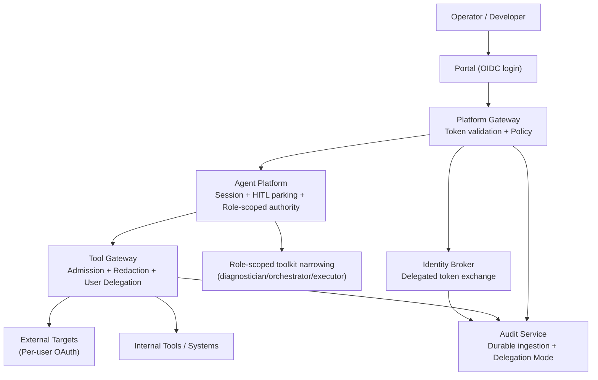

**Diagram sources**
- [exchange_service.py:148-195](file://products/identity-broker/src/identity_service/services/exchange_service.py#L148-L195)
- [delegation_client.py:81-104](file://products/platform-gateway/src/platform_gateway/services/delegation_client.py#L81-L104)
- [policy_engine.py:390-444](file://products/platform-gateway/src/platform_gateway/services/policy_engine.py#L390-L444)
- [gateway_service.py:307-334](file://products/tool-gateway/src/tool_gateway/services/gateway_service.py#L307-L334)
- [agent_role.py:30-49](file://products/agent-platform/src/agent_service/services/agent_role.py#L30-L49)
- [runtime_kernel.py:502-580](file://products/agent-platform/src/agent_service/runtime_kernel.py#L502-L580)
- [user_delegated_client.py:1-33](file://products/tool-gateway/src/tool_gateway/tools/user_delegated_client.py#L1-L33)
- [SPEC-013-durable-audit-trail/spec.md:52-73](file://docs/specs/SPEC-013-durable-audit-trail/spec.md#L52-L73)

**Section sources**
- [identity-and-authorization-design.md:60-166](file://docs/agentic-aiops-platform/identity-and-authorization-design.md#L60-L166)
- [policy-specification.md:22-59](file://docs/agentic-aiops-platform/policy-specification.md#L22-L59)

## Core Components
- Authentication and identity federation via Keycloak OIDC, with normalized roles and environment scopes passed downstream.
- Policy-as-code engine that evaluates action authorization with deny-by-default semantics and explicit approval tiers.
- Token delegation through a broker-mediated exchange to propagate user identity to downstream services without elevating roles.
- **New**: Role-scoped authority model with closed vocabulary (diagnostician/orchestrator/executor) that narrows agent capabilities at the toolkit layer while preserving the same delegated token.
- **New**: User-delegated outbound identity via per-user OAuth authorization-code flows, maintaining strict separation from machine grants.
- HITL approval workflow that parks mutating tool calls until a designated approver confirms or denies them, with role provenance tracking for executor-staged mutations.
- Deterministic output redaction at the tool gateway choke point to prevent credential leakage.
- Durable, permission-scoped audit trail with retention, bounded growth, and delegation mode attribution.

**Section sources**
- [identity-and-authorization-design.md:121-166](file://docs/agentic-aiops-platform/identity-and-authorization-design.md#L121-L166)
- [policy-engine.py:390-444](file://products/platform-gateway/src/platform_gateway/services/policy_engine.py#L390-L444)
- [exchange_service.py:148-195](file://products/identity-broker/src/identity_service/services/exchange_service.py#L148-L195)
- [agent_role.py:30-49](file://products/agent-platform/src/agent_service/services/agent_role.py#L30-L49)
- [user_delegated_client.py:1-33](file://products/tool-gateway/src/tool_gateway/tools/user_delegated_client.py#L1-L33)
- [gateway_service.py:307-334](file://products/tool-gateway/src/tool_gateway/services/gateway_service.py#L307-L334)
- [SPEC-013-durable-audit-trail/spec.md:30-73](file://docs/specs/SPEC-013-durable-audit-trail/spec.md#L30-L73)

## Architecture Overview
The platform enforces least privilege end-to-end across two distinct identity planes with an additional role-scoped authority dimension:

**Inbound Plane (Service-to-Service)**: The portal authenticates via Keycloak OIDC; the gateway validates tokens and forwards trusted identity. The policy engine evaluates actions against a versioned bundle with deny-by-default and approval outcomes. Mutating tool calls are parked and require tiered approval before execution. Service-to-service calls use broker-mediated delegated tokens bound to target audiences; roles are never elevated.

**Outbound Plane (User-Delegated)**: For external targets requiring per-user RBAC, the tool gateway acquires OAuth 2.x authorization-code credentials on behalf of the requesting user. These target-issued tokens carry the user's identity and authority, allowing external systems to enforce their own RBAC. The platform custodies encrypted refresh tokens but never elevates beyond the user's target-side authority.

**Role-Scoped Authority Model**: Within the agent platform, a closed vocabulary of roles (diagnostician/orchestrator/executor) narrows toolkit access at the agent layer while every role rides the same delegated token. This enables bounded read-only multi-agent orchestration without creating new principals or identity edges.

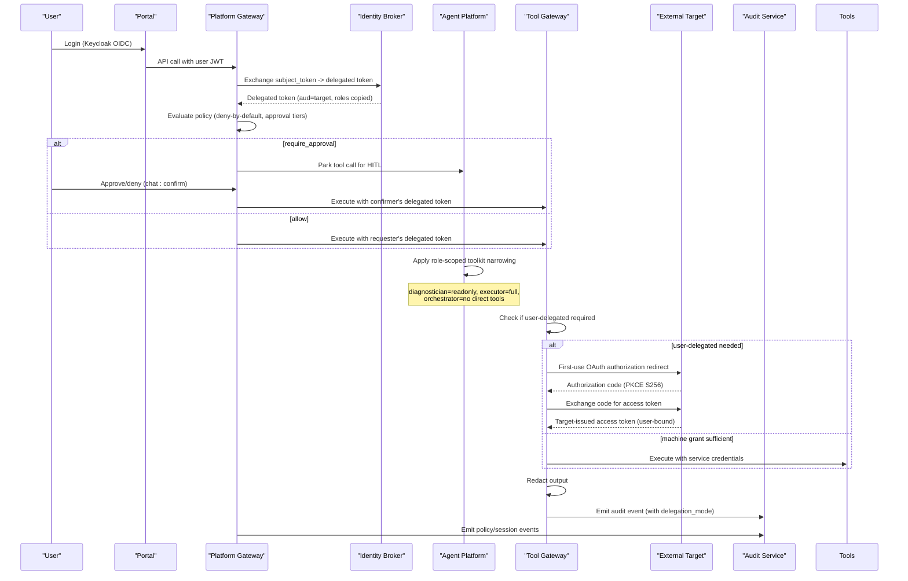

**Diagram sources**
- [delegation_client.py:81-104](file://products/platform-gateway/src/platform_gateway/services/delegation_client.py#L81-L104)
- [exchange_service.py:148-195](file://products/identity-broker/src/identity_service/services/exchange_service.py#L148-L195)
- [policy_engine.py:390-444](file://products/platform-gateway/src/platform_gateway/services/policy_engine.py#L390-L444)
- [gateway_service.py:307-334](file://products/tool-gateway/src/tool_gateway/services/gateway_service.py#L307-L334)
- [agent_role.py:30-49](file://products/agent-platform/src/agent_service/services/agent_role.py#L30-L49)
- [runtime_kernel.py:629-660](file://products/agent-platform/src/agent_service/runtime_kernel.py#L629-L660)
- [user_delegated_client.py:485-506](file://products/tool-gateway/src/tool_gateway/tools/user_delegated_client.py#L485-L506)
- [SPEC-013-durable-audit-trail/spec.md:52-73](file://docs/specs/SPEC-013-durable-audit-trail/spec.md#L52-L73)

## Detailed Component Analysis

### Authentication and Identity Propagation
- Keycloak OIDC is used for portal login and API access. Tokens are validated at the gateway, which forwards normalized identity context downstream.
- Identity flows into session state, policy checks, approvals, execution requests, and audit events. Human attribution is preserved even when workers execute on behalf of services.
- Group claims from AD/Keycloak are normalized into platform roles and environment scopes before policy evaluation.

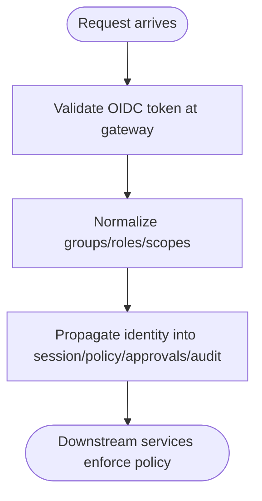

**Diagram sources**
- [identity-and-authorization-design.md:121-166](file://docs/agentic-aiops-platform/identity-and-authorization-design.md#L121-L166)
- [identity-and-authorization-design.md:278-331](file://docs/agentic-aiops-platform/identity-and-authorization-design.md#L278-L331)

**Section sources**
- [identity-and-authorization-design.md:60-166](file://docs/agentic-aiops-platform/identity-and-authorization-design.md#L60-L166)
- [identity-and-authorization-design.md:278-331](file://docs/agentic-aiops-platform/identity-and-authorization-design.md#L278-L331)

### Token Delegation and Service-to-Service Authentication
- The identity broker exposes an exchange endpoint that accepts a verified subject token and mints a short-lived, audience-bound delegated token. Roles are copied verbatim; no elevation occurs.
- The platform gateway obtains delegated tokens using either projected workload tokens or static client credentials.
- Delegated tokens carry actor information so audit logs record both the human subject and acting service.

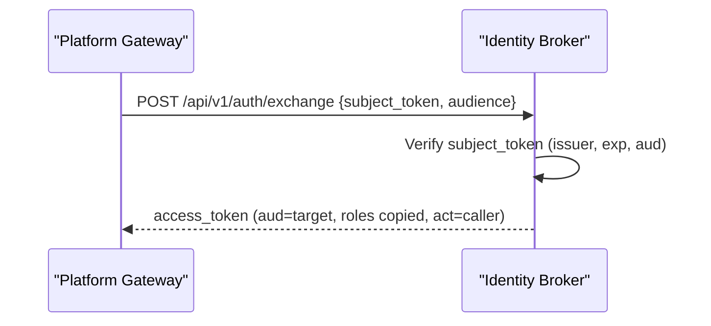

**Diagram sources**
- [exchange_service.py:148-195](file://products/identity-broker/src/identity_service/services/exchange_service.py#L148-L195)
- [delegation_client.py:81-104](file://products/platform-gateway/src/platform_gateway/services/delegation_client.py#L81-L104)

**Section sources**
- [exchange_service.py:1-43](file://products/identity-broker/src/identity_service/services/exchange_service.py#L1-L43)
- [exchange_service.py:148-195](file://products/identity-broker/src/identity_service/services/exchange_service.py#L148-L195)
- [delegation_client.py:81-104](file://products/platform-gateway/src/platform_gateway/services/delegation_client.py#L81-L104)

### Role-Scoped Authority Model and Multi-Agent Orchestration Foundation
**Updated** Added comprehensive documentation for the new role-scoped authority model that enables bounded read-only multi-agent orchestration while preserving single-edge identity.

The platform now implements a closed vocabulary of agent roles that narrow toolkit access at the agent platform layer while every role rides the same delegated token:

**Closed Role Vocabulary**: Three platform-owned roles with strict semantics:
- **Diagnostician**: Read-only toolkit access, reuses existing `_filter_read_only` logic
- **Executor**: Full toolkit access including mutating tools, but still requires HITL approval
- **Orchestrator**: No direct gateway tools - delegates to other roles but cannot invoke tools directly

**Same-Token Identity Preservation**: All roles operate on the same gateway-forwarded delegated token - no per-role broker minting, no new identity edges, no separate principals. The human requester's identity (`sub`, `namespace`, `subject`) remains unchanged across role transitions.

**Subtractive-Only Narrowing**: Role-based toolkit restrictions are always subsets of the underlying token's permissions - they can never grant capabilities that the token doesn't already possess. This maintains the existing gateway policy as the authoritative enforcement boundary.

**Phase Boundaries**: Phase 2 delivers an inert substrate with no active orchestration caller - the deployed single-agent path remains byte-identical. Future phases will add policy role axis, audit attribution, and bounded autonomous diagnosis.

```mermaid
sequenceDiagram
participant O as "Orchestrator"
participant D as "Diagnostician"
participant X as "Executor"
participant K as "Kernel"
participant T as "Toolkit Cache"
Note over O,D,X : Same delegated token, different toolkit access
O->>K : _ensure_toolkit(token)
K->>K : current_agent_role() = orchestrator
K->>T : cache_key = token : : orchestrator
T-->>K : Empty toolkit (no direct tools)
D->>K : _ensure_toolkit(token)
K->>K : current_agent_role() = diagnostician
K->>T : cache_key = token : : diagnostician
T-->>K : Read-only toolkit
X->>K : _ensure_toolkit(token)
K->>K : current_agent_role() = executor
K->>T : cache_key = token : : executor
T-->>K : Full toolkit (may include mutators)
Note over X : Mutating tools still park on HITL
```

**Diagram sources**
- [agent_role.py:30-49](file://products/agent-platform/src/agent_service/services/agent_role.py#L30-L49)
- [runtime_kernel.py:502-580](file://products/agent-platform/src/agent_service/runtime_kernel.py#L502-L580)
- [runtime_kernel.py:629-660](file://products/agent-platform/src/agent_service/runtime_kernel.py#L629-L660)
- [test_agent_role.py:148-171](file://products/agent-platform/tests/test_agent_role.py#L148-L171)

**Section sources**
- [agent_role.py:1-120](file://products/agent-platform/src/agent_service/services/agent_role.py#L1-L120)
- [runtime_kernel.py:502-660](file://products/agent-platform/src/agent_service/runtime_kernel.py#L502-L660)
- [test_agent_role.py:68-171](file://products/agent-platform/tests/test_agent_role.py#L68-L171)
- [0017-bounded-read-only-multi-agent-orchestration.md:73-81](file://docs/adr/0017-bounded-read-only-multi-agent-orchestration.md#L73-L81)
- [SPEC-073-role-scoped-agent-identity/spec.md:65-77](file://docs/specs/SPEC-073-role-scoped-agent-identity/spec.md#L65-L77)

### User-Delegated Outbound Identity and Per-User OAuth Flows
**Updated** Added comprehensive documentation for the new user-delegated outbound identity capabilities that enable tools to act as the requesting human against external targets.

The platform now supports two distinct identity planes with strict isolation:

**Machine Grants (Existing)**: Service accounts with `basic`, `bearer`, or `oauth2_client_credentials` schemes operate without user identity. These are suitable for internal tools or external systems that accept shared service accounts.

**User-Delegated Grants (New)**: The `oauth2_authorization_code` scheme enables per-user OAuth flows where tools act as the requesting human. The platform stores encrypted refresh tokens and exchanges them for target-issued access tokens that carry the user's identity and authority.

Key security properties:
- **No broker mint**: The identity broker does not sign or mint outbound tokens; only the target issues user-bound credentials
- **Fail closed**: Failed user-delegated acquisition never falls back to machine grants or other authentication methods
- **Strict isolation**: Machine and human identities remain separate throughout the platform boundary
- **Encrypted custody**: Refresh tokens are stored in Postgres with authenticated encryption and versioned keys
- **First-use consent**: Users complete one-time authorization flows against external targets when needed

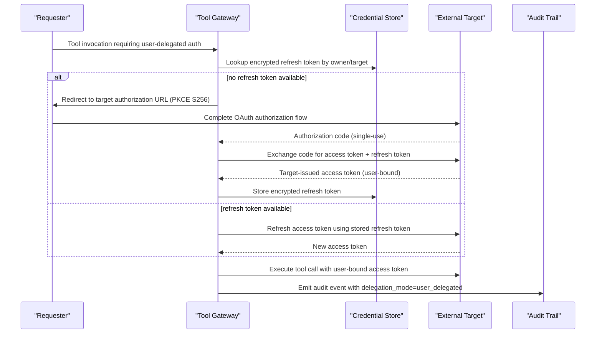

**Diagram sources**
- [user_delegated_client.py:485-506](file://products/tool-gateway/src/tool_gateway/tools/user_delegated_client.py#L485-L506)
- [authorization_transactions.py:65-100](file://products/tool-gateway/src/tool_gateway/services/authorization_transactions.py#L65-L100)
- [authorization_transaction_store.py:286-294](file://products/tool-gateway/src/tool_gateway/services/authorization_transaction_store.py#L286-L294)

**Section sources**
- [0015-outbound-user-delegated-identity-via-per-user-oauth.md:66-95](file://docs/adr/0015-outbound-user-delegated-identity-via-per-user-oauth.md#L66-L95)
- [0016-just-in-time-outbound-oauth-authorization.md:42-75](file://docs/adr/0016-just-in-time-outbound-oauth-authorization.md#L42-L75)
- [SPEC-070-outbound-user-delegated-identity/spec.md:98-113](file://docs/specs/SPEC-070-outbound-user-delegated-identity/spec.md#L98-L113)
- [user_delegated_client.py:1-33](file://products/tool-gateway/src/tool_gateway/tools/user_delegated_client.py#L1-L33)

### Policy Engine and Rule Evaluation
- The policy engine loads a versioned YAML bundle and evaluates actions with deny-by-default semantics. Outcomes include allow, deny, and require_approval with explicit tiers.
- Precedence: explicit deny wins; require_approval overrides allow; higher priority wins within an outcome class; disabled rules are ignored.
- The live permission matrix is derived from the same evaluate path, ensuring transparency matches enforcement.

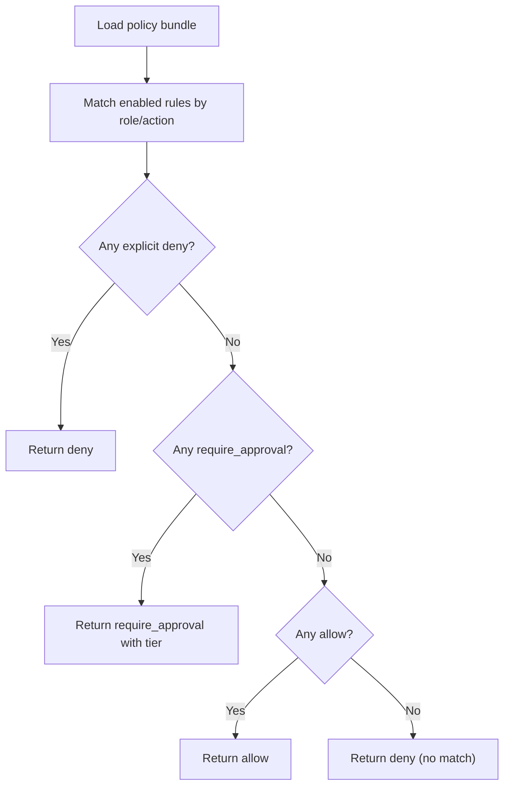

**Diagram sources**
- [policy_engine.py:390-444](file://products/platform-gateway/src/platform_gateway/services/policy_engine.py#L390-L444)
- [policy_matrix.py:1-35](file://products/platform-gateway/src/platform_gateway/services/policy_matrix.py#L1-L35)

**Section sources**
- [policy-specification.md:61-87](file://docs/agentic-aiops-platform/policy-specification.md#L61-L87)
- [policy-engine.py:390-444](file://products/platform-gateway/src/platform_gateway/services/policy_engine.py#L390-L444)
- [policy_matrix.py:1-35](file://products/platform-gateway/src/platform_gateway/services/policy_matrix.py#L1-L35)

### Authorization Matrix and Role Permissions
- Roles include read-only-observer, operator, developer, approver, auditor, and platform-admin. Environment scopes include dev, test, staging, prod. Action tiers range from tier 0 (read-only) to tier 3 (high-risk production).
- Feature access, environment eligibility, and action permissions are defined per role and environment. Approval matrices define who may request and approve at each tier.
- The shipped default bundle encodes these permissions as rules, including mutation gating and approval requirements.

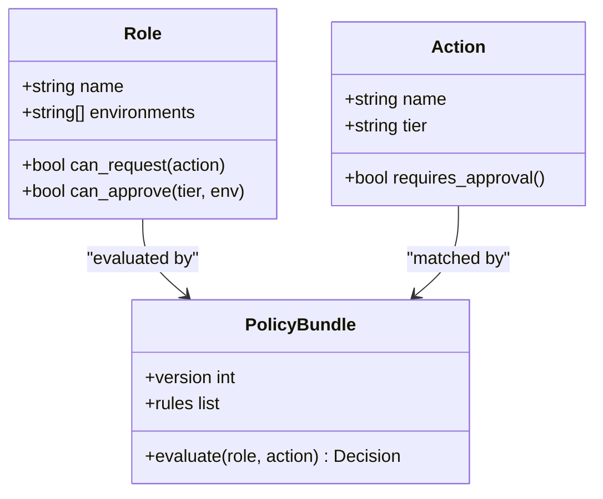

**Diagram sources**
- [authorization-matrix.md:155-265](file://docs/agentic-aiops-platform/authorization-matrix.md#L155-L265)
- [policy-default.yaml:53-152](file://shared/shared-contracts/policies/policy-default.yaml#L53-L152)

**Section sources**
- [authorization-matrix.md:16-60](file://docs/agentic-aiops-platform/authorization-matrix.md#L16-L60)
- [authorization-matrix.md:155-265](file://docs/agentic-aiops-platform/authorization-matrix.md#L155-L265)
- [policy-default.yaml:53-152](file://shared/shared-contracts/policies/policy-default.yaml#L53-L152)

### Secret Delivery Authorization and Approval Workflows
**Updated** Added comprehensive documentation for the new `secrets:deliver` policy action and enhanced approval workflows for secret delivery operations.

The platform now implements a distinct authorization model for secret delivery operations:

- **Separate Action Model**: The `secrets:deliver` action is independent from `tools:mutate`, allowing granular control over external secret delivery capabilities separate from general tool mutation permissions.
- **Write-Tier Enforcement**: Secret delivery operations are classified as write-tier, requiring the same approval gates as other mutating operations but with additional authorization checks.
- **Enhanced Approval Coverage**: The approval workflow now covers secret delivery operations, requiring tier-2 approval from designated approvers distinct from the requester.
- **Policy Integration**: The default policy bundle includes explicit grants for `secrets:deliver` to operational roles (platform-admin, approver, operator), maintaining separation of duties.

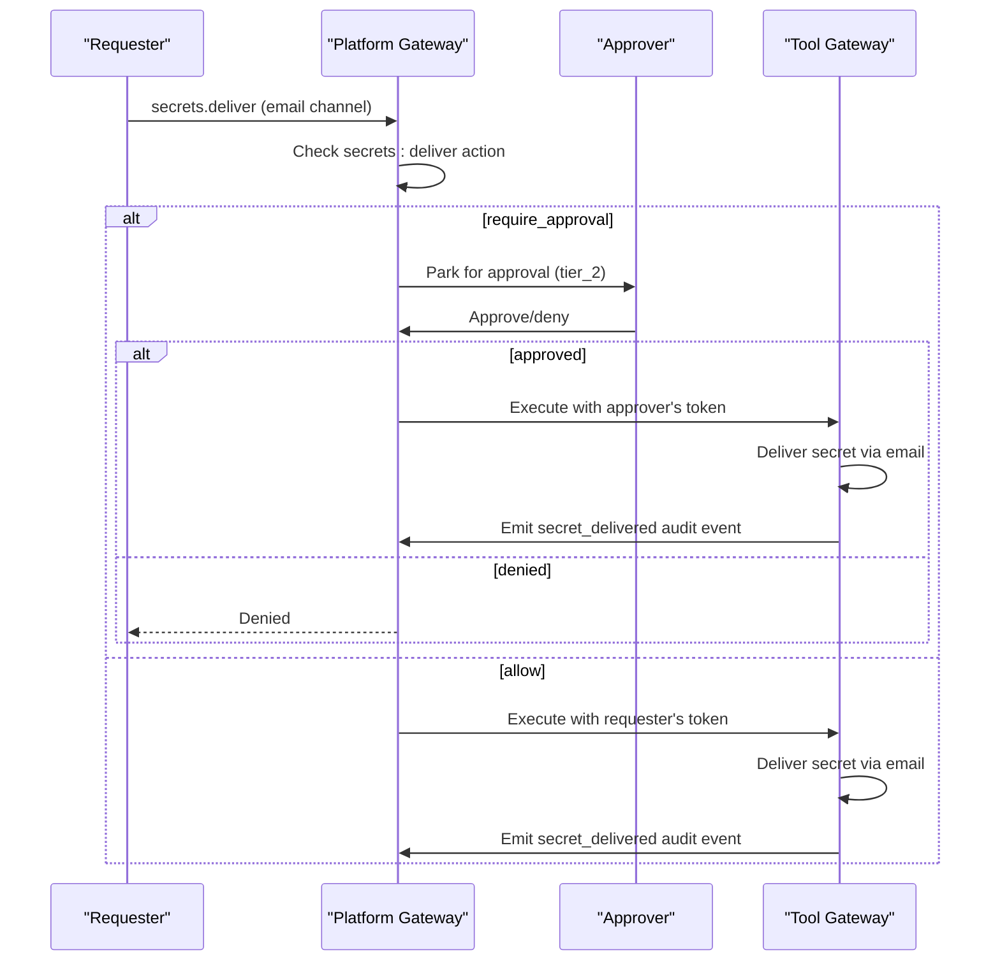

**Diagram sources**
- [gateway_service.py:1035-1050](file://products/platform-gateway/src/platform_gateway/services/gateway_service.py#L1035-L1050)
- [policy-default.yaml:130-152](file://shared/shared-contracts/policies/policy-default.yaml#L130-L152)
- [secrets_connector.py:576-620](file://products/tool-gateway/src/tool_gateway/tools/secrets_connector.py#L576-L620)

**Section sources**
- [policy-default.yaml:130-152](file://shared/shared-contracts/policies/policy-default.yaml#L130-L152)
- [gateway_service.py:1035-1050](file://products/platform-gateway/src/platform_gateway/services/gateway_service.py#L1035-L1050)
- [secrets_connector.py:576-620](file://products/tool-gateway/src/tool_gateway/tools/secrets_connector.py#L576-L620)

### Tool Execution Security and Data Redaction
- Tool invocation is admitted based on policy actions (tools:invoke for read-risk, tools:mutate for write/admin risk).
- Output redaction runs at a single choke point before both the HTTP response and audit log. If too much content appears to contain credentials, the result is withheld with a REDACTION_OVERFLOW error.
- Redaction targets known patterns (JWTs, bearer/basic credentials, PEM private keys, AWS-style keys) and explicit sensitive key names.

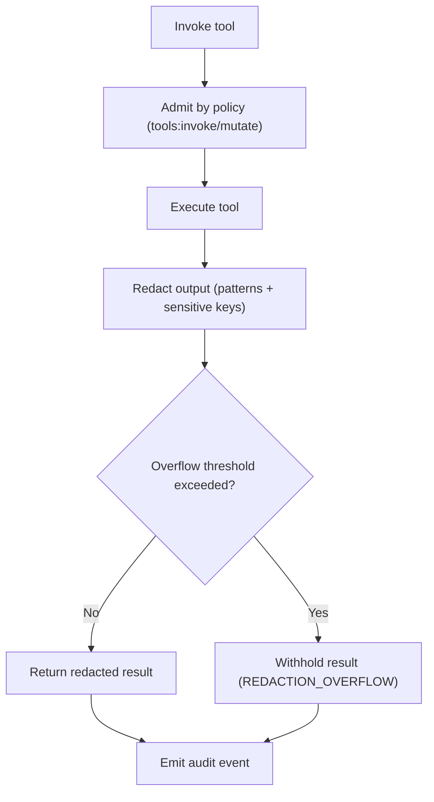

**Diagram sources**
- [gateway_service.py:307-334](file://products/tool-gateway/src/tool_gateway/services/gateway_service.py#L307-L334)
- [redaction.py:92-127](file://products/tool-gateway/src/tool_gateway/tools/redaction.py#L92-L127)

**Section sources**
- [gateway_service.py:307-334](file://products/tool-gateway/src/tool_gateway/services/gateway_service.py#L307-L334)
- [redaction.py:92-127](file://products/tool-gateway/src/tool_gateway/tools/redaction.py#L92-L127)

### Durable Audit Trail Integrity and Delegation Attribution
**Updated** Enhanced audit trail with delegation mode attribution to distinguish between machine-grant and user-delegated execution contexts.

The platform now emits comprehensive audit events with delegation mode attribution:

- **Delegation Modes**: Events carry `delegation_mode` values of `none` (legacy), `acting_service` (machine grants), or `user_delegated` (per-user OAuth flows)
- **Event Type**: New `target_authorization` event type tracks user-delegated authorization lifecycle events including successful authorization and failures
- **Attribution Fidelity**: Audit events preserve separate requester `sub`, acting service, target identity, and signed-execution correlation
- **Query Support**: Audit queries support filtering by `delegation_mode` to analyze machine vs. human execution patterns

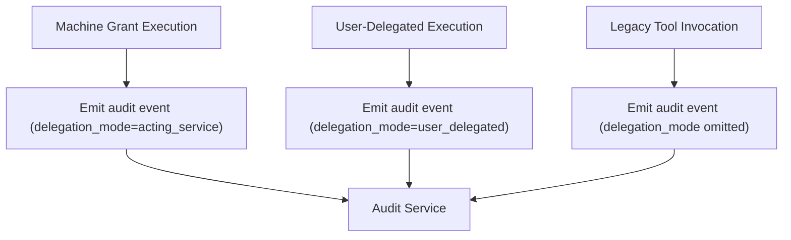

**Diagram sources**
- [audit.py:40-43](file://products/audit-service/src/audit_service/schemas/audit.py#L40-L43)
- [authorization_service.py:240-243](file://products/tool-gateway/src/tool_gateway/services/authorization_service.py#L240-L243)

**Section sources**
- [SPEC-013-durable-audit-trail/spec.md:30-73](file://docs/specs/SPEC-013-durable-audit-trail/spec.md#L30-L73)
- [SPEC-013-durable-audit-trail/spec.md:86-104](file://docs/specs/SPEC-013-durable-audit-trail/spec.md#L86-L104)
- [authorization_service.py:240-243](file://products/tool-gateway/src/tool_gateway/services/authorization_service.py#L240-L243)

### Role Provenance Tracking in HITL Confirmations
**Updated** Added role provenance tracking for executor-staged mutations in the HITL confirmation system.

The platform now tracks which agent role staged a mutation for audit and attribution purposes:

- **Staged By Role**: Pending confirmations carry a `staged_by_role` field indicating whether the mutation was staged by an `executor` role agent
- **Kernel-Internal Only**: Role provenance stays kernel-internal in phase 2 - it's recorded on the confirmation object but not persisted to durable records or wire schemas
- **Executor-Only Staging**: Only `executor` role agents can stage mutations; `diagnostician` and `orchestrator` roles have no mutating toolkit access
- **Human Approval Required**: Even executor-staged mutations require distinct human approval through the existing HITL workflow

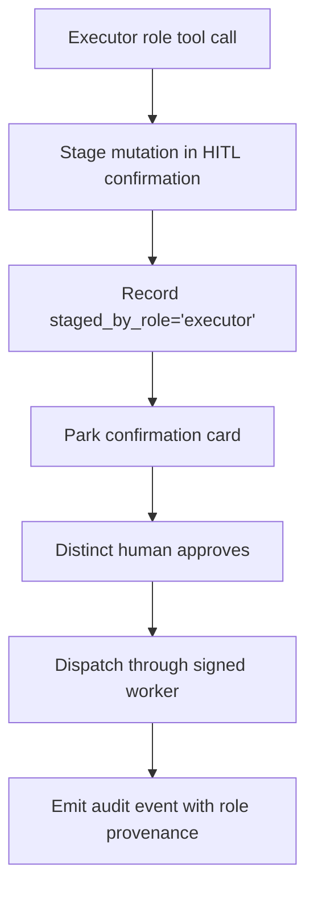

**Diagram sources**
- [hitl_confirmations.py:101-111](file://products/agent-platform/src/agent_service/services/hitl_confirmations.py#L101-L111)
- [test_agent_role.py:240-245](file://products/agent-platform/tests/test_agent_role.py#L240-L245)

**Section sources**
- [hitl_confirmations.py:101-111](file://products/agent-platform/src/agent_service/services/hitl_confirmations.py#L101-L111)
- [test_agent_role.py:240-245](file://products/agent-platform/tests/test_agent_role.py#L240-L245)
- [SPEC-073-role-scoped-agent-identity/spec.md:173-193](file://docs/specs/SPEC-073-role-scoped-agent-identity/spec.md#L173-L193)

### Secret Delivery Audit Events
**Updated** Enhanced audit trail with `secret_delivered` events for tracking secret delivery completion.

The platform now emits comprehensive audit events for secret delivery operations:

- **Event Type**: New `secret_delivered` event type tracks when generated secrets reach their intended recipients through external channels like email.
- **Event Content**: Audit events carry delivery metadata including delivery_id, channel type, and recipient information, but never the actual secret value.
- **Delivery Points**: Events are emitted at key delivery points - when portal-copy handoffs are redeemed and when external channels successfully deliver secrets.
- **Integration**: The audit service schema has been updated to validate and store these new event types alongside existing audit events.

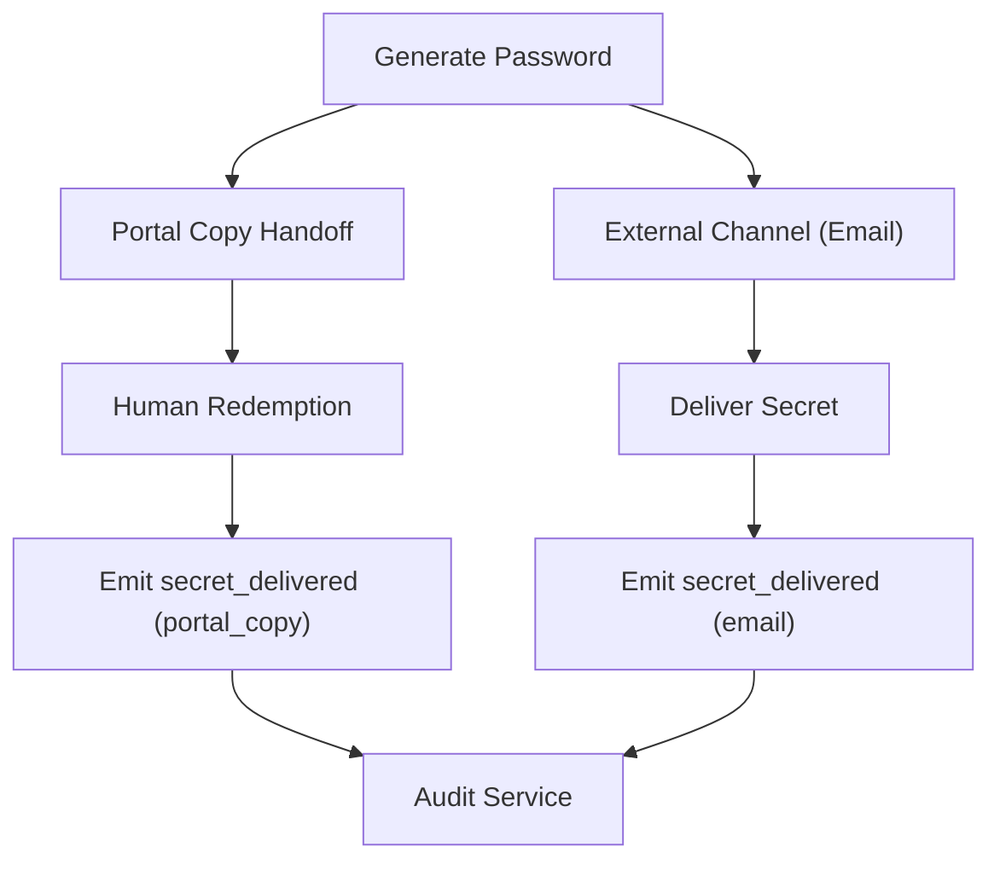

**Diagram sources**
- [routes/secrets.py:76-94](file://products/tool-gateway/src/tool_gateway/api/routes/secrets.py#L76-L94)
- [audit.py:40-43](file://products/audit-service/src/audit_service/schemas/audit.py#L40-L43)
- [app.py:131-144](file://products/tool-gateway/src/tool_gateway/app.py#L131-L144)

**Section sources**
- [routes/secrets.py:76-94](file://products/tool-gateway/src/tool_gateway/api/routes/secrets.py#L76-L94)
- [audit.py:40-43](file://products/audit-service/src/audit_service/schemas/audit.py#L40-L43)
- [app.py:131-144](file://products/tool-gateway/src/tool_gateway/app.py#L131-L144)

## Dependency Analysis
- Platform gateway depends on the policy engine and policy bundle to enforce action authorization and approval requirements.
- Identity broker provides delegated tokens to platform gateway; roles are copied, never elevated.
- Agent platform integrates role-scoped authority model that narrows toolkit access while preserving the same delegated token.
- Tool gateway depends on policy actions for admission, applies deterministic redaction before emitting audit events, and manages per-user OAuth credential acquisition.
- Audit service depends on emitters to forward events and provides a policy-gated query API with delegation mode filtering.

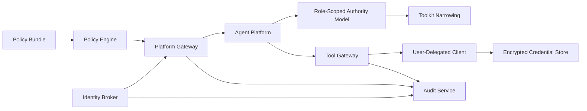

**Diagram sources**
- [policy_engine.py:390-444](file://products/platform-gateway/src/platform_gateway/services/policy_engine.py#L390-L444)
- [exchange_service.py:148-195](file://products/identity-broker/src/identity_service/services/exchange_service.py#L148-L195)
- [agent_role.py:30-49](file://products/agent-platform/src/agent_service/services/agent_role.py#L30-L49)
- [runtime_kernel.py:502-580](file://products/agent-platform/src/agent_service/runtime_kernel.py#L502-L580)
- [gateway_service.py:307-334](file://products/tool-gateway/src/tool_gateway/services/gateway_service.py#L307-L334)
- [user_delegated_client.py:1-33](file://products/tool-gateway/src/tool_gateway/tools/user_delegated_client.py#L1-L33)
- [SPEC-013-durable-audit-trail/spec.md:52-73](file://docs/specs/SPEC-013-durable-audit-trail/spec.md#L52-L73)

**Section sources**
- [policy_engine.py:390-444](file://products/platform-gateway/src/platform_gateway/services/policy_engine.py#L390-L444)
- [exchange_service.py:148-195](file://products/identity-broker/src/identity_service/services/exchange_service.py#L148-L195)
- [agent_role.py:30-49](file://products/agent-platform/src/agent_service/services/agent_role.py#L30-L49)
- [runtime_kernel.py:502-580](file://products/agent-platform/src/agent_service/runtime_kernel.py#L502-L580)
- [gateway_service.py:307-334](file://products/tool-gateway/src/tool_gateway/services/gateway_service.py#L307-L334)
- [user_delegated_client.py:1-33](file://products/tool-gateway/src/tool_gateway/tools/user_delegated_client.py#L1-L33)
- [SPEC-013-durable-audit-trail/spec.md:52-73](file://docs/specs/SPEC-013-durable-audit-trail/spec.md#L52-L73)

## Performance Considerations
- Policy evaluation is lightweight and operates on an in-memory bundle; ensure bundles remain concise and prioritized to minimize matching overhead.
- Redaction walks serialized results; keep tool outputs bounded to avoid excessive traversal and potential overflow rejections.
- Audit ingestion is fire-and-forget with timeouts; configure appropriate backends and retention to avoid storage pressure.
- **New**: Role-scoped toolkit caching uses per-role cache keys `(token, role)` to maintain separate toolkits per role while avoiding redundant discovery calls.
- **New**: User-delegated OAuth acquisition uses process-local LRU-bounded access token caching with single-flight coordination to minimize redundant token exchanges while maintaining security boundaries.
- **New**: Encrypted credential store operations are bounded and coordinated across replicas; rotation and revocation must be tested for performance impact.

## Troubleshooting Guide
- Token exchange failures: verify service credentials, subject token validity, and audience allow-lists. Check metrics and logs for exchange errors.
- Policy denials: inspect matched rule IDs and reasons returned by the policy engine; confirm roles and actions align with the bundle.
- Approval blocks: ensure the caller holds the required decider roles and that self-approval is permitted per tier; review blocked confirmation events.
- Redaction overflow: if tool output is withheld due to high credential density, tighten parameters or scope inputs to reduce sensitive content.
- Audit ingestion issues: confirm emitter URLs and service identities; check audit service health and retention configuration.
- Secret delivery failures: verify email channel configuration, recipient allowlists, and SMTP connectivity; check for UPSTREAM_ERROR responses.
- **New**: Role-scoped authority issues: verify that role values are from the closed enum (diagnostician/orchestrator/executor), check that toolkit narrowing is subtractive-only, and confirm that unknown roles fail closed to empty toolkit.
- **New**: User-delegated OAuth failures: check target client registration, callback URI configuration, PKCE S256 support, and refresh token rotation; verify that failed acquisitions fail closed without falling back to machine grants.

**Section sources**
- [exchange_service.py:148-195](file://products/identity-broker/src/identity_service/services/exchange_service.py#L148-L195)
- [policy_engine.py:390-444](file://products/platform-gateway/src/platform_gateway/services/policy_engine.py#L390-L444)
- [gateway_service.py:307-334](file://products/tool-gateway/src/tool_gateway/services/gateway_service.py#L307-L334)
- [agent_role.py:70-85](file://products/agent-platform/src/agent_service/services/agent_role.py#L70-L85)
- [runtime_kernel.py:654-660](file://products/agent-platform/src/agent_service/runtime_kernel.py#L654-L660)
- [user_delegated_client.py:87-100](file://products/tool-gateway/src/tool_gateway/tools/user_delegated_client.py#L87-L100)
- [SPEC-013-durable-audit-trail/spec.md:52-73](file://docs/specs/SPEC-013-durable-audit-trail/spec.md#L52-L73)

## Conclusion
Luban AIOPS enforces least privilege through a layered model: OIDC-based authentication, policy-as-code authorization with explicit approval tiers, broker-mediated token delegation preserving human attribution, deterministic redaction of tool outputs, and a durable audit trail with retention. The authorization matrix defines clear permissions per role and environment, while the policy engine ensures consistent enforcement.

The platform now supports three complementary security dimensions: inbound service-to-service delegation using broker-mediated tokens, outbound user-delegated execution using per-user OAuth credentials, and role-scoped authority narrowing within the same delegated token context. The role-scoped authority model enables bounded read-only multi-agent orchestration while maintaining strict isolation between machine identities (service accounts) and human identities (per-user delegation), ensuring that external systems can enforce their own RBAC on individual users rather than shared service accounts. Operators can configure security settings, extend policies, add OAuth target integrations, and implement additional controls while maintaining separation of duties and auditability.

## Appendices

### Configuring Security Settings
- Configure Keycloak realm, clients, and federation to your directory source; set OIDC client IDs and redirect URIs for the portal and APIs.
- Set identity broker settings for token TTLs, issuer, audience, and service client registry; enable workload identity if using projected service-account tokens.
- Configure platform gateway policy path and audience for delegated tokens; ensure the policy bundle is versioned and synced.
- Enable tool gateway redaction and tune thresholds; configure audit service URL for durable ingestion.

**Section sources**
- [identity-and-authorization-design.md:121-166](file://docs/agentic-aiops-platform/identity-and-authorization-design.md#L121-L166)
- [exchange_service.py:148-195](file://products/identity-broker/src/identity_service/services/exchange_service.py#L148-L195)
- [delegation_client.py:81-104](file://products/platform-gateway/src/platform_gateway/services/delegation_client.py#L81-L104)
- [gateway_service.py:307-334](file://products/tool-gateway/src/tool_gateway/services/gateway_service.py#L307-L334)
- [SPEC-013-durable-audit-trail/spec.md:52-73](file://docs/specs/SPEC-013-durable-audit-trail/spec.md#L52-L73)

### Defining Custom Policies
- Add or modify rules in the policy bundle with clear id, domain, priority, match criteria, decision, and conditions.
- Use require_approval with explicit tiers for sensitive actions; ensure decided_by_roles excludes synthetic identities where appropriate.
- Test precedence and deny-by-default behavior; use policy diff and scenario tests before rollout.

**Section sources**
- [policy-specification.md:158-255](file://docs/agentic-aiops-platform/policy-specification.md#L158-L255)
- [policy-default.yaml:53-152](file://shared/shared-contracts/policies/policy-default.yaml#L53-L152)
- [policy_engine.py:390-444](file://products/platform-gateway/src/platform_gateway/services/policy_engine.py#L390-L444)

### Implementing Additional Authorization Controls
- Introduce new actions (e.g., resource-specific verbs) and map them to roles and environments in the bundle.
- Enforce separation of duties by restricting self-approval for high-risk tiers and requiring designated approvers.
- Extend HITL parking to new mutating tool categories and ensure confirm paths are bridged in the gateway.

**Section sources**
- [authorization-matrix.md:183-265](file://docs/agentic-aiops-platform/authorization-matrix.md#L183-L265)
- [approval-and-hitl.md:190-215](file://docs/guides/approval-and-hitl.md#L190-L215)
- [policy-default.yaml:130-152](file://shared/shared-contracts/policies/policy-default.yaml#L130-L152)

### Configuring Role-Scoped Authority Model
**New** Added configuration guidance for the role-scoped authority model implementation.

- The role-scoped authority model is currently inert in phase 2 - no orchestration caller binds roles yet
- When future phases activate role binding, ensure that role values come from the closed enum (diagnostician/orchestrator/executor)
- Verify that toolkit narrowing follows subtractive-only principles - roles can only restrict, never expand, toolkit access
- Monitor that unknown or malformed roles fail closed to empty toolkit rather than being coerced to wider postures
- Ensure that role provenance tracking captures executor-staged mutations for audit attribution in future phases

**Section sources**
- [agent_role.py:30-49](file://products/agent-platform/src/agent_service/services/agent_role.py#L30-L49)
- [runtime_kernel.py:629-660](file://products/agent-platform/src/agent_service/runtime_kernel.py#L629-L660)
- [test_agent_role.py:93-104](file://products/agent-platform/tests/test_agent_role.py#L93-L104)
- [SPEC-073-role-scoped-agent-identity/spec.md:113-130](file://docs/specs/SPEC-073-role-scoped-agent-identity/spec.md#L113-L130)

### Configuring Secret Delivery Security
**Updated** Added configuration guidance for secret delivery security controls.

- Configure email delivery channels with proper SMTP settings, recipient allowlists, and TLS encryption.
- Set secret delivery TTL values to control how long generated secrets remain available for redemption.
- Configure password policies for generated secrets including minimum length requirements and character class mandates.
- Enable recipient warning acknowledgments to ensure approvers understand when secrets will be sent to external recipients.
- Monitor secret delivery audit events for successful deliveries and track delivery channels used.

**Section sources**
- [secrets_connector.py:295-332](file://products/tool-gateway/src/tool_gateway/tools/secrets_connector.py#L295-L332)
- [app.py:146-162](file://products/tool-gateway/src/tool_gateway/app.py#L146-L162)
- [policy-default.yaml:130-152](file://shared/shared-contracts/policies/policy-default.yaml#L130-L152)

### Configuring User-Delegated OAuth Targets
**New** Added configuration guidance for setting up per-user OAuth authorization flows with external targets.

- Register the platform as a confidential OAuth client with the external target, configuring exact HTTPS callback URIs and PKCE S256 support.
- Configure authorization and token endpoints, target identity endpoints for account verification, and allowed scopes/resource destinations.
- Set refresh token lifetimes, access token caches, and local TTL defaults following the pinned specifications (60-second start, 600-second transaction limits).
- Configure encrypted credential store with Postgres backend, application-level authenticated encryption, and separately mounted versioned keys.
- Enable first-use authorization redirects for users who haven't completed target consent; subsequent calls use server-to-server renewal.
- Monitor delegation mode audit events to distinguish between machine-grant and user-delegated execution patterns.

**Section sources**
- [SPEC-070-outbound-user-delegated-identity/spec.md:156-177](file://docs/specs/SPEC-070-outbound-user-delegated-identity/spec.md#L156-L177)
- [user_delegated_client.py:605-623](file://products/tool-gateway/src/tool_gateway/tools/user_delegated_client.py#L605-L623)
- [authorization_transaction_store.py:286-294](file://products/tool-gateway/src/tool_gateway/services/authorization_transaction_store.py#L286-L294)
- [0016-just-in-time-outbound-oauth-authorization.md:42-75](file://docs/adr/0016-just-in-time-outbound-oauth-authorization.md#L42-L75)