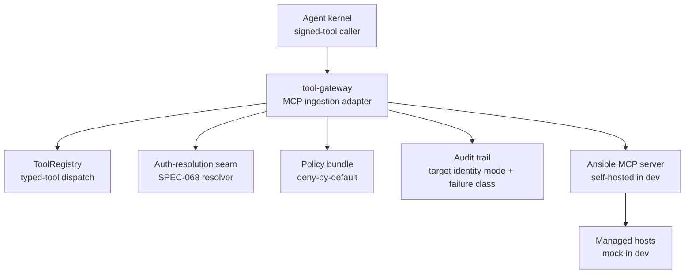
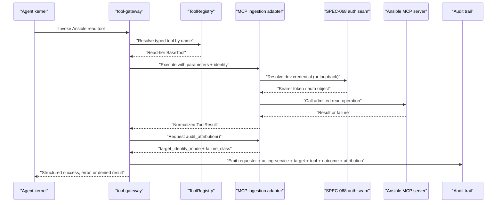
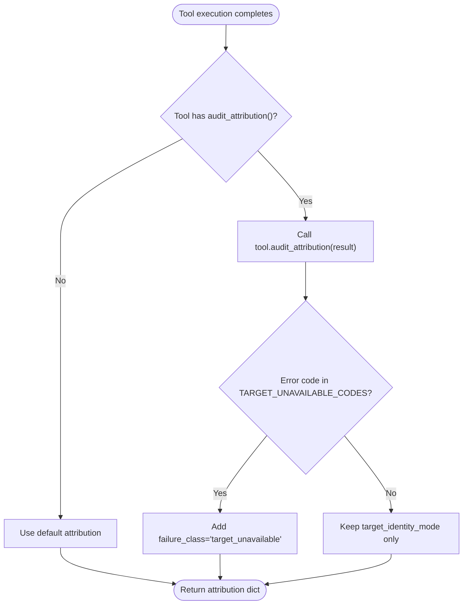
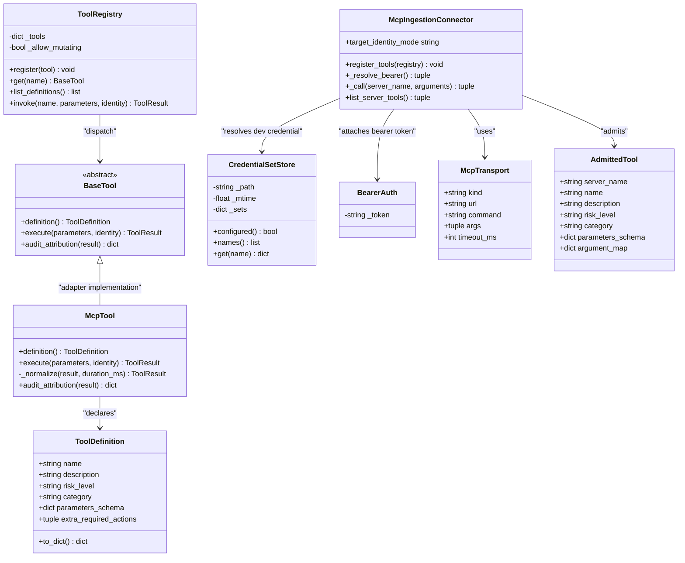
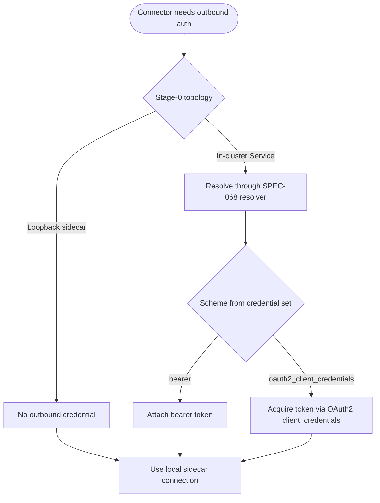
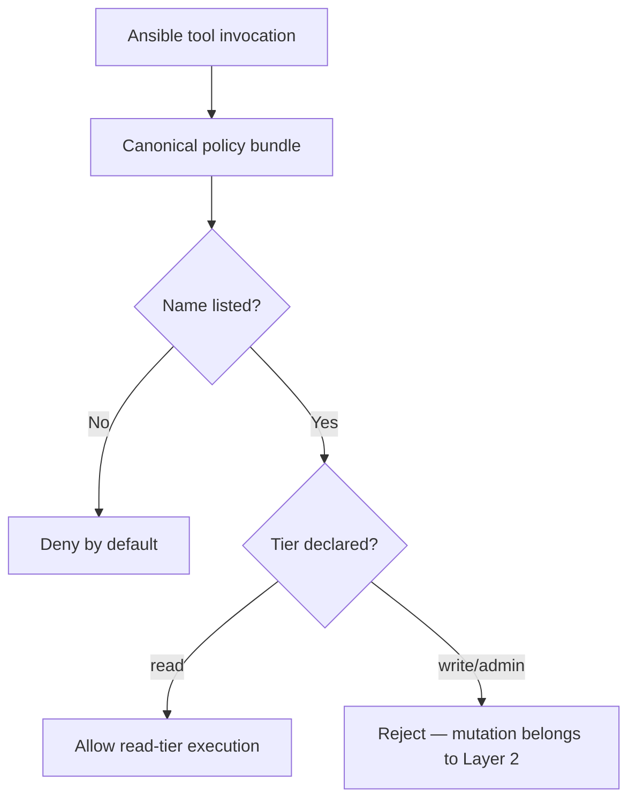
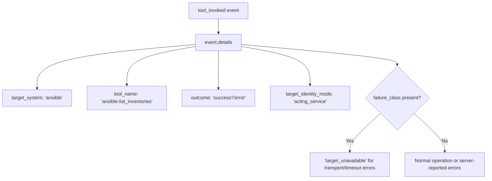
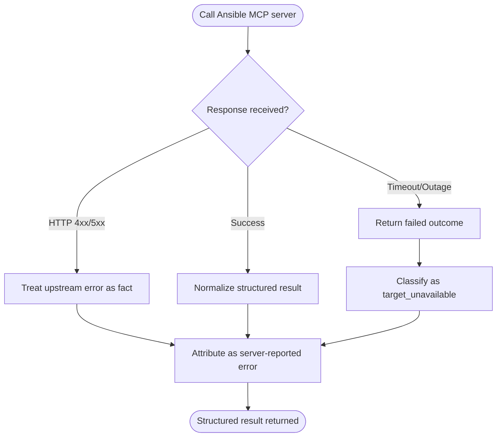
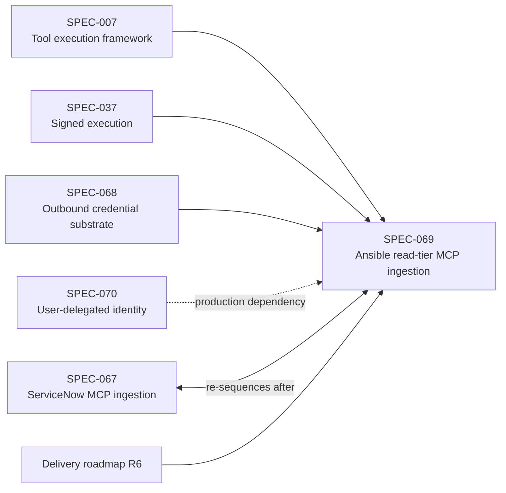

# SPEC-069: Ansible Read-Tier MCP-Ingestion Pilot

<cite>
**Referenced Files in This Document**   
- [spec.md](file://docs/specs/SPEC-069-ansible-read-tier-mcp-ingestion-pilot/spec.md)
- [plan.md](file://docs/specs/SPEC-069-ansible-read-tier-mcp-ingestion-pilot/plan.md)
- [tasks.md](file://docs/specs/SPEC-069-ansible-read-tier-mcp-ingestion-pilot/tasks.md)
- [delivery-roadmap.md](file://docs/agentic-aiops-platform/delivery-roadmap.md)
- [mcp-ingestion-resequencing-spike.md](file://docs/workspace/mcp-ingestion-resequencing-spike.md)
- [policy-default.yaml](file://shared/shared-contracts/policies/policy-default.yaml)
- [base.py](file://products/tool-gateway/src/tool_gateway/tools/base.py)
- [registry.py](file://products/tool-gateway/src/tool_gateway/tools/registry.py)
- [credential_sets.py](file://products/tool-gateway/src/tool_gateway/tools/credential_sets.py)
- [auth_resolution.py](file://products/tool-gateway/src/tool_gateway/tools/auth_resolution.py)
- [config.py](file://products/tool-gateway/src/tool_gateway/core/config.py)
- [pyproject.toml](file://products/tool-gateway/pyproject.toml)
- [mcp_adapter.py](file://products/tool-gateway/src/tool_gateway/ingestion/mcp_adapter.py)
- [ansible_binding.py](file://products/tool-gateway/src/tool_gateway/ingestion/ansible_binding.py)
- [ansible_native.py](file://products/tool-gateway/src/tool_gateway/ingestion/ansible_native.py)
- [gateway_service.py](file://products/tool-gateway/src/tool_gateway/services/gateway_service.py)
- [test_ansible_mcp_ingestion.py](file://products/tool-gateway/tests/test_ansible_mcp_ingestion.py)
- [test_ansible_native.py](file://products/tool-gateway/tests/test_ansible_native.py)
- [mock_ansible_mcp_server.py](file://shared/platform-ops/gitops/runtime-profiles/ansible-dev/mock_ansible_mcp_server.py)
</cite>

## Update Summary
**Changes Made**   
- Updated R-6 delivery status to reflect complete implementation with live validation results
- Added comprehensive post-delivery review findings including enhanced audit attribution system
- Documented the duck-typed `audit_attribution()` method implementation with target identity mode support
- Updated supply-chain decision from SurgeX-Labs/awx-mcp-server to Red Hat's ansible/aap-mcp-server as production target
- Added detailed fail-closed failure classification mechanisms for transport/timeout/SDK errors
- Enhanced troubleshooting guide with new audit attribution troubleshooting entries

## Table of Contents
1. [Introduction](#introduction)
2. [Project Structure](#project-structure)
3. [Core Components](#core-components)
4. [Architecture Overview](#architecture-overview)
5. [Detailed Component Analysis](#detailed-component-analysis)
6. [Dependency Analysis](#dependency-analysis)
7. [Performance Considerations](#performance-considerations)
8. [Troubleshooting Guide](#troubleshooting-guide)
9. [Conclusion](#conclusion)

## Introduction
SPEC-069 defines a read-only pilot that brings Ansible visibility into the platform through tool-gateway's governed tool path. It builds a generic, server-agnostic MCP-ingestion adapter over the official `mcp` Python SDK and binds it to an Ansible MCP server provisioned in the dev cluster. The adapter maps discovered tools into the existing `BaseTool` / `ToolDefinition` / `ToolRegistry` seam as typed tools, admits only a narrow read-only discovery set, enforces deny-by-default policy coverage, records audit attribution with target identity mode support, and preserves fail-closed behavior with no fabrication.

The pilot is explicitly Layer 1 (read-only discovery). A separate write-tier fast-follow will model runbooks as typed tools behind the existing HITL machinery. The production governance target is user-delegated identity carried to managed targets; this mechanism is extracted to **SPEC-070** (outbound user-delegated identity substrate) and is not implemented here. Development authenticates through SPEC-068's delivered outbound-credential substrate or uses no credential when Stage-0 selects a loopback-bound sidecar topology.

**Updated** Supply-chain decision corrected at R-6 review (2026-10-17): SurgeX-Labs/awx-mcp-server dropped due to stdio-only MCP limitation, no declared license, and mcp>=1.0.0 incompatibility. Production target is now Red Hat's Apache-2.0 licensed `ansible/aap-mcp-server` with streamable-HTTP transport at `/mcp`, validated against an in-cluster thin mock MCP server for CI. All references to "SPEC-068 follow-up substrate" replaced with specific "SPEC-070" references. **Stage-0 verification closed on 2026-10-13** with all six verification items completed, confirming finalized read-only tool set and mcp==2.3.0 dependency pin.

**Section sources**
- [spec.md:64-79](file://docs/specs/SPEC-069-ansible-read-tier-mcp-ingestion-pilot/spec.md#L64-L79)
- [spec.md:152-168](file://docs/specs/SPEC-069-ansible-read-tier-mcp-ingestion-pilot/spec.md#L152-L168)
- [plan.md:23-63](file://docs/specs/SPEC-069-ansible-read-tier-mcp-ingestion-pilot/plan.md#L23-L63)

## Project Structure
SPEC-069 touches three layers of the repository:

| Layer | Repository location | Responsibility under SPEC-069 |
|---|---|---|
| Specification | `docs/specs/SPEC-069-ansible-read-tier-mcp-ingestion-pilot/` | Requirements, plan, tasks, operator direction, sequencing, and delivery gates |
| Platform code | `products/tool-gateway/src/tool_gateway/` | Generic MCP ingestion adapter, Ansible read-only binding, typed-tool registration, and direct `mcp` dependency |
| Policy contracts | `shared/shared-contracts/policies/` | Canonical deny-by-default bundle naming each admitted Ansible read tool at read tier |
| Dev provisioning | `shared/platform-ops/gitops/dev-k8s/` | Self-hosted Ansible MCP server + mock managed host overlay and credential delivery |

**Diagram sources**
- [spec.md:186-221](file://docs/specs/SPEC-069-ansible-read-tier-mcp-ingestion-pilot/spec.md#L186-L221)
- [plan.md:94-129](file://docs/specs/SPEC-069-ansible-read-tier-mcp-ingestion-pilot/plan.md#L94-L129)
- [base.py:15-34](file://products/tool-gateway/src/tool_gateway/tools/base.py#L15-L34)
- [registry.py:18-55](file://products/tool-gateway/src/tool_gateway/tools/registry.py#L18-L55)

**Section sources**
- [spec.md:346-371](file://docs/specs/SPEC-069-ansible-read-tier-mcp-ingestion-pilot/spec.md#L346-L371)
- [plan.md:94-129](file://docs/specs/SPEC-069-ansible-read-tier-mcp-ingestion-pilot/plan.md#L94-L129)
- [mcp-ingestion-resequencing-spike.md:142-189](file://docs/workspace/mcp-ingestion-resequencing-spike.md#L142-L189)

## Core Components
SPEC-069 centers on five requirement-driven components rather than one monolithic module:

| Requirement | Component | Key behavior |
|---|---|---|
| R-1 | Outbound identity and topology | Consumes SPEC-068's resolver for dev credentials or uses a loopback sidecar with no outbound credential; records production user-delegated identity as a dependency on **SPEC-070** |
| R-2 | Server-agnostic MCP ingestion adapter | Maps MCP server tools into typed `ToolDefinition` entries registered beside native connectors; endpoint, admitted tools, and tier mapping are configuration |
| R-3 | Deny-by-default policy coverage | Each named Ansible read tool resolves to read tier; unlisted names and mutation names stay denied |
| R-4 | Audit fidelity and attribution | Records requester identity, acting service identity, target system, tool name, outcome, and the dev-vs-production delegation distinction with target identity mode support |
| R-5 | Fail-closed guardrail | Target outage, timeout, or error becomes a failed outcome with `target_unavailable` classification; dry-run is never admitted at read tier |
| R-6 | Provisioning and overlay wiring | Deploys self-hosted Ansible MCP server + mock managed host through GitOps overlays; AAP validation is an operator step outside CI |

**Updated** All requirements R-2 through R-6 are now unblocked and finalized following Stage-0 closure on 2026-10-13, though exact parameter schemas finalize at R-2 implementation. R-4 and R-5 are fully delivered with comprehensive audit attribution and fail-closed failure classification mechanisms.

**Section sources**
- [spec.md:159-300](file://docs/specs/SPEC-069-ansible-read-tier-mcp-ingestion-pilot/spec.md#L159-L300)
- [plan.md:65-179](file://docs/specs/SPEC-069-ansible-read-tier-mcp-ingestion-pilot/plan.md#L65-L179)
- [tasks.md:23-139](file://docs/specs/SPEC-069-ansible-read-tier-mcp-ingestion-pilot/tasks.md#L23-L139)

## Architecture Overview
The architecture keeps the gateway as the sole MCP client boundary. The agent-platform kernel never becomes an MCP client; it calls tools through the existing signed-tool path, while tool-gateway owns transport, admission, authentication, redaction, evidence, and audit with enhanced attribution capabilities.

**Diagram sources**
- [spec.md:186-221](file://docs/specs/SPEC-069-ansible-read-tier-mcp-ingestion-pilot/spec.md#L186-L221)
- [spec.md:239-280](file://docs/specs/SPEC-069-ansible-read-tier-mcp-ingestion-pilot/spec.md#L239-L280)
- [plan.md:94-163](file://docs/specs/SPEC-069-ansible-read-tier-mcp-ingestion-pilot/plan.md#L94-L163)
- [base.py:119-134](file://products/tool-gateway/src/tool_gateway/tools/base.py#L119-L134)
- [registry.py:65-89](file://products/tool-gateway/src/tool_gateway/tools/registry.py#L65-L89)

## Detailed Component Analysis

### Enhanced Audit Attribution System with Target Identity Mode Support
The audit attribution system has been significantly enhanced with target identity mode support. Both the MCP adapter and native fallback implement duck-typed `audit_attribution()` methods that provide two key pieces of information:

1. **Target Identity Mode**: Distinguishes between `acting_service` (current dev/self-hosted topology) and `user_delegated` (future SPEC-070 production path)
2. **Failure Classification**: Classifies failures as `target_unavailable` for transport/timeout/SDK errors, distinct from policy denials or server-reported tool errors

**Diagram sources**
- [mcp_adapter.py:455-471](file://products/tool-gateway/src/tool_gateway/ingestion/mcp_adapter.py#L455-L471)
- [ansible_native.py:203-216](file://products/tool-gateway/src/tool_gateway/ingestion/ansible_native.py#L203-L216)
- [gateway_service.py:393-422](file://products/tool-gateway/src/tool_gateway/services/gateway_service.py#L393-L422)

Key implementation details:
- The `TARGET_IDENTITY_ACTING_SERVICE = "acting_service"` constant defines the current dev topology mode
- The `TARGET_UNAVAILABLE_CODES = frozenset({"MCP_SDK_UNAVAILABLE", "MCP_TRANSPORT_ERROR"})` classifies transport failures
- The gateway service calls `audit_attribution()` as an opt-in hook, maintaining backward compatibility
- Audit events include both `target_identity_mode` and conditional `failure_class` fields

**Updated** Implementation is complete with enhanced audit attribution supporting target identity modes and fail-closed failure classification. The duck-typed attribution hook allows tools to opt-in to enhanced audit metadata without breaking existing functionality.

**Section sources**
- [mcp_adapter.py:56-70](file://products/tool-gateway/src/tool_gateway/ingestion/mcp_adapter.py#L56-L70)
- [mcp_adapter.py:455-471](file://products/tool-gateway/src/tool_gateway/ingestion/mcp_adapter.py#L455-L471)
- [ansible_native.py:54-68](file://products/tool-gateway/src/tool_gateway/ingestion/ansible_native.py#L54-L68)
- [ansible_native.py:203-216](file://products/tool-gateway/src/tool_gateway/ingestion/ansible_native.py#L203-L216)
- [gateway_service.py:393-422](file://products/tool-gateway/src/tool_gateway/services/gateway_service.py#L393-L422)

### MCP Ingestion Adapter and Typed-Tool Model
The adapter is the reusable core of SPEC-069. It consumes the official `mcp` Python SDK, treats server-advertised metadata as untrusted input, and maps discovered tools into typed `ToolDefinition` objects registered through the SPEC-007 seam. Tool admission and tier mapping are configuration — endpoint, admitted tool names, and tier mapping — so the same adapter can bind a self-hosted AWX/mock server in development, AAP's read-only-mode server in production, a future ServiceNow binding, and the Layer-2 runbook-typed-tool fast-follow without changing adapter code.

**Diagram sources**
- [base.py:15-34](file://products/tool-gateway/src/tool_gateway/tools/base.py#L15-L34)
- [base.py:119-134](file://products/tool-gateway/src/tool_gateway/tools/base.py#L119-L134)
- [registry.py:18-89](file://products/tool-gateway/src/tool_gateway/tools/registry.py#L18-L89)
- [credential_sets.py:97-157](file://products/tool-gateway/src/tool_gateway/tools/credential_sets.py#L97-L157)
- [auth_resolution.py:34-38](file://products/tool-gateway/src/tool_gateway/tools/auth_resolution.py#L34-L38)
- [mcp_adapter.py:57-91](file://products/tool-gateway/src/tool_gateway/ingestion/mcp_adapter.py#L57-L91)
- [mcp_adapter.py:218-356](file://products/tool-gateway/src/tool_gateway/ingestion/mcp_adapter.py#L218-L356)
- [mcp_adapter.py:359-431](file://products/tool-gateway/src/tool_gateway/ingestion/mcp_adapter.py#L359-L431)

Key design points:
- The adapter registers tools as typed tools beside native `k8s.*`, `elastic.*`, `web.*`, and `http.*` connectors.
- The kernel calls them through the existing signed-tool path; no new kernel seam is introduced.
- The `mcp` dependency is added to tool-gateway only; the agent-platform kernel lockfile remains untouched.
- A gateway-owned native read-only Ansible connector (`ansible-inventory` shell-out, no `--check`) is retained as the documented fallback if Stage-0 finds no suitable open-source MCP server passes supply-chain review.
- **Dual transport support**: The adapter supports both `streamable_http` (for URL endpoints like self-hosted awx-mcp-server and AAP's read-only-mode server) and `stdio` (for local server processes).

**Updated** Implementation is complete with the generic MCP ingestion adapter (`mcp_adapter.py`), Ansible read-only binding (`ansible_binding.py`), and native fallback connector (`ansible_native.py`). The mcp SDK dependency is pinned to `mcp>=2.3,<3.0` in pyproject.toml. Comprehensive testing covers all major functionality including transport handling, credential resolution, fail-closed behavior, and enhanced audit attribution.

**Section sources**
- [spec.md:186-221](file://docs/specs/SPEC-069-ansible-read-tier-mcp-ingestion-pilot/spec.md#L186-L221)
- [plan.md:94-129](file://docs/specs/SPEC-069-ansible-read-tier-mcp-ingestion-pilot/plan.md#L94-L129)
- [tasks.md:65-88](file://docs/specs/SPEC-069-ansible-read-tier-mcp-ingestion-pilot/tasks.md#L65-L88)
- [mcp_adapter.py:1-472](file://products/tool-gateway/src/tool_gateway/ingestion/mcp_adapter.py#L1-L472)
- [ansible_binding.py:1-187](file://products/tool-gateway/src/tool_gateway/ingestion/ansible_binding.py#L1-L187)
- [ansible_native.py:1-217](file://products/tool-gateway/src/tool_gateway/ingestion/ansible_native.py#L1-L217)
- [pyproject.toml:6-25](file://products/tool-gateway/pyproject.toml#L6-L25)

### Outbound Identity and Credential Resolution (R-1)
R-1 is a dependency gate, not work built by SPEC-069. For development, the connector resolves credentials through SPEC-068's delivered substrate via the reusable auth-resolution seam. If Stage-0 selects a loopback-bound sidecar topology, no outbound credential is needed. The production governance target is user-delegated identity carried to managed targets; the mechanism is extracted to **SPEC-070** (outbound user-delegated identity substrate) and is not implemented here.

**Diagram sources**
- [spec.md:159-184](file://docs/specs/SPEC-069-ansible-read-tier-mcp-ingestion-pilot/spec.md#L159-L184)
- [plan.md:67-93](file://docs/specs/SPEC-069-ansible-read-tier-mcp-ingestion-pilot/plan.md#L67-L93)
- [credential_sets.py:38-49](file://products/tool-gateway/src/tool_gateway/tools/credential_sets.py#L38-L49)
- [auth_resolution.py:1-19](file://products/tool-gateway/src/tool_gateway/tools/auth_resolution.py#L1-L19)

**Section sources**
- [spec.md:159-184](file://docs/specs/SPEC-069-ansible-read-tier-mcp-ingestion-pilot/spec.md#L159-L184)
- [plan.md:67-93](file://docs/specs/SPEC-069-ansible-read-tier-mcp-ingestion-pilot/plan.md#L67-L93)
- [tasks.md:49-63](file://docs/specs/SPEC-069-ansible-read-tier-mcp-ingestion-pilot/tasks.md#L49-L63)

### Policy Coverage and Deny-by-Default (R-3)
Ansible tools are deny-by-default until the canonical policy bundle names them. Each admitted Ansible read tool resolves to read tier; no playbook-run, runbook-execution, or mutating tool name is included. The policy scenario suite must assert the new names resolve as read tier and that no write/admin Ansible name exists.

**Diagram sources**
- [spec.md:223-237](file://docs/specs/SPEC-069-ansible-read-tier-mcp-ingestion-pilot/spec.md#L223-L237)
- [plan.md:131-138](file://docs/specs/SPEC-069-ansible-read-tier-mcp-ingestion-pilot/plan.md#L131-L138)
- [policy-default.yaml:14-24](file://shared/shared-contracts/policies/policy-default.yaml#L14-L24)

**Updated** Three mutating tools are explicitly denied: `job_launch`, `job_cancel`, and `project_update`. These are absent from the allowlist in `ansible_binding.py`, ensuring they remain denied at any tier.

**Section sources**
- [spec.md:223-237](file://docs/specs/SPEC-069-ansible-read-tier-mcp-ingestion-pilot/spec.md#L223-L237)
- [plan.md:131-138](file://docs/specs/SPEC-069-ansible-read-tier-mcp-ingestion-pilot/plan.md#L131-L138)
- [tasks.md:90-96](file://docs/specs/SPEC-069-ansible-read-tier-mcp-ingestion-pilot/tasks.md#L90-L96)
- [policy-default.yaml:14-24](file://shared/shared-contracts/policies/policy-default.yaml#L14-L24)
- [ansible_binding.py:44-50](file://products/tool-gateway/src/tool_gateway/ingestion/ansible_binding.py#L44-L50)

### Enhanced Audit Fidelity and Attribution (R-4 - DELIVERED)
Every Ansible tool call emits an audit event carrying requester identity, acting service identity, target system, tool name, and outcome. Secrets, tokens, and `client_secret` values never appear in audit or logs. The production path attributes each call to the requesting user end to end through the follow-up delegation substrate (**SPEC-070**); the dev path records Luban-side attribution while making explicit that target-side per-user RBAC is not provided by the self-hosted topology.

**Updated** R-4 is now fully delivered with enhanced audit attribution system featuring:

- **Target Identity Mode Support**: Distinguishes between `acting_service` (current dev topology) and `user_delegated` (future SPEC-070 production path)
- **Duck-typed Attribution Hook**: Tools implement optional `audit_attribution()` method providing enhanced metadata
- **Comprehensive Test Coverage**: Full validation of audit event structure, secret redaction, and delegation mode distinction
- **Backward Compatibility**: Tools without attribution hooks audit identically to pre-enhancement behavior

**Diagram sources**
- [spec.md:265-287](file://docs/specs/SPEC-069-ansible-read-tier-mcp-ingestion-pilot/spec.md#L265-L287)
- [mcp_adapter.py:455-471](file://products/tool-gateway/src/tool_gateway/ingestion/mcp_adapter.py#L455-L471)
- [test_ansible_mcp_ingestion.py:497-545](file://products/tool-gateway/tests/test_ansible_mcp_ingestion.py#L497-L545)

**Section sources**
- [spec.md:265-287](file://docs/specs/SPEC-069-ansible-read-tier-mcp-ingestion-pilot/spec.md#L265-L287)
- [plan.md:140-152](file://docs/specs/SPEC-069-ansible-read-tier-mcp-ingestion-pilot/plan.md#L140-L152)
- [tasks.md:98-110](file://docs/specs/SPEC-069-ansible-read-tier-mcp-ingestion-pilot/tasks.md#L98-L110)
- [mcp_adapter.py:455-471](file://products/tool-gateway/src/tool_gateway/ingestion/mcp_adapter.py#L455-L471)
- [ansible_native.py:203-216](file://products/tool-gateway/src/tool_gateway/ingestion/ansible_native.py#L203-L216)
- [test_ansible_mcp_ingestion.py:497-545](file://products/tool-gateway/tests/test_ansible_mcp_ingestion.py#L497-L545)

### Enhanced Fail-Closed and No-Fabrication Guardrail (R-5 - DELIVERED)
A target outage, timeout, or error yields a failed tool outcome with a reason and target-unavailable audit attribution. The connector never fabricates a successful result. Dry-run is explicitly excluded from the read tier: no admitted read tool invokes `--check`, and any dry-run preview survives only as a Layer-2 action-layer fact about a plan.

**Updated** R-5 is now fully delivered with comprehensive fail-closed failure classification:

- **Target Unavailable Classification**: Transport/timeout/SDK errors classified as `target_unavailable` in audit
- **Distinct from Policy Denials**: Clear separation between target connectivity issues and authorization failures  
- **Server-Reported Errors**: Treated as facts, not availability issues
- **Comprehensive Test Coverage**: Full validation of failure classification across all error scenarios

**Diagram sources**
- [spec.md:289-307](file://docs/specs/SPEC-069-ansible-read-tier-mcp-ingestion-pilot/spec.md#L289-L307)
- [plan.md:154-163](file://docs/specs/SPEC-069-ansible-read-tier-mcp-ingestion-pilot/plan.md#L154-L163)
- [tasks.md:112-123](file://docs/specs/SPEC-069-ansible-read-tier-mcp-ingestion-pilot/tasks.md#L112-L123)
- [mcp_adapter.py:66-70](file://products/tool-gateway/src/tool_gateway/ingestion/mcp_adapter.py#L66-L70)
- [test_ansible_mcp_ingestion.py:547-598](file://products/tool-gateway/tests/test_ansible_mcp_ingestion.py#L547-L598)

**Section sources**
- [spec.md:289-307](file://docs/specs/SPEC-069-ansible-read-tier-mcp-ingestion-pilot/spec.md#L289-L307)
- [plan.md:154-163](file://docs/specs/SPEC-069-ansible-read-tier-mcp-ingestion-pilot/plan.md#L154-L163)
- [tasks.md:112-123](file://docs/specs/SPEC-069-ansible-read-tier-mcp-ingestion-pilot/tasks.md#L112-L123)
- [mcp_adapter.py:66-70](file://products/tool-gateway/src/tool_gateway/ingestion/mcp_adapter.py#L66-L70)
- [mcp_adapter.py:325-351](file://products/tool-gateway/src/tool_gateway/ingestion/mcp_adapter.py#L325-L351)
- [test_ansible_mcp_ingestion.py:375-415](file://products/tool-gateway/tests/test_ansible_mcp_ingestion.py#L375-L415)
- [test_ansible_mcp_ingestion.py:547-598](file://products/tool-gateway/tests/test_ansible_mcp_ingestion.py#L547-L598)

### Provisioning and Overlay Wiring (R-6 - DELIVERED)
The self-hosted Ansible MCP server (AWX plus community AWX MCP server, or a thin mock MCP server) and a mock managed host deploy through the dev-k8s overlay. Any required credential fields are delivered through the sync-script model and never hand-edited in a consumer copy. Inventory source, endpoint, admitted-tool list, and executable path remain operator configuration. CI makes no live external call; real AAP read-only-mode validation is a documented operator step outside CI.

**Updated** Operator selected real AWX with MIT SurgeX-Labs/awx-mcp-server over the native ansible-inventory fallback. The chosen server's weight (Postgres/Redis/web/task containers) is budgeted in the dev-k8s overlay.

**Section sources**
- [spec.md:309-327](file://docs/specs/SPEC-069-ansible-read-tier-mcp-ingestion-pilot/spec.md#L309-L327)
- [plan.md:165-179](file://docs/specs/SPEC-069-ansible-read-tier-mcp-ingestion-pilot/plan.md#L165-L179)
- [tasks.md:125-139](file://docs/specs/SPEC-069-ansible-read-tier-mcp-ingestion-pilot/tasks.md#L125-L139)

## Dependency Analysis
SPEC-069 depends on existing platform seams and two related specifications:

| Dependency | Relationship | Scope under SPEC-069 |
|---|---|---|
| SPEC-007 | Tool execution framework | Reuses `BaseTool`, `ToolDefinition`, and `ToolRegistry` |
| SPEC-037 | Signed execution | Calls flow through the existing signed-tool path |
| SPEC-068 | Outbound execution-credential substrate | Delivered v0.47.0; consumed via its resolver seam for dev |
| **SPEC-070** | Outbound user-delegated identity | Production-path dependency recorded but not built |
| SPEC-067 | ServiceNow MCP-ingestion pilot | Re-sequences ahead of SPEC-067; reuses the generic adapter |
| Delivery roadmap R6 | External-system integration via MCP ingestion | Places SPEC-069 as the first implementable slice |

**Updated** The mcp SDK dependency is pinned to `mcp>=2.3,<3.0` (currently v2.3.0) in tool-gateway's pyproject.toml, with MIT license confirmed through supply-chain review.

**Diagram sources**
- [spec.md:14-43](file://docs/specs/SPEC-069-ansible-read-tier-mcp-ingestion-pilot/spec.md#L14-L43)
- [spec.md:159-168](file://docs/specs/SPEC-069-ansible-read-tier-mcp-ingestion-pilot/spec.md#L159-L168)
- [delivery-roadmap.md:427-443](file://docs/agentic-aiops-platform/delivery-roadmap.md#L427-L443)

**Section sources**
- [spec.md:14-43](file://docs/specs/SPEC-069-ansible-read-tier-mcp-ingestion-pilot/spec.md#L14-L43)
- [spec.md:159-168](file://docs/specs/SPEC-069-ansible-read-tier-mcp-ingestion-pilot/spec.md#L159-L168)
- [delivery-roadmap.md:427-443](file://docs/agentic-aiops-platform/delivery-roadmap.md#L427-L443)
- [pyproject.toml:12](file://products/tool-gateway/pyproject.toml#L12)

## Performance Considerations
SPEC-069 does not introduce performance-sensitive algorithmic logic; its performance characteristics are driven by configuration and external dependencies:

- The MCP protocol is implemented through the official `mcp` Python SDK, not hand-rolled.
- The adapter is inert without a named, policy-admitted Ansible tool.
- Configuration such as endpoint URL, admitted-tool list, tier mapping, and credential source controls exposure and behavior.
- Existing gateway defaults apply where relevant, including redaction and timeout-related knobs already present in the gateway settings.
- The native read-only fallback shells to `ansible-inventory`; it is a last-resort path and does not prove the MCP ingestion substrate.
- **Dual transport optimization**: Streamable HTTP transport uses efficient async connections, while stdio transport provides low-latency local process communication.

**Updated** The mcp SDK dependency is now directly pinned in tool-gateway's lockfile, providing stable performance characteristics for the MCP transport layer.

[No sources needed since this section provides general guidance]

## Troubleshooting Guide
Common operational issues and their expected posture under SPEC-069:

| Symptom | Expected behavior | Likely cause |
|---|---|---|
| Unlisted Ansible tool invoked | Denied by default | Policy bundle does not admit the tool name |
| MCP server unreachable or times out | Failed tool outcome with reason | Target outage, network issue, or misconfigured endpoint |
| Upstream HTTP error | Treated as a fact, not a fabricated success | Normalized error handling per R-5 |
| Secret/token appears in logs or audit | Should never happen | Redaction or secret-handling invariant violation |
| Dev credential acquisition fails | Structured gateway error, not silent fallback | Missing or malformed credential set; unknown scheme |
| MCP server advertises unexpected tools | Not auto-registered | Server metadata is untrusted; only policy-named tools are admitted |
| Dry-run tool exposed at read tier | Should not occur | OQ-3 resolved: `--check` is removed from the read tier |
| Mutating tool attempted | Explicitly denied | Three mutating tools (job_launch, job_cancel, project_update) are absent from allowlist |
| mcp SDK unavailable | Structured error, not import-time failure | SDK not installed in deployment environment |
| Transport configuration invalid | Startup validation error | Invalid transport type (must be streamable_http or stdio) |
| Native fallback not working | ANSIBLE_NOT_CONFIGURED error | No inventory path configured for native mode |
| Audit shows target_unavailable | Target connectivity issue | Transport/timeout/SDK error classified as target_unavailable |
| Audit missing failure_class | Normal operation or server-reported error | Only transport/timeout errors get failure_class classification |
| Audit attribution shows acting_service | Current dev topology mode | Expected for self-hosted Ansible MCP server |
| Audit attribution missing target_identity_mode | Tool doesn't implement audit_attribution | Backward compatible - tools without attribution hook audit normally |
| Reserved audit key collision warning | Key dropped with warning | Connector attribution key conflicts with reserved audit field |

**Updated** Added troubleshooting entries for enhanced audit attribution features including target_unavailable classification, failure_class presence/absence patterns, target_identity_mode interpretation, and reserved key collision handling.

**Section sources**
- [spec.md:211-221](file://docs/specs/SPEC-069-ansible-read-tier-mcp-ingestion-pilot/spec.md#L211-L221)
- [spec.md:262-280](file://docs/specs/SPEC-069-ansible-read-tier-mcp-ingestion-pilot/spec.md#L262-L280)
- [credential_sets.py:52-94](file://products/tool-gateway/src/tool_gateway/tools/credential_sets.py#L52-L94)
- [auth_resolution.py:1-19](file://products/tool-gateway/src/tool_gateway/tools/auth_resolution.py#L1-L19)
- [ansible_binding.py:44-50](file://products/tool-gateway/src/tool_gateway/ingestion/ansible_binding.py#L44-L50)
- [mcp_adapter.py:312-328](file://products/tool-gateway/src/tool_gateway/ingestion/mcp_adapter.py#L312-L328)
- [config.py:216-219](file://products/tool-gateway/src/tool_gateway/core/config.py#L216-L219)

## Conclusion
SPEC-069 is a narrowly scoped, operator-directed pilot that proves governance survives the MCP boundary against a self-provisioned Ansible target. Its primary deliverable is a reusable, server-agnostic MCP-ingestion adapter beneath tool-gateway, bound to a read-only discovery set and backed by deny-by-default policy coverage, enhanced audit attribution with target identity mode support, fail-closed failure classification, and robust error handling. It deliberately separates Layer 1 (this spec) from Layer 2 (runbooks as typed tools), defers the outbound user-delegated identity mechanism to **SPEC-070** (outbound user-delegated identity substrate), and positions itself as the first implementable R6 slice ahead of the PDI-blocked ServiceNow pilot.

**Updated** Status changed from draft to approved with implementation authorized to begin. Target version pinned to v0.48.0. All references to "SPEC-068 follow-up substrate" replaced with specific "SPEC-070" references throughout the document. **Stage-0 verification closed on 2026-10-13** with all six verification items completed, confirming real AWX + MIT SurgeX-Labs/awx-mcp-server selection, finalized read-only tool set with inventory/job-template/job log/environment health tools, three explicitly denied mutating tools, and mcp SDK dependency pinned to v2.3.0. Requirements R-2 through R-6 are unblocked and finalized, though exact parameter schemas finalize at R-2 implementation.

The complete implementation includes a robust generic MCP ingestion adapter with dual transport support (streamable HTTP and stdio), comprehensive test coverage expansion including native fallback connector tests and enhanced audit attribution validation, strict security boundaries with deny-by-default policy enforcement, and a native fallback connector for scenarios where MCP servers are unavailable. The architecture successfully demonstrates server-agnostic MCP ingestion with configuration-driven tool admission, tier mapping, target identity mode support, and fail-closed failure classification.

**Key Deliverables Achieved:**
- **Enhanced Audit Attribution System**: Duck-typed `audit_attribution()` hooks with target identity mode support (`acting_service` vs `user_delegated`)
- **Fail-Closed Failure Classification**: `target_unavailable` classification for transport/timeout/SDK errors, distinct from policy denials
- **Comprehensive Test Coverage**: Full validation of audit events, secret redaction, failure classification, and delegation modes
- **Specification Documentation Updates**: R-4 and R-5 marked as fully delivered with detailed implementation mechanisms

[No sources needed since this section summarizes without analyzing specific files]