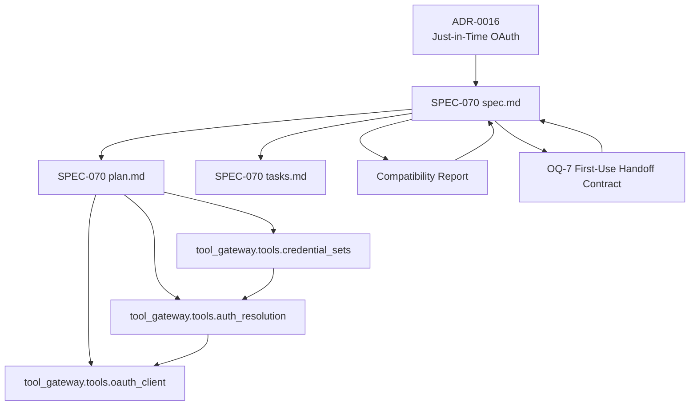
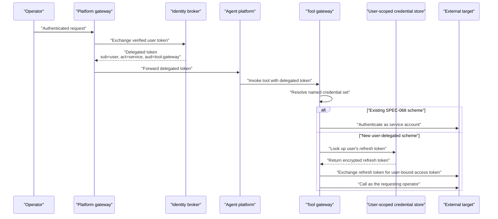
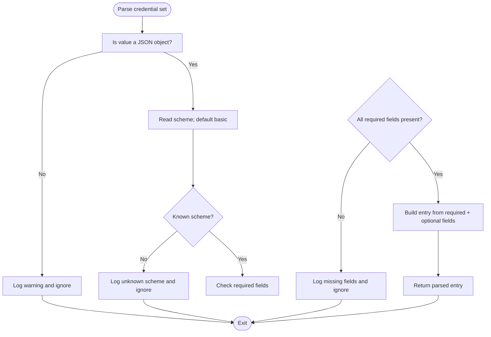
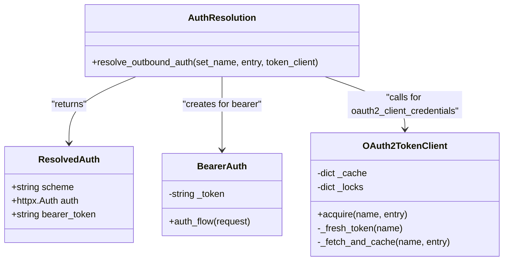
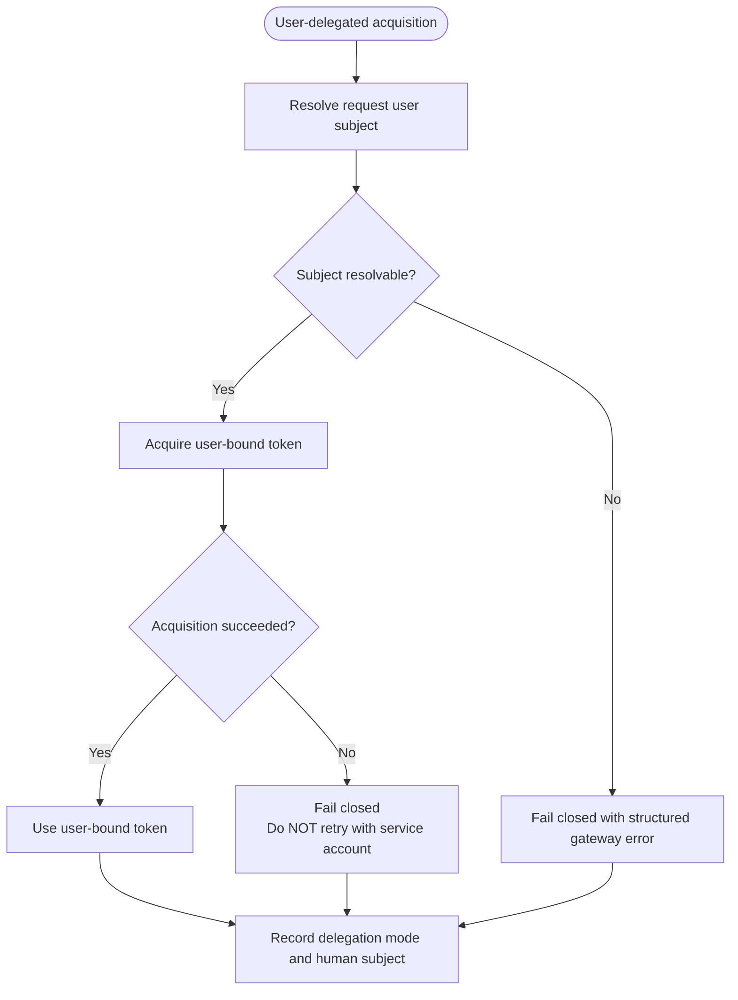
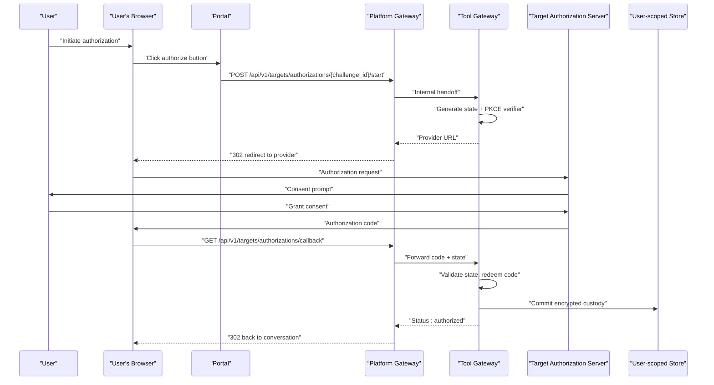
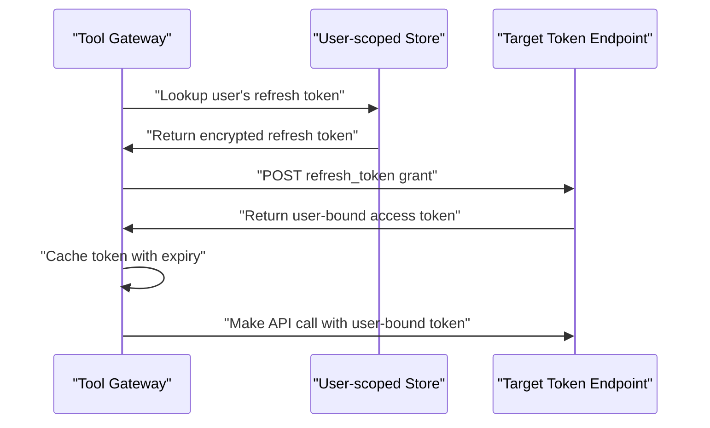
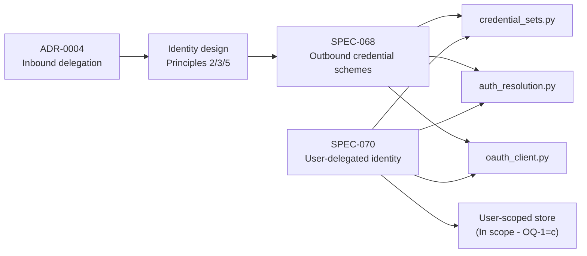

# SPEC-070: Outbound User-Delegated Identity

<cite>
**Referenced Files in This Document**   
- [spec.md](file://docs/specs/SPEC-070-outbound-user-delegated-identity/spec.md)
- [plan.md](file://docs/specs/SPEC-070-outbound-user-delegated-identity/plan.md)
- [tasks.md](file://docs/specs/SPEC-070-outbound-user-delegated-identity/tasks.md)
- [compatibility-report.md](file://docs/specs/SPEC-070-outbound-user-delegated-identity/compatibility-report.md)
- [oq7-first-use-handoff-contract.md](file://docs/specs/SPEC-070-outbound-user-delegated-identity/oq7-first-use-handoff-contract.md)
- [0016-just-in-time-outbound-oauth-authorization.md](file://docs/adr/0016-just-in-time-outbound-oauth-authorization.md)
- [credential_sets.py](file://products/tool-gateway/src/tool_gateway/tools/credential_sets.py)
- [auth_resolution.py](file://products/tool-gateway/src/tool_gateway/tools/auth_resolution.py)
- [oauth_client.py](file://products/tool-gateway/src/tool_gateway/tools/oauth_client.py)
</cite>

## Update Summary
**Changes Made**   
- Updated status to reflect ADR-0016 acceptance and OQ-7 ratification
- Enhanced with comprehensive design package including detailed cross-product contract
- Added first-use browser-based OAuth authorization flow with callback handling
- Incorporated owner-scoped state management and encrypted Postgres custody
- Updated architecture diagrams to reflect the ratified handoff contract
- Added detailed component analysis for the complete cross-product implementation

## Table of Contents
1. [Introduction](#introduction)
2. [Project Structure](#project-structure)
3. [Core Components](#core-components)
4. [Architecture Overview](#architecture-overview)
5. [Detailed Component Analysis](#detailed-component-analysis)
6. [First-Use Authorization Handoff Contract](#first-use-authorization-handoff-contract)
7. [Security Considerations](#security-considerations)
8. [Dependency Analysis](#dependency-analysis)
9. [Performance Considerations](#performance-considerations)
10. [Troubleshooting Guide](#troubleshooting-guide)
11. [Conclusion](#conclusion)

## Introduction
SPEC-070 defines the substrate for **outbound user-delegated execution identity** in the tool-gateway. Its purpose is to let a connector act as the requesting operator at an external target, rather than only as a shared platform service account. The spec extends the outbound credential model established by SPEC-068 and threads the inbound human subject into outbound token acquisition so that the target enforces its own per-user RBAC.

The spec is now **approved** (2026-10-18, amended) following operator direction resolving all open questions:
- OQ-1 selects **(c) per-user OAuth 2.x authorization-code, connector-local** as the delegation mechanism
- OQ-2 determines **no identity-broker mint** — the target issues user-bound tokens directly  
- OQ-7 detailed handoff contract was **ratified 2026-10-19**, closing the pre-runtime design gate
- ADR-0016 is **accepted** (2026-10-18), superseding ADR-0015 while retaining its accepted body

ADR-0016 records the decision: **per-user OAuth 2.x authorization-code, resolved connector-locally** against the target's own token endpoint (a **target-issued, user-bound** token), with **no identity-broker mint** (OQ-2) and a new **user-scoped credential store** as the principal new trust surface. The design establishes first-use browser-based OAuth authorization flows with callback handling and owner-scoped state management.

**Section sources**
- [spec.md:3-35](file://docs/specs/SPEC-070-outbound-user-delegated-identity/spec.md#L3-L35)
- [spec.md:54-67](file://docs/specs/SPEC-070-outbound-user-delegated-identity/spec.md#L54-L67)
- [0016-just-in-time-outbound-oauth-authorization.md:24-47](file://docs/adr/0016-just-in-time-outbound-oauth-authorization.md#L24-L47)

## Project Structure
SPEC-070 is centered on three existing tool-gateway modules plus the comprehensive specification scaffold:

| Area | File | Responsibility |
|---|---|---|
| Specification | `docs/specs/SPEC-070-outbound-user-delegated-identity/spec.md` | Requirements, non-goals, impact, open questions |
| Plan | `docs/specs/SPEC-070-outbound-user-delegated-identity/plan.md` | Stage-0-gated build shape and sequencing |
| Tasks | `docs/specs/SPEC-070-outbound-user-delegated-identity/tasks.md` | Task list tied to requirements |
| Compatibility Report | `docs/specs/SPEC-070-outbound-user-delegated-identity/compatibility-report.md` | Target profile assessment and redirect-based reassessment |
| OQ-7 Contract | `docs/specs/SPEC-070-outbound-user-delegated-identity/oq7-first-use-handoff-contract.md` | Detailed cross-product handoff contract |
| Credential vocabulary | `products/tool-gateway/src/tool_gateway/tools/credential_sets.py` | Additive user-delegated scheme alongside `basic`, `bearer`, `oauth2_client_credentials` |
| Auth seam | `products/tool-gateway/src/tool_gateway/tools/auth_resolution.py` | Thread the request's user subject into outbound resolution |
| Token client | `products/tool-gateway/src/tool-gateway/tools/oauth_client.py` | Existing machine-grant client; extended or replaced by a user-delegated grant |

**Diagram sources**
- [spec.md:284-317](file://docs/specs/SPEC-070-outbound-user-delegated-identity/spec.md#L284-L317)
- [plan.md:27-42](file://docs/specs/SPEC-070-outbound-user-delegated-identity/plan.md#L27-L42)
- [credential_sets.py:1-18](file://products/tool-gateway/src/tool_gateway/tools/credential_sets.py#L1-L18)
- [auth_resolution.py:1-19](file://products/tool-gateway/src/tool_gateway/tools/auth_resolution.py#L1-L19)
- [oauth_client.py:1-22](file://products/tool-gateway/src/tool_gateway/tools/oauth_client.py#L1-L22)

**Section sources**
- [spec.md:284-317](file://docs/specs/SPEC-070-outbound-user-delegated-identity/spec.md#L284-L317)
- [plan.md:27-42](file://docs/specs/SPEC-070-outbound-user-delegated-identity/plan.md#L27-L42)

## Core Components
SPEC-070 does not introduce a new product boundary. It extends the tool-gateway's outbound plane with a sixth conceptual capability — a user-delegated form of External Execution Identity — while keeping every existing SPEC-068 path byte-for-byte unchanged.

### Current outbound credential vocabulary
The current vocabulary is defined in `credential_sets.py`:

| Scheme | Required fields | Meaning |
|---|---|---|
| `basic` | `username`, `password` | HTTP Basic authentication |
| `bearer` | `token` | Static bearer token |
| `oauth2_client_credentials` | `token_url`, `client_id`, `client_secret` | Machine grant acquiring a target-issued access token |

A set without a `scheme` key defaults to `basic`. Unknown schemes or missing required fields are ignored with a warning and never admitted half-formed.

### What SPEC-070 adds conceptually
SPEC-070 adds a **user-delegated** scheme provisionally named `oauth2_authorization_code` whose exact name and fields are pinned by OQ-1's resolution. Conceptually it carries:
- Target configuration needed to obtain a user-bound token (authorization + token endpoints).
- Platform client credentials at the chosen endpoint.
- Trust configuration declaring which external authorization server may receive the user assertion.
- Reference to the **user-scoped credential store** holding each user's refresh token.

Unlike `oauth2_client_credentials`, the resulting token must represent the requesting operator, not a shared service account. The mechanism is **connector-local**: the target issues the user-bound token directly, not via broker minting.

**Section sources**
- [credential_sets.py:38-49](file://products/tool-gateway/src/tool_gateway/tools/credential_sets.py#L38-L49)
- [credential_sets.py:57-94](file://products/tool-gateway/src/tool_gateway/tools/credential_sets.py#L57-L94)
- [spec.md:125-147](file://docs/specs/SPEC-070-outbound-user-delegated-identity/spec.md#L125-L147)

## Architecture Overview
SPEC-070 sits between the inbound human identity established by ADR-0004 and the outbound External Execution Identity established by SPEC-068.

**Diagram sources**
- [0016-just-in-time-outbound-oauth-authorization.md:42-75](file://docs/adr/0016-just-in-time-outbound-oauth-authorization.md#L42-L75)
- [spec.md:69-84](file://docs/specs/SPEC-070-outbound-user-delegated-identity/spec.md#L69-L84)
- [spec.md:148-171](file://docs/specs/SPEC-070-outbound-user-delegated-identity/spec.md#L148-L171)

The inbound flow is already implemented: the platform gateway exchanges the verified user token at the identity broker for a short-lived delegated token where `sub` is the real user, `act` names the calling service, and `aud` is the target audience. SPEC-070 reuses that inbound human subject when resolving a user-delegated credential set.

**Section sources**
- [0016-just-in-time-outbound-oauth-authorization.md:42-75](file://docs/adr/0016-just-in-time-outbound-oauth-authorization.md#L42-L75)
- [spec.md:69-84](file://docs/specs/SPEC-070-outbound-user-delegated-identity/spec.md#L69-L84)

## Detailed Component Analysis

### R-1: User-delegated outbound credential scheme
R-1 requires adding a user-delegated scheme to the additive `credential_sets` vocabulary. The implementation approach is explicit: extend `_SCHEME_REQUIRED_FIELDS` and retain the scheme's fields in `_parse_set`, exactly as SPEC-068 generalized the parser.

Key properties:
- Existing `basic`, `bearer`, `oauth2_client_credentials`, and sets without a `scheme` key parse identically.
- Unknown schemes or incomplete sets are ignored with `LOGGER.warning`.
- The scheme is platform configuration resolved from the file-mounted secret at call time.
- The scheme name `oauth2_authorization_code` and required fields are pinned by OQ-1's resolution.

**Diagram sources**
- [credential_sets.py:57-94](file://products/tool-gateway/src/tool_gateway/tools/credential_sets.py#L57-L94)

**Section sources**
- [spec.md:125-147](file://docs/specs/SPEC-070-outbound-user-delegated-identity/spec.md#L125-L147)
- [plan.md:46-60](file://docs/specs/SPEC-070-outbound-user-delegated-identity/plan.md#L46-L60)
- [tasks.md:46-58](file://docs/specs/SPEC-070-outbound-user-delegated-identity/tasks.md#L46-L58)
- [credential_sets.py:57-94](file://products/tool-gateway/src/tool_gateway/tools/credential_sets.py#L57-L94)

### R-2: User-subject threading into outbound acquisition
R-2 extends the auth-resolution seam so a user-delegated set can use the request's human subject instead of a shared service account. The spec identifies `auth_resolution.py` as the seam and `oauth_client.py` as either extended or replaced by a dedicated user-delegated client.

Current behavior:
- `resolve_outbound_auth` dispatches on the resolved scheme.
- `basic` returns `httpx.BasicAuth`.
- `bearer` returns a `BearerAuth` wrapper around a static token.
- `oauth2_client_credentials` calls `OAuth2TokenClient.acquire`.

SPEC-070's intended extension:
- Accept the request's user identity context.
- For a user-delegated set, perform the OQ-1 grant against the target endpoint.
- Return a target-issued token bound to the requesting user.
- Cache per `(set name, user subject)` with near-expiry refresh and single-flight concurrency.
- Never share tokens across users.

**Diagram sources**
- [auth_resolution.py:34-57](file://products/tool-gateway/src/tool_gateway/tools/auth_resolution.py#L34-L57)
- [auth_resolution.py:69-112](file://products/tool-gateway/src/tool_gateway/tools/auth_resolution.py#L69-L112)
- [oauth_client.py:81-139](file://products/tool-gateway/src/tool_gateway/tools/oauth_client.py#L81-L139)

**Section sources**
- [spec.md:148-171](file://docs/specs/SPEC-070-outbound-user-delegated-identity/spec.md#L148-L171)
- [plan.md:62-92](file://docs/specs/SPEC-070-outbound-user-delegated-identity/plan.md#L62-L92)
- [tasks.md:60-77](file://docs/specs/SPEC-070-outbound-user-delegated-identity/tasks.md#L60-L77)
- [auth_resolution.py:69-112](file://products/tool-gateway/src/tool_gateway/tools/auth_resolution.py#L69-L112)
- [oauth_client.py:81-139](file://products/tool-gateway/src/tool_gateway/tools/oauth_client.py#L81-L139)

### R-3: Trust-boundary / federation contract
R-3 requires the trust prerequisite to be explicit per-set configuration. Under OQ-1's resolution, the mechanism is **connector-local**: a platform OAuth client registered at the target (client id/secret + redirect URI) and a completed per-user consent at the target's own authorization endpoint — **not** a federated platform issuer the target IdP trusts, and **not** a broker-minted assertion (OQ-2 = no mint).

A missing or broken federation must fail closed with a structured gateway error. The platform must never assert a user identity to a target not configured to trust it.

**Section sources**
- [spec.md:173-191](file://docs/specs/SPEC-070-outbound-user-delegated-identity/spec.md#L173-L191)
- [plan.md:93-107](file://docs/specs/SPEC-070-outbound-user-delegated-identity/plan.md#L93-L107)
- [tasks.md:79-89](file://docs/specs/SPEC-070-outbound-user-delegated-identity/tasks.md#L79-L89)

### R-4: End-to-end attribution fidelity
R-4 requires audit to record both the human subject and the fact that the outbound call was user-delegated. The delegation mode must be queryable, and no token, secret, or credential value may surface in audit, evidence, tool results, or logs.

This requirement preserves the existing durable and signed-execution machinery and does not introduce a new HITL surface.

**Section sources**
- [spec.md:193-208](file://docs/specs/SPEC-070-outbound-user-delegated-identity/spec.md#L193-L208)
- [plan.md:109-116](file://docs/specs/SPEC-070-outbound-user-delegated-identity/plan.md#L109-L116)
- [tasks.md:91-101](file://docs/specs/SPEC-070-outbound-user-delegated-identity/tasks.md#L91-L101)

### R-5: Secret handling, fail-closed, no-fabrication, and no-downgrade
R-5 is the governance crux. It requires:
- Existing redaction vocabularies to cover user-delegated tokens.
- Tokens to be held in memory only.
- Fail-closed behavior on all failure paths.
- A strict **no-downgrade** invariant: a failed user-delegated acquisition must never silently retry with `oauth2_client_credentials`, `basic`, or `bearer`.

The spec explicitly calls out that the absence of a service-account fallback must be tested, not merely commented.

**Diagram sources**
- [spec.md:210-233](file://docs/specs/SPEC-070-outbound-user-delegated-identity/spec.md#L210-L233)
- [plan.md:118-130](file://docs/specs/SPEC-070-outbound-user-delegated-identity/plan.md#L118-L130)
- [tasks.md:103-116](file://docs/specs/SPEC-070-outbound-user-delegated-identity/tasks.md#L103-L116)

**Section sources**
- [spec.md:210-233](file://docs/specs/SPEC-070-outbound-user-delegated-identity/spec.md#L210-L233)
- [plan.md:118-130](file://docs/specs/SPEC-070-outbound-user-delegated-identity/plan.md#L118-L130)
- [tasks.md:103-116](file://docs/specs/SPEC-070-outbound-user-delegated-identity/tasks.md#L103-L116)

### R-6: Provisioning and per-user storage
R-6 keeps the platform-config half identical to SPEC-068: the user-delegated set rides the existing file-mounted `credential-sets.json` model and is inert until provisioned.

Per-user storage is now **in scope** because OQ-1 forces it:
- A new user-scoped credential store is required to hold each user's target-issued refresh token.
- Consent capture, refresh-token persistence, rotation, and revocation are scoped by OQ-4.
- The store is its own reviewed capability (encrypted at rest, in-memory on use, rotatable, revocable, redaction-covered per R-5), **not** an ad-hoc file.

**Section sources**
- [spec.md:235-254](file://docs/specs/SPEC-070-outbound-user-delegated-identity/spec.md#L235-L254)
- [plan.md:132-143](file://docs/specs/SPEC-070-outbound-user-delegated-identity/plan.md#L132-L143)
- [tasks.md:118-128](file://docs/specs/SPEC-070-outbound-user-delegated-identity/tasks.md#L118-L128)

## First-Use Authorization Handoff Contract
The ratified OQ-7 contract establishes the detailed cross-product implementation for first-use browser-based OAuth authorization flows with callback handling and owner-scoped state management.

### Authorization Code Flow

### Refresh Token Exchange Flow

**Section sources**
- [oq7-first-use-handoff-contract.md:15-37](file://docs/specs/SPEC-070-outbound-user-delegated-identity/oq7-first-use-handoff-contract.md#L15-L37)
- [oq7-first-use-handoff-contract.md:150-210](file://docs/specs/SPEC-070-outbound-user-delegated-identity/oq7-first-use-handoff-contract.md#L150-L210)
- [spec.md:120-123](file://docs/specs/SPEC-070-outbound-user-delegated-identity/spec.md#L120-L123)
- [plan.md:62-92](file://docs/specs/SPEC-070-outbound-user-delegated-identity/plan.md#L62-L92)

## Security Considerations
SPEC-070 introduces significant security implications that must be carefully managed:

### Trust Model Changes
- **First outbound user-delegated identity**: Establishes a new trust relationship where the platform crosses its boundary with a user assertion that an external party relies on for access decisions.
- **Principal new trust surface**: The user-scoped credential store (custody of per-user external refresh tokens) is the genuinely new risk surface, not a broker change.
- **No elevation invariant**: The outbound token carries at most the authority the user holds at the target; role→RBAC mapping is the target's decision, not a platform translation layer.

### Secret Management
- **Encryption at rest**: Per-user refresh tokens must be encrypted at rest in the user-scoped store.
- **In-memory only**: Tokens are held in memory only during use — never written to disk, a result, evidence, audit, or log line.
- **Redaction coverage**: Existing redaction vocabularies already cover the new values (`url_redaction.SECRET_QUERY_PARAMS` substring-matches `token`/`secret`/`credential`; `redaction._VALUE_PATTERNS` covers the password/secret/token family plus `client_secret` and `authorization`).

### Failure Handling
- **Fail-closed on all paths**: Missing/broken federation, consent, or token-endpoint failures must fail closed with structured gateway errors.
- **No downgrade invariant**: Failed user-delegated acquisition must never silently retry with service-account credentials — this is a governance invariant that must be tested, not just documented.
- **No fabrication**: The platform must never fabricate user assertions or elevate user authority.

**Section sources**
- [0016-just-in-time-outbound-oauth-authorization.md:77-101](file://docs/adr/0016-just-in-time-outbound-oauth-authorization.md#L77-L101)
- [spec.md:210-233](file://docs/specs/SPEC-070-outbound-user-delegated-identity/spec.md#L210-L233)
- [plan.md:118-130](file://docs/specs/SPEC-070-outbound-user-delegated-identity/plan.md#L118-L130)

## Dependency Analysis
SPEC-070 is intentionally additive and target-agnostic. Its dependencies are layered:

| Layer | Dependency | Status |
|---|---|---|
| Specification | SPEC-068 outbound credential schemes | Implemented and approved |
| Inbound identity | ADR-0004 broker-mediated token delegation | Implemented |
| Human attribution | Identity and authorization design principles 2, 3, and 5 | Documented |
| Implementation | `credential_sets.py`, `auth_resolution.py`, `oauth_client.py` | Extension points identified |
| Optional broker change | Identity broker minting a new outbound token | Conditional on OQ-2 (resolved: no mint) |
| Per-user store | User-scoped credential storage | **In scope** (OQ-1 = c forces it) |

**Diagram sources**
- [0016-just-in-time-outbound-oauth-authorization.md:42-75](file://docs/adr/0016-just-in-time-outbound-oauth-authorization.md#L42-L75)
- [spec.md:284-317](file://docs/specs/SPEC-070-outbound-user-delegated-identity/spec.md#L284-L317)

**Section sources**
- [spec.md:284-317](file://docs/specs/SPEC-070-outbound-user-delegated-identity/spec.md#L284-L317)
- [plan.md:145-157](file://docs/specs/SPEC-070-outbound-user-delegated-identity/plan.md#L145-L157)

## Performance Considerations
SPEC-070's performance model mirrors SPEC-068:
- Credential sets are loaded once and refreshed on file mtime changes.
- Tokens are cached in memory with near-expiry refresh.
- Concurrent callers for one set share a single in-flight fetch.
- The user-delegated cache should be keyed by `(set name, user subject)` so tokens are never shared across users.
- No live external call is expected in CI; integration tests should use a mock transport.

The existing `OAuth2TokenClient` implements per-set locking, double-checked caching, and controlled timeouts. The plan states that the user-delegated branch should mirror that discipline while isolating per-user state.

**Section sources**
- [credential_sets.py:97-157](file://products/tool-gateway/src/tool_gateway/tools/credential_sets.py#L97-L157)
- [oauth_client.py:81-139](file://products/tool-gateway/src/tool_gateway/tools/oauth_client.py#L81-L139)
- [plan.md:163-181](file://docs/specs/SPEC-070-outbound-user-delegated-identity/plan.md#L163-L181)

## Troubleshooting Guide
When diagnosing user-delegated outbound identity, distinguish between configuration, federation, and runtime failures.

| Symptom | Likely cause | Expected behavior |
|---|---|---|
| Unknown scheme warning during load | A new user-delegated set has an unrecognized scheme name or missing required fields | Set is ignored; existing sets remain valid |
| Missing required field warning | A user-delegated set lacks fields pinned by OQ-1 | Set is ignored; no partial credential is admitted |
| Structured gateway error naming the set | Missing user subject, broken federation, or failed token acquisition | Call fails closed; no service-account fallback |
| Audit shows service-account mode | The set uses `oauth2_client_credentials`, `basic`, or `bearer` | Not user-delegated |
| Audit shows user-delegated mode | The set uses the new user-delegated scheme | Human subject and delegation mode are recorded |
| Token appears in logs/results/evidence | Redaction gap or incorrect logging path | Must be treated as a security defect |
| Downgrade to service account after failure | Violation of R-5 | Must be treated as a governance defect |
| User consent required error | Per-user authorization-code flow not completed | User must complete one-time consent flow |
| Refresh token lookup failed | User-scoped credential store issue | Check store encryption, availability, and user isolation |

Operational checks:
- Confirm the user-delegated set exists in the mounted `credential-sets.json`.
- Confirm the set's scheme name and fields match the OQ-1 decision.
- Confirm the target IdP trusts the configured outbound trust boundary.
- Confirm the inbound delegated token contains a resolvable human subject.
- Verify audit records show delegation mode and human subject without secrets.
- Check user-scoped credential store availability and encryption status.

**Section sources**
- [credential_sets.py:67-94](file://products/tool-gateway/src/tool_gateway/tools/credential_sets.py#L67-L94)
- [auth_resolution.py:60-66](file://products/tool-gateway/src/tool_gateway/tools/auth_resolution.py#L60-L66)
- [spec.md:148-171](file://docs/specs/SPEC-070-outbound-user-delegated-identity/spec.md#L148-L171)
- [spec.md:210-233](file://docs/specs/SPEC-070-outbound-user-delegated-identity/spec.md#L210-L233)

## Conclusion
SPEC-070 defines the shape of the platform's first outbound user-delegated identity and is now **approved** (2026-10-18, amended). It establishes the platform's **first outbound user-delegated identity** — carrying a human subject's identity and authority across the platform boundary to an external system that enforces its own RBAC on that user.

The mechanism is now decision-complete:
- **OQ-1 resolved**: per-user OAuth 2.x authorization-code, connector-local
- **OQ-2 resolved**: no identity-broker mint  
- **OQ-7 ratified**: detailed cross-product handoff contract (2026-10-19)
- **ADR-0016 accepted**: records the trust-model decision and consequences

The spec extends the tool-gateway's additive credential vocabulary, threads the inbound human subject into outbound acquisition, and enforces strict safety invariants: fail-closed, no fabrication, no elevation, and no downgrade to a service account.

The principal new trust surface is the **user-scoped credential store** (OQ-4 in scope), which custodies per-user external refresh tokens with encryption-at-rest, in-memory-only use, rotation, and revocation capabilities.

Once implementation begins, the same substrate will enable MCP-ingestion pilots to attribute production actions to the requesting operator rather than a shared service identity, closing the outbound confused-deputy gap that SPEC-068's machine grant left open.

**Section sources**
- [spec.md:3-35](file://docs/specs/SPEC-070-outbound-user-delegated-identity/spec.md#L3-L35)
- [spec.md:373-395](file://docs/specs/SPEC-070-outbound-user-delegated-identity/spec.md#L373-L395)
- [plan.md:1-11](file://docs/specs/SPEC-070-outbound-user-delegated-identity/plan.md#L1-L11)
- [tasks.md:1-11](file://docs/specs/SPEC-070-outbound-user-delegated-identity/tasks.md#L1-L11)
- [0016-just-in-time-outbound-oauth-authorization.md:24-47](file://docs/adr/0016-just-in-time-outbound-oauth-authorization.md#L24-L47)