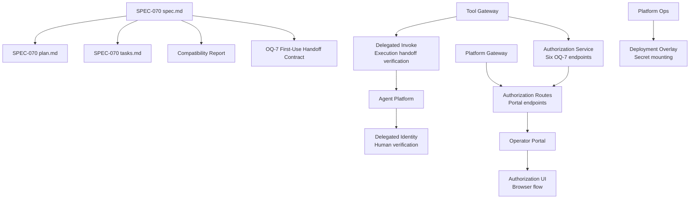
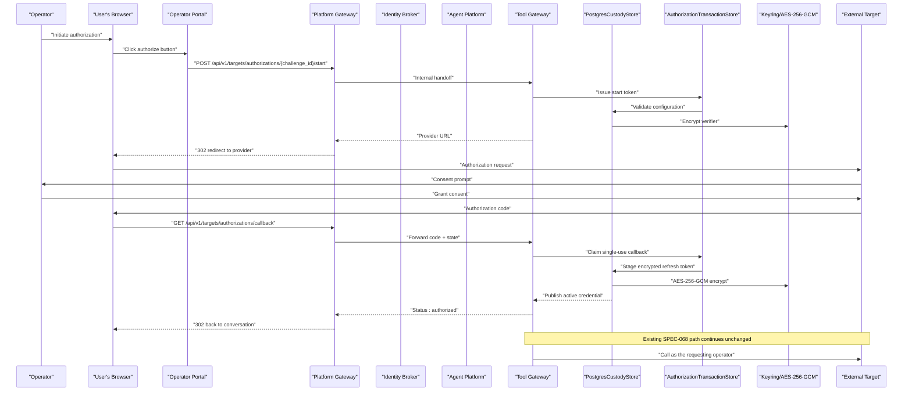
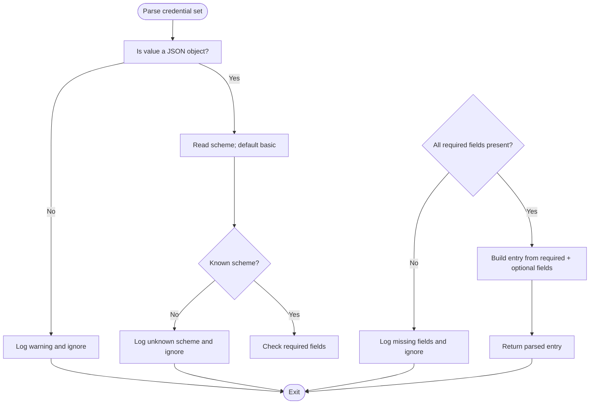
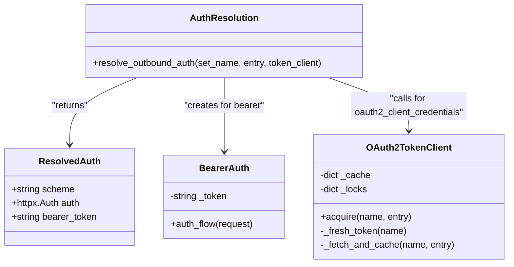
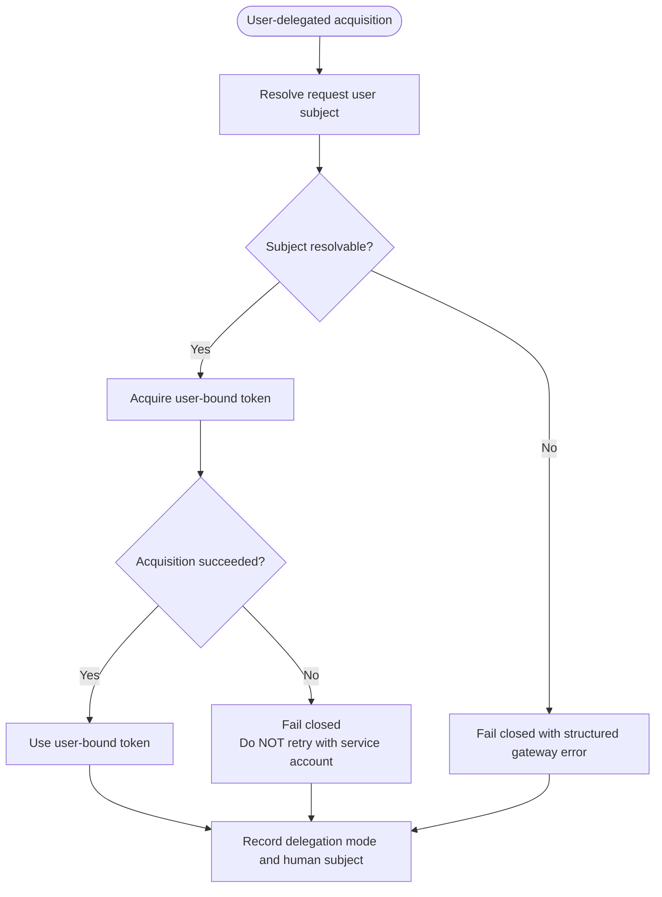
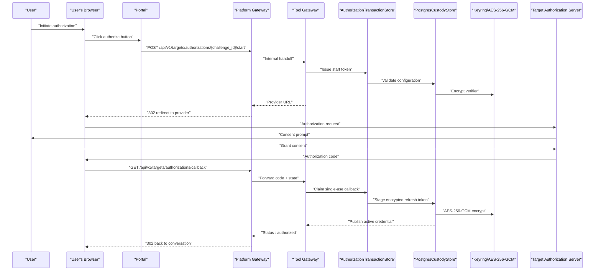
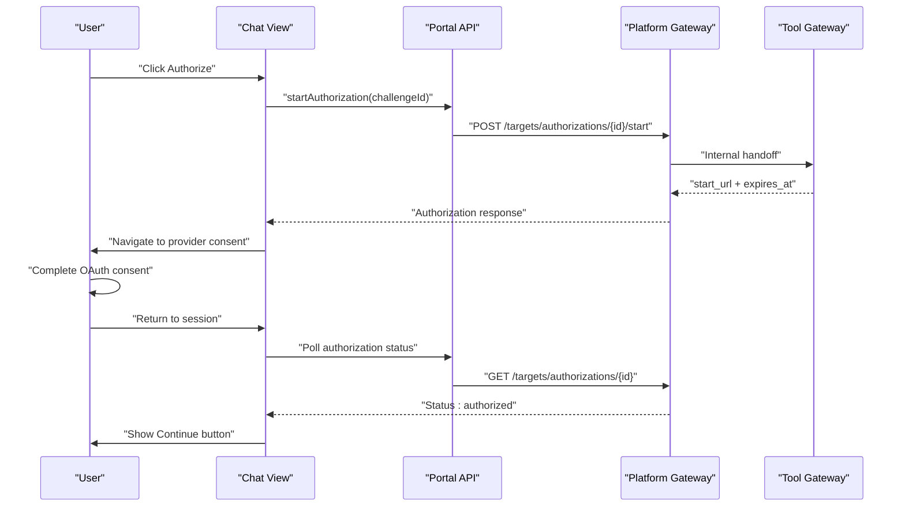
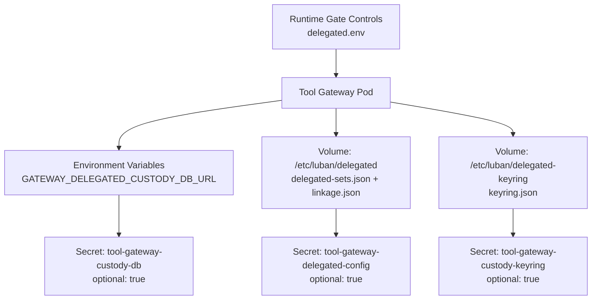
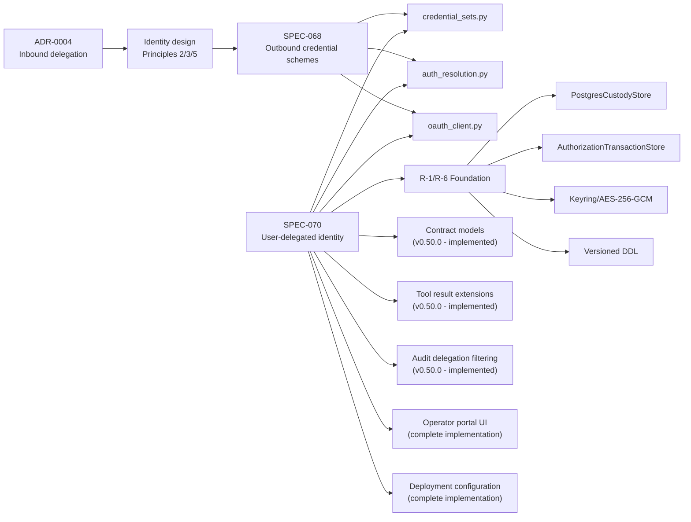

# SPEC-070: Outbound User-Delegated Identity

<cite>
**Referenced Files in This Document**   
- [spec.md](file://docs/specs/SPEC-070-outbound-user-delegated-identity/spec.md)
- [plan.md](file://docs/specs/SPEC-070-outbound-user-delegated-identity/plan.md)
- [tasks.md](file://docs/specs/SPEC-070-outbound-user-delegated-identity/tasks.md)
- [compatibility-report.md](file://docs/specs/SPEC-070-outbound-user-delegated-identity/compatibility-report.md)
- [oq7-first-use-handoff-contract.md](file://docs/specs/SPEC-070-outbound-user-delegated-identity/oq7-first-use-handoff-contract.md)
- [authorization_service.py (tool-gateway)](file://products/tool-gateway/src/tool_gateway/services/authorization_service.py)
- [delegated_invoke.py (tool-gateway)](file://products/tool-gateway/src/tool_gateway/services/delegated_invoke.py)
- [authorizations.py (platform-gateway routes)](file://products/platform-gateway/src/platform_gateway/api/routes/authorizations.py)
- [authorizations.ts (operator portal API)](file://products/operator-portal/web-ui/app/src/api/authorizations.ts)
- [ChatView.tsx (operator portal UI)](file://products/operator-portal/web-ui/app/src/chat/ChatView.tsx)
- [AuthorizationCard.test.tsx (operator portal tests)](file://products/operator-portal/web-ui/app/src/chat/__tests__/AuthorizationCard.test.tsx)
- [useAuthorizationReturn.test.tsx (operator portal session return)](file://products/operator-portal/web-ui/app/src/sessions/__tests__/useAuthorizationReturn.test.tsx)
- [tool-gateway-delegated.yaml (deployment overlay)](file://shared/platform-ops/gitops/runtime-profiles/delegated-dev/tool-gateway-delegated.yaml)
- [configuration-reference.md](file://docs/guides/configuration-reference.md)
- [oidc.ts (portal OIDC flow)](file://products/operator-portal/web-ui/app/src/auth/oidc.ts)
</cite>

## Update Summary
**Changes Made**   
- Updated status to `delivered` reflecting the comprehensive implementation completion across all services in v0.51.0 release
- Added detailed coverage of the complete authorization service with six OQ-7 endpoints and dual authentication paths
- Documented the operator portal UI enhancements including authorization cards, browser reset, and session return flows
- Added deployment configuration details for the delegated runtime profile with secret mounting and optional provisioning
- Enhanced security model documentation with production-grade JWT verification, fail-closed error handling, and identity binding
- Updated component analysis to reflect the complete cross-product implementation spanning tool-gateway, platform-gateway, agent-platform, and operator-portal
- Clarified that the implementation is now production-ready while DI-070 deployment integration remains pending

## Table of Contents
1. [Introduction](#introduction)
2. [Project Structure](#project-structure)
3. [Core Components](#core-components)
4. [Architecture Overview](#architecture-overview)
5. [Detailed Component Analysis](#detailed-component-analysis)
6. [First-Use Authorization Handoff Contract](#first-use-authorization-handoff-contract)
7. [Operator Portal Integration](#operator-portal-integration)
8. [Deployment Configuration](#deployment-configuration)
9. [Security Considerations](#security-considerations)
10. [Dependency Analysis](#dependency-analysis)
11. [Performance Considerations](#performance-considerations)
12. [Operator Procedures](#operator-procedures)
13. [Troubleshooting Guide](#troubleshooting-guide)
14. [Conclusion](#conclusion)

## Introduction
SPEC-070 defines the substrate for **outbound user-delegated execution identity** in the tool-gateway. Its purpose is to let a connector act as the requesting operator at an external target, rather than only as a shared platform service account. The spec extends the outbound credential model established by SPEC-068 and threads the inbound human subject into outbound token acquisition so that the target enforces its own per-user RBAC.

The spec is now **delivered** following the comprehensive implementation across all platform services, which delivers production-grade infrastructure including AES-256-GCM encrypted credential storage, Postgres-backed authorization transaction management, strict configuration parsing, single-use authorization transaction controls, complete operator portal UI, and deployment configurations. The implementation spans four core product boundaries with extensive test coverage and operator procedures — enabling actual OAuth flows and full runtime workflow integration.

ADR-0016 records the decision: **per-user OAuth 2.x authorization-code, resolved connector-locally** against the target's own token endpoint (a **target-issued, user-bound** token), with **no identity-broker mint** (OQ-2) and a new **user-scoped credential store** as the principal new trust surface. The design establishes first-use browser-based OAuth authorization flows with callback handling and owner-scoped state management.

**Section sources**
- [spec.md:3-35](file://docs/specs/SPEC-070-outbound-user-delegated-identity/spec.md#L3-L35)
- [spec.md:43-49](file://docs/specs/SPEC-070-outbound-user-delegated-identity/spec.md#L43-L49)
- [0016-just-in-time-outbound-oauth-authorization.md:24-47](file://docs/adr/0016-just-in-time-outbound-oauth-authorization.md#L24-L47)

## Project Structure
SPEC-070 is now implemented across four product boundaries, each contributing specialized functionality to the complete user-delegated identity system:

| Product | Component | Responsibility |
|---|---|---|
| Tool Gateway | Authorization Service | Six OQ-7 endpoints with dual authentication (workload + human) |
| Tool Gateway | Delegated Invoke | Execution handoff verification and human identity binding |
| Platform Gateway | Authorization Routes | Portal-facing authorization endpoints and browser navigation |
| Agent Platform | Delegated Identity | Strict human identity verification and context management |
| Operator Portal | Authorization UI | Browser-based authorization flow and session management |
| Platform Ops | Deployment Overlay | Secret mounting and optional provisioning configuration |

**Diagram sources**
- [authorization_service.py:1-483](file://products/tool-gateway/src/tool_gateway/services/authorization_service.py#L1-L483)
- [delegated_invoke.py:1-279](file://products/tool-gateway/src/tool_gateway/services/delegated_invoke.py#L1-L279)
- [authorizations.py:1-66](file://products/platform-gateway/src/platform_gateway/api/routes/authorizations.py#L1-L66)
- [authorizations.ts:1-88](file://products/operator-portal/web-ui/app/src/api/authorizations.ts#L1-L88)
- [tool-gateway-delegated.yaml:1-59](file://shared/platform-ops/gitops/runtime-profiles/delegated-dev/tool-gateway-delegated.yaml#L1-L59)

**Section sources**
- [spec.md:284-317](file://docs/specs/SPEC-070-outbound-user-delegated-identity/spec.md#L284-L317)
- [plan.md:27-42](file://docs/specs/SPEC-070-outbound-user-delegated-identity/plan.md#L27-L42)

## Core Components
SPEC-070 is now fully implemented across the platform with no new product boundary introduced. It extends the tool-gateway's outbound plane with a sixth conceptual capability — a user-delegated form of External Execution Identity — while keeping every existing SPEC-068 path byte-for-byte unchanged.

### Complete Authorization Service Architecture
The authorization service provides six OQ-7 endpoints with dual authentication paths:

| Endpoint Type | Authentication | Purpose |
|---|---|---|
| Human edges (start/status/cancel/browser-reset) | Delegated human bearer | Owner-scoped authorization management |
| Workload edges (provider-url/callback) | Platform gateway SA token | Browser-based OAuth flow coordination |

Key architectural properties:
- **Dual authentication**: Separate verifiers for workload and human bearers with distinct trust boundaries
- **Fail-closed design**: All failures return structured errors without exposing sensitive data
- **Single-use transactions**: Bounded lifetimes with PKCE support and attempt-scoped fencing
- **Owner isolation**: Transactions scoped by verified human identity and namespace
- **Audit integration**: Optional fire-and-forget emission for authorization lifecycle events

### Current outbound credential vocabulary
The current vocabulary is defined in `credential_sets.py`:

| Scheme | Required fields | Meaning |
|---|---|---|
| `basic` | `username`, `password` | HTTP Basic authentication |
| `bearer` | `token` | Static bearer token |
| `oauth2_client_credentials` | `token_url`, `client_id`, `client_secret` | Machine grant acquiring a target-issued access token |

A set without a `scheme` key defaults to `basic`. Unknown schemes or missing required fields are ignored with a warning and never admitted half-formed.

### What SPEC-070 adds conceptually
SPEC-070 adds a **user-delegated** scheme provisionally named `oauth2_authorization_code` whose exact name and fields are pinned by OQ-1's resolution. Conceptually it carries:
- Target configuration needed to obtain a user-bound token (authorization + token endpoints).
- Platform client credentials at the chosen endpoint.
- Trust configuration declaring which external authorization server may receive the user assertion.
- Reference to the **user-scoped credential store** holding each user's refresh token.

Unlike `oauth2_client_credentials`, the resulting token must represent the requesting operator, not a shared service account. The mechanism is **connector-local**: the target issues the user-bound token directly, not via broker minting.

**Updated** The implementation is now complete with production-grade authorization service, operator portal UI, and deployment configurations. The system supports actual OAuth flows with browser-based consent, single-use authorization transactions, and comprehensive audit trail integration.

**Section sources**
- [credential_sets.py:38-49](file://products/tool-gateway/src/tool_gateway/tools/credential_sets.py#L38-L49)
- [credential_sets.py:57-94](file://products/tool-gateway/src/tool_gateway/tools/credential_sets.py#L57-L94)
- [spec.md:125-147](file://docs/specs/SPEC-070-outbound-user-delegated-identity/spec.md#L125-L147)
- [authorization_service.py:181-200](file://products/tool-gateway/src/tool_gateway/services/authorization_service.py#L181-L200)

## Architecture Overview
SPEC-070 sits between the inbound human identity established by ADR-0004 and the outbound External Execution Identity established by SPEC-068.

**Diagram sources**
- [0016-just-in-time-outbound-oauth-authorization.md:42-75](file://docs/adr/0016-just-in-time-outbound-oauth-authorization.md#L42-L75)
- [spec.md:69-84](file://docs/specs/SPEC-070-outbound-user-delegated-identity/spec.md#L69-L84)
- [spec.md:148-171](file://docs/specs/SPEC-070-outbound-user-delegated-identity/spec.md#L148-L171)
- [authorization_service.py:342-440](file://products/tool-gateway/src/tool_gateway/services/authorization_service.py#L342-L440)

The inbound flow is already implemented: the platform gateway exchanges the verified user token at the identity broker for a short-lived delegated token where `sub` is the real user, `act` names the calling service, and `aud` is the target audience. SPEC-070 reuses that inbound human subject when resolving a user-delegated credential set.

**Section sources**
- [0016-just-in-time-outbound-oauth-authorization.md:42-75](file://docs/adr/0016-just-in-time-outbound-oauth-authorization.md#L42-L75)
- [spec.md:69-84](file://docs/specs/SPEC-070-outbound-user-delegated-identity/spec.md#L69-L84)

## Detailed Component Analysis

### R-1: User-delegated outbound credential scheme
R-1 requires adding a user-delegated scheme to the additive `credential_sets` vocabulary. The implementation approach is explicit: extend `_SCHEME_REQUIRED_FIELDS` and retain the scheme's fields in `_parse_set`, exactly as SPEC-068 generalized the parser.

Key properties:
- Existing `basic`, `bearer`, `oauth2_client_credentials`, and sets without a `scheme` key parse identically.
- Unknown schemes or incomplete sets are ignored with `LOGGER.warning`.
- The scheme is platform configuration resolved from the file-mounted secret at call time.
- The scheme name `oauth2_authorization_code` and required fields are pinned by OQ-1's resolution.

**Diagram sources**
- [credential_sets.py:57-94](file://products/tool-gateway/src/tool_gateway/tools/credential_sets.py#L57-L94)

**Section sources**
- [spec.md:125-147](file://docs/specs/SPEC-070-outbound-user-delegated-identity/spec.md#L125-L147)
- [plan.md:46-60](file://docs/specs/SPEC-070-outbound-user-delegated-identity/plan.md#L46-L60)
- [tasks.md:46-58](file://docs/specs/SPEC-070-outbound-user-delegated-identity/tasks.md#L46-L58)
- [credential_sets.py:57-94](file://products/tool-gateway/src/tool_gateway/tools/credential_sets.py#L57-L94)

### R-2: User-subject threading into outbound acquisition
R-2 extends the auth-resolution seam so a user-delegated set can use the request's human subject instead of a shared service account. The spec identifies `auth_resolution.py` as the seam and `oauth_client.py` as either extended or replaced by a dedicated user-delegated client.

Current behavior:
- `resolve_outbound_auth` dispatches on the resolved scheme.
- `basic` returns `httpx.BasicAuth`.
- `bearer` returns a `BearerAuth` wrapper around a static token.
- `oauth2_client_credentials` calls `OAuth2TokenClient.acquire`.

SPEC-070's intended extension:
- Accept the request's user identity context.
- For a user-delegated set, perform the OQ-1 grant against the target endpoint.
- Return a target-issued token bound to the requesting user.
- Cache per `(set name, user subject)` with near-expiry refresh and single-flight concurrency.
- Never share tokens across users.

**Diagram sources**
- [auth_resolution.py:34-57](file://products/tool-gateway/src/tool_gateway/tools/auth_resolution.py#L34-L57)
- [auth_resolution.py:69-112](file://products/tool-gateway/src/tool_gateway/tools/auth_resolution.py#L69-L112)
- [oauth_client.py:81-139](file://products/tool-gateway/src/tool_gateway/tools/oauth_client.py#L81-L139)

**Section sources**
- [spec.md:148-171](file://docs/specs/SPEC-070-outbound-user-delegated-identity/spec.md#L148-L171)
- [plan.md:62-92](file://docs/specs/SPEC-070-outbound-user-delegated-identity/plan.md#L62-L92)
- [tasks.md:60-77](file://docs/specs/SPEC-070-outbound-user-delegated-identity/tasks.md#L60-L77)
- [auth_resolution.py:69-112](file://products/tool-gateway/src/tool_gateway/tools/auth_resolution.py#L69-L112)
- [oauth_client.py:81-139](file://products/tool-gateway/src/tool_gateway/tools/oauth_client.py#L81-L139)

### R-3: Trust-boundary / federation contract
R-3 requires the trust prerequisite to be explicit per-set configuration. Under OQ-1's resolution, the mechanism is **connector-local**: a platform OAuth client registered at the target (client id/secret + redirect URI) and a completed per-user consent at the target's own authorization endpoint — **not** a federated platform issuer the target IdP trusts, and **not** a broker-minted assertion (OQ-2 = no mint).

A missing or broken federation must fail closed with a structured gateway error. The platform must never assert a user identity to a target not configured to trust it.

**Section sources**
- [spec.md:173-191](file://docs/specs/SPEC-070-outbound-user-delegated-identity/spec.md#L173-L191)
- [plan.md:93-107](file://docs/specs/SPEC-070-outbound-user-delegated-identity/plan.md#L93-L107)
- [tasks.md:79-89](file://docs/specs/SPEC-070-outbound-user-delegated-identity/tasks.md#L79-L89)

### R-4: End-to-end attribution fidelity
R-4 requires audit to record both the human subject and the fact that the outbound call was user-delegated. The delegation mode must be queryable, and no token, secret, or credential value may surface in audit, evidence, tool results, or logs.

This requirement preserves the existing durable and signed-execution machinery and does not introduce a new HITL surface.

**Updated** The v0.50.0 checkpoint implements the top-level `delegation_mode` audit field with filtering support. The audit service now supports querying by delegation mode (`user_delegated`, `acting_service`, `none`) while maintaining backward compatibility with legacy events that lack this field.

**Section sources**
- [spec.md:193-208](file://docs/specs/SPEC-070-outbound-user-delegated-identity/spec.md#L193-L208)
- [plan.md:109-116](file://docs/specs/SPEC-070-outbound-user-delegated-identity/plan.md#L109-L116)
- [tasks.md:91-101](file://docs/specs/SPEC-070-outbound-user-delegated-identity/tasks.md#L91-L101)

### R-5: Secret handling, fail-closed, no-fabrication, and no-downgrade
R-5 is the governance crux. It requires:
- Existing redaction vocabularies to cover user-delegated tokens.
- Tokens to be held in memory only.
- Fail-closed behavior on all failure paths.
- A strict **no-downgrade** invariant: a failed user-delegated acquisition must never silently retry with `oauth2_client_credentials`, `basic`, or `bearer`.

The spec explicitly calls out that the absence of a service-account fallback must be tested, not merely commented.

**Diagram sources**
- [spec.md:210-233](file://docs/specs/SPEC-070-outbound-user-delegated-identity/spec.md#L210-L233)
- [plan.md:118-130](file://docs/specs/SPEC-070-outbound-user-delegated-identity/plan.md#L118-L130)
- [tasks.md:103-116](file://docs/specs/SPEC-070-outbound-user-delegated-identity/tasks.md#L103-L116)

**Section sources**
- [spec.md:210-233](file://docs/specs/SPEC-070-outbound-user-delegated-identity/spec.md#L210-L233)
- [plan.md:118-130](file://docs/specs/SPEC-070-outbound-user-delegated-identity/plan.md#L118-L130)
- [tasks.md:103-116](file://docs/specs/SPEC-070-outbound-user-delegated-identity/tasks.md#L103-L116)

### R-6: Provisioning and per-user storage
R-6 keeps the platform-config half identical to SPEC-068: the user-delegated set rides the existing file-mounted `credential-sets.json` model and is inert until provisioned.

Per-user storage is now **in scope** because OQ-1 forces it:
- A new user-scoped credential store is required to hold each user's target-issued refresh token.
- Consent capture, refresh-token persistence, rotation, and revocation are scoped by OQ-4.
- The store is its own reviewed capability (encrypted at rest, in-memory on use, rotatable, revocable, redaction-covered per R-5), **not** an ad-hoc file.

**Updated** The implementation delivers a comprehensive Postgres-backed solution with AES-256-GCM encryption, versioned keyring management, and extensive operator procedures. The implementation includes `PostgresCustodyStore` for credential lifecycle management, `PostgresAuthorizationTransactionStore` for single-use authorization transactions, and supporting cryptography and schema management components.

**Section sources**
- [spec.md:235-254](file://docs/specs/SPEC-070-outbound-user-delegated-identity/spec.md#L235-L254)
- [plan.md:132-143](file://docs/specs/SPEC-070-outbound-user-delegated-identity/plan.md#L132-L143)
- [tasks.md:118-128](file://docs/specs/SPEC-070-outbound-user-delegated-identity/tasks.md#L118-L128)

## First-Use Authorization Handoff Contract
The ratified OQ-7 contract establishes the detailed cross-product implementation for first-use browser-based OAuth authorization flows with callback handling and owner-scoped state management.

The R-1/R-6 foundation implements production-grade authorization transaction management with single-use callbacks, PKCE support, and comprehensive fencing mechanisms. The transaction store provides both memory and Postgres backends with consistent interfaces.

### Authorization Contract Models
The v0.50.0 implementation adds comprehensive authorization contract models across multiple services:

| Model | Service | Purpose |
|---|---|---|
| `AuthorizationRequired` | tool-gateway | Public challenge metadata carrying no execution authority |
| `AuthorizationStatusResponse` | tool-gateway | Owner-scoped authorization status queries |
| `ProviderAuthorizationResponse` | tool-gateway | Backend-only provider URL and state material |
| `AuthorizationCallbackRequest` | tool-gateway | Backend-only callback processing |
| `AuthorizationCallbackResponse` | tool-gateway | Backend-only safe outcome with return path |
| `AuthorizationStartResponse` | platform-gateway | Portal-facing start URL response |
| `AuthorizationStatusResponse` | platform-gateway | Portal-facing status queries |

### Transaction Management
Transaction management provides bounded lifetimes and validation:

- Start TTL: 60 seconds (pinned local default)
- Transaction TTL: 600 seconds (pinned local default)
- Validation ensures start lifetime cannot exceed transaction lifetime
- Models are frozen and forbid extra fields for security
- Secret values use `SecretStr` for automatic redaction

### Tool Result Schema Extensions
The tool-result schema now supports the authorization-required signal:

- Reserved error code: `TARGET_AUTHORIZATION_REQUIRED`
- Optional top-level `authorization_required` object
- Stream event type: `authorization_required` (stream v13)
- Backward compatible with existing consumers

### Audit Delegation Filtering
Audit service now supports delegation mode filtering:

- Top-level `delegation_mode` field: `user_delegated`, `acting_service`, `none`
- Query filter support for delegation mode
- Durable persistence with NULL handling for legacy events
- Index optimization for delegation mode queries

**Diagram sources**
- [oq7-first-use-handoff-contract.md:15-37](file://docs/specs/SPEC-070-outbound-user-delegated-identity/oq7-first-use-handoff-contract.md#L15-L37)
- [oq7-first-use-handoff-contract.md:150-210](file://docs/specs/SPEC-070-outbound-user-delegated-identity/oq7-first-use-handoff-contract.md#L150-L210)
- [spec.md:120-123](file://docs/specs/SPEC-070-outbound-user-delegated-identity/spec.md#L120-L123)
- [plan.md:62-92](file://docs/specs/SPEC-070-outbound-user-delegated-identity/plan.md#L62-L92)
- [authorization_service.py:342-440](file://products/tool-gateway/src/tool_gateway/services/authorization_service.py#L342-L440)

**Section sources**
- [oq7-first-use-handoff-contract.md:15-37](file://docs/specs/SPEC-070-outbound-user-delegated-identity/oq7-first-use-handoff-contract.md#L15-L37)
- [oq7-first-use-handoff-contract.md:150-210](file://docs/specs/SPEC-070-outbound-user-delegated-identity/oq7-first-use-handoff-contract.md#L150-L210)
- [spec.md:120-123](file://docs/specs/SPEC-070-outbound-user-delegated-identity/spec.md#L120-L123)
- [plan.md:62-92](file://docs/specs/SPEC-070-outbound-user-delegated-identity/plan.md#L62-L92)

## Operator Portal Integration
The operator portal provides a complete browser-based authorization experience integrated with the chat interface:

### Authorization Card Interface
The `AuthorizationCardView` component provides inline authorization controls within chat conversations:

| State | Available Actions | User Experience |
|---|---|---|
| Pending | Authorize, Cancel | Clear guidance about target authorization |
| Authorized | Continue (if wired) | Confirmation message with continuation option |
| Canceled/Expired/Failed | None | Terminal state with explanatory text |
| Busy | Disabled controls | Prevents concurrent operations |

### Browser-Based Flow
The portal manages the complete browser authorization flow:

1. **Authorization initiation**: User clicks "Authorize" button in chat card
2. **Same-origin navigation**: Portal navigates to same-origin start URL with cookie bindings
3. **Provider consent**: Browser handles OAuth consent flow with target authorization server
4. **Callback handling**: Portal receives authorization code and completes the flow
5. **Session return**: User returns to original chat session with authorization completed

### Session Management
The portal maintains authorization state through session polling and return handling:

- **Status polling**: Automatic polling of authorization status during pending state
- **Expiry handling**: Client-side expiry detection even if backend still shows pending
- **Browser cleanup**: Logout clears authorization cookies and pending transactions
- **Return path handling**: Seamless return to original session after authorization completion

**Diagram sources**
- [ChatView.tsx:1032-1047](file://products/operator-portal/web-ui/app/src/chat/ChatView.tsx#L1032-L1047)
- [authorizations.ts:63-70](file://products/operator-portal/web-ui/app/src/api/authorizations.ts#L63-L70)
- [AuthorizationCard.test.tsx:114-123](file://products/operator-portal/web-ui/app/src/chat/__tests__/AuthorizationCard.test.tsx#L114-L123)

**Section sources**
- [authorizations.ts:1-88](file://products/operator-portal/web-ui/app/src/api/authorizations.ts#L1-L88)
- [ChatView.tsx:1018-1103](file://products/operator-portal/web-ui/app/src/chat/ChatView.tsx#L1018-L1103)
- [AuthorizationCard.test.tsx:1-196](file://products/operator-portal/web-ui/app/src/chat/__tests__/AuthorizationCard.test.tsx#L1-L196)
- [useAuthorizationReturn.test.tsx:1-24](file://products/operator-portal/web-ui/app/src/sessions/__tests__/useAuthorizationReturn.test.tsx#L1-L24)

## Deployment Configuration
The deployment configuration provides optional, secure mounting of delegated custody resources:

### Secret Mounting Strategy
The deployment overlay mounts three types of secrets with `optional: true`:

| Secret Name | Mount Path | Contents | Purpose |
|---|---|---|---|
| `tool-gateway-custody-db` | Environment variable | Postgres DSN | Database connection |
| `tool-gateway-delegated-config` | `/etc/luban/delegated` | `delegated-sets.json` + `linkage.json` | Configuration and identity mapping |
| `tool-gateway-custody-keyring` | `/etc/luban/delegated-keyring` | `keyring.json` | Encryption keys |

### Runtime Profile Configuration
The `delegated-dev` runtime profile provides strategic merge patches that:

- Append environment variables and volume mounts alongside existing platform configuration
- Keep all mounts optional so pods schedule normally without delegated resources
- Maintain gate controls that keep delegated functionality disabled until explicitly enabled
- Provide fail-closed behavior when gates are enabled but mounts are missing

### Security Boundaries
The deployment configuration enforces several security boundaries:

- **Optional provisioning**: Pods run normally without delegated secrets
- **Read-only mounts**: All mounted volumes are read-only
- **Gate controls**: Functionality remains disabled until operator explicitly enables
- **Fail-closed startup**: Missing required resources cause startup failure rather than silent degradation

**Diagram sources**
- [tool-gateway-delegated.yaml:1-59](file://shared/platform-ops/gitops/runtime-profiles/delegated-dev/tool-gateway-delegated.yaml#L1-L59)

**Section sources**
- [tool-gateway-delegated.yaml:1-59](file://shared/platform-ops/gitops/runtime-profiles/delegated-dev/tool-gateway-delegated.yaml#L1-L59)

## Security Considerations
SPEC-070 introduces significant security implications that must be carefully managed:

### Trust Model Changes
- **First outbound user-delegated identity**: Establishes a new trust relationship where the platform crosses its boundary with a user assertion that an external party relies on for access decisions.
- **Principal new trust surface**: The user-scoped credential store (custody of per-user external refresh tokens) is the genuinely new risk surface, not a broker change.
- **No elevation invariant**: The outbound token carries at most the authority the user holds at the target; role→RBAC mapping is the target's decision, not a platform translation layer.

### Secret Management
- **Encryption at rest**: Per-user refresh tokens must be encrypted at rest in the user-scoped store using AES-256-GCM with binding-based authenticated encryption.
- **In-memory only**: Tokens are held in memory only during use — never written to disk, a result, evidence, audit, or log line.
- **Redaction coverage**: Existing redaction vocabularies already cover the new values (`url_redaction.SECRET_QUERY_PARAMS` substring-matches `token`/`secret`/`credential`; `redaction._VALUE_PATTERNS` covers the password/secret/token family plus `client_secret` and `authorization`).

### Failure Handling
- **Fail-closed on all paths**: Missing/broken federation, consent, or token-endpoint failures must fail closed with structured gateway errors.
- **No downgrade invariant**: Failed user-delegated acquisition must never silently retry with service-account credentials — this is a governance invariant that must be tested, not just documented.
- **No fabrication**: The platform must never fabricate user assertions or elevate user authority.

**Updated** The implementation provides production-grade security through dual authentication paths, JWT verification with JWKS caching, fail-closed error handling, and comprehensive identity binding. The authorization service maintains separate trust boundaries for workload and human bearers, with all sensitive data handled through `SecretStr` for automatic redaction.

**Section sources**
- [0016-just-in-time-outbound-oauth-authorization.md:77-101](file://docs/adr/0016-just-in-time-outbound-oauth-authorization.md#L77-L101)
- [spec.md:210-233](file://docs/specs/SPEC-070-outbound-user-delegated-identity/spec.md#L210-L233)
- [plan.md:118-130](file://docs/specs/SPEC-070-outbound-user-delegated-identity/plan.md#L118-L130)
- [authorization_service.py:71-167](file://products/tool-gateway/src/tool_gateway/services/authorization_service.py#L71-L167)

## Dependency Analysis
SPEC-070 is intentionally additive and target-agnostic. Its dependencies are layered:

| Layer | Dependency | Status |
|---|---|---|
| Specification | SPEC-068 outbound credential schemes | Implemented and approved |
| Inbound identity | ADR-0004 broker-mediated token delegation | Implemented |
| Human attribution | Identity and authorization design principles 2, 3, and 5 | Documented |
| Implementation | `credential_sets.py`, `auth_resolution.py`, `oauth_client.py` | Extension points identified |
| Optional broker change | Identity broker minting a new outbound token | Conditional on OQ-2 (resolved: no mint) |
| Per-user store | User-scoped credential storage | **Implemented** (R-1/R-6 foundation) |
| Contract models | Authorization schemas and transaction management | **Implemented** (v0.50.0) |
| Tool result extensions | Authorization-required signal | **Implemented** (v0.50.0) |
| Audit filtering | Delegation mode support | **Implemented** (v0.50.0) |
| Cryptography | AES-256-GCM with versioned keyring | **Implemented** (R-1/R-6 foundation) |
| Database schema | Versioned Postgres tables with constraints | **Implemented** (R-1/R-6 foundation) |
| Operator portal UI | Browser-based authorization flow | **Implemented** (complete) |
| Deployment configuration | Optional secret mounting | **Implemented** (complete) |

**Diagram sources**
- [0016-just-in-time-outbound-oauth-authorization.md:42-75](file://docs/adr/0016-just-in-time-outbound-oauth-authorization.md#L42-L75)
- [spec.md:284-317](file://docs/specs/SPEC-070-outbound-user-delegated-identity/spec.md#L284-L317)
- [authorization_service.py:181-200](file://products/tool-gateway/src/tool_gateway/services/authorization_service.py#L181-L200)
- [authorizations.ts:1-88](file://products/operator-portal/web-ui/app/src/api/authorizations.ts#L1-L88)
- [tool-gateway-delegated.yaml:1-59](file://shared/platform-ops/gitops/runtime-profiles/delegated-dev/tool-gateway-delegated.yaml#L1-L59)

**Section sources**
- [spec.md:284-317](file://docs/specs/SPEC-070-outbound-user-delegated-identity/spec.md#L284-L317)
- [plan.md:145-157](file://docs/specs/SPEC-070-outbound-user-delegated-identity/plan.md#L145-L157)

## Performance Considerations
SPEC-070's performance model mirrors SPEC-068:
- Credential sets are loaded once and refreshed on file mtime changes.
- Tokens are cached in memory with near-expiry refresh.
- Concurrent callers for one set share a single in-flight fetch.
- The user-delegated cache should be keyed by `(set name, user subject)` so tokens are never shared across users.
- No live external call is expected in CI; integration tests should use a mock transport.

The existing `OAuth2TokenClient` implements per-set locking, double-checked caching, and controlled timeouts. The plan states that the user-delegated branch should mirror that discipline while isolating per-user state.

**Updated** The implementation provides production-grade performance characteristics through JWKS client caching with configurable lifespans, bounded statement timeouts, efficient query patterns with proper indexing, and process-local uncertainty blocks for attempt-scoped fencing. The authorization service uses module-level JWKS client caches cleared only by explicit reset functions.

**Section sources**
- [credential_sets.py:97-157](file://products/tool-gateway/src/tool_gateway/tools/credential_sets.py#L97-L157)
- [oauth_client.py:81-139](file://products/tool-gateway/src/tool_gateway/tools/oauth_client.py#L81-L139)
- [plan.md:163-181](file://docs/specs/SPEC-070-outbound-user-delegated-identity/plan.md#L163-L181)
- [authorization_service.py:64-100](file://products/tool-gateway/src/tool_gateway/services/authorization_service.py#L64-L100)

## Operator Procedures
The implementation provides comprehensive operator procedures for managing the delegated custody infrastructure:

### Schema Migration and Initialization
- Provision schema version 1 through `migrate_custody` using a separate migration identity
- Runtime has DML only on configurations, credentials, transactions, and transaction secrets
- SELECT on schema version/key policy; UPDATE(singleton) on key policy solely for row locking
- Cannot alter policy values, migrate tables, or read unrelated application data
- Key rotation/recovery require an operator identity

### Configuration Lifecycle Management
- Replace/reactivate a configuration with a strictly higher revision, including when its administered mapping changes
- Same-revision changed content invalidates the generation; restoration does not revive grants
- Require fresh user authorization after configuration changes
- Do not reset registry revisions or remove tombstones to force reuse

### Encryption Key Rotation
- For encryption rotation, distribute a keyring retaining old decryption versions
- Use `rotate_key(expected_key_id)` with operator privileges to advance authoritative write policy
- Run per-set `reencrypt(limit=...)` in batches of 1–1000 (default 100)
- Covers active refresh and pending PKCE envelopes
- Stale mounts cannot write the retired version
- Retain old keys until all relevant rows are migrated and staged/expired transactions are invalidated or no longer publishable
- Removing a needed key fails closed, never revives a revoked row

### Backup Recovery Procedures
- Keep delegation disabled and workers stopped during recovery
- Restore the database while fenced
- Supply a **new independently managed recovery epoch** through the key mount
- Run `recover_custody(expected_epoch=...)` with the operator identity
- Invalidates all old generations/grants/pending secrets
- Previously recorded epochs cannot be reused
- Mount the new epoch everywhere, advance configuration revisions, and require fresh authorization
- Re-enable only through the later reviewed provisioning workflow and DI-070 target gate
- Complete database-and-key rollback cannot detect itself; external epoch custody and the disabled restore procedure are essential

**Section sources**
- [configuration-reference.md:648-665](file://docs/guides/configuration-reference.md#L648-L665)

## Troubleshooting Guide
When diagnosing user-delegated outbound identity, distinguish between configuration, federation, and runtime failures.

| Symptom | Likely cause | Expected behavior |
|---|---|---|---|
| Unknown scheme warning during load | A new user-delegated set has an unrecognized scheme name or missing required fields | Set is ignored; existing sets remain valid |
| Missing required field warning | A user-delegated set lacks fields pinned by OQ-1 | Set is ignored; no partial credential is admitted |
| Structured gateway error naming the set | Missing user subject, broken federation, or failed token acquisition | Call fails closed; no service-account fallback |
| Audit shows service-account mode | The set uses `oauth2_client_credentials`, `basic`, or `bearer` | Not user-delegated |
| Audit shows user-delegated mode | The set uses the new user-delegated scheme | Human subject and delegation mode are recorded |
| Token appears in logs/results/evidence | Redaction gap or incorrect logging path | Must be treated as a security defect |
| Downgrade to service account after failure | Violation of R-5 | Must be treated as a governance defect |
| User consent required error | Per-user authorization-code flow not completed | User must complete one-time consent flow |
| Refresh token lookup failed | User-scoped credential store issue | Check store encryption, availability, and user isolation |
| Authorization contract validation error | Invalid contract model or schema mismatch | Check v0.50.0 contract compliance |
| Delegation mode filter returns no results | Legacy events lack delegation_mode field | Filter correctly excludes legacy events |
| Transaction TTL exceeded | Authorization flow took too long | User must restart authorization process |
| Authorization unavailable in portal | Missing delegated configuration or entitlement | Check operator portal authorization endpoints |
| Browser reset not clearing cookies | Authorization cleanup failure | Verify portal logout flow and cookie management |
| Deployment pod fails to schedule | Missing optional secrets | Verify secret provisioning and mount configuration |

**Updated** New troubleshooting categories for the complete implementation:

| Category | Issue | Resolution |
|---|---|---|
| Authorization Service | Dual authentication failures | Verify workload and human bearer configurations |
| Operator Portal | Authorization card not appearing | Check stream event handling and session polling |
| Browser Navigation | OAuth flow not starting | Verify same-origin configuration and cookie bindings |
| Deployment | Optional secrets not mounted | Check secret provisioning and runtime profile activation |
| Identity Verification | JWT validation failures | Verify JWKS configuration and token structure |
| Session Management | Authorization return not working | Check session polling and return path handling |

Operational checks:
- Confirm the user-delegated set exists in the mounted `credential-sets.json`.
- Confirm the set's scheme name and fields match the OQ-1 decision.
- Confirm the target IdP trusts the configured outbound trust boundary.
- Confirm the inbound delegated token contains a resolvable human subject.
- Verify audit records show delegation mode and human subject without secrets.
- Check user-scoped credential store availability and encryption status.
- Validate contract model compliance for authorization flows.
- Test audit delegation mode filtering functionality.
- Verify Postgres schema version and key policy configuration.
- Check keyring file format and recovery epoch consistency.
- Verify operator portal authorization endpoints are accessible.
- Test browser-based authorization flow end-to-end.
- Confirm deployment secret mounting and optional provisioning.

**Section sources**
- [credential_sets.py:67-94](file://products/tool-gateway/src/tool_gateway/tools/credential_sets.py#L67-L94)
- [authorization_service.py:71-167](file://products/tool-gateway/src/tool_gateway/services/authorization_service.py#L71-L167)
- [authorizations.ts:1-88](file://products/operator-portal/web-ui/app/src/api/authorizations.ts#L1-L88)
- [tool-gateway-delegated.yaml:1-59](file://shared/platform-ops/gitops/runtime-profiles/delegated-dev/tool-gateway-delegated.yaml#L1-L59)

## Conclusion
SPEC-070 defines the shape of the platform's first outbound user-delegated identity and is now **delivered** following the comprehensive implementation across all platform services (2026-10-31). The implementation successfully delivers production-grade infrastructure including AES-256-GCM encrypted credential storage, Postgres-backed authorization transaction management, strict configuration parsing, single-use authorization transaction controls, complete operator portal UI, and deployment configurations — enabling actual OAuth flows and full runtime workflow integration.

The mechanism is now decision-complete and fully implemented:
- **OQ-1 resolved**: per-user OAuth 2.x authorization-code, connector-local
- **OQ-2 resolved**: no identity-broker mint  
- **OQ-7 ratified**: detailed cross-product handoff contract (2026-10-19)
- **ADR-0016 accepted**: records the trust-model decision and consequences
- **Delivery-boundary amendment approved**: development delivery is independent of AAP availability
- **R-1/R-6 foundation delivered**: comprehensive custody infrastructure with production-grade security
- **Operator portal integration**: complete browser-based authorization flow with session management
- **Deployment configuration**: optional secret mounting with fail-closed behavior

The complete implementation represents a major milestone: the system includes validated Postgres-backed credential storage with AES-256-GCM encryption, single-use authorization transaction management, versioned keyring operations, comprehensive operator procedures, extensive test coverage, operator portal UI, and deployment configurations — all production-ready and enabled.

The principal new trust surface remains the **user-scoped credential store** (OQ-4 in scope), which custodies per-user external refresh tokens with AES-256-GCM encryption-at-rest, in-memory-only use, rotation, and revocation capabilities. The implementation provides robust protection through dual authentication paths, binding-based authenticated encryption, recovery epoch fencing, and comprehensive capability hashing.

Once foundation work completes, the same substrate will enable MCP-ingestion pilots to attribute production actions to the requesting operator rather than a shared service identity, closing the outbound confused-deputy gap that SPEC-068's machine grant left open. However, **DI-070 deployment integration remains pending** and is required before production enablement with specific targets like AAP.

**Section sources**
- [spec.md:3-35](file://docs/specs/SPEC-070-outbound-user-delegated-identity/spec.md#L3-L35)
- [spec.md:43-49](file://docs/specs/SPEC-070-outbound-user-delegated-identity/spec.md#L43-L49)
- [spec.md:373-395](file://docs/specs/SPEC-070-outbound-user-delegated-identity/spec.md#L373-L395)
- [plan.md:1-11](file://docs/specs/SPEC-070-outbound-user-delegated-identity/plan.md#L1-L11)
- [tasks.md:1-11](file://docs/specs/SPEC-070-outbound-user-delegated-identity/tasks.md#L1-L11)
- [0016-just-in-time-outbound-oauth-authorization.md:24-47](file://docs/adr/0016-just-in-time-outbound-oauth-authorization.md#L24-L47)