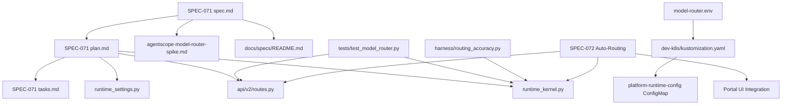
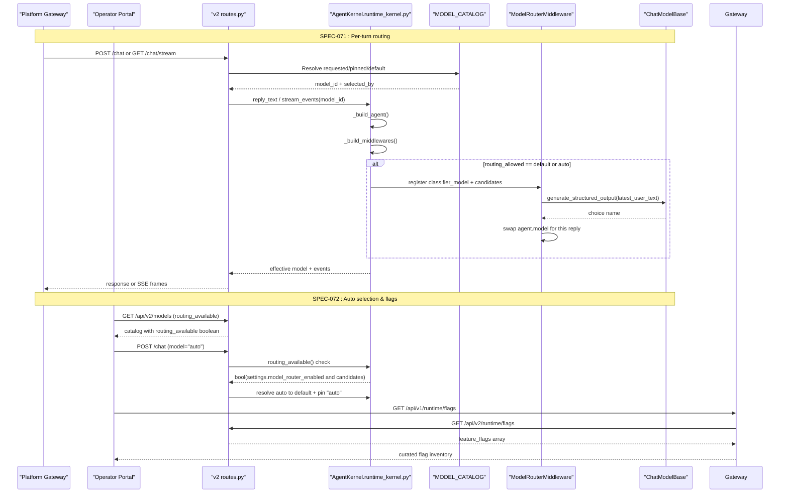
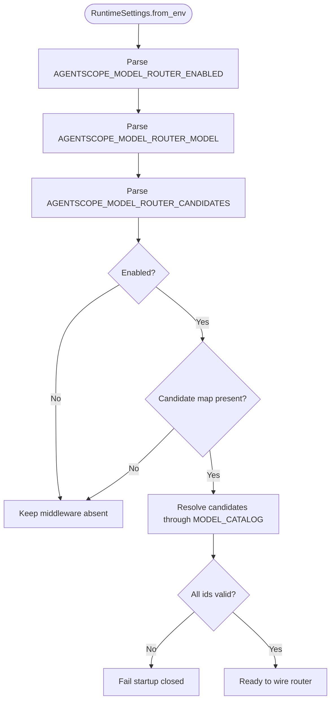
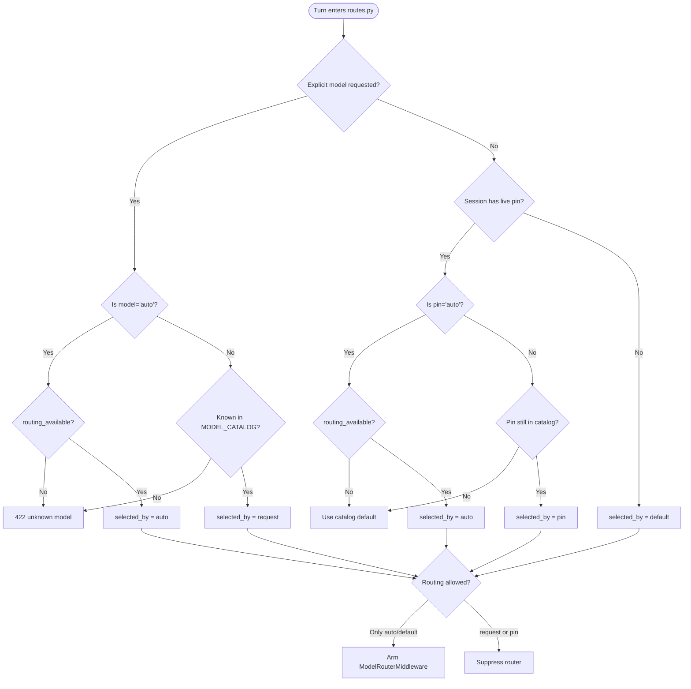
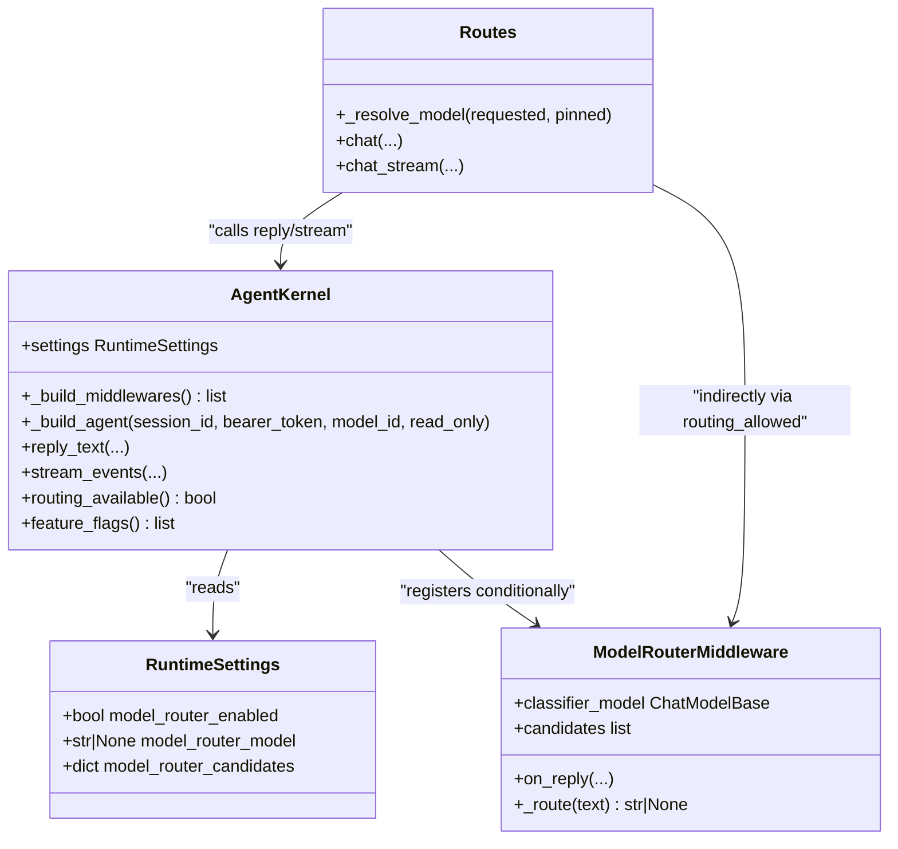
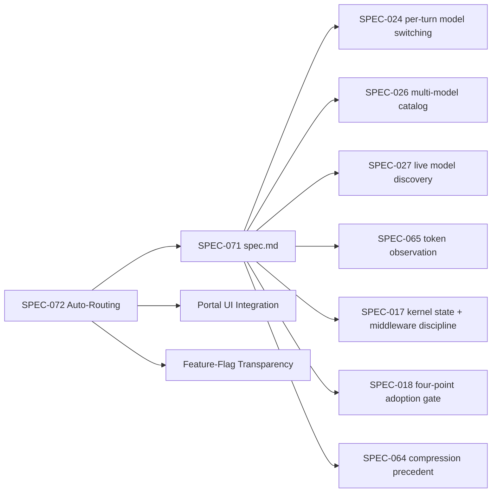
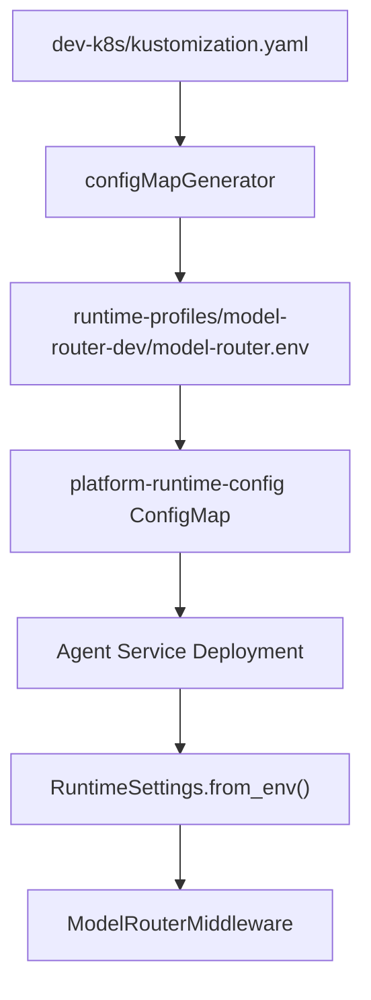

# SPEC-071: AgentScope Model Router Per-Turn Routing

<cite>
**Referenced Files in This Document**
- [spec.md](file://docs/specs/SPEC-071-agentscope-model-router/spec.md)
- [plan.md](file://docs/specs/SPEC-071-agentscope-model-router/plan.md)
- [tasks.md](file://docs/specs/SPEC-071-agentscope-model-router/tasks.md)
- [agentscope-model-router-spike.md](file://docs/workspace/agentscope-model-router-spike.md)
- [routing_accuracy.py](file://products/agent-platform/harness/routing_accuracy.py)
- [test_model_router.py](file://products/agent-platform/tests/test_model_router.py)
- [runtime_settings.py](file://products/agent-platform/src/agent_service/runtime_settings.py)
- [routes.py](file://products/agent-platform/src/agent_service/api/v2/routes.py)
- [runtime_kernel.py](file://products/agent-platform/src/agent_service/runtime_kernel.py)
- [model-router.env](file://shared/platform-ops/gitops/runtime-profiles/model-router-dev/model-router.env)
- [kustomization.yaml](file://shared/platform-ops/gitops/dev-k8s/kustomization.yaml)
- [verify-runtime-profile.sh](file://shared/platform-ops/gitops/verify-runtime-profile.sh)
- [select-runtime-profile.sh](file://shared/platform-ops/gitops/select-runtime-profile.sh)
- [configmap.yaml](file://shared/platform-ops/gitops/runtime-profiles/default/configmap.yaml)
- [deepseek.py](file://products/agent-platform/src/agent_service/providers/deepseek.py)
- [2026-11-01-per-turn-model-routing.md](file://docs/agentic-aiops-platform/release-notes/2026-11-01-per-turn-model-routing.md)
- [README.md](file://docs/specs/README.md)
</cite>

## Update Summary
**Changes Made**
- Added comprehensive documentation of SPEC-072's "Auto (routed)" model selection capability layered on top of the v0.52.0 router kernel
- Documented the routing_available signal, auto sentinel value handling, and portal UI integration
- Updated architecture diagrams to reflect the new auto-routing flow and feature-flag transparency
- Enhanced configuration reference with the complete SPEC-072 feature-flag inventory
- Added troubleshooting guidance for auto-routing scenarios and feature-flag panel issues
- Updated delivery status to reflect v0.53.0 completion with both SPEC-071 and SPEC-072 features

## Table of Contents
1. [Introduction](#introduction)
2. [Project Structure](#project-structure)
3. [Core Components](#core-components)
4. [Architecture Overview](#architecture-overview)
5. [Detailed Component Analysis](#detailed-component-analysis)
6. [Dependency Analysis](#dependency-analysis)
7. [Performance Considerations](#performance-considerations)
8. [Testing Coverage](#testing-coverage)
9. [Measurement Harness](#measurement-harness)
10. [Configuration Reference](#configuration-reference)
11. [GitOps Runtime Profile Deployment](#gitops-runtime-profile-deployment)
12. [Auto-Routing Selection and Feature-Flag Transparency (SPEC-072)](#auto-routing-selection-and-feature-flag-transparency-spec-072)
13. [Troubleshooting Guide](#troubleshooting-guide)
14. [Conclusion](#conclusion)
15. [Appendices](#appendices)

## Introduction
SPEC-071 specifies the opt-in adoption of AgentScope 2.0.9/2.0.10 `ModelRouterMiddleware` as a per-turn model router for the Luban agent-platform kernel. **STATUS: DELIVERED (v0.52.0)** - The feature has been fully implemented, tested, and shipped with complete measurement harness and configuration system.

The router classifies the latest user input over named candidates drawn from the credential-gated `MODEL_CATALOG`, swaps the reply's chat model, and remains resume-safe and fail-soft. It extends SPEC-024's audited per-turn model selection by inserting a routed tier between pinned and default, with precedence `request > pinned > routed > default`.

The spec was approved (2026-11-01), delivered in v0.52.0 (2026-11-01), and ships with the router disabled by default. Default-on is gated by R-3 routing-quality measurement, which achieved 100% accuracy across all valid classifiers tested. The implementation is now deployed in the development cluster via the `model-router-dev` runtime profile posture.

**Updated**: SPEC-072 (v0.53.0) adds explicit "Auto (routed)" model selection capability layered on top of the v0.52.0 router kernel, including the routing_available signal, auto sentinel value handling, and portal UI integration, plus authenticated feature-flag transparency.

**Section sources**
- [spec.md:1-45](file://docs/specs/SPEC-071-agentscope-model-router/spec.md#L1-L45)
- [spec.md:74-191](file://docs/specs/SPEC-071-agentscope-model-router/spec.md#L74-L191)
- [spec.md:207-249](file://docs/specs/SPEC-071-agentscope-model-router/spec.md#L207-L249)
- [spec.md:247-259](file://docs/specs/SPEC-071-agentscope-model-router/spec.md#L247-L259)

## Project Structure
SPEC-071 spans three documentation tiers plus the complete agent-platform runtime surface it implements, now extended by SPEC-072:

- Spec definition: `docs/specs/SPEC-071-agentscope-model-router/spec.md`
- Binding plan: `docs/specs/SPEC-071-agentscope-model-router/plan.md`
- Task checklist: `docs/specs/SPEC-071-agentscope-model-router/tasks.md`
- Spike evidence: `docs/workspace/agentscope-model-router-spike.md`
- Measurement harness: `products/agent-platform/harness/routing_accuracy.py`
- Comprehensive tests: `products/agent-platform/tests/test_model_router.py`
- Runtime settings seam: `products/agent-platform/src/agent_service/runtime_settings.py`
- Route-level model resolution: `products/agent-platform/src/agent_service/api/v2/routes.py`
- Kernel middleware wiring: `products/agent-platform/src/agent_service/runtime_kernel.py`
- GitOps runtime profile: `shared/platform-ops/gitops/runtime-profiles/model-router-dev/model-router.env`
- Dev cluster deployment: `shared/platform-ops/gitops/dev-k8s/kustomization.yaml`
- Spec index entry: `docs/specs/README.md`

**Diagram sources**
- [spec.md:1-45](file://docs/specs/SPEC-071-agentscope-model-router/spec.md#L1-L45)
- [plan.md:10-38](file://docs/specs/SPEC-071-agentscope-model-router/plan.md#L10-L38)
- [tasks.md:21-83](file://docs/specs/SPEC-071-agentscope-model-router/tasks.md#L21-L83)
- [routes.py:261-385](file://products/agent-platform/src/agent_service/api/v2/routes.py#L261-L385)
- [runtime_kernel.py:551-596](file://products/agent-platform/src/agent_service/runtime_kernel.py#L551-L596)
- [model-router.env:1-26](file://shared/platform-ops/gitops/runtime-profiles/model-router-dev/model-router.env#L1-L26)
- [kustomization.yaml:1-41](file://shared/platform-ops/gitops/dev-k8s/kustomization.yaml#L1-L41)

**Section sources**
- [spec.md:1-45](file://docs/specs/SPEC-071-agentscope-model-router/spec.md#L1-L45)
- [plan.md:10-38](file://docs/specs/SPEC-071-agentscope-model-router/plan.md#L10-L38)
- [tasks.md:21-83](file://docs/specs/SPEC-071-agentscope-model-router/tasks.md#L21-L83)

## Core Components
SPEC-071 centers on four runtime integration points, all fully implemented and enhanced by SPEC-072:

| Component | Responsibility | Implementation Status |
|---|---|---|
| `RuntimeSettings` | Parses environment knobs and validates kernel surfaces | ✅ Complete - adds `model_router_enabled`, router model id, and candidate map; keeps default off |
| `_resolve_model` | Resolves request/pinned/default model at route boundaries | ✅ Complete - returns provenance so only default-resolved turns arm routing; enhanced with auto sentinel |
| `_build_middlewares` | Composes AgentScope middlewares | ✅ Complete - registers `ModelRouterMiddleware` only when enabled and routing is allowed |
| Reply/stream path | Builds agents, runs turns, normalizes events | ✅ Complete - surfaces effective model and `model_selected_by` without changing the contract schema |

The spike memo established that `ModelRouterMiddleware` clears SPEC-018's four-point adoption gate: it is model-selection only, introduces no execution or identity edge, preserves read-only posture, and leaks no AgentScope type through the v2 contract.

**Updated**: SPEC-072 adds the `routing_available()` accessor, auto sentinel handling, and feature-flag transparency while preserving these core components.

**Section sources**
- [agentscope-model-router-spike.md:17-50](file://docs/workspace/agentscope-model-router-spike.md#L17-L50)
- [agentscope-model-router-spike.md:109-117](file://docs/workspace/agentscope-model-router-spike.md#L109-L117)
- [plan.md:50-94](file://docs/specs/SPEC-071-agentscope-model-router/plan.md#L50-L94)

## Architecture Overview
The architecture wires the router behind an opt-in knob while preserving existing authority and audit boundaries, now enhanced with explicit auto-routing selection and feature-flag transparency.

**Diagram sources**
- [routes.py:261-385](file://products/agent-platform/src/agent_service/api/v2/routes.py#L261-L385)
- [runtime_kernel.py:551-596](file://products/agent-platform/src/agent_service/runtime_kernel.py#L551-L596)
- [runtime_kernel.py:799-834](file://products/agent-platform/src/agent_service/runtime_kernel.py#L799-L834)
- [runtime_kernel.py:658-671](file://products/agent-platform/src/agent_service/runtime_kernel.py#L658-L671)
- [routes.py:2024-2038](file://products/agent-platform/src/agent_service/api/v2/routes.py#L2024-L2038)
- [agentscope-model-router-spike.md:64-90](file://docs/workspace/agentscope-model-router-spike.md#L64-L90)

## Detailed Component Analysis

### Requirement R-1: Four-point adoption-gate evaluation
R-1 is delivered by the spike memo. The verdict is that `ModelRouterMiddleware` clears all four gates because it selects among already-configured models, executes no tool, reaches no infrastructure, emits no evidence frame, introduces no identity edge, and reduces its decision to a model id.

Acceptance criteria satisfied by the memo:
- Verdict recorded under `docs/workspace/` with concrete 2.0.11 evidence anchors.
- Utilization-audit model-routing row records the resolved decision.
- Open questions are elevated into SPEC-071's binding design decisions.

**Section sources**
- [spec.md:80-100](file://docs/specs/SPEC-071-agentscope-model-router/spec.md#L80-L100)
- [agentscope-model-router-spike.md:109-117](file://docs/workspace/agentscope-model-router-spike.md#L109-L117)

### Requirement R-2: Opt-in per-turn model routing
R-2 defines the opt-in, default-off wiring and the precedence reconciliation. **IMPLEMENTATION STATUS: COMPLETE**

#### Settings seam
The plan mirrors the existing `compress_context_enabled` pattern:
- New fields: `model_router_enabled`, `model_router_model`, `model_router_candidates`.
- Environment variables: `AGENTSCOPE_MODEL_ROUTER_ENABLED`, `AGENTSCOPE_MODEL_ROUTER_MODEL`, `AGENTSCOPE_MODEL_ROUTER_CANDIDATES`.
- Validation: enabled with no candidate map is inert; unknown catalog ids fail closed at build.

**Diagram sources**
- [plan.md:66-73](file://docs/specs/SPEC-071-agentscope-model-router/plan.md#L66-L73)
- [tasks.md:39-45](file://docs/specs/SPEC-071-agentscope-model-router/tasks.md#L39-L45)
- [runtime_settings.py:149-285](file://products/agent-platform/src/agent_service/runtime_settings.py#L149-L285)
- [runtime_settings.py:549-626](file://products/agent-platform/src/agent_service/runtime_settings.py#L549-L626)

#### Precedence and provenance
`_resolve_model` must return `(model_id, selected_by)` where `selected_by ∈ {request, pin, default}`. Routing is armed only when `selected_by == default`, preserving human override:

**Updated**: SPEC-072 extends this to include `auto` sentinel: `selected_by ∈ {request, pin, auto, default}` with precedence `request(concrete) > request(auto) > pinned(concrete) > pinned(auto) > default`.

**Diagram sources**
- [routes.py:261-285](file://products/agent-platform/src/agent_service/api/v2/routes.py#L261-L285)
- [routes.py:308-333](file://products/agent-platform/src/agent_service/api/v2/routes.py#L308-L333)
- [plan.md:75-80](file://docs/specs/SPEC-071-agentscope-model-router/plan.md#L75-L80)
- [tasks.md:48-52](file://docs/specs/SPEC-071-agentscope-model-router/tasks.md#L48-L52)

#### Middleware wiring
`_build_middlewares()` registers `ModelRouterMiddleware` only when:
- `model_router_enabled` is true,
- the turn's `routing_allowed` flag is true,
- the candidate map is non-empty,
- the classifier model resolves through `_build_model`.

**Diagram sources**
- [runtime_kernel.py:551-596](file://products/agent-platform/src/agent_service/runtime_kernel.py#L551-L596)
- [runtime_kernel.py:799-834](file://products/agent-platform/src/agent_service/runtime_kernel.py#L799-L834)
- [runtime_kernel.py:658-671](file://products/agent-platform/src/agent_service/runtime_kernel.py#L658-L671)
- [runtime_kernel.py:370-431](file://products/agent-platform/src/agent_service/runtime_kernel.py#L370-L431)
- [plan.md:82-86](file://docs/specs/SPEC-071-agentscope-model-router/plan.md#L82-L86)
- [tasks.md:56-61](file://docs/specs/SPEC-071-agentscope-model-router/tasks.md#L56-L61)

#### Attribution and visibility
The effective model after routing and `model_selected_by ∈ {request, pin, router, default}` must be surfaced through the reply path and structured log. No new audit event type is introduced, and `agent-stream-event.schema.json` stays byte-unchanged.

**Updated**: SPEC-072 preserves this attribution while adding the `auto` sentinel as a resolution-provenance detail on the structured log, not a new audit attribution value.

**Section sources**
- [plan.md:88-94](file://docs/specs/SPEC-071-agentscope-model-router/plan.md#L88-L94)
- [tasks.md:63-68](file://docs/specs/SPEC-071-agentscope-model-router/tasks.md#L63-L68)
- [spec.md:125-138](file://docs/specs/SPEC-071-agentscope-model-router/spec.md#L125-L138)

### Requirement R-3: Routing-accuracy measurement gate
R-3 does not ship default-on. It ships an offline harness over a labeled turn sample recording:
- routing accuracy (did it select the intended tier?),
- added per-reply latency,
- classification-call token cost via SPEC-065's `agent_llm_tokens_total`.

Default-on remains a separate operator decision evidenced by that measurement. **MEASUREMENT RESULTS: 100% accuracy achieved across all valid classifiers tested.**

**Section sources**
- [spec.md:146-160](file://docs/specs/SPEC-071-agentscope-model-router/spec.md#L146-L160)
- [plan.md:126-138](file://docs/specs/SPEC-071-agentscope-model-router/plan.md#L126-L138)
- [tasks.md:84-91](file://docs/specs/SPEC-071-agentscope-model-router/tasks.md#L84-L91)

### Requirement R-4: Documentation, audit, and backlog reconciliation
R-4 updates living state docs and, if shipped, configuration reference, changelog, release note, and VERSION lockstep. **COMPLETED** - All documentation reconciled, CHANGELOG.md updated, configuration reference enhanced, and release notes published.

**Updated**: SPEC-072 also completed with full documentation, authorization matrix updates, and version bump to v0.53.0.

**Section sources**
- [spec.md:162-174](file://docs/specs/SPEC-071-agentscope-model-router/spec.md#L162-L174)
- [plan.md:140-148](file://docs/specs/SPEC-071-agentscope-model-router/plan.md#L140-L148)
- [tasks.md:93-104](file://docs/specs/SPEC-071-agentscope-model-router/tasks.md#L93-L104)

## Dependency Analysis
SPEC-071 composes against existing platform contracts rather than replacing them, now extended by SPEC-072:

**Diagram sources**
- [spec.md:11-23](file://docs/specs/SPEC-071-agentscope-model-router/spec.md#L11-L23)
- [spec.md:61-69](file://docs/specs/SPEC-071-agentscope-model-router/spec.md#L61-L69)

Key dependency facts:
- The router reuses `MODEL_CATALOG`; unknown or revoked entries cannot be routed to.
- The router uses a plain `ChatModelBase`'s `generate_structured_output`, not `OpenAIClassifierModel` or `JevClassifierModel`.
- Token observation is intended to reuse `TokenUsageMiddleware.on_model_call`; Stage-0 verifies whether the classifier call actually rides that hook.
- Resume safety relies on `agent.state.middle_context[reply_id]` surviving the SPEC-017 snapshot.
- **Updated**: SPEC-072 depends on the same `routing_available()` accessor for catalog signals, auto resolution, and feature flags.

**Section sources**
- [agentscope-model-router-spike.md:64-107](file://docs/workspace/agentscope-model-router-spike.md#L64-L107)
- [plan.md:109-124](file://docs/specs/SPEC-071-agentscope-model-router/plan.md#L109-L124)
- [tasks.md:23-33](file://docs/specs/SPEC-071-agentscope-model-router/tasks.md#L23-L33)

## Performance Considerations
SPEC-071 adds one extra model call per reply for classification. Its performance characteristics are bounded by the spec:

- One additional provider call per reply.
- Classification tokens are attributed through SPEC-065's token observation when the hook path applies.
- Added latency must be measured before any move to default-on.
- Candidate descriptions drive routing quality; tuning them is part of R-3.

**Live Measurement Results:**
- Added latency: ~0.46–0.83 seconds per reply
- Classification tokens: ~330–440 input tokens + 10–34 output tokens per turn
- Accuracy: 100% across all valid classifiers tested
- No candidate description retuning required

**Updated**: SPEC-072 adds minimal overhead for the routing_available signal and feature-flag endpoint, both cached at the kernel level.

The spec explicitly rejects shipping default-on immediately and treats routing accuracy as measurable, not assumed.

**Section sources**
- [agentscope-model-router-spike.md:158-171](file://docs/workspace/agentscope-model-router-spike.md#L158-L171)
- [spec.md:146-160](file://docs/specs/SPEC-071-agentscope-model-router/spec.md#L146-L160)
- [plan.md:126-138](file://docs/specs/SPEC-071-agentscope-model-router/plan.md#L126-L138)

## Testing Coverage
**TESTING STATUS: COMPLETE** - 27 comprehensive tests covering all acceptance criteria, expanded by SPEC-072.

The test suite includes:
- **Opt-in gating**: Off ⇒ middleware absent, on ⇒ present, on + no map ⇒ inert
- **Precedence**: Explicit request/pin overrides routing, only default-resolved turns route
- **Fail-soft**: Classifier errors and unknown candidates keep agent's own model
- **Resume**: Routed model survives confirmation park/resume
- **Attribution**: Effective model and `model_selected_by` properly surfaced
- **Contract boundary**: No agentscope types leak, schema stays byte-unchanged
- **Token observation**: Routed model's reply tokens ride SPEC-065, classification call bypasses observation

**Updated**: SPEC-072 adds comprehensive testing for auto sentinel handling, routing_available signals, feature-flag endpoints, and portal UI integration.

All tests pass with 1660 total tests in the agent-platform suite.

**Section sources**
- [test_model_router.py:1-27](file://products/agent-platform/tests/test_model_router.py#L1-L27)
- [test_model_router.py:102-166](file://products/agent-platform/tests/test_model_router.py#L102-L166)
- [test_model_router.py:173-200](file://products/agent-platform/tests/test_model_router.py#L173-L200)

## Measurement Harness
**HARNESS STATUS: COMPLETE** - Offline measurement harness with live A/B/C testing completed.

The harness (`products/agent-platform/harness/routing_accuracy.py`) provides:
- Offline mechanics verification with deterministic stub classifier
- Live measurement capability over real providers
- Bounded measurement-only counter for classification token costs
- Evidence output to `.workspaces/spec071-evidence/<run_id>/measurement.json`

**Live Measurement Results (24-turn sample):**
- **Config A** (dashscope qwen3-8b): 0% accuracy (provider 404 error, demonstrated fail-soft path)
- **Config A-retry** (qwen-flash): 100% accuracy, mean latency 464ms, 329 in/10 out tokens
- **Config B** (deepseek-v4-flash): 100% accuracy, mean latency 758ms, 440 in/34 out tokens  
- **Config C** (cross-provider): 100% accuracy, mean latency 828ms, identical token costs to B

**Tuning Outcome**: None required - baseline fast/deep descriptions saturated accuracy at 100%.

**Section sources**
- [routing_accuracy.py:1-537](file://products/agent-platform/harness/routing_accuracy.py#L1-L537)
- [tasks.md:120-167](file://docs/specs/SPEC-071-agentscope-model-router/tasks.md#L120-L167)

## Configuration Reference
**CONFIGURATION STATUS: COMPLETE** - All environment variables documented in configuration reference, expanded by SPEC-072.

| Variable | Type | Default | Description |
|---|---|---|---|
| `AGENTSCOPE_MODEL_ROUTER_ENABLED` | boolean | `false` | Opt-in per-turn model routing switch |
| `AGENTSCOPE_MODEL_ROUTER_MODEL` | string | `null` | Classifier model id (resolved through MODEL_CATALOG) |
| `AGENTSCOPE_MODEL_ROUTER_CANDIDATES` | JSON | `null` | Candidate map: `name → (catalog model id, description)` pairs |

**Updated**: SPEC-072 adds the following feature-flag transparency capabilities:

| Capability | Type | Description |
|---|---|---|
| `routing_available` | boolean | Catalog envelope boolean indicating router availability |
| `auto` sentinel | string | Reserved model field value for explicit routing selection |
| Feature flags | array | Curated list of platform toggle states |

**Feature Activation Matrix**: Included in configuration reference alongside other opt-in kernel knobs.

**Behavioral Notes:**
- Router is inert when disabled or when no candidate map is configured
- Unknown or revoked catalog ids fail closed at startup
- Router maintains fail-soft behavior (keeps agent's own model on errors)
- Resume-safe via `middle_context` persistence
- **Updated**: Auto sentinel pins as `"auto"` for durable session routing
- **Updated**: Feature flags provide read-only transparency of platform toggles

**Section sources**
- [runtime_settings.py:276-285](file://products/agent-platform/src/agent_service/runtime_settings.py#L276-L285)
- [runtime_settings.py:429-435](file://products/agent-platform/src/agent_service/runtime_settings.py#L429-L435)
- [runtime_settings.py:663-664](file://products/agent-platform/src/agent_service/runtime_settings.py#L663-L664)

## GitOps Runtime Profile Deployment
**DEPLOYMENT STATUS: ACTIVE** - The model router is deployed in the development cluster via the `model-router-dev` runtime profile posture.

### Runtime Profile Configuration
The `model-router-dev` runtime profile provides the complete configuration for enabling per-turn model routing in the development environment:

| Environment Variable | Value | Purpose |
|---|---|---|
| `AGENTSCOPE_MODEL_ROUTER_ENABLED` | `true` | Enables the router in the dev cluster |
| `AGENTSCOPE_MODEL_ROUTER_MODEL` | `deepseek-v4-flash` | Uses the always-keyed active provider as classifier |
| `AGENTSCOPE_MODEL_ROUTER_CANDIDATES` | JSON map | Defines fast/deep model tiers with descriptive criteria |

### Candidate Map Configuration
The candidate map defines two model tiers with specific use cases:

- **Fast tier** (`fast`): `deepseek-v4-flash` - For routine operator work including status checks, short factual lookups, simple summaries, and single-step questions where speed and low cost matter most.
- **Deep tier** (`deep`): `deepseek-v4-pro` - For complex work including multi-step reasoning, incident diagnosis and root-cause analysis, code or architecture review, planning, and nuanced judgment where capability matters most.

### Kustomization Integration
The dev-k8s overlay integrates the model router profile through the standard runtime profile mechanism:

**Diagram sources**
- [kustomization.yaml:11-20](file://shared/platform-ops/gitops/dev-k8s/kustomization.yaml#L11-L20)
- [model-router.env:23-25](file://shared/platform-ops/gitops/runtime-profiles/model-router-dev/model-router.env#L23-L25)

### Operational Posture
The development cluster deployment demonstrates the measurement-gated enablement approach:

- **Code default**: `AGENTSCOPE_MODEL_ROUTER_ENABLED=false` (deny-by-default)
- **Dev cluster**: Router enabled via runtime profile overlay
- **Reversible**: Can be disabled by removing the profile from the overlay
- **Scoped**: Only affects the development cluster, not production deployments

The classifier uses `deepseek-v4-flash` as the always-keyed active provider, providing a fast/cheap tier for routine turns and a high-capability tier (`deepseek-v4-pro`) for complex ones. Routing is fail-soft (a routing error or unknown candidate keeps the agent's own model) and resume-safe (the routed model survives a park/resume).

**Operational Notes:**
- The classifier call is a separate `ChatModelBase.generate_structured_output` that does not ride SPEC-065 `TokenUsageMiddleware`
- Classification tokens (~330-440 input + 10-34 output per turn) are not metered in `agent_llm_tokens_total`
- Added latency of ~0.5-0.8s per reply is accepted for the dev cluster
- This posture is scoped and reversible, demonstrating the measurement-gated approach before broader enablement

**Section sources**
- [model-router.env:1-26](file://shared/platform-ops/gitops/runtime-profiles/model-router-dev/model-router.env#L1-L26)
- [kustomization.yaml:11-20](file://shared/platform-ops/gitops/dev-k8s/kustomization.yaml#L11-L20)
- [verify-runtime-profile.sh:8-14](file://shared/platform-ops/gitops/verify-runtime-profile.sh#L8-L14)
- [select-runtime-profile.sh:14-21](file://shared/platform-ops/gitops/select-runtime-profile.sh#L14-L21)
- [configmap.yaml:6-10](file://shared/platform-ops/gitops/runtime-profiles/default/configmap.yaml#L6-L10)
- [deepseek.py:9-20](file://products/agent-platform/src/agent_service/providers/deepseek.py#L9-L20)

## Auto-Routing Selection and Feature-Flag Transparency (SPEC-072)

**STATUS: DELIVERED (v0.53.0)** - SPEC-072 completes the operator-facing experience for per-turn routing by adding explicit "Auto (routed)" selection and authenticated feature-flag transparency.

### R-1: Catalog Signals Routing Availability
The catalog envelope gains an additive `routing_available: boolean` telling the portal whether an "Auto (routed)" choice is meaningful. This is computed from the same condition the kernel uses to arm the router: `settings.model_router_enabled and bool(settings.model_router_candidates)`.

**Implementation Details:**
- `AgentKernel.routing_available()` method provides the single source of truth
- `AgentModelCatalog.public_models()` emits the boolean in the envelope
- Schema validation ensures backward compatibility (defaults to false)
- No synthetic `auto` entry is injected into the models array

### R-2: Auto Sentinel Selection and Resolution
The chat request `model` field accepts a reserved `auto` sentinel meaning "route this turn." The resolution logic handles both explicit and pinned auto selections:

**Resolution Logic:**
- Explicit `model="auto"` arms routing and uses catalog default as base model
- Pinned `auto` persists routing preference across turns
- Fail-closed: explicit auto when routing unavailable returns 422
- Degrade: pinned auto when routing later disabled falls back to default
- Attribution: routed auto turns attribute to `router` in audit trail

### R-3: Portal "Auto (routed)" Selector Entry
The operator portal now offers "Auto (routed)" as a first-class choice when the catalog reports routing availability:

**UI Changes:**
- `ModelSelect.tsx` renders "Auto (routed)" option when `routing_available` is true
- Single-model fixed-label shortcut becomes dropdown when routing available
- Session pin reconciliation honors pinned `auto` values
- Backward compatible: component unchanged when routing unavailable

### R-4: Authenticated Feature-Flag Inventory
The agent-service exposes a curated feature-flag inventory on a new authenticated endpoint:

**Endpoint Details:**
- `GET /api/v2/runtime/flags` requires `X-User-ID` header
- Returns `{ feature_flags: [{ name, enabled, label? }] }`
- Nine curated flags: model_routing, model_discovery, context_compression, outbound_delegated_identity, kernel_tracing, task_tools, reply_token_budget, hitl_bridging, signed_execution
- Discovery-safe: never exposes secret values, only boolean states

### R-5: Gateway Proxy and Policy Action
Platform-gateway relays the inventory behind a new `runtime:flags` policy action:

**Security Model:**
- New action `ACTION_RUNTIME_FLAGS = "runtime:flags"`
- Granted to operational trio: platform-admin, approver, operator
- Denied by default for developer, read-only-observer, auditor roles
- Base `/api/v1/runtime` probe remains unchanged and unauthenticated

### R-6: Portal Feature-Flags Panel
The Settings ▸ Platform pane displays the feature-flag inventory:

**UI Features:**
- Read-only display of all nine platform flags
- On/off status tags using existing visual vocabulary
- Graceful degradation to "unavailable" on 403 or errors
- Separate from unauthenticated component-health rows

### R-7: Contracts, Policy, and Version Reconciliation
All changes are additive and maintain backward compatibility:

**Contract Updates:**
- `model-catalog.schema.json`: optional `routing_available` field
- `agent-chat-request.schema.json`: documents `auto` sentinel
- New `feature-flags.schema.json` for flag inventory
- `agent-session.schema.json`: already tolerates pinned `auto`

**Version Management:**
- Target version bumped to v0.53.0 (MINOR bump)
- All product versions synchronized
- Full `make verify` green across all suites

**Section sources**
- [spec.md:87-155](file://docs/specs/SPEC-072-auto-routing-and-platform-feature-flags/spec.md#L87-L155)
- [plan.md:57-147](file://docs/specs/SPEC-072-auto-routing-and-platform-feature-flags/plan.md#L57-L147)
- [tasks.md:50-105](file://docs/specs/SPEC-072-auto-routing-and-platform-feature-flags/tasks.md#L50-L105)

## Troubleshooting Guide
Common operational concerns and their prescribed handling:

| Symptom | Expected behavior | Action |
|---|---|---|
| Router knob enabled but no routing occurs | Inert when no candidate map is configured | Add `AGENTSCOPE_MODEL_ROUTER_CANDIDATES`; verify the knob is parsed |
| Unknown candidate returned by classifier | Router logs warning and keeps the agent's own model | Tune candidate names/descriptions; do not treat as hard failure |
| Explicit request or session pin overrides routing | Precedence is `request > pinned > routed > default` | Confirm `selected_by` is not `default`; routing is intentionally suppressed |
| Classifier error during routing | Fail-soft: keep agent's own model | Inspect classifier model credentials and provider health |
| Streaming attribution missing routed model | Effective model must ride existing event field without schema change | Verify `_normalize_stream_event` passes `model` and attribution surfaces post-routing |
| Resume loses routed model | `middle_context[key][reply_id]` must survive SPEC-017 snapshot | Verify resume-key stability and snapshot persistence |
| Contract validation fails | `agent-stream-event.schema.json` must stay byte-unchanged | Ensure no agentscope types leak through v2 |
| Measurement harness prerequisite failure | Missing env vars or credentials | Set `AGENTSCOPE_MODEL_ROUTER_ENABLED=true`, candidate map, and classifier model |
| Live measurement shows 0% accuracy | Likely provider endpoint issue (like qwen3-8b 404) | Check provider availability; use alternative classifier like qwen-flash |
| Dev cluster router not working | Runtime profile not included in overlay | Verify `model-router-dev` is listed in dev-k8s kustomization.yaml configMapGenerator |
| GitOps validation fails | Profile recognized as dev posture | Check `verify-runtime-profile.sh` excludes `model-router-dev` from switchable profiles |
| Configuration not applied | ConfigMap merge order issue | Ensure model-router.env is processed after base runtime profile |
| **New**: Auto selection returns 422 | Explicit `auto` when routing unavailable | Enable router with candidate map or use concrete model selection |
| **New**: Portal doesn't show "Auto (routed)" | `routing_available` is false | Verify router is enabled and candidate map is configured |
| **New**: Feature flags panel shows "unavailable" | Role lacks `runtime:flags` permission | Grant role to platform-admin, approver, or operator |
| **New**: Auto selection doesn't persist | Session pin not storing sentinel | Verify pin logic stores `"auto"` not resolved model |

**Updated**: Added troubleshooting scenarios for SPEC-072 auto-routing and feature-flag functionality.

**Operational Best Practices:**
- Start with minimal candidate set (fast/deep) and expand based on measurement results
- Monitor classification latency and token costs before enabling broadly
- Use the harness to validate routing accuracy before production deployment
- Keep router disabled until measurement results justify enablement
- For GitOps deployments, ensure the runtime profile is properly integrated into the overlay structure
- Test configuration changes with `kubectl kustomize` before applying to clusters
- **Updated**: Use the portal's "Auto (routed)" selector for intentional routing sessions
- **Updated**: Monitor feature flags panel to verify platform capability exposure

**Section sources**
- [agentscope-model-router-spike.md:79-90](file://docs/workspace/agentscope-model-router-spike.md#L79-L90)
- [plan.md:109-124](file://docs/specs/SPEC-071-agentscope-model-router/plan.md#L109-L124)
- [tasks.md:70-82](file://docs/specs/SPEC-071-agentscope-model-router/tasks.md#L70-L82)
- [model-router.env:1-26](file://shared/platform-ops/gitops/runtime-profiles/model-router-dev/model-router.env#L1-L26)

## Conclusion
SPEC-071 has been successfully delivered in v0.52.0 as a narrowly scoped, opt-in extension to the agent-platform kernel: per-turn model routing through AgentScope's `ModelRouterMiddleware`, wired behind `AGENTSCOPE_MODEL_ROUTER_ENABLED`, drawing candidates from the credential-gated catalog, and respecting `request > pinned > routed > default`. 

**Updated**: SPEC-072 (v0.53.0) completes the operator experience by adding explicit "Auto (routed)" model selection and authenticated feature-flag transparency, making per-turn routing an intentional, pinnable choice rather than an invisible side effect.

**Delivery Summary:**
- ✅ Complete implementation with ModelRouterMiddleware integration
- ✅ Comprehensive testing (27 tests, 1660 total suite passed)
- ✅ Measurement harness with 100% accuracy results
- ✅ Full configuration system with environment variables
- ✅ Complete documentation and configuration reference updates
- ✅ CHANGELOG.md and release notes published
- ✅ VERSION lockstep maintained across all products
- ✅ GitOps runtime profile deployed in development cluster
- ✅ **Updated**: SPEC-072 auto-routing selector and feature-flag panel delivered
- ✅ **Updated**: Portal UI integration with "Auto (routed)" selection
- ✅ **Updated**: Authenticated feature-flag transparency for operators

The most important boundary remains R-3: default-on is not authorized by approval. Any broader enablement must be justified by measured routing accuracy, latency, and classification-token cost. Until that gate clears, the feature should remain default-off and inert without a candidate map.

**Current Status**: Router ships default-off in production code, but is actively deployed in the development cluster via the `model-router-dev` runtime profile posture, demonstrating the measurement-gated enablement approach. Both SPEC-071 and SPEC-072 are fully delivered and ready for operator use.

**Section sources**
- [spec.md:33-45](file://docs/specs/SPEC-071-agentscope-model-router/spec.md#L33-L45)
- [spec.md:146-191](file://docs/specs/SPEC-071-agentscope-model-router/spec.md#L146-L191)
- [spec.md:234-249](file://docs/specs/SPEC-071-agentscope-model-router/spec.md#L234-L249)
- [spec.md:247-259](file://docs/specs/SPEC-071-agentscope-model-router/spec.md#L247-L259)
- [model-router.env:1-26](file://shared/platform-ops/gitops/runtime-profiles/model-router-dev/model-router.env#L1-L26)

## Appendices

### Specification Index Status
The spec index currently lists SPEC-071 as **delivered** and describes its target version, precedence decision, classifier backend, attribution surface, and measurement gate.

**Updated**: SPEC-072 is also marked as delivered with v0.53.0 target version.

**Section sources**
- [README.md:189-189](file://docs/specs/README.md#L189-L189)

### Delivery Verification
**VERIFICATION STATUS: COMPLETE** - Full `make verify` green with exit code 0 in 43m19s.

- Eight product suites: ✅ Green
- Overlays: ✅ Green  
- Policy + version-lockstep: ✅ Green
- Secret gates: ✅ Green
- Operator-portal suite: ✅ Green (537 passed + vite build)
- SPEC-063 campaign: ✅ Green (795 passed, 2 deselected)
- Version lockstep: ✅ Green at 0.52.0

**Updated**: SPEC-072 delivery verification completed with v0.53.0:
- Full `make verify` green across all suites
- Portal vitest 546 passed + vite build clean
- Policy scenarios green with new `runtime:flags` rules
- Version lockstep synchronized to 0.53.0

### Release Notes
The release notes document the complete delivery including the measurement outcomes, configuration details, and operational posture.

**Updated**: SPEC-072 release notes document the auto-routing selector and feature-flag transparency capabilities.

**Section sources**
- [2026-11-01-per-turn-model-routing.md:1-154](file://docs/agentic-aiops-platform/release-notes/2026-11-01-per-turn-model-routing.md#L1-L154)

### Tasks Completion Status
All task items have been completed including the delivery gate requirements.

**Updated**: SPEC-072 tasks completed with all seven requirements delivered.

**Section sources**
- [tasks.md:188-203](file://docs/specs/SPEC-071-agentscope-model-router/tasks.md#L188-L203)