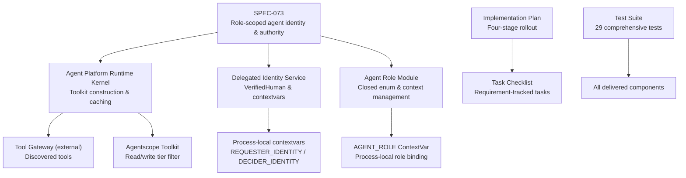
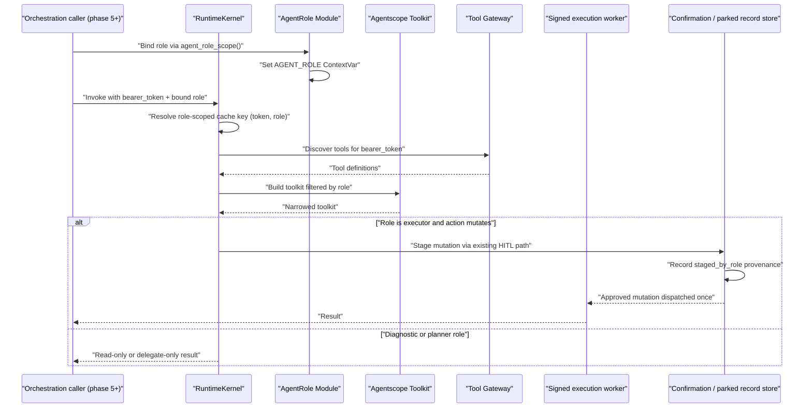
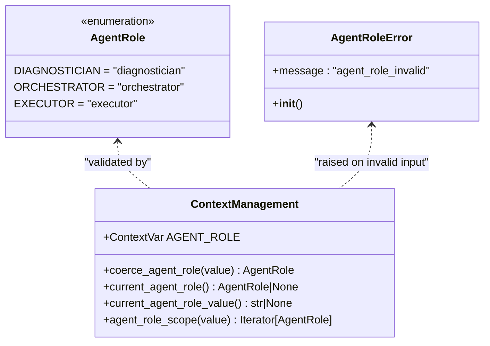
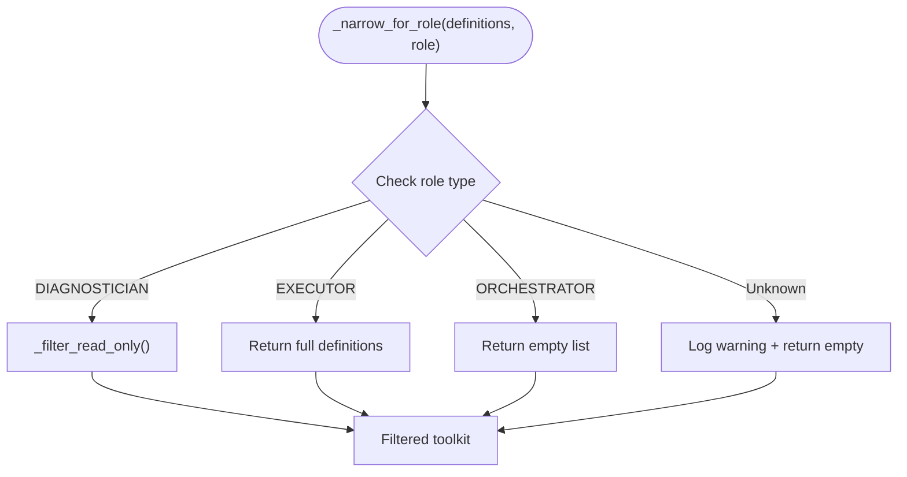
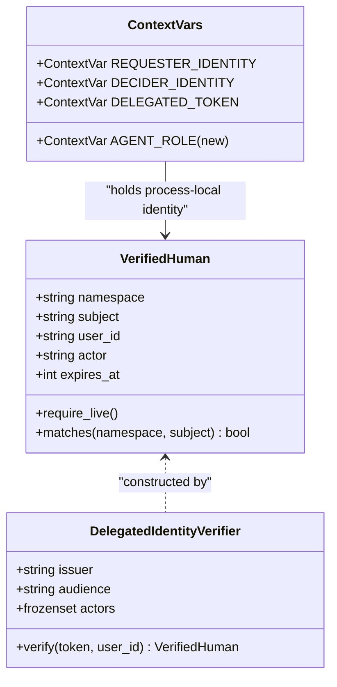
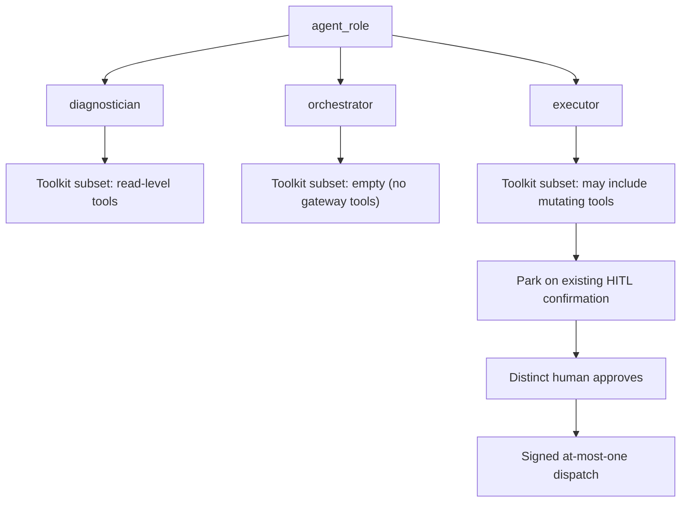
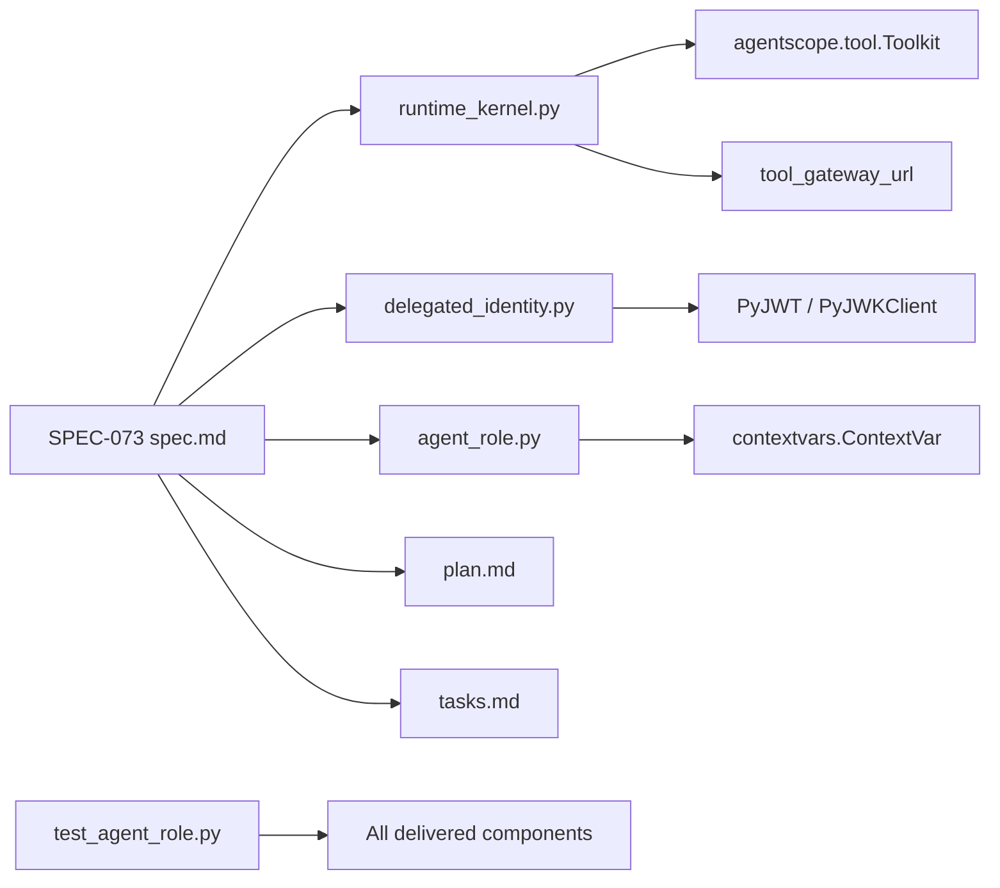

# SPEC-073: Role-Scoped Agent Identity and Authority

<cite>
**Referenced Files in This Document**
- [spec.md](file://docs/specs/SPEC-073-role-scoped-agent-identity/spec.md)
- [plan.md](file://docs/specs/SPEC-073-role-scoped-agent-identity/plan.md)
- [tasks.md](file://docs/specs/SPEC-073-role-scoped-agent-identity/tasks.md)
- [agent_role.py](file://products/agent-platform/src/agent_service/services/agent_role.py)
- [test_agent_role.py](file://products/agent-platform/tests/test_agent_role.py)
- [runtime_kernel.py](file://products/agent-platform/src/agent_service/runtime_kernel.py)
- [delegated_identity.py](file://products/agent-platform/src/agent_service/services/delegated_identity.py)
- [identity-and-authorization-design.md](file://docs/agentic-aiops-platform/identity-and-authorization-design.md)
</cite>

## Update Summary
**Changes Made**
- Updated SPEC-073 status from approved to **delivered** as v0.54.0 with complete implementation
- Added comprehensive implementation details for the delivered AgentRole enum and runtime extensions
- Documented the complete test coverage including 29 new role-specific tests
- Updated architecture diagrams to reflect the actual implementation patterns
- Added detailed component analysis of the delivered agent_role.py module
- Enhanced troubleshooting guide with specific implementation checks for the delivered substrate

## Table of Contents
1. [Introduction](#introduction)
2. [Project Structure](#project-structure)
3. [Core Components](#core-components)
4. [Architecture Overview](#architecture-overview)
5. [Detailed Component Analysis](#detailed-component-analysis)
6. [Dependency Analysis](#dependency-analysis)
7. [Performance Considerations](#performance-considerations)
8. [Implementation Roadmap](#implementation-roadmap)
9. [Troubleshooting Guide](#troubleshooting-guide)
10. [Conclusion](#conclusion)

## Introduction
SPEC-073 defines the role-scoped agent identity and authority substrate required by ADR-0017's phased multi-agent program. **Status: Delivered** (2026-11-04 as v0.54.0). Its phase-2 goal was narrow and defensive: introduce a closed, platform-owned `agent-role` vocabulary (`diagnostician`, `orchestrator`, `executor`) that narrows an agent's toolkit on the existing gateway-forwarded delegated token, without creating a new principal, broker identity, or wire claim. The spec preserves end-to-end human identity ("on whose behalf"), keeps every mutation on the existing HITL-gated signed dispatch path, and ships inert by default so the deployed single-agent turn remains byte-identical.

The specification is now **delivered** with all six Open Questions resolved and all six requirements implemented. Delivery authorizes the substrate to be present in production but does not authorize any orchestration caller wiring — the substrate remains inert with no active role binding in the deployed paths. Phase 2 touches only the agent-platform runtime seam and documentation — no tool-gateway, platform-gateway, identity-broker, portal, or contract schema changes were made for this phase.

**Section sources**
- [spec.md:3-30](file://docs/specs/SPEC-073-role-scoped-agent-identity/spec.md#L3-L30)
- [spec.md:65-77](file://docs/specs/SPEC-073-role-scoped-agent-identity/spec.md#L65-L77)
- [spec.md:322-342](file://docs/specs/SPEC-073-role-scoped-agent-identity/spec.md#L322-L342)

## Project Structure
SPEC-073 is now fully implemented as a design and requirements document backed by concrete runtime surfaces in the agent-platform product:

| Area | Repository location | Implementation Status |
|---|---|---|
| Specification | `docs/specs/SPEC-073-role-scoped-agent-identity/spec.md` | Defines roles, requirements, non-goals, impact boundaries, and open questions. |
| Implementation Plan | `docs/specs/SPEC-073-role-scoped-agent-identity/plan.md` | Binding four-stage rollout plan with detailed technical approach. |
| Task Tracking | `docs/specs/SPEC-073-role-scoped-agent-identity/tasks.md` | Granular task checklist tied to requirement IDs - all tasks completed. |
| Role Substrate | `products/agent-platform/src/agent_service/services/agent_role.py` | Closed AgentRole enum, AGENT_ROLE ContextVar, and role scope management. |
| Toolkit narrowing seam | `products/agent-platform/src/agent_service/runtime_kernel.py` | Implements per-token toolkit caching, read-only filtering, and role-aware narrowing. |
| Human identity context | `products/agent-platform/src/agent_service/services/delegated_identity.py` | Provides `VerifiedHuman` and the `REQUESTER_IDENTITY` / `DECIDER_IDENTITY` contextvars referenced by R-3. |
| Test Coverage | `products/agent-platform/tests/test_agent_role.py` | Comprehensive 29-test suite covering all requirements and acceptance criteria. |

**Diagram sources**
- [spec.md:45-57](file://docs/specs/SPEC-073-role-scoped-agent-identity/spec.md#L45-L57)
- [plan.md:8-18](file://docs/specs/SPEC-073-role-scoped-agent-identity/plan.md#L8-L18)
- [agent_role.py:30-120](file://products/agent-platform/src/agent_service/services/agent_role.py#L30-L120)
- [runtime_kernel.py:501-660](file://products/agent-platform/src/agent_service/runtime_kernel.py#L501-L660)
- [delegated_identity.py:28-55](file://products/agent-platform/src/agent_service/services/delegated_identity.py#L28-L55)

**Section sources**
- [spec.md:232-249](file://docs/specs/SPEC-073-role-scoped-agent-identity/spec.md#L232-L249)
- [plan.md:8-18](file://docs/specs/SPEC-073-role-scoped-agent-identity/plan.md#L8-L18)
- [agent_role.py:1-120](file://products/agent-platform/src/agent_service/services/agent_role.py#L1-L120)
- [runtime_kernel.py:501-660](file://products/agent-platform/src/agent_service/runtime_kernel.py#L501-L660)
- [delegated_identity.py:28-55](file://products/agent-platform/src/agent_service/services/delegated_identity.py#L28-L55)

## Core Components
SPEC-073 centers on six requirements that together form the phase-2 substrate, all now fully implemented and tested:

| Requirement | Purpose | Current Status |
|---|---|---|
| R-1 | Closed, immutable, platform-owned `agent-role` vocabulary with no agentscope type leakage. | **Delivered**: Three-value enum `diagnostician`, `orchestrator`, `executor` in `agent_role.py`. |
| R-2 | Generalize `_ensure_toolkit(bearer_token, read_only)` into per-role toolkit narrowing keyed by `(token, role)`. | **Delivered**: `_narrow_for_role` method with role-aware cache keys. |
| R-3 | Preserve the same delegated token and human requester identity across role-scoped delegation. | **Delivered**: Process-local `AGENT_ROLE` ContextVar beside `DELEGATED_TOKEN`. |
| R-4 | Label executor-staged mutations with staging role provenance while keeping the existing HITL + signed dispatch path unchanged. | **Delivered**: Kernel-internal provenance labeling via `staged_by_role` field. |
| R-5 | Fail-closed posture, four-point-gate parity, and inertness proof with no orchestration caller. | **Delivered**: Guard tests and full suite verification (1710 passed). |
| R-6 | Update identity/design documentation and spec index without changing shared contracts. | **Delivered**: Documentation reconciliation completed. |

Key acceptance constraints are all satisfied:
- No per-role broker mint or second identity edge.
- Toolkit narrowing is subtractive only.
- Unknown or absent role fails closed to the most restrictive posture.
- No additive field on `execution-request.schema.json` in phase 2.
- No v2 stream/schema change in phase 2.
- Full agent-platform suite passes with 1710 tests green.

**Section sources**
- [spec.md:98-215](file://docs/specs/SPEC-073-role-scoped-agent-identity/spec.md#L98-L215)
- [spec.md:257-305](file://docs/specs/SPEC-073-role-scoped-agent-identity/spec.md#L257-L305)
- [tasks.md:7-85](file://docs/specs/SPEC-073-role-scoped-agent-identity/tasks.md#L7-L85)

## Architecture Overview
At a high level, SPEC-073 extends the existing agent-platform execution model rather than introducing a new control plane:

**Diagram sources**
- [spec.md:111-172](file://docs/specs/SPEC-073-role-scoped-agent-identity/spec.md#L111-L172)
- [agent_role.py:103-120](file://products/agent-platform/src/agent_service/services/agent_role.py#L103-L120)
- [runtime_kernel.py:501-660](file://products/agent-platform/src/agent_service/runtime_kernel.py#L501-L660)

The diagram maps the intended flow from requirement R-2 (role-scoped toolkit narrowing) through R-4 (executor staging), while preserving the existing HITL and signed-dispatch boundary described in the spec.

## Detailed Component Analysis

### Agent Role Module (R-1)
The `agent_role.py` module implements the closed, platform-owned role vocabulary with fail-closed semantics:

**Diagram sources**
- [agent_role.py:30-120](file://products/agent-platform/src/agent_service/services/agent_role.py#L30-L120)

#### Key Implementation Details
- **Closed Enum**: `AgentRole` inherits from both `str` and `Enum`, providing plain string values while maintaining type safety
- **Fail-Closed Validation**: `coerce_agent_role()` rejects unknown values with `AgentRoleError` instead of coercing them
- **Process-Local Context**: `AGENT_ROLE` is a `ContextVar` with `default=None`, ensuring unscoped turns remain byte-identical
- **Scope Management**: `agent_role_scope()` provides a context manager that sets and restores the role context automatically
- **No Agentscope Imports**: The module contains no agentscope imports, satisfying gate point 4

**Section sources**
- [agent_role.py:30-120](file://products/agent-platform/src/agent_service/services/agent_role.py#L30-L120)

### Per-Role Toolkit Narrowing (R-2)
The `_narrow_for_role` method in `runtime_kernel.py` implements role-based toolkit filtering:

**Diagram sources**
- [runtime_kernel.py:629-660](file://products/agent-platform/src/agent_service/runtime_kernel.py#L629-L660)

#### Cache Key Strategy
The cache key extension follows a precise pattern:
- Base key: `(bearer_token or "") + ("::read-only" if read_only else "")`
- Role extension: Only appended when `role is not None`
- Result: Unscoped turns keep exact current behavior; role-scoped turns get separate cache entries

**Section sources**
- [runtime_kernel.py:501-580](file://products/agent-platform/src/agent_service/runtime_kernel.py#L501-L580)
- [runtime_kernel.py:629-660](file://products/agent-platform/src/agent_service/runtime_kernel.py#L629-L660)

### Human Identity Context Preservation (R-3)
The role context operates alongside existing identity contextvars without interference:

| Symbol | Meaning | Relevance to SPEC-073 |
|---|---|---|
| `VerifiedHuman` | Frozen dataclass representing a verified human identity with namespace, subject, user_id, actor, and expiry. | Used to assert "on whose behalf" identity preservation across delegation hops. |
| `REQUESTER_IDENTITY` | Process-local contextvar holding the verified requester. | Must remain unchanged when an orchestrator delegates to a member. |
| `DECIDER_IDENTITY` | Process-local contextvar holding the verified decider/approver. | Must remain distinct from the requester for self-approval checks. |
| `AGENT_ROLE` | New process-local contextvar for role binding. | Mirrors the pattern of other contextvars while remaining independent. |

**Diagram sources**
- [delegated_identity.py:28-55](file://products/agent-platform/src/agent_service/services/delegated_identity.py#L28-L55)
- [delegated_identity.py:58-98](file://products/agent-platform/src/agent_service/services/delegated_identity.py#L58-L98)

**Section sources**
- [delegated_identity.py:28-98](file://products/agent-platform/src/agent_service/services/delegated_identity.py#L28-L98)
- [spec.md:138-156](file://docs/specs/SPEC-073-role-scoped-agent-identity/spec.md#L138-L156)

### Role Vocabulary and Authority Model
The three conceptual roles are now implemented as a closed enum with clear authority boundaries:

| Role | Authority posture | Implementation behavior |
|---|---|---|
| `diagnostician` | Read-only toolkit. | Reuses `_filter_read_only` over discovered tools. |
| `orchestrator` | Delegation-only; no direct tool authority. | Returns empty list from `_narrow_for_role`. |
| `executor` | May stage mutations through the existing HITL + signed path. | Returns full definitions; mutations still park on HITL. |

**Diagram sources**
- [spec.md:98-125](file://docs/specs/SPEC-073-role-scoped-agent-identity/spec.md#L98-L125)
- [spec.md:158-178](file://docs/specs/SPEC-073-role-scoped-agent-identity/spec.md#L158-L178)

**Section sources**
- [spec.md:98-125](file://docs/specs/SPEC-073-role-scoped-agent-identity/spec.md#L98-L125)
- [spec.md:257-305](file://docs/specs/SPEC-073-role-scoped-agent-identity/spec.md#L257-L305)

## Dependency Analysis
SPEC-073's phase-2 dependencies are intentionally narrow and all dependencies are satisfied:

**Diagram sources**
- [spec.md:232-249](file://docs/specs/SPEC-073-role-scoped-agent-identity/spec.md#L232-L249)
- [agent_role.py:22-27](file://products/agent-platform/src/agent_service/services/agent_role.py#L22-L27)
- [runtime_kernel.py:520-557](file://products/agent-platform/src/agent_service/runtime_kernel.py#L520-L557)
- [delegated_identity.py:13-13](file://products/agent-platform/src/agent_service/services/delegated_identity.py#L13-L13)

### Coupling and Cohesion
- **High cohesion within agent-platform**: The substrate lives in `agent_service`, where toolkit construction and identity context already coexist.
- **Low coupling to external services**: The role concept itself is process-local; the only external dependency is the existing tool discovery call through `tool_gateway_url`.
- **No new principal**: The spec explicitly forbids per-role broker identities, keeping identity coupling to the single delegated token.

### Potential Risks
- If role binding leaks into serialized surfaces, it violates R-1 and R-3.
- If toolkit widening occurs due to incorrect cache-key logic, it violates R-2 and R-5.
- If executor staging bypasses the existing HITL path, it violates R-4.

**Section sources**
- [spec.md:111-182](file://docs/specs/SPEC-073-role-scoped-agent-identity/spec.md#L111-L182)
- [agent_role.py:30-120](file://products/agent-platform/src/agent_service/services/agent_role.py#L30-L120)
- [runtime_kernel.py:501-660](file://products/agent-platform/src/agent_service/runtime_kernel.py#L501-L660)
- [delegated_identity.py:28-55](file://products/agent-platform/src/agent_service/services/delegated_identity.py#L28-L55)

## Performance Considerations
SPEC-073's performance expectations are conservative because phase 2 is inert:

- The existing per-token toolkit cache must be extended to split by role only when a role can change the constructed toolkit.
- An unrole-scoped single-agent turn must keep one cache entry and remain byte-identical.
- Empty discovery results must remain uncached, matching current behavior.
- No additional network round-trips to the identity broker or tool gateway are introduced by the role label itself.
- The role context operations are lightweight ContextVar operations with minimal overhead.

These constraints follow directly from R-2's cache semantics and the existing `_ensure_toolkit` implementation.

**Section sources**
- [spec.md:111-130](file://docs/specs/SPEC-073-role-scoped-agent-identity/spec.md#L111-L130)
- [runtime_kernel.py:501-580](file://products/agent-platform/src/agent_service/runtime_kernel.py#L501-L580)

## Implementation Roadmap
SPEC-073 follows a binding four-stage rollout plan established in the approved implementation plan, all stages now completed:

### Stage 1: Role Type + Context Variable (R-1) ✅ COMPLETED
- ✅ Added `services/agent_role.py` with closed `AgentRole` enum (`diagnostician`, `orchestrator`, `executor`)
- ✅ Implemented `AGENT_ROLE: ContextVar[AgentRole | None]` with fail-closed `coerce_agent_role`
- ✅ Created `agent_role_scope` context manager for role binding
- ✅ Tested out-of-set construction rejection and immutability guarantees

### Stage 2: Per-Role Toolkit Narrowing (R-2) ✅ COMPLETED
- ✅ Extended `_ensure_toolkit`'s `cache_key` to append `::{role.value}` only when a role is bound
- ✅ Added `_narrow_for_role(definitions, role)` method with role-specific filtering
- ✅ Tested per-role toolkit contents and subtractive-only invariant
- ✅ Verified cache splitting per role while maintaining unscoped behavior

### Stage 3: Same-Token Identity Preservation (R-3) ✅ COMPLETED
- ✅ Set/reset `AGENT_ROLE` around role-scoped turns mirroring `DELEGATED_TOKEN` bracket
- ✅ Tested member presents same delegated token as orchestrator
- ✅ Verified requester `VerifiedHuman` unchanged across delegation hop
- ✅ Confirmed role never appears as JWT claim or wire field

### Stage 4: Provenance Labeling + Guards (R-4, R-5) ✅ COMPLETED
- ✅ Record staging `AgentRole` on kernel-internal parked/confirmation records via `staged_by_role`
- ✅ Implement fail-closed guards for absent/unrecognized roles
- ✅ Add guard tests asserting no role-scoped path reachable from deployed handlers
- ✅ Verify contract schemas remain unchanged

### Stage 5: Inertness Proof (R-5) ✅ COMPLETED
- ✅ Verify single-agent turn is byte-identical with substrate present but unexercised
- ✅ Confirm full agent-platform suite + root `make verify` green (1710 tests passed)
- ✅ Validate no contract or gateway/policy changes
- ✅ Execute comprehensive test suite with 29 new role-specific tests

### Stage 6: Documentation Reconciliation (R-6) ✅ COMPLETED
- ✅ Updated `identity-and-authorization-design.md` with role model and phase boundaries
- ✅ Annotated ADR-0017 consequence note that phase 2 is delivered
- ✅ Updated specs index and roadmap rows to reflect delivery status
- ✅ Maintained no changes to shared contract schemas

**Section sources**
- [plan.md:97-105](file://docs/specs/SPEC-073-role-scoped-agent-identity/plan.md#L97-L105)
- [tasks.md:7-85](file://docs/specs/SPEC-073-role-scoped-agent-identity/tasks.md#L7-L85)

## Troubleshooting Guide
When implementing or reviewing SPEC-073, use these checks based on the delivered implementation:

| Symptom | Likely cause | Required check |
|---|---|---|
| Toolkit widens under a restricted role | Cache key or narrowing logic grants tools instead of subtracting them. | Assert role toolkit ⊆ unscoped toolkit for the same token using `_count_gateway_tools`. |
| Diagnostician can stage mutations | Role mapping exposes mutating tools or bypasses `_filter_read_only`. | Verify diagnostician toolkit has no mutating tool via `_narrow_for_role` tests. |
| Orchestrator sees gateway tools | Role is mapped to more than delegation-only. | Verify orchestrator toolkit excludes gateway tools (should be empty). |
| Broker exchange invoked multiple times per user | Code mints or requests a second delegated token for a role. | Add a guard test failing on extra broker calls (see test_agent_role.py patterns). |
| Requester identity changes after delegation | Role context or identity contextvar handling is incorrect. | Assert `VerifiedHuman` equality before and after delegation using existing test patterns. |
| Contract test fails unexpectedly | Phase-2 code added a field to `execution-request.schema.json`. | Confirm phase-2 leaves the schema byte-unchanged (already verified in tests). |
| Single-agent path behaves differently | Substrate is not inert or cache key changed for unrole-scoped turns. | Run full suite and compare deployed chat path behavior (1710 tests should pass). |
| Role context doesn't restore properly | `agent_role_scope` context manager not used correctly. | Verify proper usage of context manager pattern with try/finally semantics. |
| Unknown role causes unexpected behavior | `coerce_agent_role` not rejecting invalid values. | Test that unknown values raise `AgentRoleError` with message "agent_role_invalid". |

**Section sources**
- [spec.md:111-191](file://docs/specs/SPEC-073-role-scoped-agent-identity/spec.md#L111-L191)
- [test_agent_role.py:68-299](file://products/agent-platform/tests/test_agent_role.py#L68-L299)

## Conclusion
SPEC-073 is a narrowly scoped, defensively designed substrate that has successfully advanced from draft to delivered status. Its value is not in adding new runtime surfaces, but in fixing the identity and authority seam that ADR-0017 requires before later phases can safely add policy axes, audit attribution, bounded autonomous diagnosis, and a v2 multi-agent contract. The existing `_ensure_toolkit` seam and `VerifiedHuman` contextvars provide the right anchors; the delivered work includes defining the closed role vocabulary, generalizing toolkit narrowing, preserving identity, labeling executor staging internally, and proving inertness.

With all six Open Questions resolved and a complete implementation plan executed, SPEC-073 represents a solid foundation for the phased multi-agent program. The three-value closed enum (`diagnostician`, `orchestrator`, `executor`) provides clear authority boundaries while maintaining the single-edge identity model. The process-local `AGENT_ROLE` ContextVar ensures no wire protocol changes, and the comprehensive test coverage (29 new tests plus integration with the existing 1710-test suite) validates all requirements.

The policy role axis is appropriately deferred to phase 3, allowing phase 2 to focus on the core identity and toolkit narrowing substrate. This separation of concerns ensures each phase delivers a focused, testable increment while building toward the complete multi-agent capability envisioned by ADR-0017. The delivered substrate is now ready for future phases to build upon, with clear boundaries between what phase 2 owns (identity and toolkit narrowing) and what later phases will own (policy evaluation, audit attribution, and orchestration).