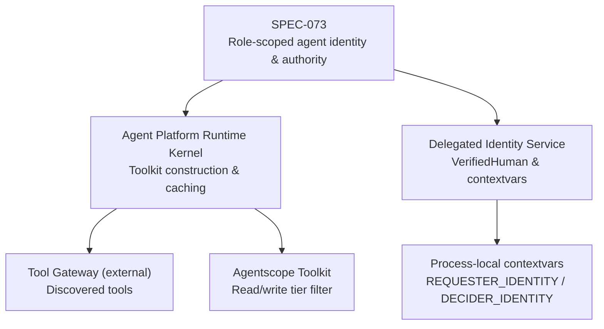
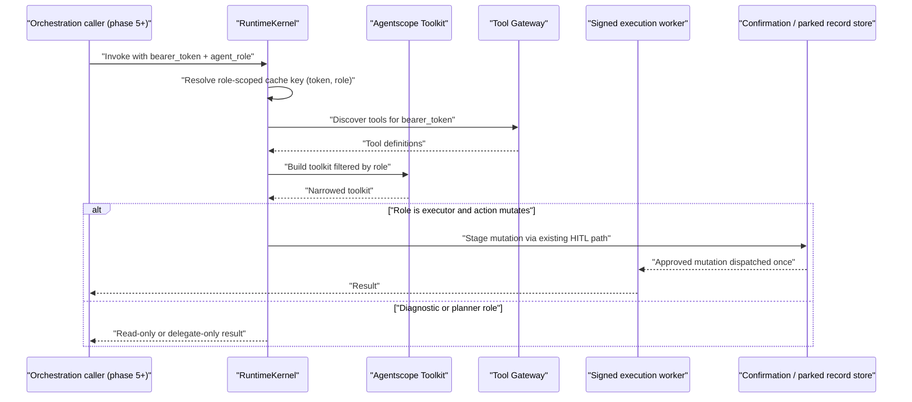
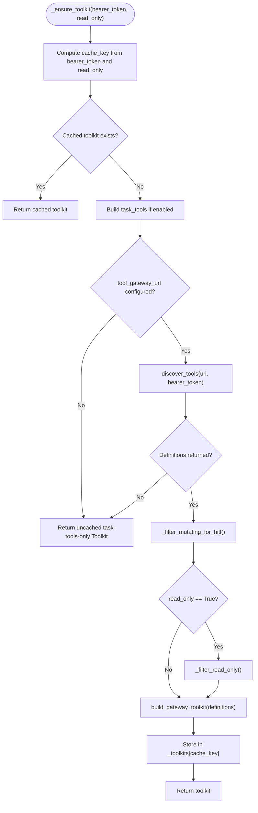
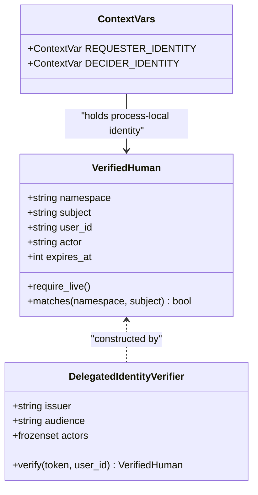
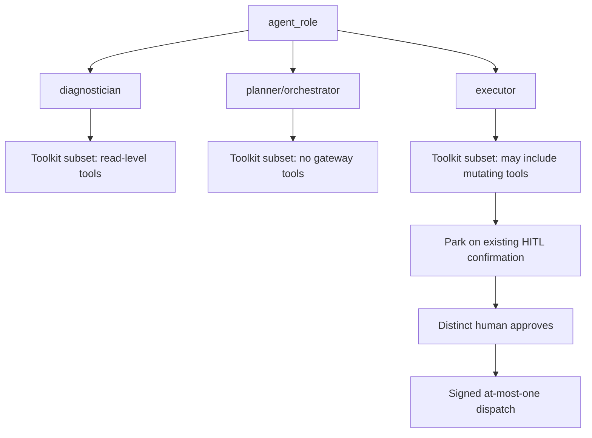
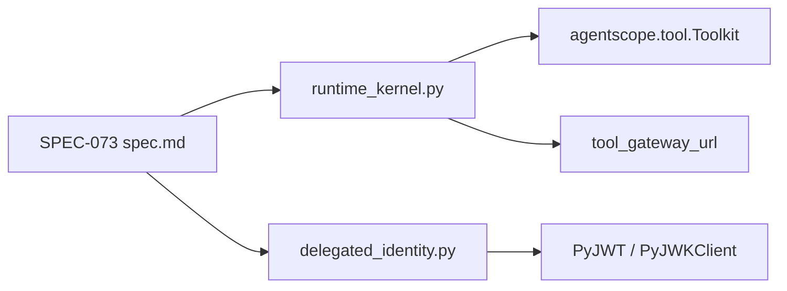

# SPEC-073: Role-Scoped Agent Identity and Authority

<cite>
**Referenced Files in This Document**
- [spec.md](file://docs/specs/SPEC-073-role-scoped-agent-identity/spec.md)
- [runtime_kernel.py](file://products/agent-platform/src/agent_service/runtime_kernel.py)
- [delegated_identity.py](file://products/agent-platform/src/agent_service/services/delegated_identity.py)
</cite>

## Table of Contents
1. [Introduction](#introduction)
2. [Project Structure](#project-structure)
3. [Core Components](#core-components)
4. [Architecture Overview](#architecture-overview)
5. [Detailed Component Analysis](#detailed-component-analysis)
6. [Dependency Analysis](#dependency-analysis)
7. [Performance Considerations](#performance-considerations)
8. [Troubleshooting Guide](#troubleshooting-guide)
9. [Conclusion](#conclusion)

## Introduction
SPEC-073 defines the role-scoped agent identity and authority substrate required by ADR-0017’s phased multi-agent program. Its phase-2 goal is narrow and defensive: introduce a closed, platform-owned `agent-role` vocabulary (`diagnostician`, `planner`/`orchestrator`, `executor`) that narrows an agent’s toolkit on the existing gateway-forwarded delegated token, without creating a new principal, broker identity, or wire claim. The spec preserves end-to-end human identity (“on whose behalf”), keeps every mutation on the existing HITL-gated signed dispatch path, and ships inert by default so the deployed single-agent turn remains byte-identical.

The specification is currently `draft` and carries six Open Questions that block approval. Approval authorizes planning and implementation work; it does not authorize merge, deployment, or version bumping. Phase 2 touches only the agent-platform runtime seam and documentation — no tool-gateway, platform-gateway, identity-broker, portal, or contract schema changes are planned for this phase.

**Section sources**
- [spec.md:3-11](file://docs/specs/SPEC-073-role-scoped-agent-identity/spec.md#L3-L11)
- [spec.md:45-57](file://docs/specs/SPEC-073-role-scoped-agent-identity/spec.md#L45-L57)
- [spec.md:232-249](file://docs/specs/SPEC-073-role-scoped-agent-identity/spec.md#L232-L249)

## Project Structure
SPEC-073 is primarily a design and requirements document backed by two existing runtime surfaces in the agent-platform product:

| Area | Repository location | Role in SPEC-073 |
|---|---|---|
| Specification | `docs/specs/SPEC-073-role-scoped-agent-identity/spec.md` | Defines roles, requirements, non-goals, impact boundaries, and open questions. |
| Toolkit narrowing seam | `products/agent-platform/src/agent_service/runtime_kernel.py` | Implements per-token toolkit caching, read-only filtering, and the entry point generalized by R-2. |
| Human identity context | `products/agent-platform/src/agent_service/services/delegated_identity.py` | Provides `VerifiedHuman` and the `REQUESTER_IDENTITY` / `DECIDER_IDENTITY` contextvars referenced by R-3. |

**Diagram sources**
- [spec.md:45-57](file://docs/specs/SPEC-073-role-scoped-agent-identity/spec.md#L45-L57)
- [runtime_kernel.py:501-564](file://products/agent-platform/src/agent_service/runtime_kernel.py#L501-L564)
- [delegated_identity.py:28-55](file://products/agent-platform/src/agent_service/services/delegated_identity.py#L28-L55)

**Section sources**
- [spec.md:232-249](file://docs/specs/SPEC-073-role-scoped-agent-identity/spec.md#L232-L249)
- [runtime_kernel.py:501-611](file://products/agent-platform/src/agent_service/runtime_kernel.py#L501-L611)
- [delegated_identity.py:28-55](file://products/agent-platform/src/agent_service/services/delegated_identity.py#L28-L55)

## Core Components
SPEC-073 centers on six requirements that together form the phase-2 substrate:

| Requirement | Purpose | Current code anchor |
|---|---|---|
| R-1 | Closed, immutable, platform-owned `agent-role` vocabulary with no agentscope type leakage. | Not yet implemented; blocks approval until resolved. |
| R-2 | Generalize `_ensure_toolkit(bearer_token, read_only)` into per-role toolkit narrowing keyed by `(token, role)`. | `runtime_kernel.py:_ensure_toolkit`, `_filter_read_only`. |
| R-3 | Preserve the same delegated token and human requester identity across role-scoped delegation. | `runtime_kernel.py` contextvar usage; `delegated_identity.py:VerifiedHuman`, `REQUESTER_IDENTITY`, `DECIDER_IDENTITY`. |
| R-4 | Label executor-staged mutations with staging role provenance while keeping the existing HITL + signed dispatch path unchanged. | Deferred to kernel-internal confirmation/parked-record labeling; no contract change. |
| R-5 | Fail-closed posture, four-point-gate parity, and inertness proof with no orchestration caller. | Guard tests and suite verification are acceptance criteria, not yet present. |
| R-6 | Update identity/design documentation and spec index without changing shared contracts. | Documentation reconciliation is part of delivery scope. |

Key acceptance constraints include:
- No per-role broker mint or second identity edge.
- Toolkit narrowing is subtractive only.
- Unknown or absent role fails closed to the most restrictive posture.
- No additive field on `execution-request.schema.json` in phase 2.
- No v2 stream/schema change in phase 2.

**Section sources**
- [spec.md:85-210](file://docs/specs/SPEC-073-role-scoped-agent-identity/spec.md#L85-L210)

## Architecture Overview
At a high level, SPEC-073 extends the existing agent-platform execution model rather than introducing a new control plane:

**Diagram sources**
- [spec.md:111-172](file://docs/specs/SPEC-073-role-scoped-agent-identity/spec.md#L111-L172)
- [runtime_kernel.py:501-564](file://products/agent-platform/src/agent_service/runtime_kernel.py#L501-L564)

The diagram maps the intended flow from requirement R-2 (role-scoped toolkit narrowing) through R-4 (executor staging), while preserving the existing HITL and signed-dispatch boundary described in the spec.

## Detailed Component Analysis

### Existing Toolkit Narrowing Seam
The current `_ensure_toolkit` method builds a per-delegated-token toolkit, optionally restricting it to read-level tools for automated diagnostic turns. It also filters mutating tools when HITL bridging is disabled.

**Diagram sources**
- [runtime_kernel.py:501-564](file://products/agent-platform/src/agent_service/runtime_kernel.py#L501-L564)
- [runtime_kernel.py:566-611](file://products/agent-platform/src/agent_service/runtime_kernel.py#L566-L611)

#### Implementation observations
- The cache key currently combines the bearer token with a `::read-only` suffix. R-2 generalizes this to a role-aware key such as `(bearer_token, role)` only when a role could change the built toolkit.
- `_filter_read_only` excludes tools whose risk level is not `read`; this is the mechanism R-2 reuses for the `diagnostician` role.
- `_filter_mutating_for_hitl` is separate from read-only narrowing and applies when HITL bridging is disabled.
- Tool discovery failures fall back to task tools only and intentionally avoid caching empty results.

**Section sources**
- [runtime_kernel.py:501-611](file://products/agent-platform/src/agent_service/runtime_kernel.py#L501-L611)

### Human Identity Context
R-3 requires that role-scoped agents preserve the same delegated token and human requester identity. The existing identity substrate provides:

| Symbol | Meaning | Relevance to SPEC-073 |
|---|---|---|
| `VerifiedHuman` | Frozen dataclass representing a verified human identity with namespace, subject, user_id, actor, and expiry. | Used to assert “on whose behalf” identity preservation across delegation hops. |
| `REQUESTER_IDENTITY` | Process-local contextvar holding the verified requester. | Must remain unchanged when an orchestrator delegates to a member. |
| `DECIDER_IDENTITY` | Process-local contextvar holding the verified decider/approver. | Must remain distinct from the requester for self-approval checks. |
| `verify_delegated_human` | Verifies a delegated JWT against issuer, audience, actors, and JWKS. | Confirms the identity substrate is strict and process-local. |

**Diagram sources**
- [delegated_identity.py:28-55](file://products/agent-platform/src/agent_service/services/delegated_identity.py#L28-L55)
- [delegated_identity.py:58-98](file://products/agent-platform/src/agent_service/services/delegated_identity.py#L58-L98)

#### Implementation observations
- `VerifiedHuman` is frozen and rejects pickling, reinforcing its process-local nature.
- Verification enforces bounded fields, required claims, OIDC authentication source, actor membership, and liveness.
- The spec’s R-3 constraint that the role never appears as a JWT claim or wire field aligns with the fact that `VerifiedHuman` and its contextvars are process-local.

**Section sources**
- [delegated_identity.py:28-98](file://products/agent-platform/src/agent_service/services/delegated_identity.py#L28-L98)
- [spec.md:132-150](file://docs/specs/SPEC-073-role-scoped-agent-identity/spec.md#L132-L150)

### Role Vocabulary and Authority Model
The spec proposes three conceptual roles:

| Role | Authority posture | Phase-2 behavior |
|---|---|---|
| `diagnostician` | Read-only toolkit. | Reuses `_filter_read_only` over discovered tools. |
| `planner` / `orchestrator` | Delegation-only; no direct tool authority. | Toolkit contains no gateway tools. |
| `executor` | May stage mutations through the existing HITL + signed path. | Toolkit may include mutating tools, but they still park and require a distinct human approver. |

**Diagram sources**
- [spec.md:93-120](file://docs/specs/SPEC-073-role-scoped-agent-identity/spec.md#L93-L120)
- [spec.md:152-172](file://docs/specs/SPEC-073-role-scoped-agent-identity/spec.md#L152-L172)

#### Open question implications
- OQ-1 asks whether `planner` and `orchestrator` should be one combined role.
- OQ-3 asks whether read/write-tier filtering is sufficient for `diagnostician`, or whether a tool-family allowlist is needed.
- OQ-6 asks whether executor staging introduces any new mutation-path machinery beyond toolkit narrowing and kernel-internal provenance labeling.

**Section sources**
- [spec.md:93-120](file://docs/specs/SPEC-073-role-scoped-agent-identity/spec.md#L93-L120)
- [spec.md:251-282](file://docs/specs/SPEC-073-role-scoped-agent-identity/spec.md#L251-L282)

## Dependency Analysis
SPEC-073’s phase-2 dependencies are intentionally narrow:

**Diagram sources**
- [spec.md:232-249](file://docs/specs/SPEC-073-role-scoped-agent-identity/spec.md#L232-L249)
- [runtime_kernel.py:520-557](file://products/agent-platform/src/agent_service/runtime_kernel.py#L520-L557)
- [delegated_identity.py:13-13](file://products/agent-platform/src/agent_service/services/delegated_identity.py#L13-L13)
- [delegated_identity.py:88-98](file://products/agent-platform/src/agent_service/services/delegated_identity.py#L88-L98)

### Coupling and Cohesion
- **High cohesion within agent-platform**: The substrate lives in `agent_service`, where toolkit construction and identity context already coexist.
- **Low coupling to external services**: The role concept itself is process-local; the only external dependency is the existing tool discovery call through `tool_gateway_url`.
- **No new principal**: The spec explicitly forbids per-role broker identities, keeping identity coupling to the single delegated token.

### Potential Risks
- If role binding leaks into serialized surfaces, it violates R-1 and R-3.
- If toolkit widening occurs due to incorrect cache-key logic, it violates R-2 and R-5.
- If executor staging bypasses the existing HITL path, it violates R-4.

**Section sources**
- [spec.md:111-182](file://docs/specs/SPEC-073-role-scoped-agent-identity/spec.md#L111-L182)
- [runtime_kernel.py:501-564](file://products/agent-platform/src/agent_service/runtime_kernel.py#L501-L564)
- [delegated_identity.py:28-55](file://products/agent-platform/src/agent_service/services/delegated_identity.py#L28-L55)

## Performance Considerations
SPEC-073’s performance expectations are conservative because phase 2 is inert:

- The existing per-token toolkit cache must be extended to split by role only when a role can change the constructed toolkit.
- An unrole-scoped single-agent turn must keep one cache entry and remain byte-identical.
- Empty discovery results must remain uncached, matching current behavior.
- No additional network round-trips to the identity broker or tool gateway are introduced by the role label itself.

These constraints follow directly from R-2’s cache semantics and the existing `_ensure_toolkit` implementation.

**Section sources**
- [spec.md:111-130](file://docs/specs/SPEC-073-role-scoped-agent-identity/spec.md#L111-L130)
- [runtime_kernel.py:501-564](file://products/agent-platform/src/agent_service/runtime_kernel.py#L501-L564)

## Troubleshooting Guide
When implementing or reviewing SPEC-073, use these checks:

| Symptom | Likely cause | Required check |
|---|---|---|
| Toolkit widens under a restricted role | Cache key or narrowing logic grants tools instead of subtracting them. | Assert role toolkit ⊆ unscoped toolkit for the same token. |
| Diagnostician can stage mutations | Role mapping exposes mutating tools or bypasses `_filter_read_only`. | Verify diagnostician toolkit has no mutating tool. |
| Planner/orchestrator sees gateway tools | Role is mapped to more than delegation-only. | Verify planner toolkit excludes gateway tools. |
| Broker exchange is invoked multiple times per user | Code mints or requests a second delegated token for a role. | Add a guard test failing on extra broker calls. |
| Requester identity changes after delegation | Role context or identity contextvar handling is incorrect. | Assert `VerifiedHuman` equality before and after delegation. |
| Contract test fails unexpectedly | Phase-2 code added a field to `execution-request.schema.json`. | Confirm phase-2 leaves the schema byte-unchanged. |
| Single-agent path behaves differently | Substrate is not inert or cache key changed for unrole-scoped turns. | Run full suite and compare deployed chat path behavior. |

**Section sources**
- [spec.md:111-191](file://docs/specs/SPEC-073-role-scoped-agent-identity/spec.md#L111-L191)

## Conclusion
SPEC-073 is a narrowly scoped, defensively designed substrate. Its value is not in adding new runtime surfaces, but in fixing the identity and authority seam that ADR-0017 requires before later phases can safely add policy axes, audit attribution, bounded autonomous diagnosis, and a v2 multi-agent contract. The existing `_ensure_toolkit` seam and `VerifiedHuman` contextvars provide the right anchors; the remaining work is to define the closed role vocabulary, generalize toolkit narrowing, preserve identity, label executor staging internally, and prove inertness. Until the six Open Questions are resolved, the spec remains draft and implementation-ready but not approved.