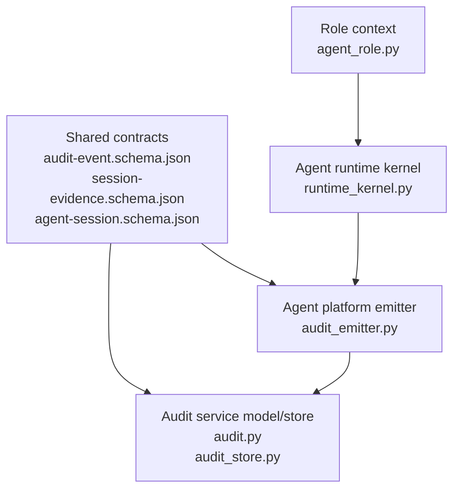
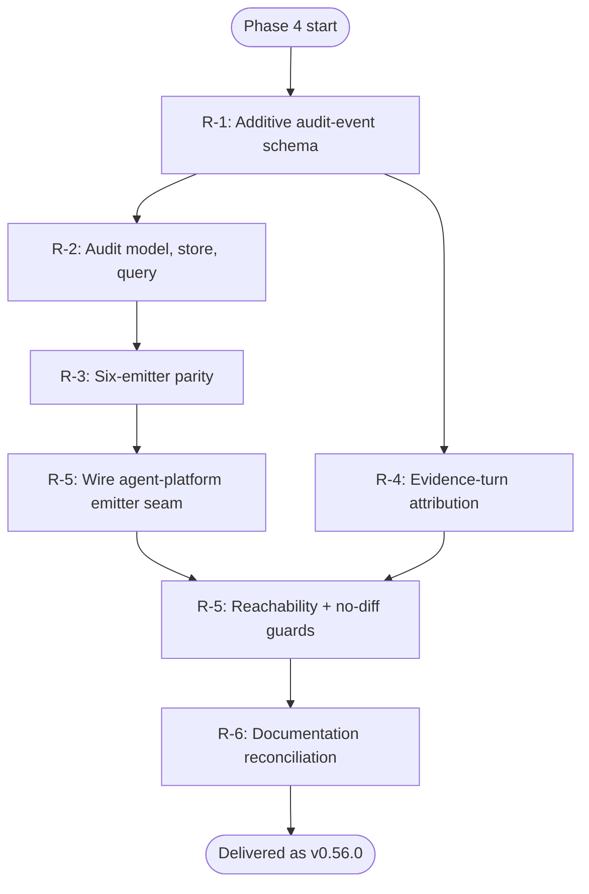
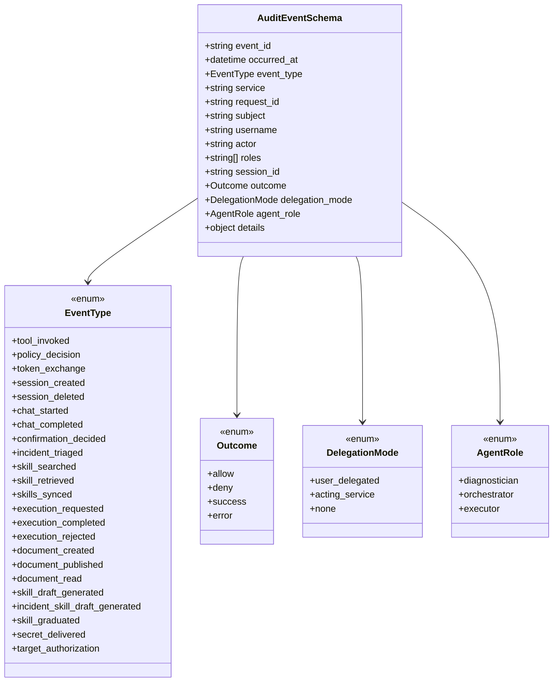
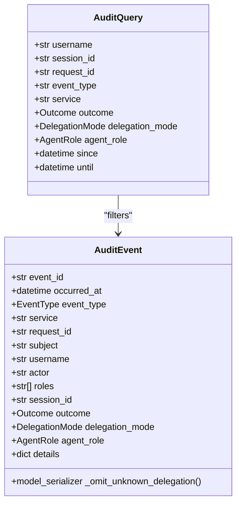
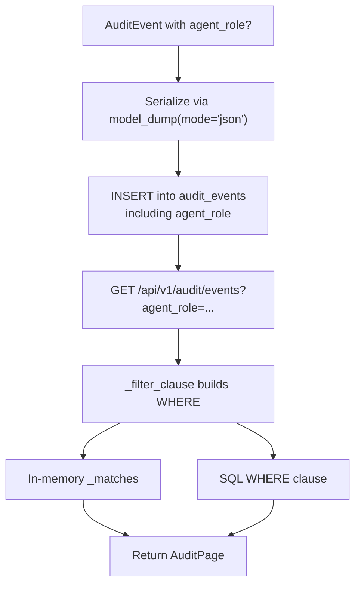
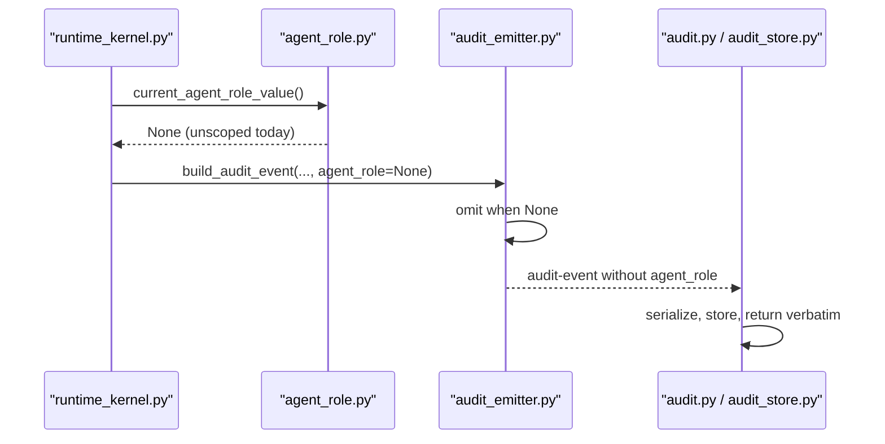
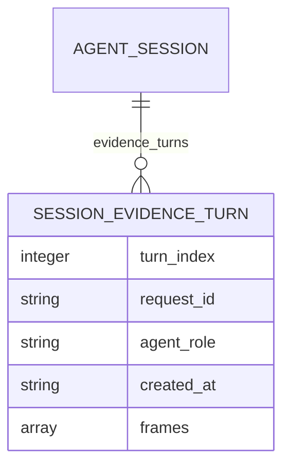
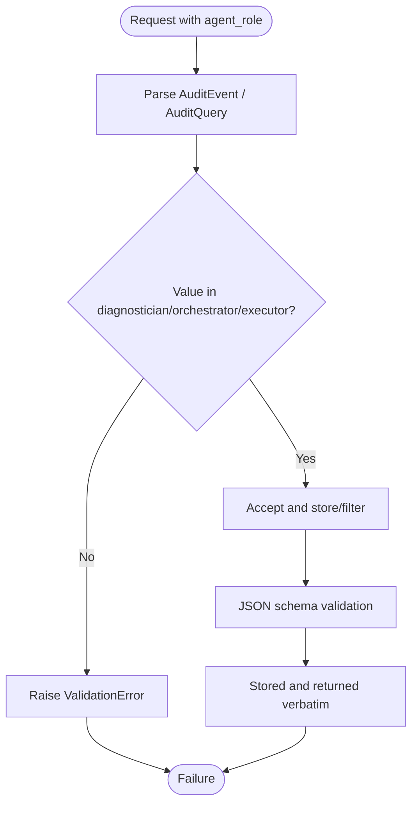
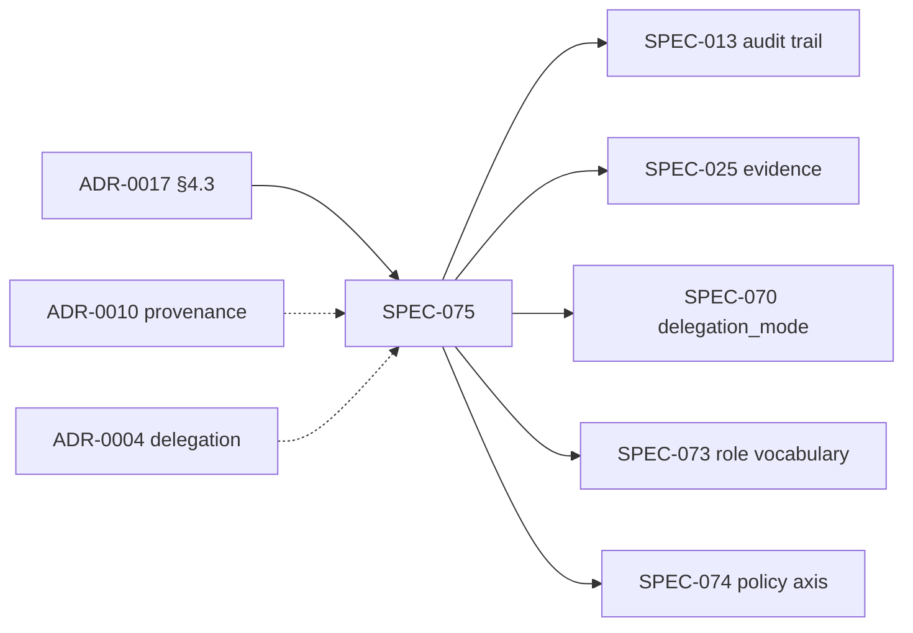

# SPEC-075: Multi-Agent Audit & Attribution

<cite>
**Referenced Files in This Document**
- [spec.md](file://docs/specs/SPEC-075-multi-agent-audit-attribution/spec.md)
- [plan.md](file://docs/specs/SPEC-075-multi-agent-audit-attribution/plan.md)
- [tasks.md](file://docs/specs/SPEC-075-multi-agent-audit-attribution/tasks.md)
- [audit-event.schema.json](file://shared/shared-contracts/schemas/audit-event.schema.json)
- [session-evidence.schema.json](file://shared/shared-contracts/schemas/session-evidence.schema.json)
- [agent-session.schema.json](file://shared/shared-contracts/schemas/agent-session.schema.json)
- [audit.py](file://products/audit-service/src/audit_service/schemas/audit.py)
- [audit_store.py](file://products/audit-service/src/audit_service/services/audit_store.py)
- [audit_emitter.py (agent-platform)](file://products/agent-platform/src/agent_service/services/audit_emitter.py)
- [runtime_kernel.py](file://products/agent-platform/src/agent_service/runtime_kernel.py)
- [agent_role.py](file://products/agent-platform/src/agent_service/services/agent_role.py)
- [test_contracts.py](file://products/audit-service/tests/test_contracts.py)
- [test_agent_role.py](file://products/agent-platform/tests/test_agent_role.py)
</cite>

## Table of Contents
1. [Introduction](#introduction)
2. [Project Structure](#project-structure)
3. [Core Components](#core-components)
4. [Architecture Overview](#architecture-overview)
5. [Detailed Component Analysis](#detailed-component-analysis)
6. [Dependency Analysis](#dependency-analysis)
7. [Performance Considerations](#performance-considerations)
8. [Troubleshooting Guide](#troubleshooting-guide)
9. [Conclusion](#conclusion)

## Introduction
SPEC-075 adds the missing attribution leg to the durable audit trail by introducing an additive, inert `agent_role` dimension on existing audit events and evidence turns. It completes the memo’s role / behalf / delegation triple: `agent_role` identifies which agent role acted, `subject`/`username` identifies whose behalf, and `delegation_mode` identifies under which delegation mode. The change is deliberately modeled after SPEC-070’s `delegation_mode`: optional, omitted when absent, enum-closed to the SPEC-073 vocabulary (`diagnostician`, `orchestrator`, `executor`), and byte-identical for every unscoped single-agent event because no deployed caller binds a non-`None` role until phase 5.

The spec is delivered as v0.56.0 and is marked `delivered`. Its implementation is inert substrate plus a wired producer seam; it does not introduce new audit event types, authorization inputs, portal filters, summary facets, or wire framing of the role across process boundaries.

**Section sources**
- [spec.md:1-364](file://docs/specs/SPEC-075-multi-agent-audit-attribution/spec.md#L1-L364)
- [plan.md:1-176](file://docs/specs/SPEC-075-multi-agent-audit-attribution/plan.md#L1-L176)
- [tasks.md:1-110](file://docs/specs/SPEC-075-multi-agent-audit-attribution/tasks.md#L1-L110)

## Project Structure
SPEC-075 touches three layers:

| Layer | Responsibility | Key files |
|---|---|---|
| Contract layer | Declares the additive `agent_role` field and its closed vocabulary | `audit-event.schema.json`, `session-evidence.schema.json`, `agent-session.schema.json` |
| Audit-service layer | Models, serializes, stores, indexes, queries, and returns events with the new dimension | `audit.py`, `audit_store.py` |
| Emitter + producer seam | Builds events with the new parameter and wires the agent-platform kernel’s current role into emission | `audit_emitter.py (agent-platform)`, `runtime_kernel.py`, `agent_role.py` |

**Diagram sources**
- [audit-event.schema.json:79-83](file://shared/shared-contracts/schemas/audit-event.schema.json#L79-L83)
- [session-evidence.schema.json:19-23](file://shared/shared-contracts/schemas/session-evidence.schema.json#L19-L23)
- [agent-session.schema.json:73-102](file://shared/shared-contracts/schemas/agent-session.schema.json#L73-L102)
- [audit_emitter.py (agent-platform):30-72](file://products/agent-platform/src/agent_service/services/audit_emitter.py#L30-L72)
- [runtime_kernel.py:1003-1006](file://products/agent-platform/src/agent_service/runtime_kernel.py#L1003-L1006)
- [agent_role.py:67-119](file://products/agent-platform/src/agent_service/services/agent_role.py#L67-L119)
- [audit.py:54-91](file://products/audit-service/src/audit_service/schemas/audit.py#L54-L91)
- [audit_store.py:228-341](file://products/audit-service/src/audit_service/services/audit_store.py#L228-L341)

**Section sources**
- [spec.md:63-85](file://docs/specs/SPEC-075-multi-agent-audit-attribution/spec.md#L63-L85)
- [plan.md:12-24](file://docs/specs/SPEC-075-multi-agent-audit-attribution/plan.md#L12-L24)

## Core Components
SPEC-075 implements six requirements that together form an inert attribution substrate:

| Requirement | What changes | Why it matters |
|---|---|---|
| R-1 | Adds an optional `agent_role` property to `audit-event.schema.json`, enum-closed to `diagnostician`, `orchestrator`, `executor`; leaves `additionalProperties: false` and title unchanged | Establishes the contract anchor without changing the event-type vocabulary |
| R-2 | Adds `AgentRole`, `AuditEvent.agent_role`, `AuditQuery.agent_role`, serializer omission, store column/index, row mapping, in-memory filter, SQL WHERE, and query-API parameter | Makes the dimension queryable and indexable while preserving legacy rows |
| R-3 | Adds `agent_role` to the canonical `build_audit_event` signature and omit tuple across six emitter services | Keeps all emitters byte-for-byte identical under parity tests |
| R-4 | Adds an optional `agent_role` to the session-evidence turn and its item schema in `agent-session.schema.json` | Makes persisted tool-evidence groups self-attributing per memo §4.3 |
| R-5 | Wires the agent-platform emitter seam to `current_agent_role_value()` and proves reachability/inertness | Closes the end-to-end path while keeping every live event byte-identical |
| R-6 | Updates authorization-matrix and identity-and-authorization-design documentation and records OQ deferrals | Completes living-doc reconciliation without adding consumerless UI surfaces |

**Section sources**
- [spec.md:123-237](file://docs/specs/SPEC-075-multi-agent-audit-attribution/spec.md#L123-L237)
- [plan.md:26-127](file://docs/specs/SPEC-075-multi-agent-audit-attribution/plan.md#L26-L127)
- [tasks.md:10-99](file://docs/specs/SPEC-075-multi-agent-audit-attribution/tasks.md#L10-L99)

## Architecture Overview
The delivery follows a strict sequence: contract first, then audit-service machinery, then emitter parity, then the producer seam, then evidence-turn attribution, then inertness guards, then documentation.

**Diagram sources**
- [plan.md:128-145](file://docs/specs/SPEC-075-multi-agent-audit-attribution/plan.md#L128-L145)
- [tasks.md:100-110](file://docs/specs/SPEC-075-multi-agent-audit-attribution/tasks.md#L100-L110)

## Detailed Component Analysis

### Audit Event Contract
The shared contract declares `agent_role` as an optional top-level string with a closed enum. It is not required, so absence means “not asserted,” exactly like `delegation_mode`. The `event_type` enum remains closed at 23 values; SPEC-075 does not add new event types.

**Diagram sources**
- [audit-event.schema.json:15-104](file://shared/shared-contracts/schemas/audit-event.schema.json#L15-L104)
- [audit.py:14-58](file://products/audit-service/src/audit_service/schemas/audit.py#L14-L58)

**Section sources**
- [audit-event.schema.json:79-83](file://shared/shared-contracts/schemas/audit-event.schema.json#L79-L83)
- [spec.md:123-139](file://docs/specs/SPEC-075-multi-agent-audit-attribution/spec.md#L123-L139)
- [plan.md:28-40](file://docs/specs/SPEC-075-multi-agent-audit-attribution/plan.md#L28-L40)

### Audit Service Model and Serializer
The Python model mirrors the JSON schema. `AgentRole` is a `Literal` locked to the same three values. `AuditEvent.agent_role` defaults to `None`, and the wrap serializer pops both `delegation_mode` and `agent_role` when unset, ensuring legacy events serialize without them.

**Diagram sources**
- [audit.py:54-118](file://products/audit-service/src/audit_service/schemas/audit.py#L54-L118)

**Section sources**
- [audit.py:54-91](file://products/audit-service/src/audit_service/schemas/audit.py#L54-L91)
- [audit.py:100-118](file://products/audit-service/src/audit_service/schemas/audit.py#L100-L118)
- [spec.md:141-159](file://docs/specs/SPEC-075-multi-agent-audit-attribution/spec.md#L141-L159)

### Audit Store: Column, Index, Insert, Row Mapping, and Filters
The PostgreSQL DDL adds `agent_role TEXT` and `idx_audit_agent_role` idempotently, alongside the existing `delegation_mode` column and index. Inserts include the parameter, `_ROW_COLUMNS` includes the column, `_row_to_event` maps it back, and both in-memory and SQL filters compose it with other envelope-column filters using AND semantics.

**Diagram sources**
- [audit_store.py:228-278](file://products/audit-service/src/audit_service/services/audit_store.py#L228-L278)
- [audit_store.py:283-341](file://products/audit-service/src/audit_service/services/audit_store.py#L283-L341)
- [audit_store.py:377-406](file://products/audit-service/src/audit_service/services/audit_store.py#L377-L406)

**Section sources**
- [audit_store.py:159-180](file://products/audit-service/src/audit_service/services/audit_store.py#L159-L180)
- [audit_store.py:228-278](file://products/audit-service/src/audit_service/services/audit_store.py#L228-L278)
- [audit_store.py:283-341](file://products/audit-service/src/audit_service/services/audit_store.py#L283-L341)
- [spec.md:141-159](file://docs/specs/SPEC-075-multi-agent-audit-attribution/spec.md#L141-L159)

### Emitter Parity and Producer Seam
The agent-platform `build_audit_event` accepts `agent_role: str | None = None` and includes it in the optional-field loop beside `delegation_mode`. The runtime kernel calls this function with `agent_role=current_agent_role_value()`. Because `AGENT_ROLE` defaults to `None` on every deployed unscoped turn, the emitted payload is byte-identical to before. The emitter itself never validates the value; the audit-service model and schema own the vocabulary.

**Diagram sources**
- [runtime_kernel.py:1003-1006](file://products/agent-platform/src/agent_service/runtime_kernel.py#L1003-L1006)
- [agent_role.py:67-119](file://products/agent-platform/src/agent_service/services/agent_role.py#L67-L119)
- [audit_emitter.py (agent-platform):30-72](file://products/agent-platform/src/agent_service/services/audit_emitter.py#L30-L72)
- [audit.py:82-91](file://products/audit-service/src/audit_service/schemas/audit.py#L82-L91)

**Section sources**
- [audit_emitter.py (agent-platform):30-72](file://products/agent-platform/src/agent_service/services/audit_emitter.py#L30-L72)
- [runtime_kernel.py:1003-1006](file://products/agent-platform/src/agent_service/runtime_kernel.py#L1003-L1006)
- [agent_role.py:67-119](file://products/agent-platform/src/agent_service/services/agent_role.py#L67-L119)
- [spec.md:198-218](file://docs/specs/SPEC-075-multi-agent-audit-attribution/spec.md#L198-L218)
- [plan.md:94-110](file://docs/specs/SPEC-075-multi-agent-audit-attribution/plan.md#L94-L110)

### Evidence-Turn Attribution
Per OQ-3, phase 4 lands only the additive `agent_role` field on the session-evidence turn. The `session-evidence.schema.json` and the `evidence_turns` item in `agent-session.schema.json` both declare the same closed enum. A turn stored without the field replays identically; a turn stored with it carries attribution. Transcript-turn projection and concurrent multi-agent transcript re-modelling are deferred to phase 5/6.

**Diagram sources**
- [session-evidence.schema.json:19-23](file://shared/shared-contracts/schemas/session-evidence.schema.json#L19-L23)
- [agent-session.schema.json:73-102](file://shared/shared-contracts/schemas/agent-session.schema.json#L73-L102)

**Section sources**
- [session-evidence.schema.json:19-23](file://shared/shared-contracts/schemas/session-evidence.schema.json#L19-L23)
- [agent-session.schema.json:73-102](file://shared/shared-contracts/schemas/agent-session.schema.json#L73-L102)
- [spec.md:179-197](file://docs/specs/SPEC-075-multi-agent-audit-attribution/spec.md#L179-L197)
- [plan.md:80-92](file://docs/specs/SPEC-075-multi-agent-audit-attribution/plan.md#L80-L92)

### Validation and Rejection Flow
Out-of-vocabulary `agent_role` values are rejected at the audit-service boundary, mirroring how invalid `delegation_mode` values are handled. Contract tests assert lockstep between the Python `AgentRole` literal and the JSON schema enum.

**Diagram sources**
- [test_contracts.py:124-150](file://products/audit-service/tests/test_contracts.py#L124-L150)
- [audit.py:54-118](file://products/audit-service/src/audit_service/schemas/audit.py#L54-L118)
- [audit-event.schema.json:79-83](file://shared/shared-contracts/schemas/audit-event.schema.json#L79-L83)

**Section sources**
- [test_contracts.py:124-150](file://products/audit-service/tests/test_contracts.py#L124-L150)
- [spec.md:141-159](file://docs/specs/SPEC-075-multi-agent-audit-attribution/spec.md#L141-L159)

## Dependency Analysis
SPEC-075 is intentionally decoupled from authorization and wire contracts:

| Dependency | Relationship | Phase 4 status |
|---|---|---|
| SPEC-073 (role-scoped agent identity) | Provides the closed vocabulary and `current_agent_role_value()` seed | Vocabulary locked; producer seam wired but inert |
| SPEC-070 (outbound user-delegated identity) | Precedent for `delegation_mode` | Sibling dimension, untouched |
| SPEC-074 (policy role axis) | Prescriptive policy axis | No enforcement added here |
| SPEC-025 (evidence persistence) | Evidence-turn shape | Optional attribution field added |
| SPEC-013 (durable audit trail) | Canonical envelope | Extended additively |
| ADR-0017 (§4.3) | Authorizes audit-attribution leg | Implemented as phase 4 |
| ADR-0010 (signed execution envelopes) | Provenance rides the fact | Unchanged |
| ADR-0004 (broker-mediated token delegation) | Identity edge contract | Role stays a label beside the token |

**Diagram sources**
- [spec.md:28-51](file://docs/specs/SPEC-075-multi-agent-audit-attribution/spec.md#L28-L51)
- [spec.md:239-287](file://docs/specs/SPEC-075-multi-agent-audit-attribution/spec.md#L239-L287)

**Section sources**
- [spec.md:28-51](file://docs/specs/SPEC-075-multi-agent-audit-attribution/spec.md#L28-L51)
- [spec.md:239-287](file://docs/specs/SPEC-075-multi-agent-audit-attribution/spec.md#L239-L287)

## Performance Considerations
- The new `agent_role` column is nullable text and indexed with `idx_audit_agent_role`, following the same pattern as `delegation_mode`.
- Filtering composes with existing envelope-column filters using AND semantics; empty filters remain unconstrained.
- Serialization omits `agent_role` when `None`, so unscoped events do not grow payloads.
- Summary aggregation does not add an `agent_role` facet in phase 4; the plan explicitly defers this until real data exists.
- Emission remains fire-and-forget and non-blocking; audit failures cannot degrade the agent path.

[No sources needed since this section provides general guidance]

## Troubleshooting Guide

| Symptom | Likely cause | Resolution |
|---|---|---|
| `agent_role` appears as `null` in serialized output | Serializer omission was not applied or a custom serializer bypassed `_omit_unknown_delegation` | Verify the Pydantic wrap serializer pops `agent_role` when `None` |
| `?agent_role=planner` returns a validation error | Out-of-vocabulary value rejected at the audit-service boundary | Use only `diagnostician`, `orchestrator`, or `executor` |
| Existing events lack `agent_role` | Legacy events were emitted before phase 4 or the field was absent | Expected; absence is not an assertion of any role |
| Queries with `agent_role` do not narrow results | The store filter or SQL WHERE clause was not extended | Check `_matches` and `_filter_clause` |
| Emitter payload changed unexpectedly | A caller passed a non-`None` `agent_role` | Confirm the reachability guard and that `current_agent_role_value()` is `None` on deployed paths |
| Enum drift detected | The audit schema enum differs from the Python `AgentRole` literal | Run the enum-lockstep guard in `test_agent_role.py` |

**Section sources**
- [audit.py:82-91](file://products/audit-service/src/audit_service/schemas/audit.py#L82-L91)
- [audit_store.py:159-180](file://products/audit-service/src/audit_service/services/audit_store.py#L159-L180)
- [audit_store.py:302-341](file://products/audit-service/src/audit_service/services/audit_store.py#L302-L341)
- [test_contracts.py:124-150](file://products/audit-service/tests/test_contracts.py#L124-L150)
- [test_agent_role.py:332-355](file://products/agent-platform/tests/test_agent_role.py#L332-L355)

## Conclusion
SPEC-075 delivers the audit-attribution leg of ADR-0017’s phased series as an inert, additive `agent_role` dimension. It extends the durable audit envelope and session-evidence turns, wires the agent-platform producer seam, and preserves byte-identical behavior for every unscoped event. Authorization, wire framing, portal filtering, and summary aggregation remain out of scope for phase 4. When phase 5 binds roles and runs concurrent members, each member’s audited action is already attributable to its role, satisfying gate point 1 (“audit preserved”) by construction.

[No sources needed since this section summarizes without analyzing specific files]