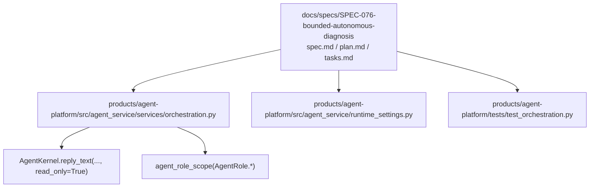
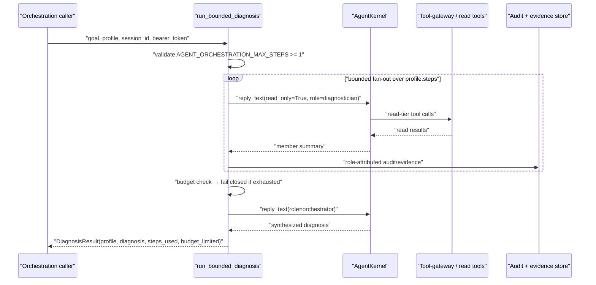
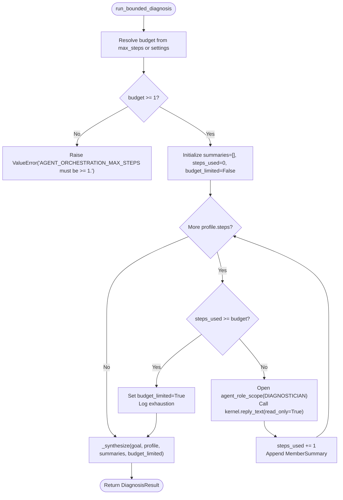
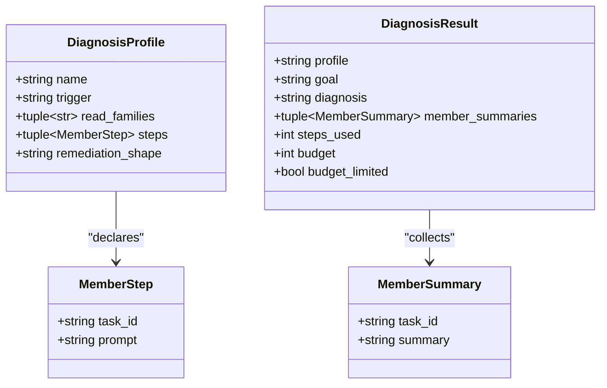
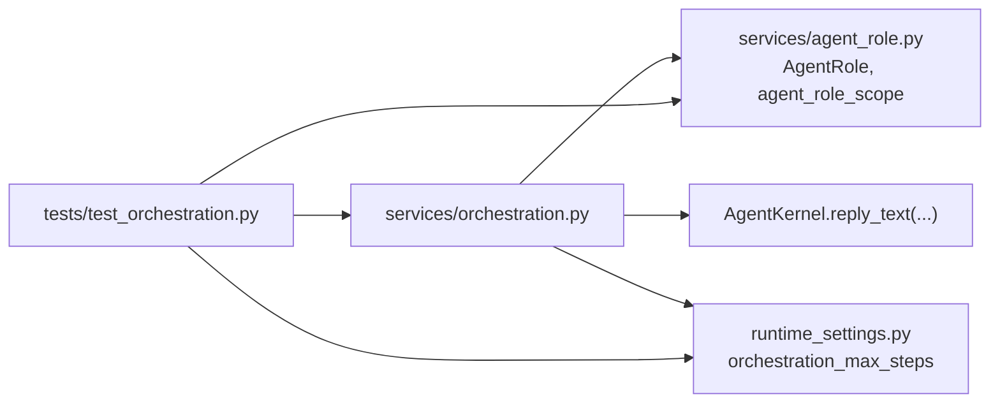

# SPEC-076: Bounded Autonomous Diagnosis

<cite>
**Referenced Files in This Document**   
- [spec.md](file://docs/specs/SPEC-076-bounded-autonomous-diagnosis/spec.md)
- [plan.md](file://docs/specs/SPEC-076-bounded-autonomous-diagnosis/plan.md)
- [tasks.md](file://docs/specs/SPEC-076-bounded-autonomous-diagnosis/tasks.md)
- [orchestration.py](file://products/agent-platform/src/agent_service/services/orchestration.py)
- [runtime_settings.py](file://products/agent-platform/src/agent_service/runtime_settings.py)
- [test_orchestration.py](file://products/agent-platform/tests/test_orchestration.py)
</cite>

## Table of Contents
1. [Introduction](#introduction)
2. [Project Structure](#project-structure)
3. [Core Components](#core-components)
4. [Architecture Overview](#architecture-overview)
5. [Detailed Component Analysis](#detailed-component-analysis)
6. [Dependency Analysis](#dependency-analysis)
7. [Performance Considerations](#performance-considerations)
8. [Troubleshooting Guide](#troubleshooting-guide)
9. [Conclusion](#conclusion)

## Introduction
SPEC-076 introduces the **bounded autonomous diagnosis** capability — a platform-owned, read-only orchestration loop that first binds the agent roles introduced by earlier phases of the multi-agent program. It decomposes a diagnosis goal into a bounded fan-out of role-scoped `diagnostician` turns over the existing read-only diagnostic seam, synthesizes a diagnosis from member summaries alone, and stages any proposed remediation through the existing HITL + signed-dispatch path. The loop is explicitly bounded by `AGENT_ORCHESTRATION_MAX_STEPS`, fails closed on exhaustion, preserves one delegated identity token across the fan-out, and surfaces results through existing assistant/evidence/card frames without changing the v2 wire contract.

The spec is approved (status `approved`) and targets version **v0.57.0**. Its implementation so far consists of the bounded loop module, the orchestration budget setting, and a comprehensive test suite; operator-invoked entry points and the canonical policy rule are part of the binding plan but are not represented by additional source files in this snapshot.

**Section sources**
- [spec.md:3-21](file://docs/specs/SPEC-076-bounded-autonomous-diagnosis/spec.md#L3-L21)
- [spec.md:76-131](file://docs/specs/SPEC-076-bounded-autonomous-diagnosis/spec.md#L76-L131)

## Project Structure
SPEC-076 is centered in the agent-platform product and its specification directory:

**Diagram sources**
- [spec.md:1-21](file://docs/specs/SPEC-076-bounded-autonomous-diagnosis/spec.md#L1-L21)
- [orchestration.py:1-39](file://products/agent-platform/src/agent_service/services/orchestration.py#L1-L39)
- [runtime_settings.py:372-382](file://products/agent-platform/src/agent_service/runtime_settings.py#L372-L382)
- [test_orchestration.py:1-10](file://products/agent-platform/tests/test_orchestration.py#L1-L10)

The repository layout follows the established pattern: specifications live under `docs/specs/SPEC-NNN-*`, the agent-platform Python package lives under `products/agent-platform/src/agent_service/`, and tests live under `products/agent-platform/tests/`.

**Section sources**
- [plan.md:11-33](file://docs/specs/SPEC-076-bounded-autonomous-diagnosis/plan.md#L11-L33)
- [tasks.md:12-112](file://docs/specs/SPEC-076-bounded-autonomous-diagnosis/tasks.md#L12-L112)

## Core Components
SPEC-076’s runtime behavior is implemented by three primary artifacts:

| Artifact | Responsibility | Key Behaviors |
|---|---|---|
| `services/orchestration.py` | Platform-owned bounded read-only orchestration loop | Decomposes a `DiagnosisProfile` into ordered `MemberStep`s, runs each as a `diagnostician` turn, synthesizes a diagnosis as an `orchestrator`, enforces the step budget, and returns a `DiagnosisResult`. |
| `runtime_settings.py` | Orchestration budget configuration | Declares `orchestration_max_steps` with default `20`, validates it at startup, and reads `AGENT_ORCHESTRATION_MAX_STEPS` from the environment. |
| `tests/test_orchestration.py` | Phase-5 acceptance for R-1 and R-2 | Asserts bounded termination, fail-closed partial diagnosis, read-only posture, process-local role binding, leader-sees-only-summaries semantics, no agentscope orchestration types, same-token identity preservation, and knob behavior. |

The spec also defines requirements R-3 through R-8 covering identity preservation, diagnose-before-act staging, live policy enforcement, attribution, runbook profiles, and gate parity. Those requirements are binding on the plan and tasks even where their full wiring is deferred to later stages or follow-ups.

**Section sources**
- [orchestration.py:52-117](file://products/agent-platform/src/agent_service/services/orchestration.py#L52-L117)
- [runtime_settings.py:372-382](file://products/agent-platform/src/agent_service/runtime_settings.py#L372-L382)
- [runtime_settings.py:532-536](file://products/agent-platform/src/agent_service/runtime_settings.py#L532-L536)
- [runtime_settings.py:752-754](file://products/agent-platform/src/agent_service/runtime_settings.py#L752-L754)
- [test_orchestration.py:1-10](file://products/agent-platform/tests/test_orchestration.py#L1-L10)
- [spec.md:133-314](file://docs/specs/SPEC-076-bounded-autonomous-diagnosis/spec.md#L133-L314)

## Architecture Overview
At a high level, SPEC-076 adds a bounded orchestration layer between a caller and the existing agent kernel:

**Diagram sources**
- [orchestration.py:173-268](file://products/agent-platform/src/agent_service/services/orchestration.py#L173-L268)
- [orchestration.py:271-299](file://products/agent-platform/src/agent_service/services/orchestration.py#L271-L299)
- [spec.md:142-167](file://docs/specs/SPEC-076-bounded-autonomous-diagnosis/spec.md#L142-L167)
- [spec.md:190-208](file://docs/specs/SPEC-076-bounded-autonomous-diagnosis/spec.md#L190-L208)
- [spec.md:252-268](file://docs/specs/SPEC-076-bounded-autonomous-diagnosis/spec.md#L252-L268)

Key architectural constraints enforced by the design:

| Constraint | Enforcement |
|---|---|
| Read-only admission | Every member and synthesis call uses `read_only=True`; mutating tools are excluded from the `diagnostician` toolkit by earlier role-narrowing work. |
| Bounded autonomy | `AGENT_ORCHESTRATION_MAX_STEPS` bounds total member read steps per orchestration; exhaustion produces a budget-limited partial diagnosis. |
| No agentscope orchestration surface | The module imports only `agent_role_scope` and `AgentRole`; guard tests assert no `TeamPipeline`, `GoalPipeline`, or `A2AAgent` construction. |
| Same-token identity | The orchestrator forwards its own `bearer_token` to every member turn; no broker exchange or second identity edge is minted inside the loop. |
| Process-local role binding | Roles are bound via `agent_role_scope()` around each turn and restored on exit; they are not persisted in the resumable snapshot. |
| Existing contract boundary | The diagnosis surfaces through existing assistant/evidence/card frames; `agent-stream-event.schema.json` and `execution-request.schema.json` remain byte-unchanged. |

**Section sources**
- [orchestration.py:1-39](file://products/agent-platform/src/agent_service/services/orchestration.py#L1-L39)
- [orchestration.py:119-170](file://products/agent-platform/src/agent_service/services/orchestration.py#L119-L170)
- [orchestration.py:173-299](file://products/agent-platform/src/agent_service/services/orchestration.py#L173-L299)
- [test_orchestration.py:310-335](file://products/agent-platform/tests/test_orchestration.py#L310-L335)
- [test_orchestration.py:445-477](file://products/agent-platform/tests/test_orchestration.py#L445-L477)
- [spec.md:293-314](file://docs/specs/SPEC-076-bounded-autonomous-diagnosis/spec.md#L293-L314)

## Detailed Component Analysis

### Bounded Orchestration Loop
The public entry point is `run_bounded_diagnosis(kernel, *, profile, goal, session_id, user_name, bearer_token, model_id=None, max_steps=None)`. It:

1. Resolves the effective budget from `max_steps` or `kernel.settings.orchestration_max_steps`.
2. Validates the budget is at least `1`; otherwise it raises `ValueError`.
3. Iterates `profile.steps`, checking `steps_used >= budget` before each member turn.
4. For each member, opens `agent_role_scope(AgentRole.DIAGNOSTICIAN)` and calls `kernel.reply_text(..., read_only=True)` with a derived session id (`{session_id}::orch::{task_id}`).
5. Collects only the returned content as a `MemberSummary`; intermediate member tool calls stay out of the orchestrator’s context.
6. Invokes `_synthesize`, which wraps the synthesis turn in `agent_role_scope(AgentRole.ORCHESTRATOR)` and composes a prompt containing the goal, profile name, and member summaries.
7. Returns a frozen `DiagnosisResult` carrying the profile, goal, synthesized diagnosis, member summaries, `steps_used`, `budget`, and `budget_limited`.

**Diagram sources**
- [orchestration.py:173-268](file://products/agent-platform/src/agent_service/services/orchestration.py#L173-L268)
- [orchestration.py:271-299](file://products/agent-platform/src/agent_service/services/orchestration.py#L271-L299)

**Section sources**
- [orchestration.py:173-299](file://products/agent-platform/src/agent_service/services/orchestration.py#L173-L299)

### Data Models
The orchestration module exposes four frozen dataclasses that define the shape of the bounded diagnosis capability:

| Model | Fields | Purpose |
|---|---|---|
| `MemberStep` | `task_id`, `prompt` | One declared read-only diagnostic sub-goal in a profile’s fan-out. |
| `DiagnosisProfile` | `name`, `trigger`, `read_families`, `steps`, `remediation_shape` | A runbook-agnostic declaration of one detect→troubleshoot→propose flow. |
| `MemberSummary` | `task_id`, `summary` | What the orchestrator is allowed to see from one member — only the synthesized content, never intermediate steps. |
| `DiagnosisResult` | `profile`, `goal`, `diagnosis`, `member_summaries`, `steps_used`, `budget`, `budget_limited` | The bounded loop’s outcome, including whether the result is a best-effort partial diagnosis. |

These models separate declarative runbook intent (`DiagnosisProfile`) from runtime state (`DiagnosisResult`) and keep the orchestrator’s view of members intentionally narrow.

**Diagram sources**
- [orchestration.py:52-117](file://products/agent-platform/src/agent_service/services/orchestration.py#L52-L117)

**Section sources**
- [orchestration.py:52-117](file://products/agent-platform/src/agent_service/services/orchestration.py#L52-L117)

### Budget Configuration
The orchestration budget is defined as `RuntimeSettings.orchestration_max_steps` with a default of `20`. It is validated in `__post_init__` to reject values below `1`, and it is read from the environment variable `AGENT_ORCHESTRATION_MAX_STEPS` in `from_env`. The comment explicitly describes it as a deliberate twin of the tool-gateway’s `GATEWAY_BROWSER_FLOW_MAX_STEPS` discipline.

| Setting | Default | Validation | Scope |
|---|---:|---|---|
| `orchestration_max_steps` | `20` | Must be `>= 1`; startup failure otherwise | Total member read steps per orchestration |

The runtime validation mirrors the in-loop validation: both raise `ValueError("AGENT_ORCHESTRATION_MAX_STEPS must be >= 1.")` when the configured value is invalid.

**Section sources**
- [runtime_settings.py:372-382](file://products/agent-platform/src/agent_service/runtime_settings.py#L372-L382)
- [runtime_settings.py:532-536](file://products/agent-platform/src/agent_service/runtime_settings.py#L532-L536)
- [runtime_settings.py:752-754](file://products/agent-platform/src/agent_service/runtime_settings.py#L752-L754)
- [orchestration.py:202-210](file://products/agent-platform/src/agent_service/services/orchestration.py#L202-L210)

### Test Coverage
The test suite in `test_orchestration.py` directly covers the following behaviors:

| Requirement | Test Class / Method | Assertion |
|---|---|---|
| R-1: bounded loop terminates at budget | `TestBoundedLoop.test_budget_bounds_total_member_steps_and_fails_closed` | Only the configured number of member steps ran; `budget_limited` is `True`; synthesis still ran. |
| R-1: full fanout within budget | `TestBoundedLoop.test_full_fanout_within_budget_is_not_limited` | All declared steps ran; `budget_limited` is `False`. |
| R-1: default budget from settings | `TestBoundedLoop.test_default_budget_comes_from_settings` | Uses `settings.orchestration_max_steps`. |
| R-1: zero budget fails closed | `TestBoundedLoop.test_zero_budget_fails_closed_with_error` | Raises `ValueError` matching `AGENT_ORCHESTRATION_MAX_STEPS`; no calls executed. |
| R-1: read-only posture | `TestBoundedLoop.test_every_member_turn_is_read_only` | Every recorded `reply_text` call has `read_only=True`. |
| R-1: budget-limited synthesis prompt | `TestBoundedLoop.test_budget_limited_synthesis_is_marked_partial` | Synthesis message contains exhaustion notice and `PARTIAL`. |
| R-2: role binding | `TestRoleBinding.test_members_bind_diagnostician_and_synthesis_binds_orchestrator` | Member calls have `DIAGNOSTICIAN`; synthesis has `ORCHESTRATOR`; no unscoped call. |
| R-2: process-local role | `TestRoleBinding.test_role_is_process_local_and_restored_after_the_loop` | `current_agent_role()` is `None` before and after the loop. |
| R-2: isolated sessions | `TestRoleBinding.test_each_participant_runs_on_an_isolated_session` | Each turn gets a distinct derived session id prefixed with `{session_id}::orch::`. |
| Leader sees only summaries | `TestLeaderSeesOnlySummaries.test_synthesis_prompt_carries_summaries_not_intermediate_steps` | Synthesis contains member summaries but not the member instruction prompt. |
| Decision 5: no agentscope orchestration type | `TestPlatformOwned.test_no_agentscope_orchestration_type_is_constructed` | AST scan finds no agentscope import and no reference to `TeamPipeline`, `GoalPipeline`, or `A2AAgent`. |
| R-1/OQ-2: knob defaults and env | `TestBudgetKnob.*` | Default is `20`; below-one fails startup; `AGENT_ORCHESTRATION_MAX_STEPS` is read from environment. |
| R-3: same-token identity | `TestSameTokenIdentity.test_every_participant_rides_the_same_delegated_token` | All calls use the original `bearer_token`. |
| R-3: requester identity preserved | `TestSameTokenIdentity.test_requester_identity_unchanged_across_every_hop` | `REQUESTER_IDENTITY` resolves to the same human for every hop. |
| R-3: no second identity edge | `TestSameTokenIdentity.test_orchestration_path_mints_no_second_identity_edge` | AST scan forbids importing broker/identity/JWT modules. |
| R-3: role not forwarded as wire field | `TestSameTokenIdentity.test_role_is_never_forwarded_as_a_wire_field` | Source text contains no `agent_role=` parameter usage. |

The tests use two fake kernels: `FakeKernel` records role, session id, `read_only`, message, and bearer token; `IdentityFakeKernel` additionally simulates `REQUESTER_IDENTITY` bracketing to verify identity preservation.

**Section sources**
- [test_orchestration.py:110-219](file://products/agent-platform/tests/test_orchestration.py#L110-L219)
- [test_orchestration.py:221-277](file://products/agent-platform/tests/test_orchestration.py#L221-L277)
- [test_orchestration.py:283-305](file://products/agent-platform/tests/test_orchestration.py#L283-L305)
- [test_orchestration.py:310-335](file://products/agent-platform/tests/test_orchestration.py#L310-L335)
- [test_orchestration.py:341-351](file://products/agent-platform/tests/test_orchestration.py#L341-L351)
- [test_orchestration.py:354-477](file://products/agent-platform/tests/test_orchestration.py#L354-L477)

## Dependency Analysis
The current implementation has a small, intentional dependency graph:

**Diagram sources**
- [orchestration.py:41-48](file://products/agent-platform/src/agent_service/services/orchestration.py#L41-L48)
- [runtime_settings.py:372-382](file://products/agent-platform/src/agent_service/runtime_settings.py#L372-L382)
- [test_orchestration.py:12-29](file://products/agent-platform/tests/test_orchestration.py#L12-L29)

Coupling characteristics:

- **Low coupling to agentscope**: The orchestration module deliberately does not import agentscope types; the only external framework dependency is the process-local role context from `agent_role.py`.
- **Single responsibility**: `orchestration.py` owns the bounded fan-out, prompt composition, and result modeling; it delegates execution to `AgentKernel.reply_text`.
- **Configuration locality**: The budget is defined in `runtime_settings.py` and consumed by the loop; there is no global mutable state beyond the process-local role context.
- **Test-driven isolation**: Tests mock the kernel rather than the gateway, keeping verification focused on control flow, role binding, budgeting, and identity forwarding.

Potential circular dependencies are avoided because the loop depends on `agent_role_scope` but does not depend on the callers that would bind the role. The reachability guards in the broader agent-role test suite enforce that the orchestration frame is the only deployed binder.

**Section sources**
- [orchestration.py:41-48](file://products/agent-platform/src/agent_service/services/orchestration.py#L41-L48)
- [test_orchestration.py:310-335](file://products/agent-platform/tests/test_orchestration.py#L310-L335)

## Performance Considerations
The bounded orchestration loop is designed around predictable resource consumption:

| Concern | Mechanism | Implication |
|---|---|---|
| Unbounded fan-out | `AGENT_ORCHESTRATION_MAX_STEPS` bounds total member steps per orchestration | Adding more `MemberStep`s cannot increase cost beyond the configured cap. |
| Per-member memory leakage | Each member uses a derived session id (`{session_id}::orch::{task_id}`) | Member memory does not cross between turns and the orchestrator cache does not reuse a diagnostician toolkit for the synthesis turn. |
| Per-turn cost | Each member turn is bounded by the existing `AGENTSCOPE_MAX_ITERS` | Two-level bounding: per member turn × total orchestration steps. |
| Summary size | The orchestrator receives only `MemberSummary.summary` | Intermediate tool-call traces do not inflate the orchestrator’s context; they remain reconstructable via audit/evidence. |
| Fail-closed exhaustion | On budget exhaustion, the loop stops and synthesizes a partial diagnosis | There is no retry, widening, or fallback to mutation to “finish” the diagnosis. |

The default budget of `20` aligns with the tool-gateway’s browser-flow replay budget, making it easier for operators to reason about bounded autonomous spend alongside other bounded flows.

[No sources needed since this section provides general guidance]

## Troubleshooting Guide

### Symptom: Orchestration startup fails with `AGENT_ORCHESTRATION_MAX_STEPS must be >= 1.`
**Likely cause:** `AGENT_ORCHESTRATION_MAX_STEPS` is unset, empty, `0`, or negative.  
**Resolution:** Set `AGENT_ORCHESTRATION_MAX_STEPS` to a positive integer. The default is `20`.

**Section sources**
- [runtime_settings.py:532-536](file://products/agent-platform/src/agent_service/runtime_settings.py#L532-L536)
- [runtime_settings.py:752-754](file://products/agent-platform/src/agent_service/runtime_settings.py#L752-L754)
- [test_orchestration.py:345-351](file://products/agent-platform/tests/test_orchestration.py#L345-L351)

### Symptom: Diagnosis stops early and reports `budget_limited=True`
**Likely cause:** The profile declares more `MemberStep`s than `AGENT_ORCHESTRATION_MAX_STEPS` allows.  
**Resolution:** Increase the budget if the diagnosis genuinely requires more read steps, or reduce the profile’s fan-out. Inspect `DiagnosisResult.steps_used`, `DiagnosisResult.budget`, and `DiagnosisResult.member_summaries` to determine how many steps completed.

**Section sources**
- [orchestration.py:216-230](file://products/agent-platform/src/agent_service/services/orchestration.py#L216-L230)
- [orchestration.py:260-268](file://products/agent-platform/src/agent_service/services/orchestration.py#L260-L268)
- [test_orchestration.py:114-136](file://products/agent-platform/tests/test_orchestration.py#L114-L136)

### Symptom: `current_agent_role()` is unexpectedly non-`None` outside the orchestration path
**Likely cause:** Another code path is opening `agent_role_scope()`.  
**Resolution:** The reachability guards expect the orchestration frame to be the only binder. Investigate whether a new caller is binding a role, or whether the guard expectations need updating.

**Section sources**
- [test_orchestration.py:242-257](file://products/agent-platform/tests/test_orchestration.py#L242-L257)
- [spec.md:168-188](file://docs/specs/SPEC-076-bounded-autonomous-diagnosis/spec.md#L168-L188)

### Symptom: Member tool calls are not visible in the orchestrator’s synthesis prompt
**Expected behavior:** This is correct. The orchestrator sees only `MemberSummary.summary`, not the member’s intermediate steps. Reconstruct member activity from the durable evidence/audit record with role attribution.

**Section sources**
- [orchestration.py:87-98](file://products/agent-platform/src/agent_service/services/orchestration.py#L87-L98)
- [orchestration.py:131-170](file://products/agent-platform/src/agent_service/services/orchestration.py#L131-L170)
- [test_orchestration.py:283-305](file://products/agent-platform/tests/test_orchestration.py#L283-L305)
- [spec.md:252-268](file://docs/specs/SPEC-076-bounded-autonomous-diagnosis/spec.md#L252-L268)

### Symptom: Identity appears to change across member turns
**Likely cause:** Different `bearer_token` values were passed to `run_bounded_diagnosis`, or the caller is minting a second token per member.  
**Resolution:** Ensure the orchestrator forwards exactly one `bearer_token` to all member turns. The loop itself does not mint tokens; the test asserts that every recorded call carries the same token.

**Section sources**
- [orchestration.py:186-190](file://products/agent-platform/src/agent_service/services/orchestration.py#L186-L190)
- [test_orchestration.py:405-443](file://products/agent-platform/tests/test_orchestration.py#L405-L443)

## Conclusion
SPEC-076 delivers the first live producer that binds the agent-role substrates introduced by SPEC-073, SPEC-074, and SPEC-075. Its core contribution is a platform-owned, bounded, read-only orchestration loop that fans out role-scoped diagnostician turns, preserves one delegated identity token, attributes actions through existing audit/evidence channels, and stages mutations exclusively through the existing HITL + signed-dispatch path. The implementation in this snapshot includes the loop, the budget configuration, and a thorough test suite covering boundedness, read-only posture, role binding, identity preservation, and the no-agentscope constraint. Remaining binding work — canonical policy rules, runbook profiles, operator-invoked entry points, and gated live-cluster checks — is tracked in the plan and tasks without requiring new schema contracts.

[No sources needed since this section summarizes without analyzing specific files]