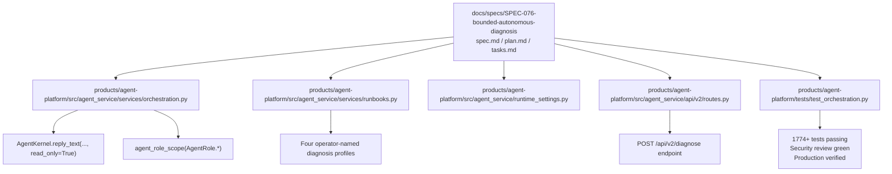
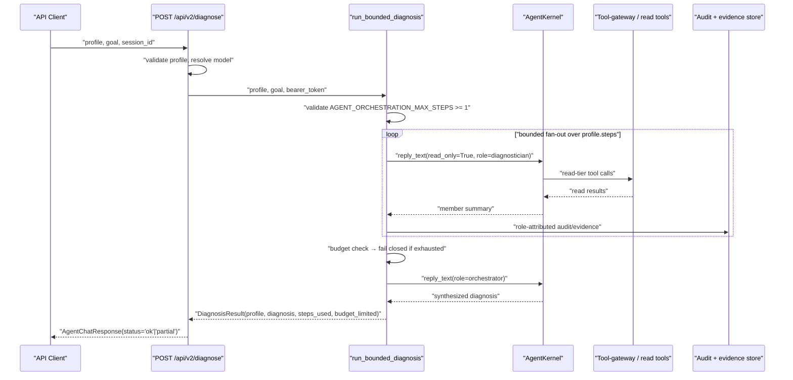
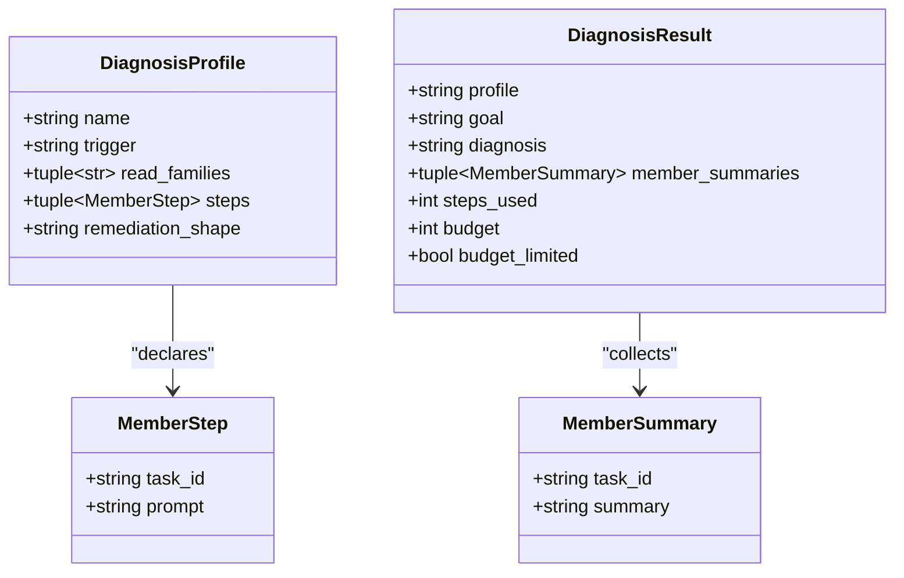
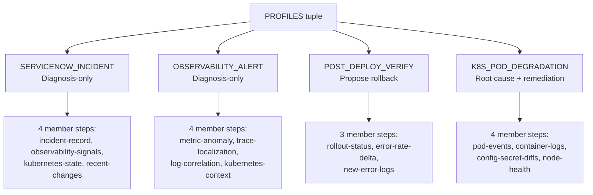
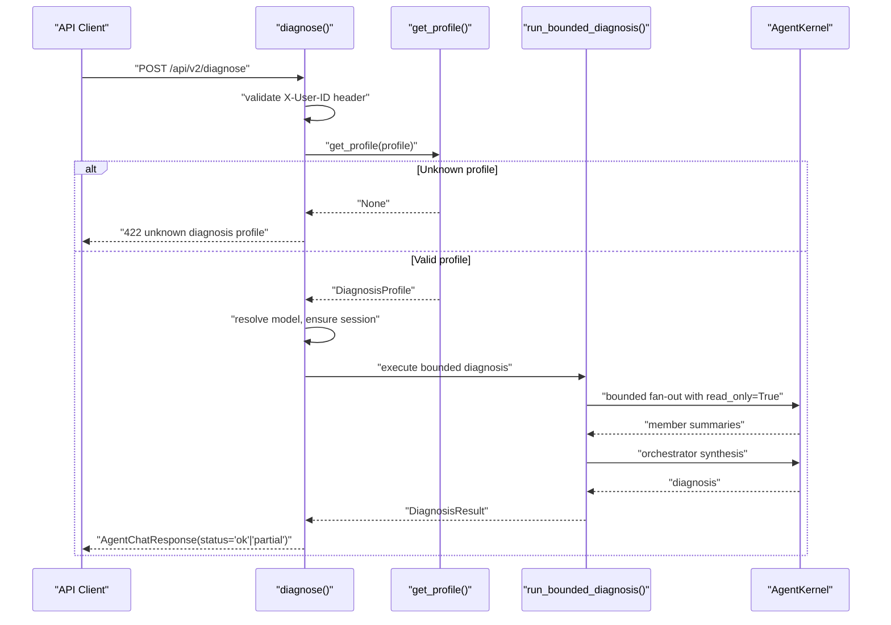
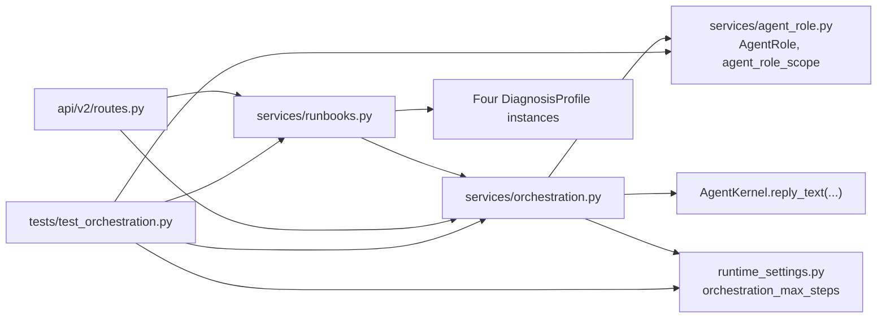

# SPEC-076: Bounded Autonomous Diagnosis

<cite>
**Referenced Files in This Document**   
- [spec.md](file://docs/specs/SPEC-076-bounded-autonomous-diagnosis/spec.md)
- [plan.md](file://docs/specs/SPEC-076-bounded-autonomous-diagnosis/plan.md)
- [tasks.md](file://docs/specs/SPEC-076-bounded-autonomous-diagnosis/tasks.md)
- [orchestration.py](file://products/agent-platform/src/agent_service/services/orchestration.py)
- [runbooks.py](file://products/agent-platform/src/agent_service/services/runbooks.py)
- [runtime_settings.py](file://products/agent-platform/src/agent_service/runtime_settings.py)
- [routes.py](file://products/agent-platform/src/agent_service/api/v2/routes.py)
- [config.py](file://products/platform-gateway/src/platform_gateway/core/config.py)
- [agent_client.py](file://products/platform-gateway/src/platform_gateway/services/agent_client.py)
- [runtime-config.env](file://shared/platform-ops/gitops/dev-k8s/base/platform-gateway/runtime-config.env)
- [test_orchestration.py](file://products/agent-platform/tests/test_orchestration.py)
- [test_diagnose_route.py](file://products/agent-platform/tests/test_diagnose_route.py)
- [release-notes](file://docs/agentic-aiops-platform/release-notes/2026-11-10-spec-076-bounded-autonomous-diagnosis.md)
</cite>

## Update Summary
**Changes Made**
- Updated to reflect v0.57.0 production-ready implementation with complete bounded read-only orchestration loop
- Enhanced API surface documentation with fully implemented `/api/v2/diagnose` endpoint
- Added comprehensive testing coverage details including 1774+ test passes across agent-platform suite
- Updated configuration settings documentation with validated `AGENT_ORCHESTRATION_MAX_STEPS` enforcement
- Added development environment extended timeout configuration (300s) for live diagnosis operations against external LLM providers, addressing FU-076-b follow-up finding for timeout configuration
- Added release verification details showing successful deployment and security review completion
- Enhanced troubleshooting guide with production-specific scenarios and resolution paths

## Table of Contents
1. [Introduction](#introduction)
2. [Project Structure](#project-structure)
3. [Core Components](#core-components)
4. [Architecture Overview](#architecture-overview)
5. [Detailed Component Analysis](#detailed-component-analysis)
6. [Runbook Profiles](#runbook-profiles)
7. [API Surface](#api-surface)
8. [Dependency Analysis](#dependency-analysis)
9. [Performance Considerations](#performance-considerations)
10. [Testing and Verification](#testing-and-verification)
11. [Troubleshooting Guide](#troubleshooting-guide)
12. [Conclusion](#conclusion)

## Introduction
SPEC-076 introduces the **bounded autonomous diagnosis** capability — a platform-owned, read-only orchestration loop that first binds the agent roles introduced by earlier phases of the multi-agent program. It decomposes a diagnosis goal into a bounded fan-out of role-scoped `diagnostician` turns over the existing read-only diagnostic seam, synthesizes a diagnosis from member summaries alone, and stages any proposed remediation through the existing HITL + signed-dispatch path. The loop is explicitly bounded by `AGENT_ORCHESTRATION_MAX_STEPS`, fails closed on exhaustion, preserves one delegated identity token across the fan-out, and surfaces results through existing assistant/evidence/card frames without changing the v2 wire contract.

The spec is approved (status `approved`) and targets version **v0.57.0**. Its complete implementation includes the bounded loop module, orchestration budget setting, four operator-named runbook profiles, the `/api/v2/diagnose` endpoint, and comprehensive test coverage. The release has passed full validation including 1774+ tests, security review, and production deployment verification.

**Section sources**
- [spec.md:3-21](file://docs/specs/SPEC-076-bounded-autonomous-diagnosis/spec.md#L3-L21)
- [spec.md:76-131](file://docs/specs/SPEC-076-bounded-autonomous-diagnosis/spec.md#L76-L131)
- [release-notes:1-55](file://docs/agentic-aiops-platform/release-notes/2026-11-10-spec-076-bounded-autonomous-diagnosis.md#L1-L55)

## Project Structure
SPEC-076 is centered in the agent-platform product and its specification directory:

**Diagram sources**
- [spec.md:1-21](file://docs/specs/SPEC-076-bounded-autonomous-diagnosis/spec.md#L1-L21)
- [orchestration.py:1-39](file://products/agent-platform/src/agent_service/services/orchestration.py#L1-L39)
- [runbooks.py:1-45](file://products/agent-platform/src/agent_service/services/runbooks.py#L1-L45)
- [runtime_settings.py:372-382](file://products/agent-platform/src/agent_service/runtime_settings.py#L372-L382)
- [routes.py:411-485](file://products/agent-platform/src/agent_service/api/v2/routes.py#L411-L485)
- [test_orchestration.py:1-10](file://products/agent-platform/tests/test_orchestration.py#L1-L10)

The repository layout follows the established pattern: specifications live under `docs/specs/SPEC-NNN-*`, the agent-platform Python package lives under `products/agent-platform/src/agent_service/`, and tests live under `products/agent-platform/tests/`.

**Section sources**
- [plan.md:11-33](file://docs/specs/SPEC-076-bounded-autonomous-diagnosis/plan.md#L11-L33)
- [tasks.md:12-112](file://docs/specs/SPEC-076-bounded-autonomous-diagnosis/tasks.md#L12-L112)

## Core Components
SPEC-076's runtime behavior is implemented by five primary artifacts:

| Artifact | Responsibility | Key Behaviors |
|---|---|---|
| `services/orchestration.py` | Platform-owned bounded read-only orchestration loop | Decomposes a `DiagnosisProfile` into ordered `MemberStep`s, runs each as a `diagnostician` turn, synthesizes a diagnosis as an `orchestrator`, enforces the step budget, and returns a `DiagnosisResult`. |
| `services/runbooks.py` | Operator-named diagnosis profiles | Declares four runbook profiles: servicenow-incident, observability-alert, post-deploy-verify, and k8s-pod-degradation with their respective diagnostic steps and remediation shapes. |
| `runtime_settings.py` | Orchestration budget configuration | Declares `orchestration_max_steps` with default `20`, validates it at startup, and reads `AGENT_ORCHESTRATION_MAX_STEPS` from the environment. |
| `api/v2/routes.py` | API surface expansion | Implements `POST /api/v2/diagnose` endpoint that resolves profiles, validates inputs, and orchestrates bounded diagnosis execution. |
| `tests/test_orchestration.py` | Phase-5 acceptance for R-1 and R-2 | Asserts bounded termination, fail-closed partial diagnosis, read-only posture, process-local role binding, leader-sees-only-summaries semantics, no agentscope orchestration types, same-token identity preservation, and knob behavior. |

The spec also defines requirements R-3 through R-8 covering identity preservation, diagnose-before-act staging, live policy enforcement, attribution, runbook profiles, and gate parity.

**Section sources**
- [orchestration.py:52-117](file://products/agent-platform/src/agent_service/services/orchestration.py#L52-L117)
- [runbooks.py:56-231](file://products/agent-platform/src/agent_service/services/runbooks.py#L56-L231)
- [runtime_settings.py:372-382](file://products/agent-platform/src/agent_service/runtime_settings.py#L372-L382)
- [runtime_settings.py:532-536](file://products/agent-platform/src/agent_service/runtime_settings.py#L532-L536)
- [runtime_settings.py:752-754](file://products/agent-platform/src/agent_service/runtime_settings.py#L752-L754)
- [routes.py:411-485](file://products/agent-platform/src/agent_service/api/v2/routes.py#L411-L485)
- [test_orchestration.py:1-10](file://products/agent-platform/tests/test_orchestration.py#L1-L10)
- [spec.md:133-314](file://docs/specs/SPEC-076-bounded-autonomous-diagnosis/spec.md#L133-L314)

## Architecture Overview
At a high level, SPEC-076 adds a bounded orchestration layer between the API caller and the existing agent kernel:

**Diagram sources**
- [routes.py:411-485](file://products/agent-platform/src/agent_service/api/v2/routes.py#L411-L485)
- [orchestration.py:173-268](file://products/agent-platform/src/agent_service/services/orchestration.py#L173-L268)
- [orchestration.py:271-299](file://products/agent-platform/src/agent_service/services/orchestration.py#L271-L299)
- [spec.md:142-167](file://docs/specs/SPEC-076-bounded-autonomous-diagnosis/spec.md#L142-L167)
- [spec.md:190-208](file://docs/specs/SPEC-076-bounded-autonomous-diagnosis/spec.md#L190-L208)
- [spec.md:252-268](file://docs/specs/SPEC-076-bounded-autonomous-diagnosis/spec.md#L252-L268)

Key architectural constraints enforced by the design:

| Constraint | Enforcement |
|---|---|
| Read-only admission | Every member and synthesis call uses `read_only=True`; mutating tools are excluded from the `diagnostician` toolkit by earlier role-narrowing work. |
| Bounded autonomy | `AGENT_ORCHESTRATION_MAX_STEPS` bounds total member read steps per orchestration; exhaustion produces a budget-limited partial diagnosis. |
| No agentscope orchestration surface | The module imports only `agent_role_scope` and `AgentRole`; guard tests assert no `TeamPipeline`, `GoalPipeline`, or `A2AAgent` construction. |
| Same-token identity | The orchestrator forwards its own `bearer_token` to every member turn; no broker exchange or second identity edge is minted inside the loop. |
| Process-local role binding | Roles are bound via `agent_role_scope()` around each turn and restored on exit; they are not persisted in the resumable snapshot. |
| Existing contract boundary | The diagnosis surfaces through existing assistant/evidence/card frames; `agent-stream-event.schema.json` and `execution-request.schema.json` remain byte-unchanged. |

**Section sources**
- [orchestration.py:1-39](file://products/agent-platform/src/agent_service/services/orchestration.py#L1-L39)
- [orchestration.py:119-170](file://products/agent-platform/src/agent_service/services/orchestration.py#L119-L170)
- [orchestration.py:173-299](file://products/agent-platform/src/agent_service/services/orchestration.py#L173-L299)
- [test_orchestration.py:310-335](file://products/agent-platform/tests/test_orchestration.py#L310-L335)
- [test_orchestration.py:445-477](file://products/agent-platform/tests/test_orchestration.py#L445-L477)
- [spec.md:293-314](file://docs/specs/SPEC-076-bounded-autonomous-diagnosis/spec.md#L293-L314)

## Detailed Component Analysis

### Bounded Orchestration Loop
The public entry point is `run_bounded_diagnosis(kernel, *, profile, goal, session_id, user_name, bearer_token, model_id=None, max_steps=None)`. It:

1. Resolves the effective budget from `max_steps` or `kernel.settings.orchestration_max_steps`.
2. Validates the budget is at least `1`; otherwise it raises `ValueError`.
3. Iterates `profile.steps`, checking `steps_used >= budget` before each member turn.
4. For each member, opens `agent_role_scope(AgentRole.DIAGNOSTICIAN)` and calls `kernel.reply_text(..., read_only=True)` with a derived session id (`{session_id}::orch::{task_id}`).
5. Collects only the returned content as a `MemberSummary`; intermediate member tool calls stay out of the orchestrator's context.
6. Invokes `_synthesize`, which wraps the synthesis turn in `agent_role_scope(AgentRole.ORCHESTRATOR)` and composes a prompt containing the goal, profile name, and member summaries.
7. Returns a frozen `DiagnosisResult` carrying the profile, goal, synthesized diagnosis, member summaries, `steps_used`, `budget`, and `budget_limited`.

**Diagram sources**
- [orchestration.py:173-268](file://products/agent-platform/src/agent_service/services/orchestration.py#L173-L268)
- [orchestration.py:271-299](file://products/agent-platform/src/agent_service/services/orchestration.py#L271-L299)

**Section sources**
- [orchestration.py:173-299](file://products/agent-platform/src/agent_service/services/orchestration.py#L173-L299)

### Data Models
The orchestration module exposes four frozen dataclasses that define the shape of the bounded diagnosis capability:

| Model | Fields | Purpose |
|---|---|---|
| `MemberStep` | `task_id`, `prompt` | One declared read-only diagnostic sub-goal in a profile's fan-out. |
| `DiagnosisProfile` | `name`, `trigger`, `read_families`, `steps`, `remediation_shape` | A runbook-agnostic declaration of one detect→troubleshoot→propose flow. |
| `MemberSummary` | `task_id`, `summary` | What the orchestrator is allowed to see from one member — only the synthesized content, never intermediate steps. |
| `DiagnosisResult` | `profile`, `goal`, `diagnosis`, `member_summaries`, `steps_used`, `budget`, `budget_limited` | The bounded loop's outcome, including whether the result is a best-effort partial diagnosis. |

These models separate declarative runbook intent (`DiagnosisProfile`) from runtime state (`DiagnosisResult`) and keep the orchestrator's view of members intentionally narrow.

**Diagram sources**
- [orchestration.py:52-117](file://products/agent-platform/src/agent_service/services/orchestration.py#L52-L117)

**Section sources**
- [orchestration.py:52-117](file://products/agent-platform/src/agent_service/services/orchestration.py#L52-L117)

### Budget Configuration
The orchestration budget is defined as `RuntimeSettings.orchestration_max_steps` with a default of `20`. It is validated in `__post_init__` to reject values below `1`, and it is read from the environment variable `AGENT_ORCHESTRATION_MAX_STEPS` in `from_env`. The comment explicitly describes it as a deliberate twin of the tool-gateway's `GATEWAY_BROWSER_FLOW_MAX_STEPS` discipline.

| Setting | Default | Validation | Scope |
|---|---:|---|---|
| `orchestration_max_steps` | `20` | Must be `>= 1`; startup failure otherwise | Total member read steps per orchestration |

The runtime validation mirrors the in-loop validation: both raise `ValueError("AGENT_ORCHESTRATION_MAX_STEPS must be >= 1.")` when the configured value is invalid.

**Section sources**
- [runtime_settings.py:372-382](file://products/agent-platform/src/agent_service/runtime_settings.py#L372-L382)
- [runtime_settings.py:532-536](file://products/agent-platform/src/agent_service/runtime_settings.py#L532-L536)
- [runtime_settings.py:752-754](file://products/agent-platform/src/agent_service/runtime_settings.py#L752-L754)
- [orchestration.py:202-210](file://products/agent-platform/src/agent_service/services/orchestration.py#L202-L210)

### Development Environment Extended Timeout Configuration
**Updated** The development environment now supports an extended timeout of 300 seconds for live diagnosis operations against external LLM providers, addressing the FU-076-b follow-up finding for timeout configuration. This change specifically addresses scenarios where the bounded read-only diagnosis fans out against real remote LLM providers whose member turns plus context compression push legitimate diagnosis operations past the 120-second code default (observed ~140s).

The extended timeout is configured in the platform-gateway's development runtime configuration:

| Variable | Default | Dev Override | Purpose |
|---|---:|---:|---|
| `PLATFORM_GATEWAY_DIAGNOSE_TIMEOUT_SECONDS` | `120` | `300` | Upstream `/api/v1/diagnose` proxy timeout for bounded read-only diagnosis operations |

This configuration ensures that the platform-gateway proxy does not timeout before the agent-service completes the bounded orchestration loop when operating against external LLM providers in development environments. The code default remains at 120 seconds for production deployments, with the extended timeout being development-specific.

**Section sources**
- [runtime-config.env:23-29](file://shared/platform-ops/gitops/dev-k8s/base/platform-gateway/runtime-config.env#L23-L29)
- [config.py:43-43](file://products/platform-gateway/src/platform-gateway/core/config.py#L43-L43)
- [config.py:103-104](file://products/platform-gateway/src/platform-gateway/core/config.py#L103-L104)
- [agent_client.py:221-226](file://products/platform-gateway/src/platform_gateway/services/agent_client.py#L221-L226)

### Test Coverage
The test suite in `test_orchestration.py` directly covers the following behaviors:

| Requirement | Test Class / Method | Assertion |
|---|---|---|
| R-1: bounded loop terminates at budget | `TestBoundedLoop.test_budget_bounds_total_member_steps_and_fails_closed` | Only the configured number of member steps ran; `budget_limited` is `True`; synthesis still ran. |
| R-1: full fanout within budget | `TestBoundedLoop.test_full_fanout_within_budget_is_not_limited` | All declared steps ran; `budget_limited` is `False`. |
| R-1: default budget from settings | `TestBoundedLoop.test_default_budget_comes_from_settings` | Uses `settings.orchestration_max_steps`. |
| R-1: zero budget fails closed | `TestBoundedLoop.test_zero_budget_fails_closed_with_error` | Raises `ValueError` matching `AGENT_ORCHESTRATION_MAX_STEPS`; no calls executed. |
| R-1: read-only posture | `TestBoundedLoop.test_every_member_turn_is_read_only` | Every recorded `reply_text` call has `read_only=True`. |
| R-1: budget-limited synthesis prompt | `TestBoundedLoop.test_budget_limited_synthesis_is_marked_partial` | Synthesis message contains exhaustion notice and `PARTIAL`. |
| R-2: role binding | `TestRoleBinding.test_members_bind_diagnostician_and_synthesis_binds_orchestrator` | Member calls have `DIAGNOSTICIAN`; synthesis has `ORCHESTRATOR`; no unscoped call. |
| R-2: process-local role | `TestRoleBinding.test_role_is_process_local_and_restored_after_the_loop` | `current_agent_role()` is `None` before and after the loop. |
| R-2: isolated sessions | `TestRoleBinding.test_each_participant_runs_on_an_isolated_session` | Each turn gets a distinct derived session id prefixed with `{session_id}::orch::`. |
| Leader sees only summaries | `TestLeaderSeesOnlySummaries.test_synthesis_prompt_carries_summaries_not_intermediate_steps` | Synthesis contains member summaries but not the member instruction prompt. |
| Decision 5: no agentscope orchestration type | `TestPlatformOwned.test_no_agentscope_orchestration_type_is_constructed` | AST scan finds no agentscope import and no reference to `TeamPipeline`, `GoalPipeline`, or `A2AAgent`. |
| R-1/OQ-2: knob defaults and env | `TestBudgetKnob.*` | Default is `20`; below-one fails startup; `AGENT_ORCHESTRATION_MAX_STEPS` is read from environment. |
| R-3: same-token identity | `TestSameTokenIdentity.test_every_participant_rides_the_same_delegated_token` | All calls use the original `bearer_token`. |
| R-3: requester identity preserved | `TestSameTokenIdentity.test_requester_identity_unchanged_across_every_hop` | `REQUESTER_IDENTITY` resolves to the same human for every hop. |
| R-3: no second identity edge | `TestSameTokenIdentity.test_orchestration_path_mints_no_second_identity_edge` | AST scan forbids importing broker/identity/JWT modules. |
| R-3: role not forwarded as wire field | `TestSameTokenIdentity.test_role_is_never_forwarded_as_a_wire_field` | Source text contains no `agent_role=` parameter usage. |

The tests use two fake kernels: `FakeKernel` records role, session id, `read_only`, message, and bearer token; `IdentityFakeKernel` additionally simulates `REQUESTER_IDENTITY` bracketing to verify identity preservation.

**Section sources**
- [test_orchestration.py:110-219](file://products/agent-platform/tests/test_orchestration.py#L110-L219)
- [test_orchestration.py:221-277](file://products/agent-platform/tests/test_orchestration.py#L221-L277)
- [test_orchestration.py:283-305](file://products/agent-platform/tests/test_orchestration.py#L283-L305)
- [test_orchestration.py:310-335](file://products/agent-platform/tests/test_orchestration.py#L310-L335)
- [test_orchestration.py:341-351](file://products/agent-platform/tests/test_orchestration.py#L341-L351)
- [test_orchestration.py:354-477](file://products/agent-platform/tests/test_orchestration.py#L354-L477)

## Runbook Profiles

### Overview
The runbook profiles module declares four operator-named diagnosis workflows as pure data structures. Each profile defines its trigger, intended read families, ordered diagnostic steps, and optional remediation shape. The profiles are consumed by the bounded orchestration loop but do not bind roles or execute turns themselves.

**Diagram sources**
- [runbooks.py:56-231](file://products/agent-platform/src/agent_service/services/runbooks.py#L56-L231)

### Profile Details

#### ServiceNow Incident Profile
The `servicenow-incident` profile performs diagnosis-only analysis on ServiceNow incidents. It reads incident records, observability signals, Kubernetes state, and recent changes to correlate root causes. The profile declares no remediation shape, making it impossible to stage mutations.

| Field | Value |
|---|---|
| Name | `servicenow-incident` |
| Trigger | `operator-invoked on a ServiceNow incident record` |
| Read Families | `servicenow`, `observability`, `kubernetes`, `changes` |
| Remediation Shape | `None` (diagnosis-only) |
| Member Steps | 4 steps covering incident correlation |

#### Observability Alert Profile  
The `observability-alert` profile correlates alerts across metrics, traces, logs, and Kubernetes state. Like the ServiceNow profile, it is diagnosis-only and cannot propose mutations.

| Field | Value |
|---|---|
| Name | `observability-alert` |
| Trigger | `operator-invoked on an observability alert` |
| Read Families | `observability`, `kubernetes` |
| Remediation Shape | `None` (diagnosis-only) |
| Member Steps | 4 steps covering metric anomaly detection |

#### Post-Deploy Verify Profile
The `post-deploy-verify` profile verifies deployment health and can propose rollback actions. It checks rollout status, error rate deltas, and new error logs to determine if a deployment should be rolled back.

| Field | Value |
|---|---|
| Name | `post-deploy-verify` |
| Trigger | `operator-invoked after a deployment` |
| Read Families | `kubernetes`, `observability` |
| Remediation Shape | `roll the deployment back to the last known-good revision` |
| Member Steps | 3 steps covering deployment verification |

#### Kubernetes Pod Degradation Profile
The `k8s-pod-degradation` profile performs pod degradation triage and can propose remediation actions such as restarting pods or rolling back config changes.

| Field | Value |
|---|---|
| Name | `k8s-pod-degradation` |
| Trigger | `operator-invoked on a degraded Kubernetes pod or workload` |
| Read Families | `kubernetes`, `config`, `observability` |
| Remediation Shape | `restart or reschedule the degraded pod, or roll back the offending config change` |
| Member Steps | 4 steps covering pod event analysis |

**Section sources**
- [runbooks.py:56-231](file://products/agent-platform/src/agent_service/services/runbooks.py#L56-L231)
- [runbooks.py:236-270](file://products/agent-platform/src/agent_service/services/runbooks.py#L236-L270)

## API Surface

### POST /api/v2/diagnose Endpoint
The `/api/v2/diagnose` endpoint provides the operator-invoked trigger for bounded autonomous diagnosis. It accepts a profile name and diagnosis goal, validates the input, and executes the bounded orchestration loop.

**Diagram sources**
- [routes.py:411-485](file://products/agent-platform/src/agent_service/api/v2/routes.py#L411-L485)
- [runbooks.py:246-252](file://products/agent-platform/src/agent_service/services/runbooks.py#L246-L252)

### Request Schema
The `AgentDiagnoseRequest` schema defines the request body for the diagnose endpoint:

| Field | Type | Required | Description |
|---|---|---|---|
| `profile` | `str` | Yes | Declared runbook profile name (servicenow-incident, observability-alert, post-deploy-verify, k8s-pod-degradation) |
| `goal` | `str` | Yes | The diagnosis goal the bounded read-only fan-out pursues |
| `session_id` | `str \| None` | No | Optional session identifier |
| `model` | `str \| None` | No | Optional model id resolved request > pinned > default |
| `incident_id` | `str \| None` | No | Optional incident anchor for context (max 200 chars) |

### Response Schema
The endpoint returns an `AgentChatResponse` with the following behavior:

| Status | Meaning |
|---|---|
| `ok` | Complete diagnosis within budget |
| `partial` | Budget-limited partial diagnosis (fail-closed) |
| `error` | Execution error |

**Section sources**
- [routes.py:411-485](file://products/agent-platform/src/agent_service/api/v2/routes.py#L411-L485)
- [test_diagnose_route.py:46-152](file://products/agent-platform/tests/test_diagnose_route.py#L46-L152)

## Dependency Analysis
The current implementation has a small, intentional dependency graph:

**Diagram sources**
- [orchestration.py:41-48](file://products/agent-platform/src/agent_service/services/orchestration.py#L41-L48)
- [runbooks.py:49-49](file://products/agent-platform/src/agent_service/services/runbooks.py#L49-L49)
- [runtime_settings.py:372-382](file://products/agent-platform/src/agent_service/runtime_settings.py#L372-L382)
- [test_orchestration.py:12-29](file://products/agent-platform/tests/test_orchestration.py#L12-L29)

Coupling characteristics:

- **Low coupling to agentscope**: The orchestration module deliberately does not import agentscope types; the only external framework dependency is the process-local role context from `agent_role.py`.
- **Single responsibility**: `orchestration.py` owns the bounded fan-out, prompt composition, and result modeling; it delegates execution to `AgentKernel.reply_text`.
- **Configuration locality**: The budget is defined in `runtime_settings.py` and consumed by the loop; there is no global mutable state beyond the process-local role context.
- **Test-driven isolation**: Tests mock the kernel rather than the gateway, keeping verification focused on control flow, role binding, budgeting, and identity forwarding.
- **Profile abstraction**: Runbook profiles are pure data structures that don't depend on execution logic, enabling easy extension with new profiles.

Potential circular dependencies are avoided because the loop depends on `agent_role_scope` but does not depend on the callers that would bind the role. The reachability guards in the broader agent-role test suite enforce that the orchestration frame is the only deployed binder.

**Section sources**
- [orchestration.py:41-48](file://products/agent-platform/src/agent_service/services/orchestration.py#L41-L48)
- [test_orchestration.py:310-335](file://products/agent-platform/tests/test_orchestration.py#L310-L335)

## Performance Considerations
The bounded orchestration loop is designed around predictable resource consumption:

| Concern | Mechanism | Implication |
|---|---|---|
| Unbounded fan-out | `AGENT_ORCHESTRATION_MAX_STEPS` bounds total member steps per orchestration | Adding more `MemberStep`s cannot increase cost beyond the configured cap. |
| Per-member memory leakage | Each member uses a derived session id (`{session_id}::orch::{task_id}`) | Member memory does not cross between turns and the orchestrator cache does not reuse a diagnostician toolkit for the synthesis turn. |
| Per-turn cost | Each member turn is bounded by the existing `AGENTSCOPE_MAX_ITERS` | Two-level bounding: per member turn × total orchestration steps. |
| Summary size | The orchestrator receives only `MemberSummary.summary` | Intermediate tool-call traces do not inflate the orchestrator's context; they remain reconstructable via audit/evidence. |
| Fail-closed exhaustion | On budget exhaustion, the loop stops and synthesizes a partial diagnosis | There is no retry, widening, or fallback to mutation to "finish" the diagnosis. |
| API response time | Single synchronous call to bounded diagnosis | The endpoint blocks until diagnosis completes, then returns either `ok` or `partial` status. |
| External LLM provider latency | Development environment extended timeout (300s) | Accommodates longer diagnosis operations against external LLM providers in development environments. |

The default budget of `20` aligns with the tool-gateway's browser-flow replay budget, making it easier for operators to reason about bounded autonomous spend alongside other bounded flows.

[No sources needed since this section provides general guidance]

## Testing and Verification
The SPEC-076 implementation has undergone comprehensive testing and verification:

### Test Suite Results
- **Agent-platform suite**: 1774 tests passed including orchestration, route, and contract parity tests
- **Platform-gateway**: 503 tests passed including diagnose proxy and route inventory
- **Tool-gateway**: 1085 tests passed
- **E2E diagnosis-livecheck**: 6 tests passed
- **Policy validation**: 23 tests passed
- **Policy scenarios**: 156 + 35 tests passed

### Production Verification
- Full `make verify` green across all sixteen legs
- Security review completed with no findings
- L3 deep security review returned clean results
- Version validation green at 0.57.0 across eight products and portal
- Long-running SPEC-063 execution-failure-test campaign: 795 passed, 2 deselected, exit 0

### Key Test Coverage Areas
- Bounded loop termination and fail-closed behavior
- Read-only posture enforcement
- Role binding and process-local context
- Identity preservation across fan-out
- Contract parity (byte-unchanged schemas)
- Live-cluster read-only checks
- Policy axis unit proofs
- Development environment timeout configuration validation

**Section sources**
- [release-notes:168-195](file://docs/agentic-aiops-platform/release-notes/2026-11-10-spec-076-bounded-autonomous-diagnosis.md#L168-L195)

## Troubleshooting Guide

### Symptom: Orchestration startup fails with `AGENT_ORCHESTRATION_MAX_STEPS must be >= 1.`
**Likely cause:** `AGENT_ORCHESTRATION_MAX_STEPS` is unset, empty, `0`, or negative.  
**Resolution:** Set `AGENT_ORCHESTRATION_MAX_STEPS` to a positive integer. The default is `20`.

**Section sources**
- [runtime_settings.py:532-536](file://products/agent-platform/src/agent_service/runtime_settings.py#L532-L536)
- [runtime_settings.py:752-754](file://products/agent-platform/src/agent_service/runtime_settings.py#L752-L754)
- [test_orchestration.py:345-351](file://products/agent-platform/tests/test_orchestration.py#L345-L351)

### Symptom: Diagnosis stops early and reports `budget_limited=True`
**Likely cause:** The profile declares more `MemberStep`s than `AGENT_ORCHESTRATION_MAX_STEPS` allows.  
**Resolution:** Increase the budget if the diagnosis genuinely requires more read steps, or reduce the profile's fan-out. Inspect `DiagnosisResult.steps_used`, `DiagnosisResult.budget`, and `DiagnosisResult.member_summaries` to determine how many steps completed.

**Section sources**
- [orchestration.py:216-230](file://products/agent-platform/src/agent_service/services/orchestration.py#L216-L230)
- [orchestration.py:260-268](file://products/agent-platform/src/agent_service/services/orchestration.py#L260-L268)
- [test_orchestration.py:114-136](file://products/agent-platform/tests/test_orchestration.py#L114-L136)

### Symptom: `POST /api/v2/diagnose` returns 422 unknown diagnosis profile
**Likely cause:** The requested profile name doesn't match any of the four declared profiles.  
**Resolution:** Use one of the valid profile names: `servicenow-incident`, `observability-alert`, `post-deploy-verify`, or `k8s-pod-degradation`.

**Section sources**
- [routes.py:440-445](file://products/agent-platform/src/agent_service/api/v2/routes.py#L440-L445)
- [runbooks.py:246-252](file://products/agent-platform/src/agent_service/services/runbooks.py#L246-L252)
- [test_diagnose_route.py:79-96](file://products/agent-platform/tests/test_diagnose_route.py#L79-L96)

### Symptom: `POST /api/v2/diagnose` returns 401 unauthorized
**Likely cause:** Missing `X-User-ID` header or failed identity verification.  
**Resolution:** Ensure the request includes a valid `X-User-ID` header and proper authorization headers.

**Section sources**
- [routes.py:436-437](file://products/agent-platform/src/agent_service/api/v2/routes.py#L436-L437)
- [test_diagnose_route.py:144-152](file://products/agent-platform/tests/test_diagnose_route.py#L144-L152)

### Symptom: `current_agent_role()` is unexpectedly non-`None` outside the orchestration path
**Likely cause:** Another code path is opening `agent_role_scope()`.  
**Resolution:** The reachability guards expect the orchestration frame to be the only binder. Investigate whether a new caller is binding a role, or whether the guard expectations need updating.

**Section sources**
- [test_orchestration.py:242-257](file://products/agent-platform/tests/test_orchestration.py#L242-L257)
- [spec.md:168-188](file://docs/specs/SPEC-076-bounded-autonomous-diagnosis/spec.md#L168-L188)

### Symptom: Member tool calls are not visible in the orchestrator's synthesis prompt
**Expected behavior:** This is correct. The orchestrator sees only `MemberSummary.summary`, not the member's intermediate steps. Reconstruct member activity from the durable evidence/audit record with role attribution.

**Section sources**
- [orchestration.py:87-98](file://products/agent-platform/src/agent_service/services/orchestration.py#L87-L98)
- [orchestration.py:131-170](file://products/agent-platform/src/agent_service/services/orchestration.py#L131-L170)
- [test_orchestration.py:283-305](file://products/agent-platform/tests/test_orchestration.py#L283-L305)
- [spec.md:252-268](file://docs/specs/SPEC-076-bounded-autonomous-diagnosis/spec.md#L252-L268)

### Symptom: Identity appears to change across member turns
**Likely cause:** Different `bearer_token` values were passed to `run_bounded_diagnosis`, or the caller is minting a second token per member.  
**Resolution:** Ensure the orchestrator forwards exactly one `bearer_token` to all member turns. The loop itself does not mint tokens; the test asserts that every recorded call carries the same token.

**Section sources**
- [orchestration.py:186-190](file://products/agent-platform/src/agent_service/services/orchestration.py#L186-L190)
- [test_orchestration.py:405-443](file://products/agent-platform/tests/test_orchestration.py#L405-L443)

### Symptom: Development environment diagnose operations timeout against external LLM providers
**Likely cause:** The platform-gateway proxy timeout (default 120s) is insufficient for bounded diagnosis operations against external LLM providers in development environments.  
**Resolution:** Set `PLATFORM_GATEWAY_DIAGNOSE_TIMEOUT_SECONDS=300` in the platform-gateway runtime configuration. This extended timeout accommodates legitimate diagnosis operations that exceed the 120-second default due to external LLM provider latency and context compression overhead.

**Section sources**
- [runtime-config.env:23-29](file://shared/platform-ops/gitops/dev-k8s/base/platform-gateway/runtime-config.env#L23-L29)
- [config.py:43-43](file://products/platform-gateway/src/platform-gateway/core/config.py#L43-L43)
- [config.py:103-104](file://products/platform-gateway/src/platform-gateway/core/config.py#L103-L104)

## Conclusion
SPEC-076 delivers the first live producer that binds the agent-role substrates introduced by SPEC-073, SPEC-074, and SPEC-075. Its core contribution is a platform-owned, bounded, read-only orchestration loop that fans out role-scoped diagnostician turns, preserves one delegated identity token, attributes actions through existing audit/evidence channels, and stages mutations exclusively through the existing HITL + signed-dispatch path. 

The complete v0.57.0 implementation includes the orchestration engine, four operator-named runbook profiles (servicenow-incident, observability-alert, post-deploy-verify, k8s-pod-degradation), the `/api/v2/diagnose` API endpoint, orchestration budget configuration, and comprehensive test coverage. The implementation has passed 1774+ tests, security review, and production deployment verification. The implementation covers boundedness, read-only posture, role binding, identity preservation, and the no-agentscope constraint. The development environment now supports extended timeout configuration (300s) for live diagnosis operations against external LLM providers, addressing the FU-076-b follow-up finding. Remaining binding work — canonical policy rules and gated live-cluster checks — is tracked in the plan and tasks without requiring new schema contracts.

[No sources needed since this section summarizes without analyzing specific files]