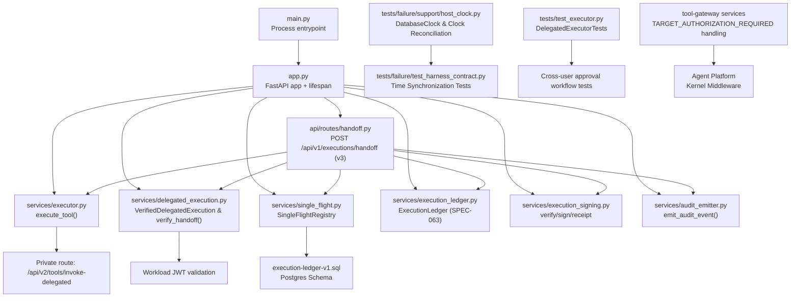
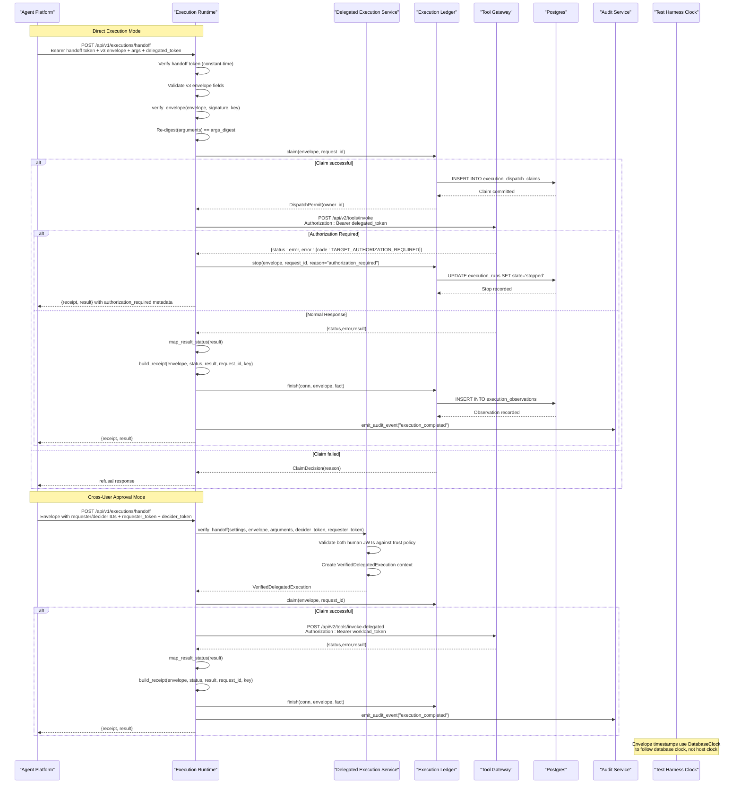
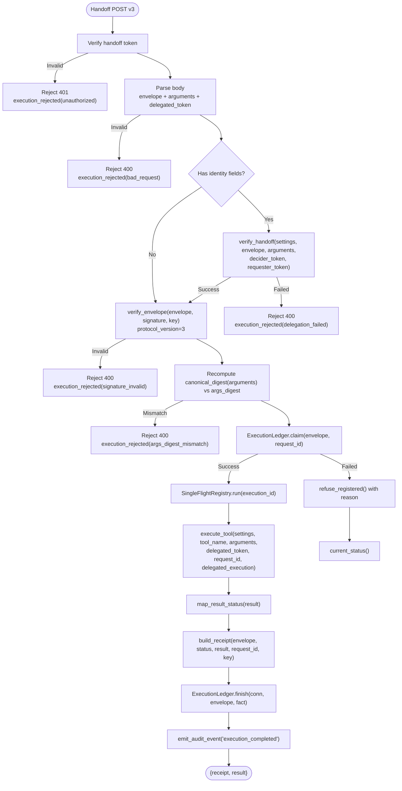
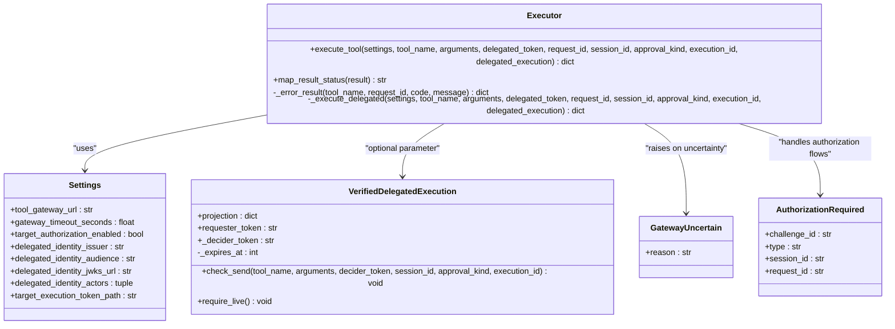
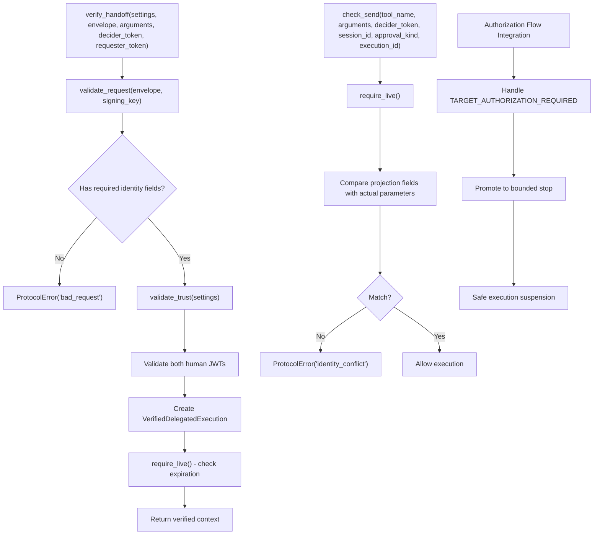
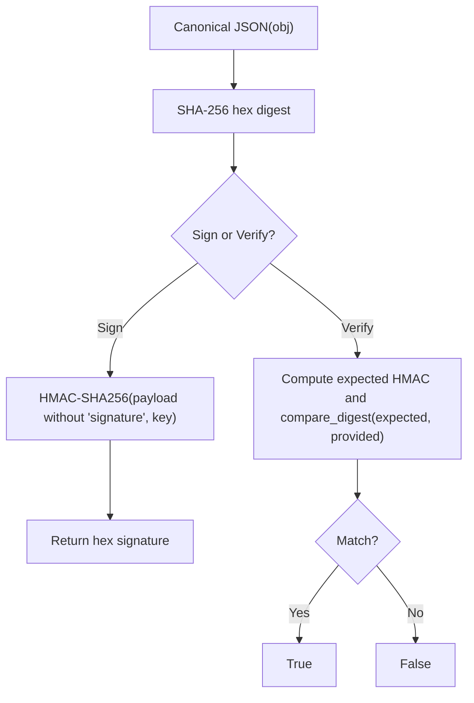
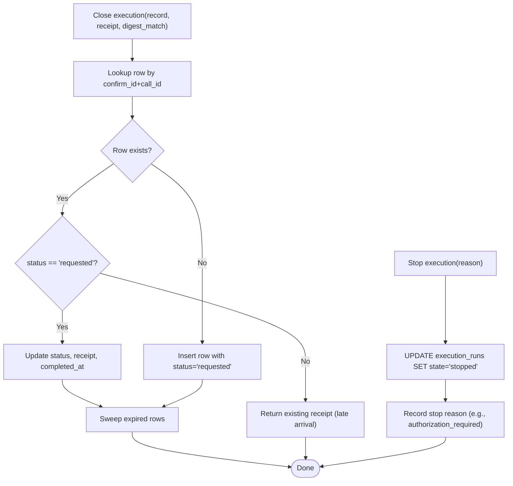
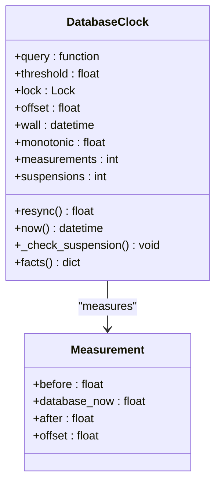
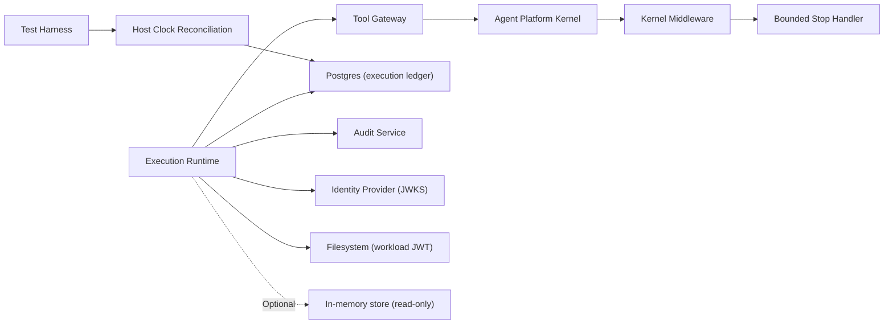

# Execution Runtime

<cite>
**Referenced Files in This Document**
- [main.py](file://products/execution-runtime/src/execution_runtime/main.py)
- [app.py](file://products/execution-runtime/src/execution_runtime/app.py)
- [config.py](file://products/execution-runtime/src/execution_runtime/core/config.py)
- [handoff.py](file://products/execution-runtime/src/execution_runtime/api/routes/handoff.py)
- [executor.py](file://products/execution-runtime/src/execution_runtime/services/executor.py)
- [delegated_execution.py](file://products/execution-runtime/src/execution_runtime/services/delegated_execution.py)
- [execution_signing.py](file://products/execution-runtime/src/execution_runtime/services/execution_signing.py)
- [single_flight.py](file://products/execution-runtime/src/execution_runtime/services/single_flight.py)
- [execution_ledger.py](file://products/execution-runtime/src/execution_runtime/services/execution_ledger.py)
- [execution_io.py](file://products/execution-runtime/src/execution_runtime/services/execution_io.py)
- [execution_protocol.py](file://products/execution-runtime/src/execution_runtime/services/execution_protocol.py)
- [audit_emitter.py](file://products/execution-runtime/src/execution_runtime/services/audit_emitter.py)
- [host_clock.py](file://products/execution-runtime/tests/failure/support/host_clock.py)
- [test_harness_contract.py](file://products/execution-runtime/tests/failure/test_harness_contract.py)
- [test_executor.py](file://products/execution-runtime/tests/test_executor.py)
- [gateway_service.py](file://products/tool-gateway/src/tool_gateway/services/gateway_service.py)
- [authorization_service.py](file://products/tool-gateway/src/tool_gateway/services/authorization_service.py)
- [kernel_middleware.py](file://products/agent-platform/src/agent_service/services/kernel_middleware.py)
- [execution-ledger-v1.sql](file://shared/shared-contracts/sql/execution-ledger-v1.sql)
- [execution-ledger-v1.sql](file://products/execution-runtime/src/execution_runtime/contracts/execution-ledger-v1.sql)
- [execution-request.schema.json](file://shared/shared-contracts/schemas/execution-request.schema.json)
- [execution-receipt.schema.json](file://shared/shared-contracts/schemas/execution-receipt.schema.json)
- [SPEC-037-signed-execution-requests/spec.md](file://docs/specs/SPEC-037-signed-execution-requests/spec.md)
- [SPEC-038-isolated-execution-worker/spec.md](file://docs/specs/SPEC-038-isolated-execution-worker/spec.md)
- [SPEC-063-crash-safe-execution/spec.md](file://docs/specs/SPEC-063-crash-safe-execution/spec.md)
</cite>

## Update Summary
**Changes Made**
- Updated execution model to reflect SPEC-063 crash-safe execution with durable single-use dispatch claims and bounded kernel stop functionality
- Enhanced delegated execution service documentation with authorization-required evidence tracking for safe execution suspension during authorization flows
- Added comprehensive coverage of the TARGET_AUTHORIZATION_REQUIRED flow that promotes authorization challenges to bounded stops
- Documented the integration between execution runtime, tool gateway, and agent platform for authorization-required scenarios
- Updated executor service documentation to cover both direct and delegated execution paths with authorization flow support
- Enhanced security model documentation with workload identity authentication and dual human bearer validation
- Added detailed examples of handling authorization-required responses and bounded stop behavior

## Table of Contents
1. [Introduction](#introduction)
2. [Project Structure](#project-structure)
3. [Core Components](#core-components)
4. [Architecture Overview](#architecture-overview)
5. [Detailed Component Analysis](#detailed-component-analysis)
6. [Dependency Analysis](#dependency-analysis)
7. [Performance Considerations](#performance-considerations)
8. [Troubleshooting Guide](#troubleshooting-guide)
9. [Conclusion](#conclusion)
10. [Appendices](#appendices)

## Introduction
This document describes the execution runtime service that provides isolated workers for potentially mutating tool actions with crash-safe execution guarantees and bounded kernel stop functionality. The runtime implements SPEC-063 enhancements including durable single-use dispatch claims, atomic claim mechanisms, execution recovery APIs with owner-scoped visibility, and synchronous run-stop latches with persistent root-run identity binding. It also supports SPEC-070 cross-user approval workflows through a new delegated execution service that validates workload-authenticated invoke-delegated handoffs and manages requester-owned target grants.

The runtime is a dedicated process that:
- Receives signed execution envelopes from the agent platform over an authenticated internal handoff endpoint.
- Verifies signatures and argument digests before any execution through a v3 admission flow.
- Supports both direct execution with confirmer's delegated token and cross-user approval workflows with separate requester and decider identities.
- Executes exactly one tool invocation per envelope through the tool gateway using appropriate authentication.
- Produces tamper-evident receipts and persists them to a durable Postgres-backed execution ledger.
- Emits audit events correlating with the resumed stream while maintaining bounded observation windows.
- Handles authorization-required scenarios by promoting TARGET_AUTHORIZATION_REQUIRED errors to bounded stops for safe execution suspension.

**Updated** The runtime now supports two execution modes: traditional direct execution and advanced cross-user approval workflows where the requester owns the grant but a different user approves the action. Both modes enforce at-most-one worker dispatch attempts per approved call, preventing duplicate mutations even after process loss, database failure, or lost responses. The runtime also handles authorization-required scenarios through the bounded kernel stop mechanism, ensuring safe suspension during authorization flows.

**Section sources**
- [SPEC-063-crash-safe-execution/spec.md:29-45](file://docs/specs/SPEC-063-crash-safe-execution/spec.md#L29-L45)
- [SPEC-038-isolated-execution-worker/spec.md:11-25](file://docs/specs/SPEC-038-isolated-execution-worker/spec.md#L11-L25)
- [SPEC-037-signed-execution-requests/spec.md:11-22](file://docs/specs/SPEC-037-signed-execution-requests/spec.md#L11-L22)
- [delegated_execution.py:1-5](file://products/execution-runtime/src/execution_runtime/services/delegated_execution.py#L1-L5)

## Project Structure
The execution runtime product is organized as a FastAPI application with clear separation of concerns, enhanced by SPEC-063 durability components and SPEC-070 cross-user approval workflows:
- Entry point and lifecycle setup
- Configuration loaded from environment variables with admission control and delegated execution settings
- API routes exposing the v3 handoff endpoint with conditional delegated execution support
- Services for execution, signing, single-flight idempotency, execution ledger persistence, audit emission, and delegated execution validation
- Database schema management for execution-ledger-v1 tables
- Test harness infrastructure for clock synchronization and failure scenario validation

**Diagram sources**
- [main.py:1-9](file://products/execution-runtime/src/execution_runtime/main.py#L1-L9)
- [app.py:19-67](file://products/execution-runtime/src/execution_runtime/app.py#L19-L67)
- [handoff.py:144-235](file://products/execution-runtime/src/execution_runtime/api/routes/handoff.py#L144-L235)
- [executor.py:17-93](file://products/execution-runtime/src/execution_runtime/services/executor.py#L17-L93)
- [delegated_execution.py:75-149](file://products/execution-runtime/src/execution_runtime/services/delegated_execution.py#L75-L149)
- [single_flight.py:34-107](file://products/execution-runtime/src/execution_runtime/services/single_flight.py#L34-L107)
- [execution_ledger.py:77-491](file://products/execution-runtime/src/execution_runtime/services/execution_ledger.py#L77-L491)
- [execution-signing.py:40-93](file://products/execution-runtime/src/execution_runtime/services/execution_signing.py#L40-L93)
- [audit_emitter.py:30-99](file://products/execution-runtime/src/execution_runtime/services/audit_emitter.py#L30-L99)
- [host_clock.py:1-165](file://products/execution-runtime/tests/failure/support/host_clock.py#L1-L165)
- [gateway_service.py:270-320](file://products/tool-gateway/src/tool_gateway/services/gateway_service.py#L270-L320)
- [kernel_middleware.py:275-313](file://products/agent-platform/src/agent_service/services/kernel_middleware.py#L275-L313)

**Section sources**
- [main.py:1-9](file://products/execution-runtime/src/execution_runtime/main.py#L1-L9)
- [app.py:19-67](file://products/execution-runtime/src/execution_runtime/app.py#L19-L67)

## Core Components
- **Handoff route**: authenticates caller via static handoff token, validates v3 envelope shape, conditionally processes delegated execution requests, verifies signature and argument digest, enforces durable single-flight idempotency, executes the tool, signs and persists receipt, emits audit event.
- **Executor**: performs one HTTP call to the tool gateway with either the forwarded delegated token (direct mode) or workload identity (delegated mode); maps timeouts and transport errors into structured results with uncertainty reporting; handles authorization-required scenarios.
- **Delegated execution service**: validates workload-authenticated invoke-delegated handoffs, verifies both requester and decider human JWTs, manages verified execution contexts with expiration, and ensures request integrity at send boundaries.
- **Signing module**: canonical JSON, HMAC-SHA256 signing and verification, receipt construction with outcome digest.
- **Single-flight registry**: ensures each execution_id runs at most once within process lifetime; joins concurrent duplicates and replays return cached outcomes with bounded retention.
- **Execution ledger**: Postgres-backed durable state machine with atomic claim mechanisms, observation tracking, and recovery projections.
- **Audit emitter**: fire-and-forget delivery to the audit service; never degrades the execution path.
- **Test harness clock reconciliation**: DatabaseClock class for measuring and reconciling host vs database clock drift, with automatic suspension detection and re-measurement capabilities.

**Updated** The execution runtime now supports two distinct execution modes: traditional direct execution where the confirmer's delegated token is used, and advanced cross-user approval workflows where separate requester and decider identities are validated. The delegated execution service provides robust validation of workload-authenticated handoffs and maintains strict integrity checks between the verified projection and actual execution parameters. The runtime also handles authorization-required scenarios through the bounded kernel stop mechanism, ensuring safe suspension during authorization flows.

**Section sources**
- [handoff.py:144-235](file://products/execution-runtime/src/execution_runtime/api/routes/handoff.py#L144-L235)
- [executor.py:17-93](file://products/execution-runtime/src/execution_runtime/services/executor.py#L17-L93)
- [delegated_execution.py:75-149](file://products/execution-runtime/src/execution_runtime/services/delegated_execution.py#L75-L149)
- [execution_signing.py:40-93](file://products/execution-runtime/src/execution_runtime/services/execution_signing.py#L40-L93)
- [single_flight.py:34-107](file://products/execution-runtime/src/execution_runtime/services/single_flight.py#L34-L107)
- [execution_ledger.py:77-491](file://products/execution-runtime/src/execution_runtime/services/execution_ledger.py#L77-L491)
- [audit_emitter.py:30-99](file://products/execution-runtime/src/execution_runtime/services/audit_emitter.py#L30-L99)
- [host_clock.py:88-165](file://products/execution-runtime/tests/failure/support/host_clock.py#L88-L165)

## Architecture Overview
The runtime isolates execution from the agent platform by receiving only pre-verified, signed requests through a v3 admission flow. The agent platform constructs the envelope, signs it with protocol version 3, and forwards it along with parked arguments and delegated token to the worker. For cross-user approval workflows, the envelope includes both requester and decider identity fields, and the worker validates both human JWTs against configured trust policies before executing through the private delegated route under workload identity.

**Diagram sources**
- [handoff.py:144-235](file://products/execution-runtime/src/execution_runtime/api/routes/handoff.py#L144-L235)
- [executor.py:17-93](file://products/execution-runtime/src/execution_runtime/services/executor.py#L17-L93)
- [delegated_execution.py:111-133](file://products/execution-runtime/src/execution_runtime/services/delegated_execution.py#L111-L133)
- [execution_ledger.py:158-221](file://products/execution-runtime/src/execution_runtime/services/execution_ledger.py#L158-L221)
- [execution_signing.py:40-93](file://products/execution-runtime/src/execution_runtime/services/execution_signing.py#L40-L93)
- [single_flight.py:42-84](file://products/execution-runtime/src/execution_runtime/services/single_flight.py#L42-L84)
- [audit_emitter.py:68-99](file://products/execution-runtime/src/execution_runtime/services/audit_emitter.py#L68-L99)
- [host_clock.py:156-165](file://products/execution-runtime/tests/failure/support/host_clock.py#L156-L165)
- [gateway_service.py:270-320](file://products/tool-gateway/src/tool_gateway/services/gateway_service.py#L270-L320)

## Detailed Component Analysis

### Handoff Endpoint and v3 Request Processing
- **Authentication**: constant-time comparison of the presented bearer token against the configured handoff secret; missing secret fails closed.
- **Envelope validation**: required fields enforced for v3 protocol; arguments must be a dict; optional delegated_token must be string if present.
- **Conditional delegated execution**: detects presence of identity fields (requester_namespace, requester_sub, decider_namespace, decider_sub) in envelope and conditionally validates cross-user approval workflow.
- **Signature verification**: uses canonical JSON and HMAC-SHA256; rejects invalid or non-ASCII signatures; enforces protocol_version = 3.
- **Argument digest check**: recomputes SHA-256 of canonical JSON of arguments and compares to args_digest.
- **Durable claim acquisition**: atomically commits execution_dispatch_claims before any gateway invocation; prevents duplicate dispatch even after process loss.
- **Result mapping and receipt authorship**: maps gateway result to succeeded/failed/timeout, builds signed receipt, records observation, emits audit event.

**Updated** The v3 admission flow now conditionally processes cross-user approval workflows when identity fields are present in the envelope. The handoff endpoint integrates with the delegated execution service to validate both requester and decider human JWTs before proceeding with the execution claim. The endpoint also handles authorization-required scenarios by promoting TARGET_AUTHORIZATION_REQUIRED errors to bounded stops.

**Diagram sources**
- [handoff.py:144-235](file://products/execution-runtime/src/execution_runtime/api/routes/handoff.py#L144-L235)
- [delegated_execution.py:111-133](file://products/execution-runtime/src/execution_runtime/services/delegated_execution.py#L111-L133)
- [execution_ledger.py:158-221](file://products/execution-runtime/src/execution_runtime/services/execution_ledger.py#L158-L221)
- [execution_protocol.py:81-92](file://products/execution-runtime/src/execution_runtime/services/execution_protocol.py#L81-L92)
- [executor.py:17-93](file://products/execution-runtime/src/execution_runtime/services/executor.py#L17-L93)

**Section sources**
- [handoff.py:144-235](file://products/execution-runtime/src/execution_runtime/api/routes/handoff.py#L144-L235)
- [execution_protocol.py:81-92](file://products/execution-runtime/src/execution_runtime/services/execution_protocol.py#L81-L92)

### Executor Service and Isolation Boundaries
- Executes exactly one tool invocation per handoff with uncertainty reporting.
- **Direct mode**: forwards the confirmer's delegated token as bearer; the token is never logged or persisted.
- **Delegated mode**: forwards through private `/api/v2/tools/invoke-delegated` route under workload identity authentication; sends verified projection and both human bearers in the body for independent re-verification.
- Uses a bounded timeout for the gateway call; timeouts and transport errors are mapped to structured error results with `GatewayUncertain` exceptions.
- Correlates tool_invoked events with execution_completed via the forwarded request_id.
- Optional session_id and approval_kind are forwarded as correlation/provenance handles; they do not confer authority.
- **Authorization flow support**: handles TARGET_AUTHORIZATION_REQUIRED responses by promoting them to bounded stops for safe execution suspension.

**Updated** The executor now supports two distinct execution paths: direct execution using the confirmer's delegated token, and delegated execution using workload identity authentication. The delegated path includes additional integrity checks at the send boundary to ensure the verified projection matches the actual execution parameters. The executor also handles authorization-required scenarios through the bounded kernel stop mechanism.

**Diagram sources**
- [executor.py:17-93](file://products/execution-runtime/src/execution_runtime/services/executor.py#L17-L93)
- [delegated_execution.py:75-109](file://products/execution-runtime/src/execution_runtime/services/delegated_execution.py#L75-L109)
- [config.py:20-49](file://products/execution-runtime/src/execution_runtime/core/config.py#L20-L49)

**Section sources**
- [executor.py:17-93](file://products/execution-runtime/src/execution_runtime/services/executor.py#L17-L93)

### Delegated Execution Service and Cross-User Approval Workflows
- **Human JWT validation**: validates both requester and decider human JWTs against configured trust policy, checking issuer, audience, subject, actor constraints, and expiration.
- **Verified execution context**: creates immutable `VerifiedDelegatedExecution` objects containing the validated projection, requester token, decider token, and expiration time.
- **Send boundary integrity**: `check_send()` method validates that the actual execution parameters match the verified projection, preventing projection tampering.
- **Workload token management**: reads bounded projected JWT from filesystem per send operation, ensuring fresh credentials without caching sensitive tokens.
- **Trust policy validation**: validates configuration requirements including JWKS URL format, allowed actors, and workload token file path.

**New** The delegated execution service enables sophisticated cross-user approval workflows where the requester owns the target grant but a different user approves the action. This supports complex organizational approval chains while maintaining strict security boundaries and audit trails. The service also integrates with the bounded kernel stop mechanism for safe execution suspension during authorization flows.

**Diagram sources**
- [delegated_execution.py:111-133](file://products/execution-runtime/src/execution_runtime/services/delegated_execution.py#L111-L133)
- [delegated_execution.py:100-109](file://products/execution-runtime/src/execution_runtime/services/delegated_execution.py#L100-L109)

**Section sources**
- [delegated_execution.py:32-149](file://products/execution-runtime/src/execution_runtime/services/delegated_execution.py#L32-L149)

### Signing and Verification System
- Canonical JSON: sorted keys, no insignificant whitespace, ensuring deterministic serialization across processes.
- Envelope signing: HMAC-SHA256 over canonical JSON excluding signature field.
- Verification: constant-time comparison to prevent timing attacks.
- Receipt construction: includes execution_id, status, outcome_digest (SHA-256 of canonical JSON of result), request_id, completed_at, and signature.

**Updated** Protocol version 3 enforcement ensures compatibility with the new execution ledger and admission controls, including support for cross-user approval workflow metadata and authorization-required scenarios.

**Diagram sources**
- [execution_signing.py:40-67](file://products/execution-runtime/src/execution_runtime/services/execution_signing.py#L40-L67)
- [execution-signing.py:70-93](file://products/execution-runtime/src/execution_runtime/services/execution_signing.py#L70-L93)

**Section sources**
- [execution_signing.py:40-93](file://products/execution-runtime/src/execution_runtime/services/execution_signing.py#L40-L93)

### Execution Ledger and Durable State Management
- **Postgres-backed state machine**: manages execution intent registration, dispatch claims, observations, and run lifecycle.
- **Atomic claim mechanism**: `execution_dispatch_claims` table ensures at-most-one dispatch per approved call with unique ownership.
- **Observation tracking**: `execution_observations` table records all execution events with immutable evidence preservation.
- **Run lifecycle**: `execution_runs` table tracks root-run identity binding with monotonic updates and stop reason tracking.
- **Retention policy**: 30-day minimum retention after request expiry with independent cleanup.
- **Database clock validation**: enforces `requested_at <= clock_timestamp() < expires_at` using the database clock for authoritative time comparisons.
- **Bounded stop support**: tracks stopped runs with reasons like "authorization_required" for safe execution suspension.

**Updated** The execution ledger replaces simple record storage with comprehensive state management that prevents duplicate mutations and provides recovery capabilities. Time validation now strictly uses the database clock to avoid host-vs-database clock drift issues. The ledger now supports bounded stop functionality for safe execution suspension during authorization flows.

**Diagram sources**
- [execution_ledger.py:269-281](file://products/execution-runtime/src/execution_runtime/services/execution_ledger.py#L269-L281)
- [execution-ledger-v1.sql:16-30](file://shared/shared-contracts/sql/execution-ledger-v1.sql#L16-L30)

**Section sources**
- [execution_ledger.py:77-491](file://products/execution-runtime/src/execution_runtime/services/execution_ledger.py#L77-L491)
- [execution-ledger-v1.sql:16-30](file://shared/shared-contracts/sql/execution-ledger-v1.sql#L16-L30)

### Test Harness Clock Synchronization
- **DatabaseClock class**: measures and reconciles clock offsets between host and database systems.
- **Suspension detection**: detects wall/monotonic divergence indicating host sleep, triggering automatic re-measurement.
- **Automatic re-measurement**: recalibrates offset when divergence exceeds threshold (default 5.0 seconds).
- **Thread-safe operations**: uses locks to ensure consistent offset measurements across threads.
- **Fact collection**: provides bounded metrics about offset, measurement count, and suspension count for proof manifests.
- **Graceful fallback**: falls back to uncorrected host clock when no database clock is registered.

**New** The test harness now includes robust clock synchronization to ensure envelope timestamps follow the database clock rather than the host clock, addressing critical issues with host vs database clock drift that could cause spurious `request_not_yet_valid` errors.

**Diagram sources**
- [host_clock.py:88-142](file://products/execution-runtime/tests/failure/support/host_clock.py#L88-L142)

**Section sources**
- [host_clock.py:1-165](file://products/execution-runtime/tests/failure/support/host_clock.py#L1-L165)
- [test_harness_contract.py:117-159](file://products/execution-runtime/tests/failure/test_harness_contract.py#L117-L159)

### Audit Emission
- Fire-and-forget delivery on a daemon thread with short timeout.
- Unconfigured audit service URL results in no-op; failures are logged and counted but never propagate to the caller.
- Events include execution_completed and execution_rejected with details correlating confirm_id, execution_id, call_id, tool_name, and status.

**Updated** Audit events now include additional context about execution ledger state and observation metadata for better recovery analysis, including delegation-related information for cross-user approval workflows and authorization-required scenarios.

**Section sources**
- [audit_emitter.py:30-99](file://products/execution-runtime/src/execution_runtime/services/audit_emitter.py#L30-L99)

## Dependency Analysis
The runtime depends on:
- Tool gateway for actual tool execution, supporting both direct and delegated execution endpoints.
- Postgres database for execution ledger with SPEC-063 schema migration.
- Audit service for durable audit events (optional).
- Internal handoff secret and execution signing key for authentication and integrity.
- **New**: Identity provider JWKS for validating human JWTs in cross-user approval workflows.
- **New**: Filesystem-mounted workload JWT for authenticating delegated execution requests.
- Test harness infrastructure for clock synchronization and failure scenario validation.
- **New**: Agent platform kernel middleware for handling authorization-required scenarios and bounded stops.

**Updated** The execution ledger requires Postgres availability for mutation admission, replacing the previous memory fallback option. The runtime now additionally requires identity provider connectivity for cross-user approval workflows and filesystem access for workload token mounting. The test harness includes sophisticated clock reconciliation to handle host vs database time drift. The runtime also integrates with the agent platform kernel middleware for handling authorization-required scenarios and bounded stop functionality.

**Diagram sources**
- [executor.py:27-93](file://products/execution-runtime/src/execution_runtime/services/executor.py#L27-L93)
- [execution_ledger.py:77-101](file://products/execution-runtime/src/execution_runtime/services/execution_ledger.py#L77-L101)
- [audit_emitter.py:68-99](file://products/execution-runtime/src/execution_runtime/services/audit_emitter.py#L68-L99)
- [delegated_execution.py:136-149](file://products/execution-runtime/src/execution_runtime/services/delegated_execution.py#L136-L149)
- [host_clock.py:145-165](file://products/execution-runtime/tests/failure/support/host_clock.py#L145-L165)
- [kernel_middleware.py:275-313](file://products/agent-platform/src/agent_service/services/kernel_middleware.py#L275-L313)

**Section sources**
- [executor.py:27-93](file://products/execution-runtime/src/execution_runtime/services/executor.py#L27-L93)
- [execution_ledger.py:77-101](file://products/execution-runtime/src/execution_runtime/services/execution_ledger.py#L77-L101)
- [audit_emitter.py:68-99](file://products/execution-runtime/src/execution_runtime/services/audit_emitter.py#L68-L99)

## Performance Considerations
- **Bounded timeouts**: gateway calls use a configurable timeout to prevent runaway operations.
- **Single-flight registry**: bounded by retention seconds and a maximum number of completed entries to avoid unbounded growth.
- **Database budgeting**: execution_io provides bounded database operations with deadline enforcement.
- **Non-blocking audit emission**: audit events are delivered asynchronously with short timeouts.
- **Ledger retention**: efficient cleanup of old execution evidence after 30-day retention horizon.
- **Clock reconciliation overhead**: DatabaseClock measures offset periodically with minimal query cost, only re-measuring when suspension is detected.
- **JWT validation caching**: JWKS client caches signing keys with 300-second lifespan to reduce identity provider load.
- **Workload token freshness**: rereads workload JWT from filesystem per send to ensure credential freshness without performance impact.
- **Authorization flow overhead**: bounded stop promotion adds minimal overhead for authorization-required scenarios.

**Updated** Performance considerations now include execution ledger operations, database connection management, observation overflow handling, the minimal overhead of clock reconciliation which only triggers re-measurement when host suspension is detected, and the additional overhead of JWT validation and filesystem access for cross-user approval workflows. The bounded stop mechanism adds negligible overhead for authorization-required scenarios.

## Troubleshooting Guide
Common rejection reasons and their meanings:
- unauthorized: missing or invalid handoff token.
- bad_request: malformed body or missing required envelope fields.
- signature_invalid: envelope signature does not match the configured signing key.
- args_digest_mismatch: executed arguments differ from the parked arguments' digest.
- NO_GATEWAY: tool-gateway URL not configured.
- NO_CREDENTIAL: delegated token missing.
- TIMEOUT: gateway call timed out.
- TRANSPORT_ERROR: unreachable gateway.
- BAD_GATEWAY_RESPONSE: non-JSON response from gateway.
- **NEW**: store_unavailable: execution ledger database unavailable.
- **NEW**: claim_commit_unconfirmed: ambiguous claim commit status.
- **NEW**: identity_conflict: conflicting execution identity or ownership.
- **NEW**: request_expired: v3 request outside validity window.
- **NEW**: admission_disabled: execution admission control disabled.
- **NEW**: request_not_yet_valid: envelope timestamp is ahead of database clock (may indicate clock drift).
- **NEW**: credential_missing: workload token file missing or invalid.
- **NEW**: gateway_not_configured: target authorization not enabled or identity trust not configured.
- **NEW**: authorization_required: target authorization is required; use portal control to authorize, then resume.

**Updated** New error codes reflect the execution ledger's state management and admission control requirements, plus the additional validation performed by the delegated execution service. The `request_not_yet_valid` error may indicate clock synchronization issues between host and database systems. The `authorization_required` error indicates that target authorization is needed and should be handled through the portal control interface.

Operational checks:
- Ensure EXECUTION_HANDOFF_TOKEN and EXECUTION_SIGNING_KEY are provisioned; missing secrets fail closed.
- Confirm TOOL_GATEWAY_URL is reachable and responds with JSON.
- Verify Postgres connectivity when using execution ledger backend; service requires database for mutation admission.
- Inspect audit events for execution_rejected and execution_completed to correlate failures.
- Monitor execution ledger health and unresolved claim counts.
- **NEW**: Check for clock drift issues if experiencing frequent `request_not_yet_valid` errors; verify host and database clocks are synchronized.
- **NEW**: For cross-user approval workflows, verify identity provider JWKS URL is accessible and workload JWT file is mounted correctly.
- **NEW**: Validate that EXECUTION_TARGET_AUTHORIZATION_ENABLED is set to true and all delegated identity configuration is properly set.
- **NEW**: For authorization-required scenarios, monitor the bounded stop mechanism and ensure proper integration with the agent platform kernel middleware.

**Section sources**
- [handoff.py:144-235](file://products/execution-runtime/src/execution_runtime/api/routes/handoff.py#L144-L235)
- [executor.py:27-93](file://products/execution-runtime/src/execution_runtime/services/executor.py#L27-L93)
- [execution_ledger.py:90-101](file://products/execution-runtime/src/execution_runtime/services/execution_ledger.py#L90-L101)
- [delegated_execution.py:32-46](file://products/execution-runtime/src/execution_runtime/services/delegated_execution.py#L32-L46)

## Conclusion
The execution runtime provides a secure, bounded, and auditable execution boundary for mutating tool actions with crash-safe guarantees and bounded kernel stop functionality. It enforces strict authentication, cryptographic verification of requests and outcomes, durable single-use dispatch claims, and immutable recording of results. By isolating execution in its own process, limiting resource exposure through timeouts and bounded registries, and implementing SPEC-063 durability guarantees, it prevents privilege escalation and runaway operations while preserving operator visibility and audit integrity.

**Updated** The runtime now supports sophisticated cross-user approval workflows through the delegated execution service, enabling complex organizational approval chains while maintaining strict security boundaries. It provides at-most-one dispatch guarantees even after process loss, database failure, or network interruptions, making it suitable for critical mutation operations where duplicate execution could cause data corruption or inconsistent state. The runtime also handles authorization-required scenarios through the bounded kernel stop mechanism, ensuring safe execution suspension during authorization flows. The test harness includes robust clock synchronization to ensure reliable testing across different host and database time environments.

## Appendices

### Configuration Options
- EXECUTION_SIGNING_KEY: signing key for envelope verification and receipt signing.
- EXECUTION_HANDOFF_TOKEN: static token used to authenticate the agent platform's handoff calls.
- TOOL_GATEWAY_URL: base URL of the tool gateway used for tool invocations.
- EXECUTION_GATEWAY_TIMEOUT_SECONDS: timeout for tool gateway calls (must be > 0 and <= 30).
- EXECUTION_STATE_STORE_BACKEND: backend selection ("memory" or "postgres").
- EXECUTION_STATE_DB_URL: Postgres connection string when using Postgres backend.
- EXECUTION_AUDIT_SERVICE_URL, EXECUTION_AUDIT_CLIENT_ID, EXECUTION_AUDIT_CLIENT_SECRET: optional audit service integration.
- EXECUTION_FLIGHT_RETENTION_SECONDS: how long completed flight outcomes are retained (>= 1).
- **NEW**: EXECUTION_ADMISSION_ENABLED: enables execution admission control (true/false).
- **NEW**: EXECUTION_ADMISSION_EPOCH: epoch identifier for admission control coordination.
- **NEW**: EXECUTION_TARGET_AUTHORIZATION_ENABLED: enables cross-user approval workflow support (true/false).
- **NEW**: EXECUTION_DELEGATED_IDENTITY_ISSUER: trusted issuer for human JWTs in cross-user approval workflows.
- **NEW**: EXECUTION_DELEGATED_IDENTITY_AUDIENCE: expected audience for human JWTs.
- **NEW**: EXECUTION_DELEGATED_IDENTITY_JWKS_URL: JWKS endpoint for validating human JWTs.
- **NEW**: EXECUTION_DELEGATED_IDENTITY_ACTORS: comma-separated list of allowed actor subjects.
- **NEW**: EXECUTION_TARGET_EXECUTION_TOKEN_PATH: filesystem path to workload JWT file for delegated execution authentication.

**Updated** New configuration options support SPEC-063 admission control, epoch-based coordination, and the complete cross-user approval workflow infrastructure, including authorization-required scenario support.

**Section sources**
- [config.py:20-99](file://products/execution-runtime/src/execution_runtime/core/config.py#L20-L99)

### Security Model for Untrusted Code Execution
- Fail-closed posture: missing secrets reject all handoffs; no unsigned execution path exists.
- Minimal trust surface: only the authenticated handoff endpoint accepts requests; no portal or external routes expose the worker.
- Authority delegation unchanged: the worker forwards the confirmer's delegated token to the tool gateway; policy and admission control remain enforced by the gateway.
- Provenance handles: optional session_id and approval_kind are forwarded as correlation/provenance metadata and do not grant additional authority.
- **Enhanced**: Durable single-use claims prevent duplicate execution even with compromised state or process restarts.
- **Enhanced**: Database clock validation prevents time-based attacks and ensures temporal consistency.
- **New**: Dual human bearer validation ensures both requester and decider identities are independently verified against trust policies.
- **New**: Workload identity authentication for delegated execution prevents unauthorized access to the private invoke-delegated route.
- **New**: Send boundary integrity checks prevent projection tampering between verification and execution phases.
- **New**: Bounded stop mechanism ensures safe execution suspension during authorization flows.

**Updated** Security model now includes execution ledger protection against replay attacks and duplicate dispatch attempts, database clock validation for temporal integrity, and comprehensive cross-user approval workflow security with dual human bearer validation and workload identity authentication. The bounded stop mechanism provides additional security for authorization-required scenarios.

**Section sources**
- [SPEC-038-isolated-execution-worker/spec.md:79-118](file://docs/specs/SPEC-038-isolated-execution-worker/spec.md#L79-L118)
- [executor.py:27-93](file://products/execution-runtime/src/execution_runtime/services/executor.py#L27-L93)
- [delegated_execution.py:32-149](file://products/execution-runtime/src/execution_runtime/services/delegated_execution.py#L32-L149)

### Examples

#### Executing a Mutating Tool with Direct Mode
- The agent platform constructs a signed execution envelope containing tool_name, args_digest, confirm_id, call_id, session_id, decider_user_id, requested_at, expires_at, run_id, admission_epoch, approval_kind, protocol_version=3, and signature.
- It sends a POST to the worker's handoff endpoint with the envelope, parked arguments, and delegated token under a Bearer handoff token.
- The worker verifies the token, signature, and argument digest, atomically claims dispatch authority, executes the tool once using the confirmer's delegated token, signs a receipt, persists it, and returns both the receipt and result.

#### Executing a Mutating Tool with Cross-User Approval Workflow
- The agent platform constructs a signed execution envelope with additional identity fields: requester_namespace, requester_sub, decider_namespace, decider_sub, owner_user_id, and decider_user_id.
- It sends a POST to the worker's handoff endpoint with the envelope, parked arguments, both requester and decider human JWTs, and a Bearer handoff token.
- The worker validates both human JWTs against the configured trust policy, atomically claims dispatch authority, executes the tool through the private delegated route under workload identity, signs a receipt, persists it, and returns both the receipt and result.

#### Handling Authorization-Required Scenarios
- When a tool requires target authorization, the tool gateway returns a response with error code TARGET_AUTHORIZATION_REQUIRED.
- The execution runtime promotes this to a bounded stop, updating the execution ledger with state='stopped' and reason='authorization_required'.
- The agent platform receives the authorization_required metadata and presents the challenge to the user through the portal control interface.
- Once authorized, the user can resume the execution through the normal approval flow.

**Updated** Examples now include both direct execution mode and the new cross-user approval workflow mode, demonstrating the flexibility of the execution runtime for different organizational approval patterns. The authorization-required example shows how the runtime handles safe execution suspension during authorization flows.

**Section sources**
- [execution-request.schema.json:1-71](file://shared/shared-contracts/schemas/execution-request.schema.json#L1-L71)
- [handoff.py:144-235](file://products/execution-runtime/src/execution_runtime/api/routes/handoff.py#L144-L235)
- [executor.py:17-93](file://products/execution-runtime/src/execution_runtime/services/executor.py#L17-L93)
- [execution-receipt.schema.json:1-47](file://shared/shared-contracts/schemas/execution-receipt.schema.json#L1-L47)
- [delegated_execution.py:111-133](file://products/execution-runtime/src/execution_runtime/services/delegated_execution.py#L111-L133)
- [gateway_service.py:270-320](file://products/tool-gateway/src/tool_gateway/services/gateway_service.py#L270-L320)

#### Handling Execution Failures with Uncertainty Reporting
- If the handoff token is invalid or missing, the worker returns a 401 with reason unauthorized.
- If the envelope signature is invalid or arguments mismatch, the worker returns 400 with signature_invalid or args_digest_mismatch.
- If the tool gateway times out or is unreachable, the worker returns a structured error result with TIMEOUT or TRANSPORT_ERROR and maps it to a failed/timeout receipt with uncertainty indication.
- Late completions after a prior timeout close are recorded as late completions and do not overwrite existing receipts.
- **New**: Execution ledger failures return store_unavailable or claim_commit_unconfirmed with appropriate HTTP status codes.
- **New**: Clock-related failures like request_not_yet_valid may indicate host vs database clock drift issues.
- **New**: Cross-user approval workflow failures include delegation-specific errors like credential_missing, gateway_not_configured, and identity_conflict.
- **New**: Authorization-required scenarios return authorization_required with guidance to use portal control for authorization.

**Updated** Failure handling now includes execution ledger uncertainty states, improved error categorization, and comprehensive cross-user approval workflow error handling, including clock synchronization issues and delegation-specific validation failures. Authorization-required scenarios are handled through the bounded stop mechanism.

**Section sources**
- [handoff.py:144-235](file://products/execution-runtime/src/execution_runtime/api/routes/handoff.py#L144-L235)
- [executor.py:27-93](file://products/execution-runtime/src/execution_runtime/services/executor.py#L27-L93)
- [execution_ledger.py:158-221](file://products/execution-runtime/src/execution_runtime/services/execution_ledger.py#L158-L221)
- [delegated_execution.py:32-149](file://products/execution-runtime/src/execution_runtime/services/delegated_execution.py#L32-L149)

### Execution Ledger Schema
The execution ledger consists of several interconnected tables providing crash-safe execution guarantees:

- **execution_protocol_state**: Singleton table managing schema version, admission epoch, and enablement status.
- **execution_runs**: Root-run identity binding with monotonic updates, stop reason tracking, and state management including 'stopped' state for authorization-required scenarios.
- **execution_intents**: Registered execution requests with immutable content and expiration enforcement.
- **execution_dispatch_claims**: Atomic single-use dispatch authority with ownership tracking and retention policies.
- **execution_observation_state**: Aggregate counters and conflict detection for execution observations.
- **execution_observations**: Immutable, attributed execution events with reserved slots and content verification.

**Updated** Schema provides comprehensive state management for SPEC-063 crash-safe execution requirements, including database clock validation for temporal consistency, support for cross-user approval workflow metadata, and bounded stop functionality for authorization-required scenarios.

**Section sources**
- [execution-ledger-v1.sql:8-200](file://shared/shared-contracts/sql/execution-ledger-v1.sql#L8-L200)
- [execution-ledger-v1.sql:8-200](file://products/execution-runtime/src/execution_runtime/contracts/execution-ledger-v1.sql#L8-L200)

### Test Harness Clock Synchronization Details
The SPEC-063 test harness includes sophisticated clock reconciliation to handle host vs database time drift:

- **Measurement methodology**: Brackets database clock queries between host time reads to calculate precise offset.
- **Suspension detection**: Compares wall clock vs monotonic clock divergence to detect host sleep events.
- **Automatic correction**: Re-measures offset when suspension threshold (5.0 seconds default) is exceeded.
- **Thread safety**: Uses locks to ensure consistent measurements across concurrent test operations.
- **Proof generation**: Provides bounded facts about offset, measurements, and suspensions for test evidence.

**New** This clock synchronization ensures that envelope timestamps always follow the database clock rather than the host clock, preventing false `request_not_yet_valid` errors during test execution.

**Section sources**
- [host_clock.py:1-165](file://products/execution-runtime/tests/failure/support/host_clock.py#L1-L165)
- [test_harness_contract.py:117-159](file://products/execution-runtime/tests/failure/test_harness_contract.py#L117-L159)

### Cross-User Approval Workflow Testing
The execution runtime includes comprehensive tests for cross-user approval workflows:

- **DelegatedExecutorTests**: Validates the complete delegated execution flow including workload identity authentication, projection integrity checks, and error handling.
- **Projection mismatch detection**: Ensures that any attempt to alter the verified projection between verification and execution is rejected with identity_conflict.
- **Decider token validation**: Confirms that the decider token used for execution matches the originally verified token.
- **Expiration enforcement**: Verifies that expired verified execution contexts are rejected before any network communication occurs.
- **Workload token validation**: Tests that missing or invalid workload tokens result in clean pre-send refusals rather than transport uncertainties.
- **Token leakage prevention**: Ensures that human bearer tokens and workload tokens are never exposed in logs or error messages.
- **Authorization flow testing**: Validates TARGET_AUTHORIZATION_REQUIRED handling and bounded stop promotion.

**New** These tests provide comprehensive coverage of the cross-user approval workflow functionality, ensuring security boundaries are maintained throughout the execution pipeline. The authorization flow testing ensures proper handling of authorization-required scenarios through the bounded stop mechanism.

**Section sources**
- [test_executor.py:255-362](file://products/execution-runtime/tests/test_executor.py#L255-L362)